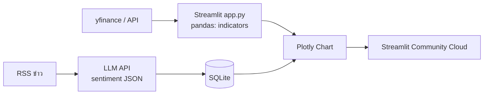
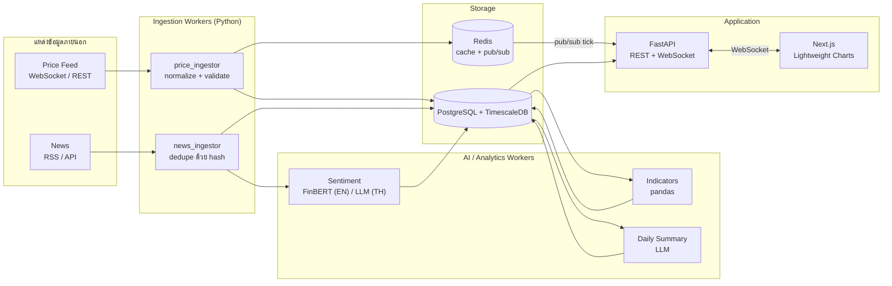
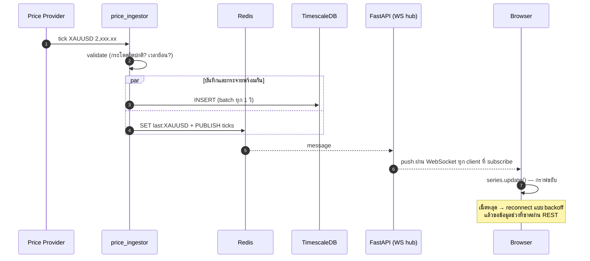
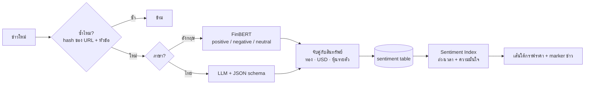
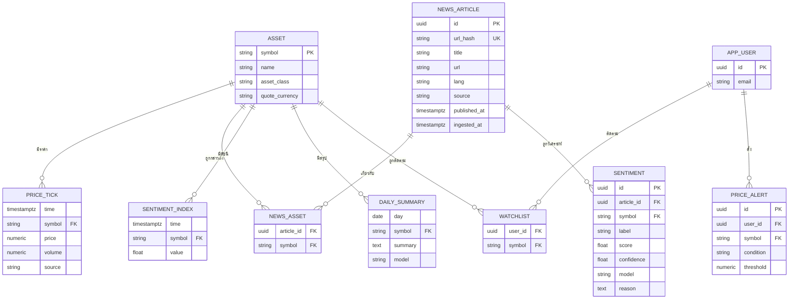
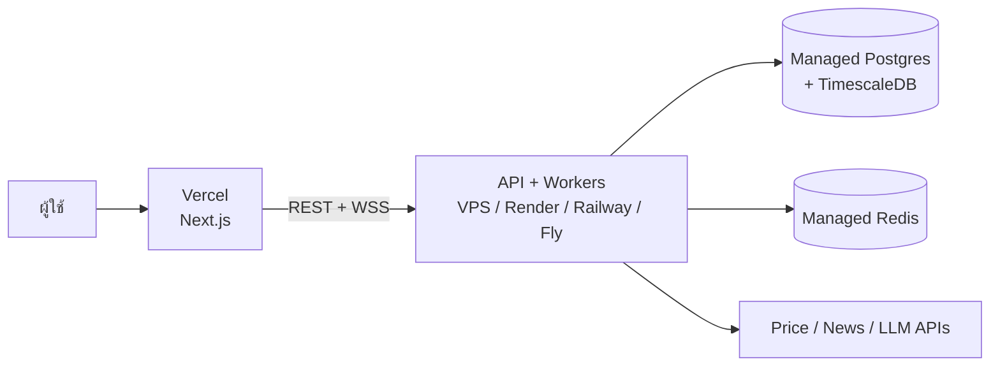

# 📈 งานที่ 3 — Full-Stack AI Finance Analytics Dashboard

> Dashboard ราคาทองคำ/หุ้นแบบ Real-time + AI วิเคราะห์อารมณ์ข่าว (Sentiment) + สรุปตลาดรายวัน
> ← [งานที่ 2](02-it-support-agent.md) · [MD หลัก](README.md) · ถัดไป → [งานที่ 4](04-erpnext-enterprise-os/04-enterprise-os.md)

> ⚠️ **Disclaimer (ต้องใส่ในแอปและ README):** โปรเจกต์นี้เพื่อการศึกษาและสาธิตทักษะ ไม่ใช่คำแนะนำการลงทุน
> ใช้คำว่า **"Market Sentiment Indicator"** แทน "สัญญาณซื้อขาย"

| หัวข้อ | สรุป |
|---|---|
| **โจทย์ธุรกิจ** | นักลงทุนต้องอ่านข่าวทั้งวันเพื่อรู้ว่าตลาดรู้สึกยังไงกับทอง/หุ้น — อยากเห็นราคา + อารมณ์ข่าว + สรุปในจอเดียว |
| **สายงานเป้าหมาย** | Full-Stack Developer, Software Engineer, Data Engineer, FinTech |
| **ความยาก** | ระดับต้น **5/10** · ระดับสูง **8.5/10** |
| **เวลา (เต็มเวลา)** | ระดับต้น 1–2 สัปดาห์ · ระดับสูง 7–11 สัปดาห์ (part-time คูณ ~2) |
| **ขนาดโค้ด** | ระดับต้น ~0.6–1.2k LOC (ไฟล์เดียวก็ได้) · ระดับสูง ~6–10k LOC / 80–120 ไฟล์ |
| **เชื่อมกับงานอื่น** | Chart component + Real-time ไปใช้ใน Executive/Finance Dashboard ของงาน 4 |

---

## สารบัญ
1. [หลักคิด: อะไรใช้ AI อะไรไม่ใช้](#1-หลักคิด-อะไรใช้-ai-อะไรไม่ใช้)
2. [ขอบเขตงาน 2 ระดับ](#2-ขอบเขตงาน-2-ระดับ)
3. [แหล่งข้อมูล](#3-แหล่งข้อมูล)
4. [Architecture](#4-architecture)
5. [Sentiment Pipeline และ Sentiment Index](#5-sentiment-pipeline-และ-sentiment-index)
6. [Local vs Cloud ของงานนี้](#6-local-vs-cloud-ของงานนี้)
7. [Database Design (TimescaleDB)](#7-database-design-timescaledb)
8. [API, หน้าจอ และโครงสร้างโฟลเดอร์](#8-api-หน้าจอ-และโครงสร้างโฟลเดอร์)
9. [Error Handling — เมื่อ API ตลาดล่ม](#9-error-handling--เมื่อ-api-ตลาดล่ม)
10. [Latency & Scalability Report](#10-latency--scalability-report)
11. [Deployment](#11-deployment)
12. [ขนาดงาน ความยาก และ Roadmap](#12-ขนาดงาน-ความยาก-และ-roadmap)
13. [ความเสี่ยง · Checklist · คำถามสัมภาษณ์](#13-ความเสี่ยง--checklist--คำถามสัมภาษณ์)
14. [การต่อยอดไปงาน 4](#14-การต่อยอดไปงาน-4)

---

## 1. หลักคิด: อะไรใช้ AI อะไรไม่ใช้

| งาน | ใช้อะไร | ห้ามใช้ LLM เพราะ |
|---|---|---|
| คำนวณ RSI, MACD, Bollinger Bands, MA | pandas / `pandas-ta` / `ta` | LLM คำนวณตัวเลขผิดได้ และช้า/แพงกว่าหลายพันเท่า |
| รวมแท่งเทียน 1 นาที → 1 ชม. | TimescaleDB continuous aggregate | งานของ database |
| จัดอารมณ์ข่าวภาษาอังกฤษ | FinBERT (Local) | — (โมเดลเฉพาะทาง เร็ว ฟรี) |
| จัดอารมณ์ข่าวภาษาไทย | LLM (Cloud หรือ Local โมเดลไทย) | FinBERT ไม่รองรับภาษาไทย |
| สรุปภาพรวมตลาดรายวัน | LLM | — (งานภาษาที่ LLM ถนัด) |
| ตัดสินใจซื้อขาย | **ไม่ทำ** | นอกขอบเขต + ความเสี่ยงทางกฎหมาย |

> 💡 "AI เป็นส่วนเสริม ~25%" — งานนี้ขายทักษะ **Full-Stack + Data Engineering** เป็นหลัก

---

## 2. ขอบเขตงาน 2 ระดับ

| ลำดับ | ระดับต้น (Streamlit Monolith) | ระดับสูง (Decoupled Full-Stack) |
|---|---|---|
| **Must** | เลือกสินทรัพย์ · กราฟราคาย้อนหลัง · indicator 2–3 ตัว · ดึงพาดหัวข่าว · LLM ให้คะแนน sentiment · เก็บใน SQLite · Deploy ฟรี | Next.js + Lightweight Charts · FastAPI REST + **WebSocket** · Ingestion workers · **TimescaleDB** · **Redis** cache + pub/sub · Sentiment Index (time-decay) · Daily summary · Dark/Light mode · Docker Compose |
| **Should** | cache ด้วย `st.cache_data` | ข่าวปักบนกราฟ (markers) · Watchlist · Fallback provider · Latency report |
| **Could** | — | Alert (ราคา/sentiment ข้ามเกณฑ์) · Backtest ความสัมพันธ์ sentiment กับราคา |
| **Won't** | — | ส่งคำสั่งซื้อขายจริง · ระบบสมาชิกเก็บเงิน |

---

## 3. แหล่งข้อมูล

> ⚠️ เงื่อนไขและ rate limit ของ API ฟรีเปลี่ยนบ่อย — **ตรวจ ToS ล่าสุดก่อนใช้** และออกแบบให้เปลี่ยนแหล่งได้ (adapter)

| ข้อมูล | ตัวเลือก | หมายเหตุ |
|---|---|---|
| ราคาหุ้นสหรัฐฯ (real-time / delayed) | Finnhub, Twelve Data, Alpha Vantage, Polygon | Free tier จำกัดจำนวนครั้ง/สัญลักษณ์ |
| ราคาย้อนหลัง | `yfinance` | **ไม่ใช่ API ทางการ** อาจพังเมื่อเว็บเปลี่ยน — เหมาะทำ prototype |
| ทองคำโลก (XAU/USD) | Provider ฝั่ง Forex (Twelve Data, OANDA, Finnhub) | — |
| ราคาทองไทย | เว็บสมาคมค้าทองคำ (scrape) | ดึงไม่ถี่, เคารพ robots.txt/ToS, cache |
| หุ้นไทย (SET) | ข้อมูล real-time ส่วนใหญ่ต้องเสียเงิน | Demo ใช้ข้อมูลล่าช้า/สิ้นวัน |
| ข่าว | RSS ของสำนักข่าว, Finnhub news, GDELT, NewsAPI | ฟรีมักจำกัดการใช้เชิงพาณิชย์/ข้อมูลล่าช้า |

### Adapter Pattern (ที่จำเป็นจริง เพราะมีหลาย provider)

```python
from typing import Protocol, AsyncIterator
from dataclasses import dataclass
from datetime import datetime
from decimal import Decimal

@dataclass(frozen=True)
class Tick:
    symbol: str
    time: datetime      # เก็บเป็น UTC เสมอ
    price: Decimal      # เงินใช้ Decimal ไม่ใช่ float
    volume: Decimal | None
    source: str

class PriceFeed(Protocol):
    async def stream(self, symbols: list[str]) -> AsyncIterator[Tick]: ...
```

---

## 4. Architecture

### 4.1 ระดับต้น



### 4.2 ระดับสูง



### 4.3 Sequence — ราคา 1 tick เดินทางถึงหน้าจอ



---

## 5. Sentiment Pipeline และ Sentiment Index

### 5.1 ขั้นตอน



### 5.2 Output Schema (กรณีใช้ LLM)

```json
{
  "assets": ["XAUUSD"],
  "label": "bullish",
  "score": 0.6,
  "confidence": 0.8,
  "reason": "เฟดส่งสัญญาณลดดอกเบี้ย ดอลลาร์อ่อนค่า มักหนุนราคาทอง"
}
```

`score` อยู่ในช่วง −1 (ลบมาก) ถึง +1 (บวกมาก) · `confidence` 0–1

### 5.3 สูตร Sentiment Index (ข่าวเก่ามีน้ำหนักน้อยลง)

```text
              Σ  sᵢ × cᵢ × e^(−λ·(t − tᵢ))
Index(t) =  ──────────────────────────────          λ = ln(2) / half_life   (เช่น half_life = 6 ชม.)
              Σ  cᵢ × e^(−λ·(t − tᵢ))

sᵢ = score ของข่าว i · cᵢ = confidence · tᵢ = เวลาที่ "ระบบรู้" ข่าวนั้น
```

> ⚠️ **Look-ahead bias:** ใช้เวลาที่ระบบรับข่าวจริง (ไม่ใช่เวลาที่ข่าวอ้างว่าเผยแพร่ ถ้าเราได้รับช้ากว่านั้น) ไม่งั้น backtest จะดูดีเกินจริง

### 5.4 Backtest อย่างซื่อตรง (จุดที่ทำให้พอร์ตดู "โต")

| คำถาม | วิธีวัด | ผลที่ควรรายงาน |
|---|---|---|
| Index สัมพันธ์กับผลตอบแทนข้างหน้าไหม? | Correlation ระหว่าง Index(t) กับ return(t → t+1h / 4h / 1d) | ตัวเลข + ช่วงความเชื่อมั่น — **ถ้าต่ำก็รายงานว่าต่ำ** |
| สัญญาณเสถียรไหม? | แบ่งช่วงเวลา train/test | เทียบสองช่วง |
| ความล่าช้าของระบบมีผลไหม? | วัด news-to-index latency | วินาที/นาที |

---

## 6. Local vs Cloud ของงานนี้

| งานย่อย | Local | Cloud | แนะนำ |
|---|---|---|---|
| Indicator | pandas (ไม่ใช่ AI) | — | Local เสมอ |
| Sentiment ข่าวอังกฤษ | FinBERT บน CPU ก็พอ | LLM | **Local** — เร็ว ฟรี วัดผลได้ |
| Sentiment ข่าวไทย | โมเดลไทย 7–14B | LLM | Cloud ก่อน · Local เป็นทางเลือก |
| Daily Summary | ได้ | ดีกว่า | Cloud (วันละครั้ง ค่าใช้จ่ายต่ำมาก) |

> 📊 **สิ่งที่ควรใส่พอร์ต:** ตารางเทียบ FinBERT vs LLM บนข่าวชุดเดียวกัน 200 ข่าว (accuracy เทียบ label ที่คุณติดเอง, เวลา/ข่าว, ค่าใช้จ่าย/1,000 ข่าว)

---

## 7. Database Design (TimescaleDB)

### 7.1 ER Diagram



### 7.2 SQL หลัก

```sql
CREATE TABLE price_tick (
    time    TIMESTAMPTZ   NOT NULL,
    symbol  TEXT          NOT NULL REFERENCES asset(symbol),
    price   NUMERIC(18,6) NOT NULL CHECK (price > 0),
    volume  NUMERIC(20,4),
    source  TEXT          NOT NULL
);
SELECT create_hypertable('price_tick', 'time');

-- แท่งเทียน 1 นาที คำนวณอัตโนมัติโดย DB
CREATE MATERIALIZED VIEW ohlc_1m WITH (timescaledb.continuous) AS
SELECT time_bucket('1 minute', time) AS bucket,
       symbol,
       first(price, time) AS open,
       max(price)         AS high,
       min(price)         AS low,
       last(price, time)  AS close,
       sum(volume)        AS volume
FROM price_tick
GROUP BY bucket, symbol;

-- ลบ tick ดิบที่เก่ากว่า 30 วัน (แท่งเทียนยังอยู่)
SELECT add_retention_policy('price_tick', INTERVAL '30 days');
```

> 💡 ทำ `ohlc_1h`, `ohlc_1d` ต่อจาก `ohlc_1m` ได้ — กราฟช่วง 1 ปีจะโหลดเร็วกว่าคิวรี tick ดิบหลายเท่า (วัดเทียบใส่ Latency report)

---

## 8. API, หน้าจอ และโครงสร้างโฟลเดอร์

### 8.1 API

| Method | Path | ใช้ทำอะไร |
|---|---|---|
| `GET` | `/assets` | รายการสินทรัพย์ |
| `GET` | `/prices/{symbol}?tf=1m\|1h\|1d&from=&to=` | แท่งเทียนย้อนหลัง |
| `GET` | `/indicators/{symbol}?name=rsi&tf=1h` | ค่า indicator |
| `GET` | `/news?symbol=XAUUSD&limit=50` | ข่าว + sentiment |
| `GET` | `/sentiment/{symbol}?tf=1h` | Sentiment Index |
| `GET` | `/summary/daily?symbol=XAUUSD&day=` | สรุปรายวัน |
| `WS` | `/ws/stream?symbols=XAUUSD,AAPL` | ราคาสด + ข่าวใหม่ |
| `POST` | `/alerts` | ตั้งการแจ้งเตือน |
| `GET` | `/health` | สถานะ provider แต่ละตัว (live / stale / down) |

### 8.2 หน้าจอ

| หน้า | องค์ประกอบ |
|---|---|
| Dashboard | Watchlist + ราคาสด · กราฟหลัก (แท่งเทียน + indicator) · เส้น Sentiment Index ใต้กราฟ · News feed พร้อมสีบวก/ลบ |
| Asset Detail | กราฟหลาย timeframe · ข่าวปักบนกราฟ · ตาราง indicator |
| Daily Briefing | สรุปตลาดจาก LLM + ข่าวสำคัญ + disclaimer |
| System Status | สถานะ provider, latency, เวลาข้อมูลล่าสุด (โชว์ทักษะ DevOps) |
| Settings | Dark/Light · Alert · Timezone (เก็บ UTC แสดง Asia/Bangkok) |

### 8.3 โครงสร้างโฟลเดอร์

```text
finance-ai-dashboard/
├── README.md
├── docker-compose.yml          # timescaledb, redis, api, workers, frontend
├── .env.example
├── backend/
│   ├── app/
│   │   ├── main.py             # FastAPI + WebSocket hub
│   │   ├── api/                # prices.py, news.py, sentiment.py, alerts.py
│   │   ├── realtime/           # ws_hub.py, redis_bridge.py
│   │   ├── providers/          # base.py (PriceFeed), finnhub.py, twelvedata.py, yfinance_hist.py, rss.py
│   │   ├── workers/
│   │   │   ├── price_ingestor.py
│   │   │   ├── news_ingestor.py
│   │   │   ├── sentiment_worker.py
│   │   │   ├── indicator_worker.py
│   │   │   └── daily_summary.py
│   │   ├── analytics/          # indicators.py, sentiment_index.py
│   │   └── llm.py
│   ├── migrations/
│   └── tests/
├── frontend/                   # Next.js + Tailwind + lightweight-charts
│   ├── app/                    # dashboard, asset/[symbol], briefing, status
│   ├── components/             # PriceChart, SentimentPane, NewsFeed, Watchlist
│   └── lib/ws.ts               # reconnect + backoff + resync
├── research/
│   ├── finbert_vs_llm.ipynb
│   └── sentiment_backtest.ipynb
├── loadtest/                   # k6 / locust สำหรับ WebSocket
└── docs/
    ├── data-pipeline.md
    ├── latency-report.md
    └── adr/
```

---

## 9. Error Handling — เมื่อ API ตลาดล่ม

| สถานการณ์ | รับมือ | ผู้ใช้เห็น |
|---|---|---|
| Provider หลักล่ม | Circuit breaker → สลับ provider สำรอง | ป้าย "แหล่งข้อมูลสำรอง" |
| ทุก provider ล่ม | เสิร์ฟราคาล่าสุดจาก Redis | ป้าย **STALE** + เวลาข้อมูลล่าสุด |
| ติด rate limit | Token bucket + cache + ลดความถี่ | ข้อมูลอัปเดตช้าลง (ไม่ error) |
| Tick ผิดปกติ (กระโดด > X% ใน 1 วิ) | ตั้ง flag ไม่ใช้วาดกราฟ รอ tick ถัดไปยืนยัน | ไม่เห็นแท่งเพี้ยน |
| WebSocket หลุด | Client reconnect แบบ exponential backoff + REST เติมช่วงที่ขาด | กราฟต่อเนื่อง |
| LLM ล่ม | ข่าวเข้าคิว "pending" วิเคราะห์ทีหลัง · ข่าวอังกฤษยังใช้ FinBERT | ข่าวแสดง "กำลังวิเคราะห์" |
| ตลาดปิด / วันหยุด | ปฏิทินตลาด → ไม่ถือว่า "ข้อมูลหาย" | ป้าย "ตลาดปิด" |
| Timezone เพี้ยน | เก็บ UTC ทั้งระบบ แปลงตอนแสดงผลเท่านั้น | — |

---

## 10. Latency & Scalability Report

Template ที่ควรใส่ใน `docs/latency-report.md` (ใส่ตัวเลขจริงที่วัดได้):

| Metric | วิธีวัด | ผล |
|---|---|---|
| Tick-to-screen latency p50 / p95 | timestamp ที่ ingestor เทียบกับเวลาที่ browser วาด | … ms |
| WebSocket ผู้ใช้พร้อมกัน | k6/locust เปิด 100 → 1,000 connections | CPU/RAM ที่จุดต่างๆ |
| Redis cache hit ratio | `INFO stats` | … % |
| คิวรีกราฟ 1 ปี (1h) | tick ดิบ vs continuous aggregate | … ms vs … ms |
| News-to-sentiment latency | ingested_at → sentiment created | … วิ |
| ค่าใช้จ่าย LLM / วัน | log tokens | … USD |

---

## 11. Deployment



| ทางเลือก | ข้อดี | ข้อเสีย |
|---|---|---|
| Vercel + PaaS free tier | ฟรี ตั้งค่าง่าย | **Free tier มักหลับเมื่อไม่มีคนใช้** → worker real-time หยุด, cold start ช้า |
| VPS เล็ก 1 เครื่อง + Docker Compose + Caddy (HTTPS อัตโนมัติ) | worker รันตลอด, คุมได้ทั้งหมด, ถูก | ต้องดูแลเอง (โชว์ทักษะ DevOps ได้อีก) |
| AWS (ECS/EC2 + RDS + ElastiCache) | ใกล้เคียงงานจริงองค์กร | แพงและซับซ้อนสำหรับพอร์ต |

> แนะนำ: **Frontend บน Vercel + Backend ทั้งหมดบน VPS เล็ก** สำหรับระบบ real-time

---

## 12. ขนาดงาน ความยาก และ Roadmap

### 12.1 ขนาดงานแยกส่วน (ระดับสูง)

| ส่วน | LOC | วัน (เต็มวัน) | ความยาก |
|---|---|---|---|
| Providers + adapter + validation | 600–1,000 | 4–6 | 6 |
| Workers (price / news / sentiment / indicator / summary) | 1,000–1,600 | 6–9 | 7 |
| TimescaleDB schema + aggregates + retention | 200–400 | 2–3 | 6 |
| FastAPI REST + WS hub + Redis bridge | 800–1,400 | 5–7 | **8** |
| Next.js UI + charts + dark mode + reconnect | 2,000–3,500 | 10–15 | 7 |
| Sentiment Index + backtest notebook | 300–600 | 3–5 | 7 |
| Load test + latency report | 200–400 | 2–3 | 6 |
| Docker + deploy + CI + docs | 300–500 | 3–5 | 6 |
| **รวม** | **~6,000–10,000** | **~35–53 วัน** | **8.5** |

### 12.2 Roadmap

| สัปดาห์ | งาน | Definition of Done |
|---|---|---|
| 1 | Streamlit MVP (ระดับต้น) | กราฟ + indicator + sentiment พาดหัว + deploy link |
| 2 | Schema TimescaleDB + price ingestor + adapter | tick ไหลเข้า DB ต่อเนื่อง 24 ชม. |
| 3 | News ingestor + sentiment (FinBERT + LLM) | ข่าวมีคะแนน + เทียบ 2 วิธี |
| 4 | FastAPI REST + WebSocket + Redis | ราคาสดถึง browser |
| 5–6 | Next.js dashboard + charts + news markers | UI ครบทุกหน้า dark/light |
| 7 | Sentiment Index + backtest | notebook + ผลที่ซื่อตรง |
| 8 | Error handling + status page | ปิด provider หลักแล้วยังทำงาน |
| 9–10 | Load test + deploy + README + วิดีโอ | Live demo + latency report |

---

## 13. ความเสี่ยง · Checklist · คำถามสัมภาษณ์

### ความเสี่ยง

| ความเสี่ยง | ป้องกัน |
|---|---|
| API ฟรีโดนจำกัด/ปิดกลางทาง | Adapter หลาย provider ตั้งแต่ต้น |
| ใช้ license กราฟผิด | ใช้ Lightweight Charts + ใส่ attribution ตามเงื่อนไข |
| ถูกมองว่าเป็นคำแนะนำการลงทุน | Disclaimer + คำว่า "Indicator" + ไม่มีปุ่มซื้อขาย |
| ใช้ `float` กับราคา | `NUMERIC` ใน DB, `Decimal` ใน Python |
| Backtest ดูดีเกินจริง | ระวัง look-ahead bias, รายงานตรงๆ |
| Demo หลับตอนกรรมการเปิด | VPS หรือวิดีโอสำรอง |

### Checklist พอร์ต

- [ ] Live Demo link + วิดีโอ 1–2 นาที (ราคาขยับสด + ข่าวเข้า + sentiment เปลี่ยน)
- [ ] Architecture (4.2) + Sequence (4.3) + Deployment (11)
- [ ] ER Diagram + เหตุผลที่เลือก TimescaleDB (ADR)
- [ ] Latency & Scalability report พร้อมตัวเลขจริง
- [ ] ตาราง FinBERT vs LLM
- [ ] Backtest notebook ที่ซื่อตรง
- [ ] Data pipeline doc + ตาราง error handling
- [ ] Disclaimer

### คำถามสัมภาษณ์ที่ต้องตอบได้

| คำถาม | ประเด็น |
|---|---|
| ทำไมใช้ TimescaleDB ไม่ใช่ Postgres ธรรมดา/MongoDB? | hypertable, continuous aggregate, retention — มีตัวเลขเทียบ |
| ผู้ใช้ 10,000 คนพร้อมกันจะ scale ยังไง? | WS hub หลาย instance + Redis pub/sub กระจาย, sticky session/LB, ตัวเลข load test |
| ถ้า provider ส่งราคาผิด? | validation, flag, ไม่วาด, แหล่งสำรอง |
| ทำไมไม่ให้ LLM คำนวณ indicator? | ข้อ 1 — ความแม่น ความเร็ว ต้นทุน |
| Sentiment ใช้ทำนายราคาได้จริงไหม? | ตอบตามผล backtest อย่างซื่อตรง + look-ahead bias |
| เงินทำไมห้ามใช้ float? | ปัดเศษสะสม · NUMERIC/Decimal |

---

## 14. การต่อยอดไปงาน 4

| ส่วนจากงาน 3 | กลายเป็นอะไรใน [งาน 4](04-erpnext-enterprise-os/04-enterprise-os.md) |
|---|---|
| Chart components | Executive Dashboard: รายได้, ค่าใช้จ่าย, กระแสเงินสด, AR/AP aging |
| WebSocket + Redis pub/sub | แจ้งเตือนงานเข้า real-time ("มี PO รออนุมัติ 3 รายการ") |
| Provider adapter | ดึงอัตราแลกเปลี่ยน / ราคาวัตถุดิบ ให้ฝ่ายจัดซื้อ |
| Daily Summary ด้วย LLM | AI ร่างคำอธิบายผลประกอบการหลังปิดงบรายเดือน |
| ความรู้ NUMERIC/Decimal, UTC | ใช้กับระบบบัญชีทั้งหมด |

← กลับ [MD หลัก](README.md)
