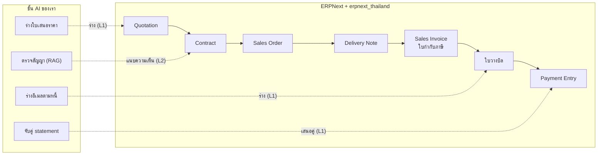
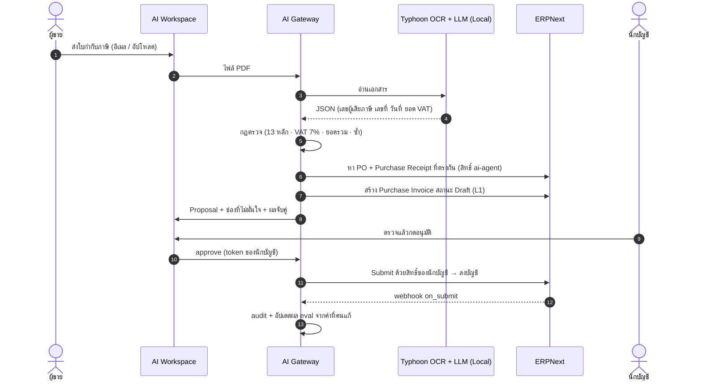
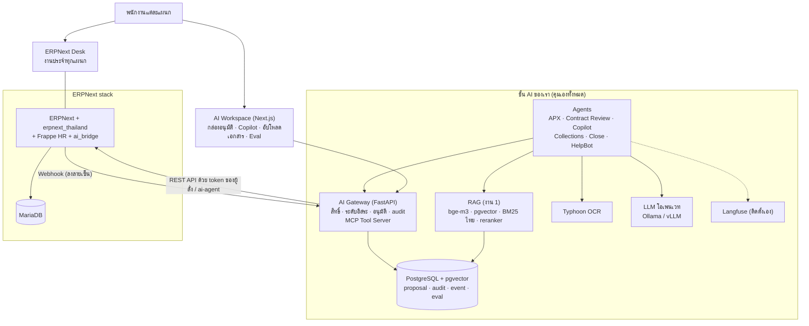
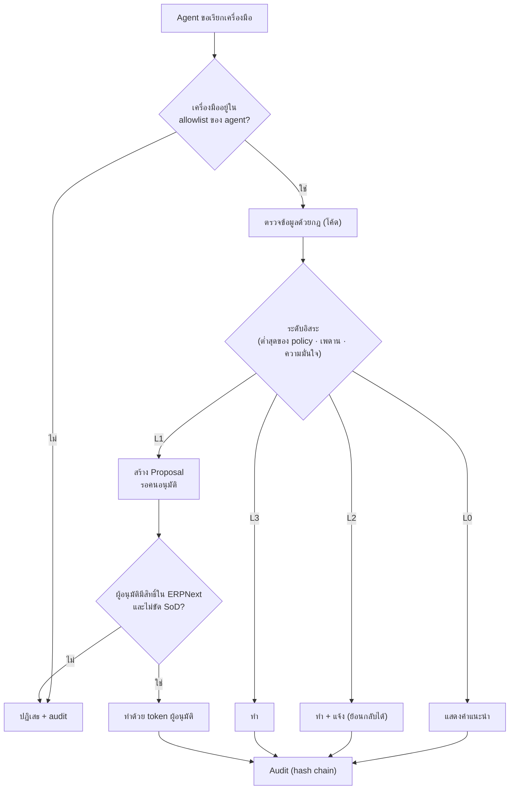
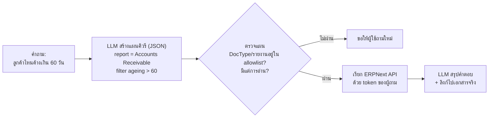
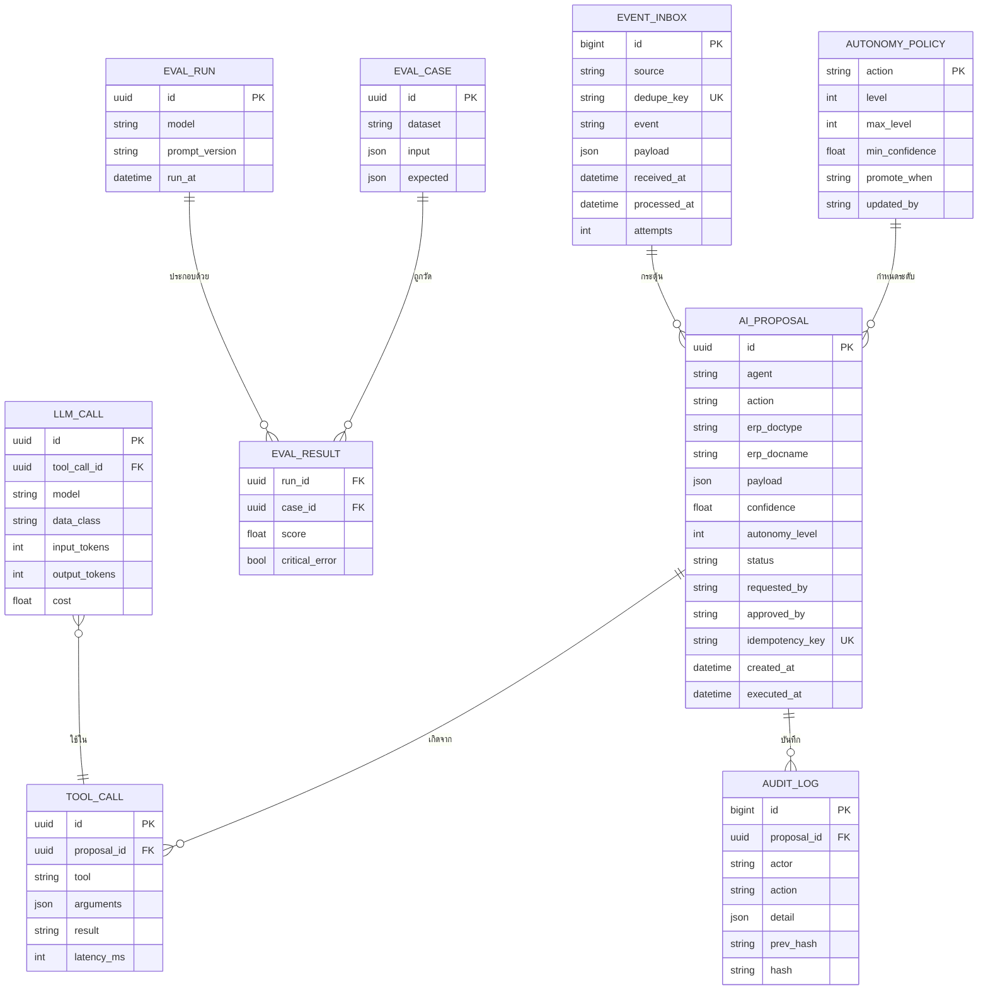
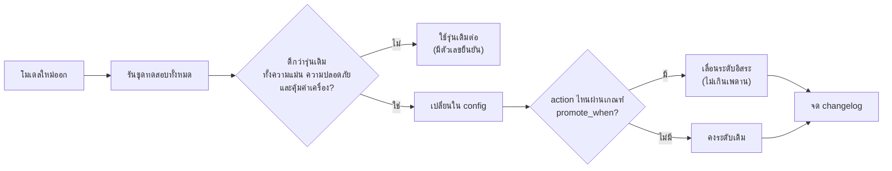

# 🏢 งานที่ 4 — AI Back-office บน ERPNext (Enterprise OS แบบไม่สร้างซ้ำ)

> เว็บเดียวที่ทุกแผนก (ขาย · กฎหมาย · จัดซื้อ · คลัง · บัญชี · การเงิน · IT · ผู้บริหาร) ทำงานต่อกันได้จริง
> ใช้ **ERPNext + erpnext_thailand** เป็นระบบหลัก แล้ว **สร้างชั้น AI ที่เราคุมเองทั้งหมด** ให้ AI ช่วยทุกแผนกได้อย่างปลอดภัย ตรวจสอบได้ และเก่งขึ้นตามโมเดลใหม่โดยไม่ต้องเขียนใหม่
> ← [งานที่ 3](../03-finance-ai-dashboard.md) · [MD หลัก](../README.md)

| หัวข้อ | สรุป |
|---|---|
| **โจทย์ธุรกิจ** | บริษัททำงานแบบ Silo · บัญชีกรอกเอกสารซ้ำ · ตรวจสัญญาช้า · ปิดงบช้า — และ SME ไทยไม่กล้าให้ AI แตะข้อมูลบัญชี เพราะคุมไม่ได้และตรวจสอบไม่ได้ |
| **แนวทาง** | **ไม่สร้าง ERP ซ้ำ** ([ADR-005](#1-ทำไมไม่สร้าง-erp-เอง-adr-005)) — ERPNext ทำงานบัญชีและเอกสาร · เราสร้าง **ชั้นควบคุม AI** |
| **AI** | คุมเองทั้งหมด: LLM โอเพนเวท (Ollama / vLLM) · RAG จากงาน 1 · Typhoon OCR · รันในเครื่องเราเป็นค่าเริ่มต้น |
| **สายงานเป้าหมาย** | AI Engineer · ERP Developer / Implementer (ERPNext, Odoo) · Integration · Solution Architect · SA/BA |
| **ความยาก** | MVP **7/10** · ครบ **9/10** |
| **เวลา (เต็มเวลา)** | MVP ~8–9 สัปดาห์ · ครบ ~11–12 สัปดาห์ (part-time คูณ ~2) |
| **ขนาดงาน (เฉพาะโค้ดของเรา)** | MVP ~6–9k LOC · ครบ ~8–13k LOC · ตารางของเรา ~12 ตาราง + ใช้ DocType ของ ERPNext |
| **ประกอบจาก** | [งาน 1](../01-enterprise-rag.md) → ค้นสัญญา/นโยบาย · [งาน 2](../02-it-support-agent.md) → HelpBot + การอนุมัติ · [งาน 3](../03-finance-ai-dashboard.md) → กราฟ Dashboard |
| **เอกสารประกอบ** | [หน้าแรกโปรเจกต์](README.md) · [04a](04a-company-blueprint.md) บริษัทจำลอง ตำแหน่ง ใครทำเอกสารอะไร · [04b](04b-depa-product-track.md) APX + ทุน depa · [04c](04c-build-guide.md) คู่มือลงมือสร้าง · [04d](04d-erp-implementation.md) สาย ERP (สาขา 2 ผลิต สต๊อก ครุภัณฑ์ รายงาน) · [04e](04e-saas-business-model.md) ให้บริษัทอื่นเช่ารายเดือน · [research/](research/erpnext-reference.md) ข้อมูลอ้างอิง |

> 🔁 **เปลี่ยนจากแผนเดิม (สร้าง ERP เองทั้งหมด)** เพราะ (1) มีของเปิดซอร์สที่ดีและมีภาษีไทยครบแล้ว (2) เวลาไปลงที่ AI ซึ่งเป็นจุดต่างจริง (3) ตรงกับงานในตลาดที่ส่วนใหญ่คือปรับแต่งและเชื่อมระบบที่มีอยู่ (4) รองรับอนาคต: AI เก่งขึ้น → ใช้เครื่องมือของเราได้มากขึ้นเอง

---

## สารบัญ
1. [ทำไมไม่สร้าง ERP เอง (ADR-005)](#1-ทำไมไม่สร้าง-erp-เอง-adr-005)
2. [ของที่มีอยู่แล้ว (Prior Art)](#2-ของที่มีอยู่แล้ว-prior-art)
3. [แผนก: ERPNext ทำอะไร · AI ช่วยอะไร](#3-แผนก-erpnext-ทำอะไร--ai-ช่วยอะไร)
4. [Flow A — ขาย → รับเงิน](#4-flow-a--ขาย--รับเงิน)
5. [Flow B — ซื้อ → จ่ายเงิน (APX)](#5-flow-b--ซื้อ--จ่ายเงิน-apx)
6. [Flow C — ปิดงบ](#6-flow-c--ปิดงบ)
7. [Flow อื่นข้ามแผนก](#7-flow-อื่นข้ามแผนก)
8. [Architecture](#8-architecture)
9. [AI Gateway: สิทธิ์ · อนุมัติ · ระดับอิสระ · Audit](#9-ai-gateway-สิทธิ์--อนุมัติ--ระดับอิสระ--audit)
10. [Agent และเครื่องมือ](#10-agent-และเครื่องมือ)
11. [Data Model ของชั้น AI](#11-data-model-ของชั้น-ai)
12. [AI Stack ที่คุมเองทั้งหมด](#12-ai-stack-ที่คุมเองทั้งหมด)
13. [Eval และวงจรอัปเกรดโมเดล](#13-eval-และวงจรอัปเกรดโมเดล)
14. [ภาษีไทย: ตรวจผลกับ ERPNext](#14-ภาษีไทย-ตรวจผลกับ-erpnext)
15. [Security](#15-security)
16. [Tech Stack และโครงสร้าง Repo](#16-tech-stack-และโครงสร้าง-repo)
17. [ขนาดงานและ Roadmap](#17-ขนาดงานและ-roadmap)
18. [Demo Strategy](#18-demo-strategy)
19. [ความเสี่ยง · Checklist · คำถามสัมภาษณ์](#19-ความเสี่ยง--checklist--คำถามสัมภาษณ์)

---

## 1. ทำไมไม่สร้าง ERP เอง (ADR-005)

| | A · สร้าง ERP เองทั้งหมด | **B · ต่อยอดบน ERPNext (เลือก)** |
|---|---|---|
| สิ่งที่สร้าง | แกนบัญชี สิทธิ์ เลขที่เอกสาร event ทุกแผนก | **ชั้น AI**: Gateway (สิทธิ์ อนุมัติ ระดับอิสระ audit) · Agent · RAG · OCR · Eval · AI Workspace |
| ภาษีไทย | เขียนเอง เสี่ยงผิด | erpnext_thailand (MIT) มีครบและยังดูแลอยู่ |
| เวลาที่ใช้กับ AI | น้อย (หมดไปกับแกน ERP) | **เกือบทั้งหมด** |
| คุม AI เอง | ได้ | **ได้เท่ากัน** (ไม่ใช้ AI ที่ติดมากับ ERP) |
| ตอบ "ทำไมไม่ใช้ของที่มี" | ต้องอธิบายว่าทำเพื่อฝึก | "ผมไม่สร้างซ้ำ ผมต่อยอดสิ่งที่ยังขาด" |
| สิ่งที่เสียไป | — | โชว์ไส้ในแกน ERP ได้น้อยลง → ชดเชยด้วยงาน 1–3 ที่สร้างเองตั้งแต่ศูนย์ + สถาปัตยกรรมของ Gateway |

**ทำไมเลือก ERPNext ไม่ใช่ Odoo:** ฟรีทุกฟีเจอร์ (Odoo รุ่นฟรีมีบัญชีเต็มรูปไม่ครบ) · REST API ใช้ง่าย · โมดูลภาษีไทยเป็น MIT · โค้ดเรียก ERP อยู่ที่เดียว (`erp/`) จึงเพิ่มตัวต่อ Odoo ทีหลังได้

**กฎเหล็ก:** ไม่ใช้ฟีเจอร์ AI ที่ติดมากับ ERP หรือ app เสริมที่ส่งข้อมูลไปคลาวด์คนอื่น — AI ทุกอย่างผ่านชั้นของเรา

> **คำตอบสัมภาษณ์:** "ถ้าบริษัทต้องการ ERP ผมแนะนำ ERPNext + erpnext_thailand ทันที — งานนี้ผมสร้างสิ่งที่ ERP ยังไม่มี คือชั้นที่ทำให้ AI ทำงานหลังบ้านได้อย่างปลอดภัย วัดผลได้ และเปลี่ยนโมเดลได้โดยไม่ต้องเขียนใหม่"

---

## 2. ของที่มีอยู่แล้ว (Prior Art)

ตรวจเมื่อ 15 ต.ค. 2569 (ดาว/license จาก GitHub API) · รายการเต็มและตลาดอยู่ใน [research/prior-art-market.md](research/prior-art-market.md)

| โปรเจกต์ | ดาว | License | เราใช้ยังไง |
|---|---|---|---|
| [frappe/erpnext](https://github.com/frappe/erpnext) | 40k | GPL-3.0 | **ระบบหลัก** — ใช้ตามที่เป็น ไม่แก้โค้ดแกน |
| [ecosoft-frappe/erpnext_thailand](https://github.com/ecosoft-frappe/erpnext_thailand) | 27 | MIT | **ภาษีไทย** — VAT (รวมภาษีขายยังไม่ถึงกำหนดของงานบริการ), หัก ณ ที่จ่าย + หนังสือรับรอง, รายงาน ภ.ง.ด./ภาษีซื้อ-ขาย, วางบิล, มัดจำ |
| [odoo/odoo](https://github.com/odoo/odoo) + [OCA/l10n-thailand](https://github.com/OCA/l10n-thailand) | 55k / 71 | LGPL-3 / AGPL-3.0 | ทางเลือกตัวต่อในอนาคต (Stage 8) |
| [scb-10x/typhoon-ocr](https://github.com/scb-10x/typhoon-ocr) | 148 | Apache-2.0 | **OCR ไทย** ใน APX |
| [erp-mafia/accounted](https://github.com/erp-mafia/accounted) | 415 | AGPL (ตาม README) | อ้างอิงแนวคิด "agent เสนอ คนอนุมัติ" ผ่าน MCP — อ่านอย่างเดียว |
| [ERPNext Copilot](https://discuss.frappe.io/t/open-source-erpnext-ai-assistant-with-permission-aware-queries/164109) | — | ไม่ระบุ | อ้างอิงแนวคิด "LLM วางแผนคิวรี ระบบตรวจก่อนรัน ไม่ให้ LLM เขียน SQL" |
| AP agents เช่น [invoice-to-pay-agent](https://github.com/mshojaei77/invoice-to-pay-agent), [APilot](https://github.com/emmaGH1/APilot) | 0–6 | MIT / — | ยืนยันแนวทาง "AI อ่าน กฎตัดสิน" — **ไม่มีตัวไหนรองรับเอกสารไทย** |

### กฎ License

| ประเภท | ทำอะไรได้ |
|---|---|
| MIT / Apache-2.0 | นำโค้ดมาใช้ได้ (คงข้อความ license เดิม) |
| GPL / AGPL | **อ่านเพื่อศึกษาเท่านั้น ไม่ copy โค้ด** · AGPL: ถ้าเปิดเป็นบริการออนไลน์ต้องเปิดซอร์สทั้งหมด |
| Custom app `ai_bridge` (ฝังใน ERPNext) | เปิดเป็น GPL-3 ตาม ERPNext เพื่อไม่มีปัญหา |
| AI Gateway (บริการแยก คุยผ่าน API) | โดยทั่วไปถือเป็นงานแยก — ก่อนขายจริงให้ปรึกษาผู้รู้เรื่อง license |

---

## 3. แผนก: ERPNext ทำอะไร · AI ช่วยอะไร

> รายชื่อตำแหน่งทั้ง 48 ตำแหน่งและใครทำเอกสารอะไร อยู่ใน [04a](04a-company-blueprint.md) · การตั้งค่า ERPNext ของแต่ละแผนกอยู่ใน [04d](04d-erp-implementation.md) · ระดับอิสระ L0–L3 อธิบายใน [ข้อ 9.3](#93-ระดับอิสระ-autonomy-dial)

| แผนก | ใช้ใน ERPNext | AI ช่วยอะไร | ระดับเริ่ม | Phase |
|---|---|---|---|---|
| **บัญชี** | Sales/Purchase Invoice, Payment Entry, Journal Entry + erpnext_thailand | **APX**: อ่านใบกำกับภาษีผู้ขาย → ร่าง Purchase Invoice + ตรวจ + จับคู่ PO + กันจ่ายซ้ำ | L1 | ⭐ MVP |
| **กฎหมาย** | Contract | ตรวจ clause เสี่ยงเทียบ Playbook (RAG) แล้วแนบเป็นความเห็น | L2 (แนบโน้ตอย่างเดียว) | ⭐ MVP |
| **ผู้บริหาร** | Reports (GL, AR, P&L) | **Copilot**: ถามข้อมูลเป็นภาษาคนภายใต้สิทธิ์ตัวเอง · ร่างคำอธิบายงบ | L3 (อ่านอย่างเดียว) | ⭐ MVP |
| **การเงิน** | Payment Entry, Bank Reconciliation Tool | จับคู่ statement · ร่างอีเมลตามหนี้ | L1 | MVP+ |
| **IT** | User, Role Profile, Permission | **HelpBot** (งาน 2): สร้าง/ปิดบัญชีตาม HR | L1 (สิทธิ์สูงเพดานถาวร) | MVP+ |
| **ขาย / Pre-sales** | Quotation, Sales Order, Customer | ร่างใบเสนอราคา/proposal จากงานเก่า (RAG) | L1 | MVP+ |
| **จัดซื้อ** | Material Request, Supplier Quotation, Purchase Order | สรุปเทียบใบเสนอราคาผู้ขาย | L0 | MVP+ |
| **คลัง / ขนส่ง** | Purchase Receipt, Delivery Note, Delivery Trip, Stock, Item Reorder | ตรวจรูปหลักฐานส่งมอบ · แจ้งลูกค้า · เชื่อม GPS/บริษัทขนส่ง (ไม่สร้าง GPS เอง) | L1 | MVP+ ([04d ข้อ 14](04d-erp-implementation.md#14-ส่งของและติดตามรถ-ทางเลือก)) |
| **ผลิต (สาขา 2)** | BOM, Work Order, Job Card, Stock Entry, Quality Inspection | พยากรณ์วัตถุดิบหมด → ร่างใบขอซื้อล่วงหน้า | L1 | MVP+ ([04d](04d-erp-implementation.md#4-การผลิต)) |
| **ครุภัณฑ์** | Asset, Asset Repair, Asset Maintenance + ฟอร์มตรวจนับ | HelpBot รับแจ้งเครื่องเสีย → ร่าง Asset Repair | L1 | MVP+ |
| **HR** | Frappe HR (Employee, Attendance, Leave, Expense Claim, Overtime) + เงินเดือนไทยใน [งาน 5](../05-thai-payroll-erpnext/README.md) | ส่ง event ให้ HelpBot · ตรวจ OT ผิดปกติ (แจ้งเตือน) | — | MVP+ |
| **Customer Support** | Issue + Service Level Agreement | HelpBot ฝั่งลูกค้า | L1 | Pro |
| **ธุรการ** | Naming Series, Print Format, File | ร่างเอกสารจาก template | L1 | Pro |

---

## 4. Flow A — ขาย → รับเงิน

| ขั้น | DocType ใน ERPNext | ใครทำ | AI ช่วย |
|---|---|---|---|
| ใบเสนอราคา | Quotation (+ Workflow อนุมัติส่วนลด) | Sales | ร่างจากใบเก่าของลูกค้า (L1) |
| สัญญา | Contract | Legal | **ตรวจ clause เสี่ยง (RAG)** แนบเป็นความเห็น |
| ยืนยันสั่งซื้อ | Sales Order | Sales | — |
| ส่งของ | Delivery Note | คลัง | — |
| ใบกำกับภาษี | Sales Invoice (erpnext_thailand จัดการ VAT) | บัญชี | — |
| วางบิล | เอกสารวางบิลของ erpnext_thailand | บัญชี / Messenger | — |
| รับเงิน | Payment Entry (หัก ณ ที่จ่ายถ้าเป็นบริการ) | การเงิน | จับคู่ statement (L1) |
| ตามหนี้ | Accounts Receivable report | การเงิน | ร่างอีเมลตามหนี้ (L1) |



---

## 5. Flow B — ซื้อ → จ่ายเงิน (APX)

| ขั้น | DocType ใน ERPNext | ใครทำ | AI ช่วย |
|---|---|---|---|
| ขอซื้อ | Material Request (+ Workflow ตามวงเงิน) | ผู้ขอ | — |
| เทียบราคา | Request for Quotation / Supplier Quotation | Buyer | สรุปเทียบ (L0) |
| สั่งซื้อ | Purchase Order | Buyer | — |
| ตรวจรับ | Purchase Receipt | คลัง | — |
| ใบกำกับภาษีผู้ขาย | **Purchase Invoice** | บัญชี | **APX: OCR → ร่าง + ตรวจ + จับคู่ + กันซ้ำ (L1)** |
| จ่ายเงิน | Payment Entry + หนังสือรับรองหัก ณ ที่จ่าย (erpnext_thailand) | การเงิน | **AI ไม่มีเครื่องมือจ่ายเงิน** |



> APX คือสินค้าที่ทดสอบกับลูกค้าจริงใน [04b](04b-depa-product-track.md) — ในงาน 4 มันคือ agent ตัวแรกของ Gateway

---

## 6. Flow C — ปิดงบ

| ขั้น | ใน ERPNext | AI ช่วย |
|---|---|---|
| ตรวจเอกสารค้าง | รายงาน Purchase Receipt ที่ยังไม่มีใบแจ้งหนี้, Payment ที่ไม่มีไฟล์แนบ | **Close Assistant** รวบรวมเป็น checklist (L2) |
| กระทบยอดธนาคาร | Bank Reconciliation Tool | เสนอคู่ที่น่าจะตรง (L1) |
| รายการปรับปรุง | Journal Entry | ร่างรายการซ้ำทุกเดือน (L1) |
| รายงานภาษี | รายงานของ erpnext_thailand | ตรวจความผิดปกติ (แจ้งเตือนเท่านั้น) |
| ล็อกงวด | Accounting Period / Period Closing Voucher | **AI ทำไม่ได้** (หัวหน้าบัญชีเท่านั้น) |
| งบการเงิน | P&L, Balance Sheet | ร่างคำอธิบายผลประกอบการจากตัวเลขในรายงาน (L1) |

> ตัวเลขทุกตัวมาจากรายงานของ ERPNext — LLM แค่อธิบาย ไม่คำนวณเงินเอง

---

## 7. Flow อื่นข้ามแผนก

| Flow | ใน ERPNext | AI | รายละเอียด |
|---|---|---|---|
| Hire-to-Retire (HR ↔ IT) | Employee (Frappe HR) → User + Role Profile | HelpBot สร้าง/ปิดบัญชี (L1) | [04a ข้อ 9.2](04a-company-blueprint.md#92-flow-e--hire-to-retire-hr--it--จุดโชว์-security) |
| Asset Lifecycle | Asset (ค่าเสื่อมในตัว) | แจ้งเตือนเครื่องที่ยังไม่คืน | [04a ข้อ 9.3](04a-company-blueprint.md#93-flow-f--asset-lifecycle-จัดซื้อ--it--บัญชี) |
| Issue-to-Resolution | Issue + Service Level Agreement | HelpBot ฝั่งลูกค้า | [04a ข้อ 9.4](04a-company-blueprint.md#94-flow-g--issue-to-resolution-ลูกค้า-ma) |
| Project-to-Cash | Project, Timesheet, Sales Invoice | สรุปสถานะโครงการ | [04a ข้อ 9.1](04a-company-blueprint.md#91-flow-d--project-to-cash) |

---

## 8. Architecture



| ส่วน | หน้าที่ | ทำไมแยกแบบนี้ |
|---|---|---|
| ERPNext Desk | งานประจำทุกแผนก | ไม่สร้างหน้าจอซ้ำกับที่ ERPNext มี |
| AI Workspace | เฉพาะงานที่เกี่ยวกับ AI | หน้าจอที่ ERPNext ไม่มี |
| AI Gateway | ทุกการเรียกของ AI ต้องผ่านที่นี่ | จุดเดียวที่คุมสิทธิ์ ระดับอิสระ และ audit |
| `ai_bridge` (custom app เล็กๆ) | ฟิลด์เสริม (สถานะ AI, ความมั่นใจ) · ปุ่ม "ส่งให้ AI" ใน Desk · role `AI Agent` · ตั้ง webhook | แตะ ERPNext น้อยที่สุด · ไม่แก้โค้ดแกน |
| PostgreSQL ของเรา | ข้อมูลของชั้น AI | แยกจาก MariaDB ของ ERPNext · ใช้ pgvector ได้ |

---

## 9. AI Gateway: สิทธิ์ · อนุมัติ · ระดับอิสระ · Audit

### 9.1 AI ใช้สิทธิ์ของใคร

| กรณี | AI เรียก ERPNext ด้วย | ผล |
|---|---|---|
| คนสั่ง AI (Copilot, ปุ่มใน Desk) | **token ของคนนั้น** (login ผ่าน OAuth ของ Frappe) | AI เห็นและทำได้**ไม่เกินสิทธิ์ของคนสั่ง** — ERPNext ตรวจสิทธิ์ให้เอง |
| งานเบื้องหลัง (APX อ่านอีเมล) | service user `ai-agent` (role `AI Agent`) | สร้างได้แค่ **Draft** · Submit / Cancel / ลบ ไม่ได้ |
| ยืนยันเอกสารที่ AI ร่าง | **token ของผู้อนุมัติ** | ในระบบบันทึกว่า "คน" เป็นผู้ยืนยัน ไม่ใช่ AI |

### 9.2 ทุก action ของ AI ผ่านขั้นตอนเดียวกัน



### 9.3 ระดับอิสระ (Autonomy Dial)

ให้ AI ทำเองได้มากขึ้น **เมื่อตัวเลข eval พิสูจน์แล้ว** — นี่คือกลไกที่ทำให้ระบบ "เก่งขึ้นตามโมเดล" โดยไม่ต้องเขียนใหม่

| ระดับ | AI ทำอะไร | ตัวอย่าง |
|---|---|---|
| L0 | แนะนำ คนทำเอง | สรุปเทียบใบเสนอราคาผู้ขาย |
| L1 | ร่าง รอคนอนุมัติ | ร่าง Purchase Invoice |
| L2 | ทำเองแล้วแจ้ง ย้อนกลับได้ | แนบความเห็นตรวจสัญญา |
| L3 | ทำเอง | อ่านข้อมูลตามสิทธิ์ผู้สั่ง |

```yaml
# policy/autonomy.yaml
purchase_invoice.create_draft: { level: 1, max: 2, min_confidence: 0.85,
  promote_when: "ช่องสำคัญถูก ≥ 98% บน 300 ใบล่าสุด และไม่มีข้อผิดพลาดร้ายแรง 30 วัน" }
purchase_invoice.submit:       { level: 1, max: 1 }   # เพดานถาวร: ลงบัญชีต้องมีคนยืนยัน
contract.attach_risk_note:     { level: 2, max: 3 }
collections.draft_email:       { level: 1, max: 2 }
user.provision_basic_role:     { level: 1, max: 2 }
user.grant_privileged_role:    { level: 1, max: 1 }   # เพดานถาวร
copilot.read:                  { level: 3, max: 3 }   # อ่านอย่างเดียว ภายใต้สิทธิ์ผู้สั่ง
```

```python
# gateway/policy.py
def decide(action: str, confidence: float) -> int:
    p = POLICY[action]
    level = min(p.level, p.max)               # เพดานถาวรชนะเสมอ
    if confidence < p.min_confidence:
        level = min(level, 1)                 # ไม่มั่นใจ → ให้คนดู
    return level
```

### 9.4 สิ่งที่ AI **ไม่มีเครื่องมือให้เรียกเลย** (ไม่ใช่แค่ห้าม)

จ่ายเงิน · ยกเลิกหรือลบเอกสารที่ยืนยันแล้ว · ล็อก/เปิดงวดบัญชี · แก้ทะเบียนบัญชีธนาคารผู้ขาย · ให้สิทธิ์ admin

### 9.5 Audit

ทุก action ของ AI (รวมที่ถูกปฏิเสธ) บันทึกใน `audit_log` แบบ hash chain ในฐานข้อมูลของเรา + เอกสารใน ERPNext เปิด Track Changes — ตรวจย้อนได้ทั้งฝั่ง AI และฝั่งเอกสาร

---

## 10. Agent และเครื่องมือ

### 10.1 Tool Catalog (เปิดเป็น MCP ด้วย — AI รุ่นไหนก็เรียกใช้ได้)

| เครื่องมือ | ทำอะไร | ใช้สิทธิ์ของ | ระดับเริ่ม | เพดาน |
|---|---|---|---|---|
| `erp.get_doc` / `erp.list_docs` | อ่านเอกสาร | ผู้สั่ง | L3 | L3 |
| `erp.run_report` | รายงาน (AR aging, GL, P&L) | ผู้สั่ง | L3 | L3 |
| `docs.search` | ค้นสัญญา/นโยบาย (RAG, กรองตามสิทธิ์) | ผู้สั่ง | L3 | L3 |
| `ocr.extract_tax_invoice` | อ่านใบกำกับภาษี → JSON | ai-agent | L3 | L3 |
| `erp.create_draft` | สร้างเอกสาร Draft | ai-agent | L1 | L2 |
| `erp.add_comment` | แนบความเห็น AI | ai-agent | L2 | L3 |
| `erp.submit` | ยืนยันเอกสาร (ลงบัญชี) | **ผู้อนุมัติ** | L1 | **L1 ถาวร** |
| `mail.create_draft` | ร่างอีเมล | ai-agent | L1 | L2 |
| `user.provision` | สร้าง/ปิดบัญชีตาม role template | ai-agent | L1 | L1–L2 |

### 10.2 Agents

| Agent | งาน | เครื่องมือ | Phase |
|---|---|---|---|
| **APX** | ใบกำกับผู้ขาย → ร่าง Purchase Invoice | ocr, erp.list_docs, erp.create_draft | MVP |
| **Contract Review** | ตรวจ clause เทียบ Playbook | docs.search, erp.get_doc, erp.add_comment | MVP |
| **Copilot** | ตอบคำถามผู้บริหาร/พนักงาน | erp.list_docs, erp.run_report, docs.search (อ่านอย่างเดียว) | MVP |
| Collections | ร่างอีเมลตามหนี้ | erp.run_report, mail.create_draft | MVP+ |
| Close Assistant | checklist ปิดงวด + คำอธิบายงบ | erp.run_report, erp.add_comment | MVP+ |
| HelpBot | IT helpdesk + Hire-to-Retire (งาน 2) | user.provision, docs.search | MVP+ |

### 10.3 Copilot: LLM วางแผน ระบบตรวจ แล้วค่อยรัน



> ไม่ให้ LLM เขียน SQL ลง MariaDB เด็ดขาด — ทุกอย่างผ่าน API ที่ ERPNext ตรวจสิทธิ์ให้

---

## 11. Data Model ของชั้น AI

ข้อมูลธุรกิจทั้งหมดอยู่ใน ERPNext — ฐานข้อมูลของเราเก็บเฉพาะเรื่องของ AI



ตาราง `doc_chunk` ของ RAG (จากงาน 1) อยู่ใน DB เดียวกัน เพิ่มคอลัมน์ `allowed_roles` ที่ sync จาก role ใน ERPNext

---

## 12. AI Stack ที่คุมเองทั้งหมด

| ชั้น | ใช้อะไร (รันบนเครื่องเรา) |
|---|---|
| โมเดล | โอเพนเวท เช่น Qwen, Llama, Gemma, Typhoon — เลือกรุ่นล่าสุดตอนทำ แล้ววัดด้วย eval |
| ตัวรัน | Ollama (พัฒนา) → vLLM (หลายผู้ใช้) |
| Embedding / Reranker | bge-m3 / bge-reranker |
| ค้นหา | PostgreSQL + pgvector + full-text ไทย (PyThaiNLP) |
| OCR | Typhoon OCR (สำรอง: PaddleOCR) |
| ติดตาม | Langfuse แบบติดตั้งเอง |

```yaml
# policy/data_classification.yaml — Gateway บังคับใช้ทุก LLM call
confidential:            # ห้ามออกนอกเครื่องเด็ดขาด
  - purchase_invoice
  - sales_invoice
  - contract
  - bank_statement
  - employee
internal:  local_only    # ค่าเริ่มต้น
public:    cloud_allowed # ปิดได้ถ้าต้องการ local 100%
```

ฮาร์ดแวร์: การ์ดจอ 8 GB พอเริ่ม · 16–24 GB ดีกว่ามากสำหรับภาษาไทยและการเรียกเครื่องมือ — ดู [MD หลัก ข้อ 7.4](../README.md#74-ฮาร์ดแวร์ที่ต้องใช้สำหรับ-local-llm-ประมาณการ)

---

## 13. Eval และวงจรอัปเกรดโมเดล

ชุดทดสอบคือ **ทรัพย์สินหลัก** ของงานนี้ — โค้ดเปลี่ยนได้ โมเดลเปลี่ยนได้ แต่ชุดทดสอบภาษาไทยของเราสะสมค่าไปเรื่อยๆ

| ชุดทดสอบ | จำนวน | วัดอะไร | เกณฑ์ |
|---|---|---|---|
| ใบกำกับภาษีไทย (ปกปิดข้อมูล/สมมติ) | 300 | ความแม่นรายช่อง · จับคู่ PO · จับใบซ้ำ | ช่องสำคัญ ≥ 95% |
| สัญญา + Playbook | 50 | จับ clause เสี่ยงเทียบที่ทนายติดป้าย | Recall ≥ 85% |
| คำถาม Copilot + คำตอบจากรายงานจริง | 100 | ตอบถูก · ไม่ล้ำสิทธิ์ | ถูก ≥ 90% · ล้ำสิทธิ์ = 0 |
| Ticket (จากงาน 2) | 150 | จัดหมวด | Macro-F1 ≥ 0.85 |
| **Prompt injection** (ใน PDF / อีเมล / สัญญา) | 30 | ต้องไม่เกิด action ใดๆ เกินระดับ | **0 ครั้ง** |

### วงจรเมื่อโมเดลใหม่ออก (ชั่วโมง ไม่ใช่สัปดาห์)



---

## 14. ภาษีไทย: ตรวจผลกับ ERPNext

erpnext_thailand ลงบัญชีให้แล้ว — หน้าที่ของเราคือ **พิสูจน์ว่าตั้งค่าถูก** ด้วย test ที่สร้างเอกสารผ่าน API แล้วตรวจ GL Entry

> ⚠️ ให้นักบัญชีตรวจทาน — ตัวอย่างใช้มูลค่า 100,000 + VAT 7%

| สถานการณ์ | ทำผ่าน API | GL ที่ต้องได้ |
|---|---|---|
| ขายสินค้า | Sales Invoice 100,000 + VAT | Dr ลูกหนี้ 107,000 / Cr ขาย 100,000 · Cr ภาษีขาย 7,000 |
| ขายบริการ (ภาษีขายเกิดตอนรับเงิน) | Sales Invoice บริการ → Payment Entry | ตอนออก: Cr **ภาษีขายยังไม่ถึงกำหนด** 7,000 · ตอนรับเงิน: โอนเป็นภาษีขาย |
| ลูกค้าหัก ณ ที่จ่าย 3% | Payment Entry 104,000 | Dr ธนาคาร 104,000 · Dr ภาษีถูกหัก ณ ที่จ่าย 3,000 / Cr ลูกหนี้ 107,000 |
| ซื้อสินค้า | Purchase Invoice 100,000 + VAT | Dr สินค้า 100,000 · Dr ภาษีซื้อ 7,000 / Cr เจ้าหนี้ 107,000 |
| จ่ายค่าบริการ หัก 3% | Payment Entry + หนังสือรับรอง | Dr เจ้าหนี้ 107,000 / Cr ธนาคาร 104,000 · Cr ภาษีหัก ณ ที่จ่ายค้างจ่าย 3,000 |
| ลูกค้าคืนของ 10,000 | Credit Note | Dr รับคืน 10,000 · Dr ภาษีขาย 700 / Cr ลูกหนี้ 10,700 |

ทุกสถานการณ์เป็น test อัตโนมัติใน CI → ถ้าอัปเกรด ERPNext หรือ erpnext_thailand แล้วผลเปลี่ยน จะรู้ทันที

---

## 15. Security

| ภัย | ป้องกัน | Test |
|---|---|---|
| AI เห็นข้อมูลเกินสิทธิ์ผู้ใช้ | เรียก ERPNext ด้วย token ผู้สั่ง · RAG กรองด้วย `allowed_roles` ที่ sync จาก ERPNext | ผู้ใช้ฝ่ายขายถาม Copilot เรื่องเงินเดือน → ไม่ได้คำตอบ |
| Prompt injection ใน PDF / อีเมล / สัญญา | เนื้อหาเอกสาร = ข้อมูล · agent มีเครื่องมือจำกัด · ได้แค่ Draft · ไม่มีเครื่องมือจ่ายเงิน | ชุด injection 30 ข้อ = 0 action |
| Webhook ปลอม | ตรวจลายเซ็น (Webhook Secret ของ Frappe) | ส่ง webhook ไม่มีลายเซ็น → 401 |
| Webhook ซ้ำ | `event_inbox.dedupe_key` UNIQUE | ส่งซ้ำ 2 ครั้ง → ทำงานครั้งเดียว |
| Key ของ ai-agent รั่ว | role `AI Agent` สร้างได้แค่ Draft · หมุน key · จำกัด IP | ใช้ key ai-agent ลอง Submit → ถูกปฏิเสธ |
| ข้อมูลออกนอกองค์กร | Data classification + local เป็นค่าเริ่มต้น | เอกสาร confidential เรียก cloud → ถูกบล็อก |
| แก้ audit ย้อนหลัง | hash chain + ปุ่ม Verify | แก้แถวกลาง → Verify เจอ |
| อัปเกรด ERPNext แล้วพัง | pin เวอร์ชัน · test ภาษีไทย (ข้อ 14) ใน CI | — |

> ตารางนี้คือภัยฝั่ง AI · ชั้นอื่นทั้งระบบ (ตัวตน/2FA · เครือข่าย · secret · ซัพพลายเชน · backup · ตรวจจับ · ตอบสนองเหตุ PDPA) อยู่ใน [04l แผนความปลอดภัยทั้งระบบ](04l-security-baseline.md)

---

## 16. Tech Stack และโครงสร้าง Repo

| ชั้น | ใช้ |
|---|---|
| ระบบหลัก | ERPNext + Frappe HR + erpnext_thailand — pin **`version-16`** ทั้งสามตัว (ERPNext ล่าสุด v16.51.1 ณ 15 ต.ค. 2569) ผ่าน frappe_docker · ดู [research/erpnext-reference.md](research/erpnext-reference.md) |
| Custom app | `ai_bridge` (Frappe) — เล็กที่สุดเท่าที่ทำได้ |
| Gateway / Agents | Python · FastAPI · SQLAlchemy + Alembic · MCP Python SDK |
| DB ของเรา | PostgreSQL + pgvector |
| UI | Next.js + Tailwind + shadcn/ui (AI Workspace เท่านั้น) |
| AI | Ollama / vLLM · bge-m3 · bge-reranker · Typhoon OCR |
| ติดตาม | Langfuse · log JSON |
| Test | pytest · Playwright · ชุด eval |

```text
ai-backoffice/
├── docker-compose.yml            # ERPNext stack + gateway + worker + postgres + web + ollama + langfuse
├── .env.example
├── erpnext/
│   ├── apps.json                 # erpnext · hrms · erpnext_thailand · ai_bridge (pin เวอร์ชัน)
│   └── setup/                    # ตั้งค่าบริษัท ภาษี role workflow naming series ด้วยสคริปต์
├── frappe-apps/ai_bridge/        # custom fields · role AI Agent · ปุ่มใน Desk · webhook
├── services/gateway/
│   ├── main.py                   # API + webhook + MCP server
│   ├── erp/                      # โค้ดเรียก ERPNext รวมไว้ที่เดียว (เพิ่ม Odoo ทีหลัง)
│   ├── policy/                   # autonomy.yaml · data_classification.yaml · sod.py · decide()
│   ├── tools/                    # tool registry
│   ├── agents/                   # apx · contract_review · copilot · collections · close · helpbot
│   ├── rag/                      # จากงาน 1 + sync สิทธิ์
│   ├── ocr/
│   ├── llm.py
│   ├── audit.py · inbox.py
│   ├── migrations/
│   └── tests/
├── apps/web/                     # AI Workspace
├── eval/                         # ชุดทดสอบ + runner + รายงาน
├── seed/                         # สร้างบริษัทสมมติใน ERPNext ผ่าน API
└── docs/ (adr/ · processes/ · security.md)
```

---

## 17. ขนาดงานและ Roadmap

| ส่วน | LOC | วัน (เต็มวัน) | MVP? |
|---|---|---|---|
| ตั้งค่า ERPNext ด้วยสคริปต์ + seed | 600–1,000 | 4–5 | ✅ |
| `ai_bridge` | 200–400 | 2 | ✅ |
| Gateway แกน (ERP client, OAuth, policy, proposal, audit, inbox, LLM gateway, MCP) | 1,800–2,800 | 8–10 | ✅ |
| APX | 800–1,300 | 6 | ✅ |
| RAG + sync สิทธิ์ + Contract Review | 600–1,100 | 5–6 | ✅ |
| Copilot | 500–800 | 4 | ✅ |
| AI Workspace (Next.js) | 1,500–2,500 | 6–8 | ✅ (ฉบับเล็ก) |
| Eval harness + ชุดข้อมูล | 400–700 | 4–5 | ✅ |
| Test ภาษีไทย · CI · deploy · docs | 600–1,000 | 5 | ✅ |
| Collections + Close Assistant | 400–700 | 3 | MVP+ |
| HelpBot Hire-to-Retire (งาน 2) | 300–500 | 3 | MVP+ |
| **รวม** | **~7,700–12,800** | **~50–58 วัน** | MVP ≈ 41–45 วัน |

| Phase | ขอบเขต | Gate |
|---|---|---|
| 0 | ออกแบบ: ผูก flow กับ DocType · policy · แผนชุดทดสอบ | ADR-005 + autonomy.yaml ฉบับแรก |
| 1 | ERPNext ไทย + บริษัทจำลอง (ตั้งค่าด้วยสคริปต์) | test ภาษีไทยข้อ 14 ผ่านทั้งหมด |
| 2 | Gateway แกน | AI ใช้ key ai-agent Submit ไม่ได้ · webhook ซ้ำไม่ทำงานซ้ำ |
| 3 | APX แบบบางครบเส้น | E2E: อัปโหลด → Draft → อนุมัติ → ลงบัญชี |
| 4 | RAG + Contract Review + Copilot | Copilot ล้ำสิทธิ์ = 0 · injection = 0 |
| 5 | AI Workspace + Eval dashboard + ส่งมอบ | วิดีโอ + Live demo + README |
| คู่ขนาน | Product Track ([04b](04b-depa-product-track.md)) | Pilot Report + Decision Memo |
| MVP+ | สาย ERP ([04d](04d-erp-implementation.md)): สาขา 2 ผลิต สต๊อก ใบเบิก ครุภัณฑ์ ลงเวลา รายงาน · ~3–4.5 สัปดาห์ | test ใน [04d ข้อ 13](04d-erp-implementation.md#13-test-เวลา-และ-gate) ผ่าน |
| แยกโปรเจกต์ | เงินเดือนไทย ([งาน 5](../05-thai-payroll-erpnext/README.md)) · ~4–6 สัปดาห์ | test ตัวอย่างที่นักบัญชียืนยันผ่าน |

ขั้นตอนลงมือรายวันอยู่ใน [04c-build-guide.md](04c-build-guide.md)

> **อัปเดต 16 ต.ค. 2569:** ทำงาน 4 อย่างเดียว — สร้างเครื่อง RAG แบบย่อเอง + สะพานที่ 2 + งานความปลอดภัย → MVP ≈ 56–70 วัน (สัปดาห์ 13–16) · ลำดับและเวลาล่าสุดอยู่ใน [04k แผนลำดับการพัฒนา](04k-dev-roadmap.md)

---

## 18. Demo Strategy

| สิ่งที่ต้องเตรียม | รายละเอียด |
|---|---|
| บริษัทสมมติ | "บริษัท ตัวอย่าง เอไอ โซลูชั่นส์ จำกัด" ตาม [04a ข้อ 3](04a-company-blueprint.md#3-company-profile-ของบริษัทสมมติ) — ตั้งใน ERPNext ด้วยสคริปต์ |
| ข้อมูล | ลูกค้า 30 · ผู้ขาย 15 · สินค้า 50 · ธุรกรรมย้อนหลัง 3 เดือน · ใบกำกับภาษีตัวอย่าง (สมมติ) 20 ใบ |
| บัญชี demo | 1 บัญชีต่อตำแหน่ง (ใช้ Role Profile) |
| วิดีโอ "A Day in the Life" 3–5 นาที | ผู้ขายส่งใบกำกับ → APX ร่าง → นักบัญชีอนุมัติ → ลงบัญชีใน ERPNext · Legal เห็นความเห็น AI ในสัญญา · ผู้บริหารถาม Copilot "ลูกค้าไหนค้างเกิน 60 วัน" · ผู้ใช้ฝ่ายขายถามเรื่องที่ไม่มีสิทธิ์ → ถูกปฏิเสธ |
| ฉากปิด | **เปลี่ยนโมเดลสดๆ**: รันชุดทดสอบ → เทียบตัวเลข → เปลี่ยน config → เลื่อนระดับอิสระของ APX จาก L1 เป็น L2 |

---

## 19. ความเสี่ยง · Checklist · คำถามสัมภาษณ์

### ความเสี่ยง

| ความเสี่ยง | ป้องกัน |
|---|---|
| ตั้งค่า ERPNext ด้วยมือแล้วทำซ้ำไม่ได้ | ตั้งค่าทุกอย่างด้วยสคริปต์ใน `erpnext/setup/` |
| แก้โค้ดแกน ERPNext | ห้าม — ใช้ custom app / hooks เท่านั้น |
| erpnext_thailand ไม่รองรับ ERPNext รุ่นใหม่ | pin เวอร์ชันที่รองรับ · test ภาษีไทยใน CI |
| โมเดล local ภาษาไทยไม่พอ | วัดด้วย eval · เริ่ม L1 ทั้งหมด · การ์ดจอ 16–24 GB |
| ไม่มี GPU สำหรับ live demo | วิดีโอเป็นหลัก + เช่า GPU ชั่วคราววันนัดเดโม |
| ใช้โค้ด GPL/AGPL ผิดเงื่อนไข | ตามกฎ License ข้อ 2 |
| เรียน Frappe นาน | ใช้ ERPNext ผ่าน API เป็นหลัก — โค้ด Frappe มีแค่ `ai_bridge` |

### Checklist พอร์ต

- [ ] ADR-005 + ตาราง Prior Art (ข้อ 1–2) ใน README
- [ ] Architecture (ข้อ 8) + ลำดับการตัดสินใจของ Gateway (ข้อ 9.2)
- [ ] autonomy.yaml + data_classification.yaml ที่ใช้งานจริง
- [ ] Tool Catalog + MCP server ที่ AI ภายนอกเรียกได้
- [ ] ผล eval ทุกชุด + changelog การเปลี่ยนโมเดล
- [ ] test ภาษีไทย (ข้อ 14) ผ่านใน CI
- [ ] test security (ข้อ 15) ผ่าน
- [ ] วิดีโอ + Live demo + `docker compose up` รันได้

### คำถามสัมภาษณ์ที่ต้องตอบได้

| คำถาม | ประเด็น |
|---|---|
| ทำไมไม่สร้าง ERP เอง? | ข้อ 1 — ต่อยอดสิ่งที่ยังขาด · เวลาไปลงที่ AI |
| AI เห็นข้อมูลเกินสิทธิ์ได้ไหม? | token ผู้สั่ง + RAG sync สิทธิ์ + test ล้ำสิทธิ์ = 0 |
| AI ลงบัญชีเองได้ไหม? | ไม่ — Submit เพดาน L1 ถาวร · ไม่มีเครื่องมือจ่ายเงิน |
| ถ้ามีคนซ่อนคำสั่งใน PDF? | เอกสาร = ข้อมูล · ได้แค่ Draft · ชุด injection = 0 action |
| โมเดลใหม่ออกทำยังไง? | วงจร eval ข้อ 13 — ชั่วโมงเดียวรู้ผล |
| ทำไมไม่ใช้ AI ที่ติดมากับ ERP? | ข้อมูลออกนอก · คุมไม่ได้ · วัดไม่ได้ · ผูกกับผู้ขายเจ้าเดียว |
| อัปเกรด ERPNext แล้วภาษีผิดจะรู้ได้ยังไง? | test ข้อ 14 ใน CI |
| ถ้าลูกค้าใช้ Odoo? | โค้ดเรียก ERP อยู่ที่ `erp/` ที่เดียว → เพิ่มตัวต่อ Odoo |

← กลับ [MD หลัก](../README.md)
