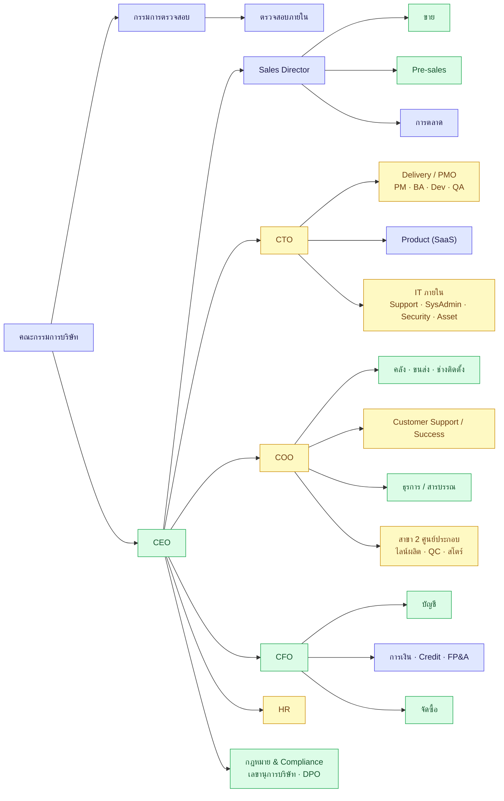
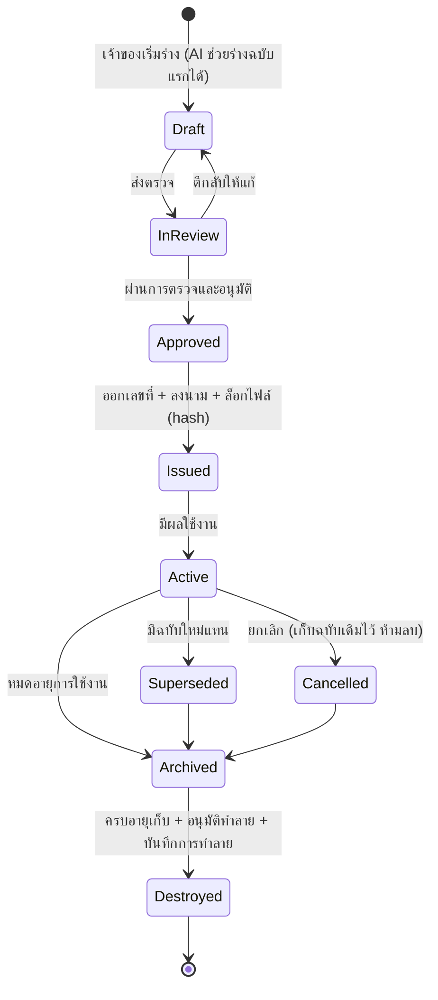
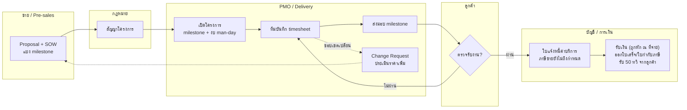
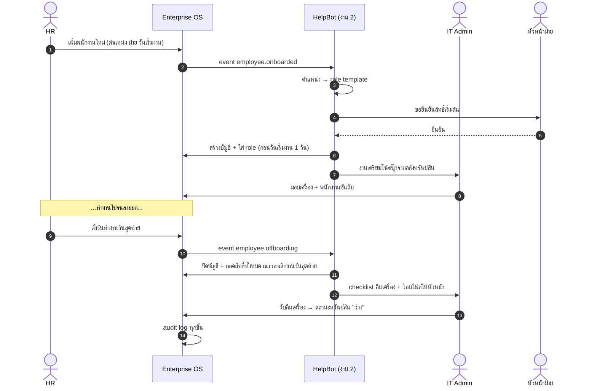
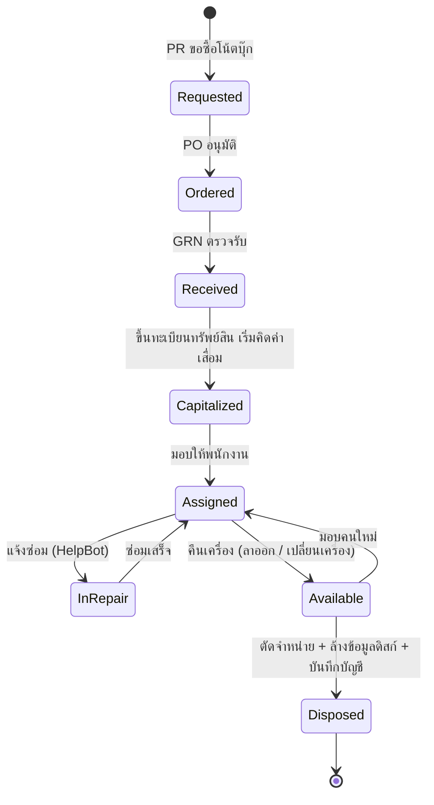
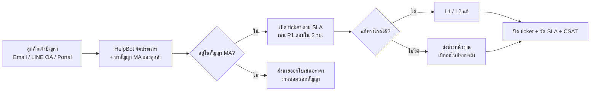

# 🏗️ งานที่ 4a — Company Blueprint: บริษัทจำลอง · ทุกฝ่าย · ทุกตำแหน่ง · ใครร่างเอกสารอะไร

> ส่วนขยายของ [งานที่ 4 · Enterprise OS](04-enterprise-os.md) — ตอบ 3 คำถาม
> 1. 04 ครอบคลุมทุกฝ่าย ทุกตำแหน่งที่บริษัทต้องมีจริงไหม (รวม IT)
> 2. ควรจำลองเป็นบริษัทประเภทไหน — Tech/AI หรือขายโปรแกรม แบบไหนเวิร์คที่สุด
> 3. เอกสารแต่ละชนิด ฝ่ายไหนร่าง ใครตรวจ ใครอนุมัติ ใครเก็บ
>
> ← [งานที่ 4](04-enterprise-os.md) · [MD หลัก](../README.md)

---

## สารบัญ
1. [คำตอบตรงๆ: 04 ครบทุกตำแหน่งไหม?](#1-คำตอบตรงๆ-04-ครบทุกตำแหน่งไหม)
2. [ควรจำลองเป็นบริษัทประเภทไหน?](#2-ควรจำลองเป็นบริษัทประเภทไหน)
3. [Company Profile ของบริษัทสมมติ](#3-company-profile-ของบริษัทสมมติ)
4. [ผังองค์กร](#4-ผังองค์กร)
5. [Role Catalog — ทุกตำแหน่งทำอะไรในระบบ](#5-role-catalog--ทุกตำแหน่งทำอะไรในระบบ)
6. [IT ในบริษัท IT — 3 ทีมที่คนมักสับสน](#6-it-ในบริษัท-it--3-ทีมที่คนมักสับสน)
7. [ใครร่างเอกสารอะไร (Document Ownership Matrix)](#7-ใครร่างเอกสารอะไร-document-ownership-matrix)
8. [Document Center — โมดูลกลางของเอกสารทั้งบริษัท](#8-document-center--โมดูลกลางของเอกสารทั้งบริษัท)
9. [Flow ข้ามฝ่ายที่เพิ่มจาก 3 Core Flow](#9-flow-ข้ามฝ่ายที่เพิ่มจาก-3-core-flow)
10. [ขอบเขตใหม่ของงาน 4 ตาม Phase](#10-ขอบเขตใหม่ของงาน-4-ตาม-phase)
11. [แปลงผังบริษัทเป็น ERPNext](#11-แปลงผังบริษัทเป็น-erpnext)

---

## 1. คำตอบตรงๆ: 04 ครบทุกตำแหน่งไหม?

**ยังไม่ครบครับ** — 04 ฉบับแรกมี 10 แผนก ~20 role ซึ่งพอสำหรับ 3 Core Flow (ขาย→รับเงิน, จัดซื้อ→จ่ายเงิน, ปิดงบ)
แต่บริษัทจริงขนาดกลาง (~100 คน) มี **12–15 ฝ่าย 40+ ตำแหน่ง** ส่วนที่ขาดไป:

| ส่วนที่ขาด | ทำไมสำคัญ | สถานะใหม่ |
|---|---|---|
| **ธุรการ / สารบรรณ** (Document Control) | ฝ่ายที่คุมเลขที่เอกสาร หนังสือเข้า-ออก ประกาศ template — เกี่ยวกับคำถาม "ใครร่างเอกสารบริษัท" โดยตรง | MVP (Document Center) |
| **Pre-sales / Solution Engineer** | บริษัท IT ขายของไม่ได้ถ้าไม่มีคนทำสเปค/BOQ/ประเมิน man-day | MVP |
| **คลัง / ขนส่ง / Messenger** | เดิมรวมอยู่ใน "วิศวกรรม" — งานจริงแยกกัน และ Messenger คือคนวางบิล/รับเช็คในไทย | MVP |
| **PMO / Delivery** (PM, BA, Developer, QA) | รายได้งานบริการมาจากโครงการ: milestone, timesheet, ใบตรวจรับงาน | MVP+ |
| **Customer Support / Customer Success** | ลูกค้าแจ้งปัญหาตามสัญญา MA/SLA — **คนละทีมกับ IT ภายใน** | MVP+ |
| **HR** (Onboarding / Offboarding / ลา) | ต่อกับ IT: สร้าง/ปิดบัญชี มอบ/คืนเครื่อง — โชว์ด้าน security ได้ดี | MVP+ |
| **IT Asset / IT Security** | ทะเบียนเครื่อง+ไลเซนส์, ทบทวนสิทธิ์, ดู audit log | MVP+ |
| **Product** (PM, UX) | จำเป็นถ้าบริษัทมีสินค้า SaaS ของตัวเอง | Pro |
| **Credit Control / FP&A** | ตามหนี้, คุมงบประมาณตอนขอซื้อ | Pro |
| **เลขานุการบริษัท / DPO / Compliance** | รายงานประชุม, เอกสารยื่นนายทะเบียน, PDPA | Pro |
| **Internal Audit** | ตรวจสอบภายใน (มี role Auditor อ่านอย่างเดียวอยู่แล้ว) | Pro |
| ขั้นตอนแบบไทย: **ใบวางบิล, ใบลดหนี้/เพิ่มหนี้** | B2B ไทยจ่ายตามรอบวางบิล + เครดิตเทอม | MVP (แก้ใน 04 แล้ว) |

> **หลักคิด:** "ครบทุกอาชีพ" ไม่ใช่เป้าที่ถูก เพราะบริษัทแต่ละประเภทมีฝ่ายไม่เหมือนกัน
> เป้าที่ถูกคือ **ครบทุกฝ่ายที่บริษัทประเภทที่เลือกต้องมี + ครบทุก flow ข้ามฝ่ายที่สำคัญ + เขียนชัดว่าอะไรไม่ทำ และเพราะอะไร**
> ผู้สัมภาษณ์ประทับใจ "การกำหนดขอบเขตที่มีเหตุผล" มากกว่าจำนวนหน้าจอ

---

## 2. ควรจำลองเป็นบริษัทประเภทไหน?

### 2.1 เปรียบเทียบ 5 แบบ

● = ได้เต็ม · ◐ = ได้บางส่วน · ○ = แทบไม่ได้

| เกณฑ์ | SaaS / ขายโปรแกรมล้วน | Software House / AI Consulting ล้วน | ขายอุปกรณ์ IT ล้วน | โรงงานผลิต | ⭐ **IT Solution & AI (ผสม)** |
|---|:-:|:-:|:-:|:-:|:-:|
| ธุรกรรมสินค้า: คลัง · ส่งของ · VAT ตอนส่งมอบ · 3-way match | ○ | ◐ | ● | ● | ● |
| ธุรกรรมบริการ: หัก ณ ที่จ่าย · milestone · timesheet | ◐ | ● | ◐ | ○ | ● |
| รายได้ประจำ: Subscription / MA | ● | ◐ | ○ | ○ | ● |
| ตรงกับสายงาน IT/AI ที่จะสมัคร | ● | ● | ◐ | ○ | ● |
| งาน 1–2 เป็น "สินค้า" ของบริษัทได้ | ● | ● | ○ | ○ | ● |
| ความง่ายของบัญชี (● = ง่าย) | ◐ รับรู้รายได้ตามงวด | ◐ | ● | ○ ต้นทุนการผลิต | ◐ คุมด้วย Phase |
| ผู้สัมภาษณ์สาย IT เข้าใจทันที | ● | ● | ● | ◐ | ● |
| จำนวนฝ่ายที่ได้โชว์ | ○ ไม่มีคลัง จัดซื้อน้อย | ◐ | ◐ | ◐ เยอะแต่ไกลจาก IT | ● |
| **คะแนน (เต็ม 8)** | 5.0 | 6.0 | 4.5 | 2.0 | **7.5** |

### 2.2 ทำไม "IT Solution & AI แบบผสม" เวิร์คที่สุด

1. **รายได้ 3 สายครอบคลุมธุรกรรมทุกแบบ** — ขายสินค้า (ฮาร์ดแวร์), ขายบริการ (โครงการ), รายได้ประจำ (MA + SaaS) จึงได้โชว์ VAT ทั้งแบบส่งมอบและแบบรับเงิน, หัก ณ ที่จ่ายทั้งฝั่งรับและจ่าย, 3-way match และ milestone billing ในระบบเดียว
2. **ทั้งพอร์ตเล่าเป็นเรื่องเดียวกันได้**
   - งาน 1 (RAG) และงาน 2 (Helpdesk Agent) = **สินค้า AI ที่บริษัทขายให้ลูกค้า**
   - งาน 4 = **ระบบหลังบ้านที่บริษัทใช้เอง** (dogfooding)
   - component จากงาน 3 = Dashboard ผู้บริหาร
3. **ตรงกับนายจ้างที่จะไปสมัคร** — บริษัท IT Solution / System Integrator เป็นนายจ้างสาย IT กลุ่มใหญ่ในไทย ผู้สัมภาษณ์จะเห็น flow ของบริษัทตัวเองในงานของคุณ
4. **ข้อเสีย:** scope ใหญ่ → แก้โดย **เปิดสายรายได้ทีละ Phase** (ข้อ 2.4)

### 2.3 เมื่อไหร่ควรเลือกแบบอื่น

| ถ้าเป้าหมายคือ | เลือก | ต้องเพิ่ม |
|---|---|---|
| SaaS startup / Product company | SaaS ล้วน | Subscription billing, MRR/Churn dashboard, ตารางรับรู้รายได้ตามงวด |
| ERP Consultant (SAP/Odoo) สายโรงงาน | ขายอุปกรณ์ หรือ โรงงาน | คลังหลายที่, ต้นทุน FIFO/ถัวเฉลี่ย, BOM |
| Software House / Agency | Consulting ล้วน | Project P&L, timesheet, resource planning |

### 2.4 เปิดสายรายได้ทีละ Phase

| Phase | สายรายได้ | ธุรกรรมที่ได้โชว์ | ความยากบัญชี |
|---|---|---|---|
| MVP | ① ขายฮาร์ดแวร์ + ไลเซนส์ | คลัง, ส่งของ, ใบกำกับภาษีตอนส่งมอบ, วางบิล, 3-way match ฝั่งซื้อ | ต่ำ |
| MVP+ | ② โครงการ AI / Implementation | Proposal/SOW, milestone, ใบตรวจรับงาน, หัก ณ ที่จ่าย, timesheet | กลาง |
| MVP+ | ③a MA ออกบิลรายเดือน/ไตรมาส | ออกบิลตามรอบ + SLA (รับรู้รายได้เมื่อออกบิล — ง่าย) | ต่ำ |
| Pro | ③b SaaS / MA จ่ายล่วงหน้ารายปี | ตารางรับรู้รายได้รายเดือน (รายได้รับล่วงหน้า) | สูง — ให้นักบัญชีเลือกมาตรฐานที่ใช้ |

> `ponytail:` ให้ MA ออกบิลรายเดือนก่อน จะได้ไม่ต้องทำระบบรายได้รับล่วงหน้าใน MVP — เพิ่มใน Pro เมื่อทำ SaaS รายปี

---

## 3. Company Profile ของบริษัทสมมติ

| หัวข้อ | ค่า |
|---|---|
| ชื่อ | บริษัท ตัวอย่าง เอไอ โซลูชั่นส์ จำกัด *(ชื่อสมมติ — ห้ามใช้ชื่อ โลโก้ หรือข้อมูลของบริษัทจริง)* |
| ธุรกิจ | IT Solution & AI: ขายฮาร์ดแวร์/ไลเซนส์ · รับทำโครงการ AI และระบบ · MA + SaaS |
| สินค้า AI ของตัวเอง (ชื่อสมมติ) | **DocQA** = งาน 1 · **HelpBot** = งาน 2 |
| ขนาด | ~125 คน · สำนักงานใหญ่ (สาขา 00000) + คลังสินค้า · **สาขา 2 ศูนย์ประกอบ AI Workstation / Edge Box (00001)** — รายละเอียดใน [04d](04d-erp-implementation.md#1-สาขา-2-ศูนย์ประกอบเครื่อง) |
| ลูกค้า | เอกชนขนาดกลาง-ใหญ่ · ภาครัฐ/ประมูล = นอกขอบเขต (ขั้นตอนเฉพาะเยอะ) |
| ภาษี | จด VAT · หัก ณ ที่จ่ายทั้งฝั่งรับและฝั่งจ่าย |
| เครดิตเทอม | ลูกค้า 30–60 วัน (วางบิลทุกสิ้นเดือน) · ผู้ขาย 30 วัน |
| รอบบัญชี | 1 ม.ค. – 31 ธ.ค. |
| สัดส่วนรายได้ (สมมติ) | ฮาร์ดแวร์ซื้อมาขาย 30% · **เครื่องที่ประกอบเอง 15%** · โครงการ 35% · MA/SaaS 20% |
| Seed data | ลูกค้า 30 · ผู้ขาย 15 · สินค้า 50 + วัตถุดิบ 20 · BOM 2 · โครงการ 6 · พนักงาน 125 · ธุรกรรมย้อนหลัง 3 เดือนทั้ง 2 สาขา |

---

## 4. ผังองค์กร



สี: 🟩 มีใน MVP · 🟨 เพิ่มใน MVP+ · 🟦 Pro (หรือเป็นแค่ผู้อนุมัติ/ผู้ดู)

> ในบริษัทไทยขนาดกลางหลายแห่ง IT ภายในขึ้นกับ CFO หรือ COO — ในบริษัท tech มักขึ้นกับ CTO ตามผังนี้ ไม่มีแบบไหนผิด แต่ควรเขียนไว้ใน ADR ว่าเลือกเพราะอะไร

---

## 5. Role Catalog — ทุกตำแหน่งทำอะไรในระบบ

> งาน 4 ใช้ ERPNext เป็นระบบหลัก — "โมดูล / หน้าจอ" ส่วนใหญ่คือ ERPNext Desk ส่วนงานที่เกี่ยวกับ AI อยู่ใน AI Workspace · ตำแหน่งแปลงเป็น Role ของ ERPNext ใน [ข้อ 11](#11-แปลงผังบริษัทเป็น-erpnext)

| ฝ่าย | ตำแหน่ง | คน | งานหลักในระบบ | โมดูล / หน้าจอ | Phase |
|---|---|---|---|---|---|
| ผู้บริหาร | CEO | 1 | อนุมัติวงเงินสูงสุด, ดูภาพรวม | Approvals, Executive Dashboard | MVP |
| | CFO | 1 | อนุมัติ PO/จ่ายวงเงินสูง, ปิดงบปี | Approvals, Finance Dashboard | MVP |
| | CTO | 1 | อนุมัติโครงการ/ทรัพยากร | Project Portfolio | MVP+ |
| | COO | 1 | ดู SLA, คลัง, งานค้าง | Ops Dashboard | MVP+ |
| ขาย | Account Manager | 8 | ลูกค้า, ใบเสนอราคา, ติดตามดีล | Customers, Quotation | MVP |
| | Sales Manager | 2 | อนุมัติส่วนลด, ดู pipeline | Approvals, Sales Dashboard | MVP |
| | Pre-sales / Solution Engineer | 4 | สเปค/BOQ, ประเมิน man-day, ร่าง proposal | Quotation (แท็บเทคนิค), Proposal | MVP |
| การตลาด | Marketing | 3 | แคมเปญ, leads, ขอใช้งบ | Leads, Budget Request | Pro |
| Delivery / PMO | Project Manager | 4 | แผนงาน, milestone, ขอให้ลูกค้าตรวจรับ | Projects, Milestones | MVP+ |
| | Business Analyst | 3 | requirement, change request | Projects (CR) | MVP+ |
| | Software / AI Engineer | 15 | บันทึก timesheet | Timesheet | MVP+ |
| | QA / Tester | 4 | UAT sign-off | Projects (UAT) | Pro |
| | Implementation Engineer | 6 | ติดตั้งระบบหน้างาน | Projects, Delivery | MVP+ |
| Product | Product Manager | 2 | แผนสินค้า SaaS, ราคา plan | Product Catalog | Pro |
| | UX/UI Designer | 2 | (ใช้แค่ timesheet) | Timesheet | Pro |
| คลัง / ขนส่ง | Warehouse Officer | 3 | รับเข้า (GRN), จ่ายออก, นับสต็อก | Inventory, GRN | MVP |
| | Logistics / Messenger | 3 | ส่งของ, **วางบิล, รับเช็ค** | Delivery, Billing Route | MVP |
| | Field Service Technician | 6 | ติดตั้ง/ซ่อม, เบิกอะไหล่ | Service Orders | MVP+ |
| สาขา 2 ศูนย์ประกอบ | หัวหน้าสาขา 2 | 1 | ดูแผนผลิต สต๊อก ค่าใช้จ่ายสาขา | Work Order, รายงานสาขา | MVP+ |
| | หัวหน้าไลน์ผลิต | 1 | เปิด/ปิด Work Order, บันทึก Job Card, อนุมัติ OT | Work Order, Job Card, Overtime Slip | MVP+ |
| | ช่างประกอบ (รายวัน) | 10 | ลงเวลา, บันทึกงานประกอบ | Employee Checkin, Job Card | MVP+ |
| | QC | 1 | ตรวจผ่าน/ไม่ผ่าน, บันทึกของเสีย | Quality Inspection | MVP+ |
| | สโตร์สาขา 2 | 1 | รับวัตถุดิบ, จ่ายเข้าผลิต, ตรวจนับ | Stock Entry, Material Request | MVP+ |
| Customer Support | Helpdesk L1/L2 (ลูกค้า) | 6 | ticket ลูกค้าตาม SLA ของ MA (ใช้ HelpBot) | Customer Tickets | MVP+ |
| | Customer Success Manager | 2 | ต่อสัญญา MA/SaaS | Renewals | Pro |
| จัดซื้อ | Buyer | 3 | RFQ, เปรียบเทียบราคา, PO | Procurement | MVP |
| | Procurement Manager | 1 | อนุมัติ PO, ทะเบียนผู้ขาย | Approvals, Vendors | MVP |
| บัญชี | AR Accountant | 2 | ใบกำกับภาษี, วางบิล, ใบเสร็จ, ใบลดหนี้ | AR | MVP |
| | AP Accountant | 2 | ตรวจใบแจ้งหนี้ผู้ขาย (OCR), ตั้งเจ้าหนี้ | AP | MVP |
| | GL / Tax Accountant | 2 | รายการปรับปรุง, รายงานภาษี | GL, Tax Reports | MVP |
| | Chief Accountant | 1 | post รายการ, ปิดงวด, ออกงบ | Period Close | MVP |
| | Project / Cost Accountant | 1 | ต้นทุนและกำไรรายโครงการ | Project P&L | Pro |
| การเงิน | Finance Officer | 2 | payment run, กระทบยอดธนาคาร | Finance | MVP |
| | Finance Manager | 1 | อนุมัติจ่าย, กระแสเงินสด | Approvals, Cash | MVP |
| | Credit Controller | 1 | ตามหนี้, AR aging, ระงับเครดิต | Collections | Pro |
| | FP&A | 1 | ทำงบประมาณ, เทียบงบกับจริง | Budget | Pro |
| HR | HR / Recruiter | 2 | รับพนักงาน → onboarding / offboarding | Employees, On/Offboarding | MVP+ |
| | HR Admin / Payroll | 2 | ลา, export ข้อมูลเงินเดือน, ประกันสังคม | Leave, Payroll Export | Pro |
| กฎหมาย & Compliance | Legal Counsel | 2 | ร่าง/ตรวจสัญญา (AI ช่วย), NDA | Contracts | MVP |
| | Company Secretary | 1 | ประชุมกรรมการ/ผู้ถือหุ้น, เอกสารนายทะเบียน | Corporate Docs | Pro |
| | DPO / Compliance | 1 | ทะเบียนกิจกรรมประมวลผลข้อมูล (ROPA), คำขอของเจ้าของข้อมูล | PDPA | Pro |
| ธุรการ | Admin / สารบรรณ | 2 | เลขที่เอกสาร, หนังสือเข้า-ออก, ประกาศ, ดูแล template | Document Center | MVP |
| IT ภายใน | IT Manager | 1 | อนุมัติสิทธิ์, นโยบาย IT | Approvals, Policies | MVP |
| | IT Support | 2 | helpdesk พนักงาน (HelpBot) | Internal Tickets | MVP+ |
| | System / Network Admin | 1 | บัญชีผู้ใช้, role, backup | Users & Roles | MVP |
| | IT Security | 1 | ทบทวน audit log, alert, ทบทวนสิทธิ์รายไตรมาส | Audit, Access Review | MVP+ |
| | IT Asset & License Admin | 1 | ทะเบียนเครื่อง/ไลเซนส์, มอบ-คืน | Asset Register | MVP+ |
| ตรวจสอบ | Internal Auditor | 1 | อ่านทุกโมดูล, ตรวจ audit chain | Audit (read-only) | MVP (role) |
| ภายนอก | ลูกค้า | — | ดูใบแจ้งหนี้, แจ้งปัญหา, เซ็นตรวจรับงาน | Customer Portal | Pro |
| | ผู้ขาย | — | ส่งใบแจ้งหนี้, ดูสถานะจ่าย | Vendor Portal | Pro |
| | ผู้สอบบัญชีภายนอก | — | ดูข้อมูลปีบัญชี | Auditor (read-only จำกัดเวลา) | Pro |

**รวม ~125 คน · 48 ตำแหน่งภายใน + ผู้ใช้ภายนอก 3 กลุ่ม** → MVP ใช้งาน 20 ตำแหน่ง · MVP+ 37 · Pro ครบ 48 + ภายนอก

---

## 6. IT ในบริษัท IT — 3 ทีมที่คนมักสับสน

ในบริษัทที่ขายงาน IT มี "คนทำ IT" อยู่ 3 กลุ่มที่ **ลูกค้าต่างกัน งบต่างกัน และใช้ระบบต่างกัน** — แยกให้ชัดในระบบจะแสดงว่าเข้าใจองค์กรจริง

| | IT ภายใน (Internal IT) | Delivery / PMO | Customer Support |
|---|---|---|---|
| ลูกค้าคือ | พนักงานบริษัทเอง | ลูกค้าที่จ้างทำโครงการ | ลูกค้าที่ซื้อ MA / SaaS |
| สร้างรายได้ไหม | ❌ เป็นต้นทุน | ✅ รายได้โครงการ | ✅ รายได้ MA/SaaS |
| งานหลัก | บัญชีผู้ใช้, สิทธิ์, เครื่อง, เครือข่าย, ความปลอดภัย | ส่งมอบตาม SOW, milestone | แก้ปัญหาตาม SLA |
| ใช้ HelpBot (งาน 2) แบบไหน | Helpdesk ภายใน | — | Helpdesk ลูกค้า (tenant แยก) |
| ตัวชี้วัด | MTTR, % บัญชีค้างของคนลาออก = 0 | ส่งตรงเวลา, margin | SLA met %, CSAT, ต่อสัญญา |
| ข้อมูลที่ห้ามปนกัน | ข้อมูลพนักงาน | ข้อมูลโครงการลูกค้า | ข้อมูลลูกค้าแต่ละราย |

### งานของ IT ภายในที่ระบบต้องรองรับ

| งาน | ในระบบ | Phase |
|---|---|---|
| สร้าง/ปิดบัญชีตาม HR (Hire-to-Retire) | event `employee.onboarded` / `employee.offboarding` → HelpBot ทำ checklist | MVP+ |
| Role template ตามตำแหน่ง | ตำแหน่ง → ชุด role เริ่มต้น (RBAC) | MVP |
| ทบทวนสิทธิ์รายไตรมาส (Access Review) | หัวหน้าแต่ละฝ่ายกดยืนยัน/ถอดสิทธิ์ลูกน้อง | MVP+ |
| ทะเบียนเครื่องและไลเซนส์ | เชื่อมกับ PO/GRN และทะเบียนทรัพย์สินของบัญชี | MVP+ |
| Security alert | login ผิดซ้ำ, เพิ่มสิทธิ์ admin, export ข้อมูลจำนวนมาก, ใช้งานนอกเวลา | MVP+ |
| Audit log review | หน้าค้นหา + ปุ่ม Verify audit chain | MVP |
| Backup / สถานะระบบ | หน้า System Status | Pro |

---

## 7. ใครร่างเอกสารอะไร (Document Ownership Matrix)

> **ไม่มีฝ่ายเดียวที่ร่างเอกสารทั้งบริษัท** — เอกสารแต่ละชนิดมี "เจ้าของเนื้อหา" ต่างกัน
> - **กฎหมาย** ร่างเอกสารที่มีผลผูกพัน (สัญญา, NDA, หนังสือมอบอำนาจ) และอนุมัติ template ให้ฝ่ายอื่นใช้
> - **บัญชี** ออกเอกสารภาษีและเอกสารการเงิน
> - **ธุรการ/สารบรรณ** ไม่ได้ร่างเนื้อหาทุกฉบับ แต่ **คุมระบบเอกสาร**: เลขที่, รูปแบบ, ทะเบียนรับ-ส่ง, การเก็บและทำลาย
> - **ฝ่ายที่เป็นเจ้าของงาน** ร่างเอกสารงานของตัวเอง (ขาย → ใบเสนอราคา, จัดซื้อ → PO, HR → สัญญาจ้างจาก template)

อายุเก็บ: เอกสารบัญชี/ภาษี **อย่างน้อย 5 ปี** · อื่นๆ ตามนโยบายบริษัทและกฎหมายที่เกี่ยวข้อง (ให้ฝ่ายกฎหมายกำหนด)

### 7.1 ขาย & ลูกค้า

| เอกสาร | ผู้เริ่ม | ผู้ร่าง | ผู้ตรวจ | ผู้อนุมัติ / ลงนาม | ผู้เก็บ | AI ช่วย |
|---|---|---|---|---|---|---|
| ใบเสนอราคา | Sales | Sales + Pre-sales (สเปค) | Sales Manager | ตามเกณฑ์ส่วนลด | ขาย | ร่างจาก template + ราคาที่เคยขาย |
| Proposal / SOW | Sales | Pre-sales + PM | Legal (เงื่อนไข) | Sales Director | ขาย | ร่างจาก proposal เก่า (RAG งาน 1) |
| สัญญาขาย / โครงการ / MA | Sales | **Legal** (จาก template) | Legal | กรรมการผู้มีอำนาจ | กฎหมาย | ตรวจ clause เสี่ยง |
| ใบส่งสินค้า / ใบกำกับภาษี | ระบบ (เมื่อส่งมอบ) | AR Accountant | — | ออกโดยระบบตามสิทธิ์ | บัญชี | — |
| ใบตรวจรับงาน (Acceptance) | PM | PM | ลูกค้า | ลูกค้าลงนาม | PMO + บัญชี | สรุปผลงานของ milestone |
| ใบวางบิล | AR | AR | — | — | บัญชี | — |
| ใบเสร็จรับเงิน | การเงิน (ยืนยันเงินเข้า) | AR | — | — | บัญชี | — |
| ใบลดหนี้ / ใบเพิ่มหนี้ | Sales (คืนของ/ปรับราคา) | AR | Chief Accountant | Chief Accountant | บัญชี | — |

### 7.2 จัดซื้อ & ผู้ขาย

| เอกสาร | ผู้เริ่ม | ผู้ร่าง | ผู้ตรวจ | ผู้อนุมัติ / ลงนาม | ผู้เก็บ | AI ช่วย |
|---|---|---|---|---|---|---|
| ใบขอซื้อ (PR) | ฝ่ายที่ต้องการ | ผู้ขอ | หัวหน้าฝ่าย (+ FP&A ตรวจงบใน Pro) | ตาม Approval Matrix | จัดซื้อ | แนะนำผู้ขาย/ราคาเดิม |
| RFQ / ตารางเปรียบเทียบราคา | Buyer | Buyer | Procurement Manager | — | จัดซื้อ | สรุปเทียบใบเสนอราคาผู้ขาย |
| ใบสั่งซื้อ (PO) | Buyer | Buyer | — | Procurement Manager / ผู้บริหาร | จัดซื้อ | — |
| สัญญาซื้อ/จ้าง, NDA ผู้ขาย | Buyer | **Legal** | Legal | กรรมการผู้มีอำนาจ | กฎหมาย | ตรวจ clause เสี่ยง |
| ใบตรวจรับสินค้า (GRN) | คลัง / ผู้ขอ | คลัง | — | ผู้ตรวจรับ | คลัง + บัญชี | — |
| ใบกำกับภาษีผู้ขาย (รับเข้า) | ผู้ขาย | — | AP Accountant | AP Accountant | บัญชี | OCR → JSON |
| หนังสือรับรองการหักภาษี ณ ที่จ่าย (50 ทวิ) | ระบบ (ตอนจ่าย) | การเงิน / AP | Tax Accountant | — | บัญชี | — |
| ทะเบียนผู้ขาย / เปลี่ยนบัญชีธนาคาร | Buyer | Buyer | การเงิน | Finance Manager (2 คน) | จัดซื้อ | ตรวจความผิดปกติ |

### 7.3 บัญชี การเงิน ภาษี

| เอกสาร | ผู้เริ่ม | ผู้ร่าง | ผู้ตรวจ | ผู้อนุมัติ / ลงนาม | ผู้เก็บ | AI ช่วย |
|---|---|---|---|---|---|---|
| ใบสำคัญจ่าย (Payment Voucher) | การเงิน | Finance Officer | Finance Manager | ตาม Approval Matrix | การเงิน | — |
| สมุดรายวัน / รายการปรับปรุง | Accountant | GL Accountant | Chief Accountant | Chief Accountant | บัญชี | — |
| แบบภาษีรายเดือน (ภ.พ.30, ภ.ง.ด.1 / 3 / 53) | ระบบ | Tax Accountant | Chief Accountant | ผู้มีอำนาจ | บัญชี | — |
| งบการเงินประจำปี + แบบยื่นกรมพัฒนาธุรกิจการค้า + ภ.ง.ด.50 | Chief Accountant | Chief Accountant | ผู้สอบบัญชีภายนอก | กรรมการ + ที่ประชุมผู้ถือหุ้น | บัญชี | ร่างคำอธิบายงบ |
| งบประมาณประจำปี | FP&A | FP&A + หัวหน้าฝ่าย | CFO | CEO / กรรมการ | การเงิน | สรุปเทียบปีก่อน |

### 7.4 HR

| เอกสาร | ผู้เริ่ม | ผู้ร่าง | ผู้ตรวจ | ผู้อนุมัติ / ลงนาม | ผู้เก็บ | AI ช่วย |
|---|---|---|---|---|---|---|
| JD / ประกาศรับสมัคร | หัวหน้าฝ่าย | HR | หัวหน้าฝ่าย | — | HR | ร่าง JD |
| สัญญาจ้าง | HR | HR (จาก template ที่ Legal อนุมัติ) | Legal (ตอนทำ template) | ผู้มีอำนาจ | HR | — |
| ข้อบังคับเกี่ยวกับการทำงาน | HR | HR | Legal | CEO | HR | — |
| ใบลา / หนังสือรับรองการทำงาน | พนักงาน | ระบบ / HR | หัวหน้า | HR | HR | — |
| แบบประกันสังคมรายเดือน / ภ.ง.ด.1 | Payroll | Payroll | HR Manager | — | HR + บัญชี | — |

### 7.5 บริษัท · กฎหมาย · PDPA

| เอกสาร | ผู้เริ่ม | ผู้ร่าง | ผู้ตรวจ | ผู้อนุมัติ / ลงนาม | ผู้เก็บ | AI ช่วย |
|---|---|---|---|---|---|---|
| รายงานการประชุมกรรมการ / ผู้ถือหุ้น | Company Secretary | Company Secretary | Legal | ประธานที่ประชุม | เลขานุการบริษัท | สรุปจากบันทึกการประชุม |
| หนังสือรับรองบริษัท / รายชื่อผู้ถือหุ้น (ยื่น/ขอจากนายทะเบียน) | Company Secretary | Company Secretary | Legal | กรรมการ | เลขานุการบริษัท | — |
| หนังสือมอบอำนาจ | ผู้ขอ | Legal | Legal | กรรมการผู้มีอำนาจ | กฎหมาย | — |
| Privacy Notice, ROPA, DPA กับผู้ขาย | DPO | DPO + Legal | Legal | CEO | DPO | ร่างจาก template |

### 7.6 ธุรการ / สารบรรณ

| เอกสาร | ผู้เริ่ม | ผู้ร่าง | ผู้ตรวจ | ผู้อนุมัติ / ลงนาม | ผู้เก็บ | AI ช่วย |
|---|---|---|---|---|---|---|
| บันทึกข้อความภายใน (Memo) | ทุกฝ่าย | ผู้ขอ | หัวหน้าฝ่าย | ตามเรื่อง | สารบรรณ | ร่างจาก template |
| หนังสือออกถึงภายนอก | ทุกฝ่าย | ผู้ขอ + สารบรรณ (รูปแบบ + เลขที่) | Legal (ถ้ามีผลผูกพัน) | ผู้มีอำนาจลงนาม | สารบรรณ | ร่าง/เกลาภาษา |
| ทะเบียนหนังสือรับ-ส่ง | สารบรรณ | ระบบ | — | — | สารบรรณ | จัดหมวด + ส่งต่อฝ่ายที่เกี่ยวข้อง (Router งาน 2) |
| ประกาศบริษัท | HR / ผู้บริหาร | HR / ธุรการ | Legal | CEO | ธุรการ | — |

### 7.7 IT

| เอกสาร | ผู้เริ่ม | ผู้ร่าง | ผู้ตรวจ | ผู้อนุมัติ / ลงนาม | ผู้เก็บ | AI ช่วย |
|---|---|---|---|---|---|---|
| นโยบายความปลอดภัยสารสนเทศ / การใช้งานที่ยอมรับได้ | IT Manager | IT Security | Legal + HR | CEO | IT | ร่างจาก framework มาตรฐาน |
| คำขอสิทธิ์ (Access Request) | พนักงาน | ระบบ (HelpBot) | IT | หัวหน้า + เจ้าของข้อมูล | IT (audit) | จัดประเภท + สรุป |
| ใบรับมอบ / คืนทรัพย์สิน IT | IT Asset Admin | ระบบ | — | พนักงานลงนาม | IT + บัญชี | — |
| รายงานเหตุการณ์ความปลอดภัย (Incident Report) | IT Security | IT Security | IT Manager | — | IT | สรุป timeline จาก log |
| คำขอเปลี่ยนแปลงระบบ (Change Request) | IT / Dev | ผู้ขอ | IT Manager | IT Manager | IT | ประเมินผลกระทบ |

### 7.8 โครงการ

| เอกสาร | ผู้เริ่ม | ผู้ร่าง | ผู้ตรวจ | ผู้อนุมัติ / ลงนาม | ผู้เก็บ | AI ช่วย |
|---|---|---|---|---|---|---|
| Project Charter / Plan | PM | PM | CTO | CTO | PMO | ร่างจาก SOW |
| Change Request จากลูกค้า | ลูกค้า / BA | BA | PM + Pre-sales (ราคา) | ลูกค้า + Sales | PMO | ประเมิน man-day จากงานเก่า |
| UAT Sign-off | QA | QA | PM | ลูกค้า | PMO | สรุปผลทดสอบ |

### 7.9 วงจรชีวิตเอกสาร (ใช้ร่วมกันทุกชนิด)



> ⚠️ เอกสารภาษี (เช่น ใบกำกับภาษี) **ห้ามแก้หรือลบ** — ถ้าผิดให้ยกเลิกและออกฉบับใหม่ตามวิธีที่กรมสรรพากรกำหนด และเก็บฉบับที่ยกเลิกไว้ด้วย

---

## 8. Document Center — โมดูลกลางของเอกสารทั้งบริษัท

> ใน ERPNext: เลขที่เอกสาร (Naming Series), template การพิมพ์ (Print Format) และไฟล์แนบ **มีให้แล้ว** — ส่วนของเราคือ AI ร่างเอกสารและค้นเอกสารทั้งบริษัทตามสิทธิ์ (ดู [ข้อ 11.4](#114-document-center--erpnext)) · โค้ดเลขที่เอกสารด้านล่างเก็บไว้เป็นความรู้ และใช้เมื่อชั้น AI ต้องออกเลขของตัวเอง

| ฟีเจอร์ | รายละเอียด | เจ้าของ | Phase |
|---|---|---|---|
| Template Library | DOCX/HTML + ตัวแปร · แต่ละ template มีเจ้าของ (Legal: สัญญา · ธุรการ: memo/หนังสือ · HR: เอกสาร HR · บัญชี: เอกสารภาษี) · มีเวอร์ชัน | ฝ่ายเจ้าของ template | MVP |
| เลขที่เอกสาร | รูปแบบ `{ประเภท}-{ปี}-{ลำดับ}` เช่น `INV-2027-00042` แยกตามประเภท/ปี/สาขา | ธุรการ (ตั้งค่า) | MVP |
| ผูกเอกสารกับงาน | ไฟล์ทุกชิ้นผูกกับ PO / invoice / contract / project | ระบบ | MVP |
| อนุมัติ + ลงนาม | approval stamp + hash ของไฟล์ (ลายมือชื่ออิเล็กทรอนิกส์จริง = Pro) | ผู้อนุมัติ | MVP |
| ทะเบียนหนังสือรับ-ส่ง | หนังสือเข้า → AI จัดหมวด → ส่งต่อฝ่าย | สารบรรณ | MVP+ |
| อายุเก็บ + ระงับการทำลาย | ตั้งอายุเก็บต่อประเภท · Legal hold เมื่อมีคดี | Legal + ธุรการ | MVP+ |
| AI ช่วยร่าง | ร่างฉบับแรกจาก template + ข้อมูลในระบบ + ตัวอย่างเก่า (RAG งาน 1) → **เจ้าของเอกสารตรวจและรับผิดชอบเสมอ** | ฝ่ายเจ้าของ | MVP+ |
| ค้นเอกสารทั้งบริษัท | ค้นด้วยภาษาคน กรองตามสิทธิ์ (งาน 1) | ทุกคน | MVP+ |

### เลขที่เอกสารต้อง "เรียงไม่ขาด" (จุดเทคนิคที่คนส่วนใหญ่พลาด)

เอกสารภาษีต้องมีเลขเรียงกันไม่ขาดช่วง แต่ `SEQUENCE` ของ PostgreSQL **ข้ามเลขได้** เมื่อ transaction rollback
→ ใช้ตาราง counter ที่อัปเดตใน transaction เดียวกับการสร้างเอกสาร (rollback แล้วเลขก็ถอยด้วย)

```sql
CREATE TABLE doc_counter (
    doc_type TEXT,
    branch   TEXT,
    year     INT,
    last_no  INT NOT NULL,
    PRIMARY KEY (doc_type, branch, year)
);

-- เรียกใน transaction เดียวกับ INSERT เอกสาร (row lock ทำให้สองคนไม่ได้เลขซ้ำ)
INSERT INTO doc_counter (doc_type, branch, year, last_no)
VALUES ('INV', '00000', 2027, 1)
ON CONFLICT (doc_type, branch, year)
DO UPDATE SET last_no = doc_counter.last_no + 1
RETURNING last_no;
```

`ponytail:` row lock ทำให้การออกเลขประเภทเดียวกันต้องต่อคิว — พอสำหรับหลักพันฉบับ/วัน · ถ้ามากกว่านั้นค่อยแยก counter ตามสาขา/จุดออกเอกสาร

---

## 9. Flow ข้ามฝ่ายที่เพิ่มจาก 3 Core Flow

| Flow | ชื่อ | ฝ่ายที่เกี่ยว | Phase |
|---|---|---|---|
| A | Order-to-Cash (สินค้า) — มีวางบิลแล้ว | ขาย → กฎหมาย → คลัง → บัญชี → การเงิน | MVP |
| B | Procure-to-Pay | ผู้ขอ → จัดซื้อ → คลัง → บัญชี → การเงิน | MVP |
| C | Record-to-Report (ปิดงบ) | บัญชี → การเงิน → ผู้บริหาร | MVP |
| **D** | **Project-to-Cash** (บริการ) | ขาย/Pre-sales → กฎหมาย → PMO → ลูกค้า → บัญชี → การเงิน | MVP+ |
| **E** | **Hire-to-Retire** (HR ↔ IT) | HR → IT → ทุกฝ่าย | MVP+ |
| **F** | **Asset Lifecycle** | จัดซื้อ → คลัง → IT → บัญชี → HR | MVP+ |
| **G** | **Issue-to-Resolution** (ลูกค้า MA) | Customer Support → ช่าง → คลัง → ขาย/บัญชี | MVP+ |
| H | Subscription-to-Revenue | Product → ขาย → บัญชี | Pro |
| I | Budget-to-Actual | FP&A → ทุกฝ่าย → CFO | Pro |
| J | Bid-to-Contract (ประมูลภาครัฐ) | ขาย → กฎหมาย → การเงิน (หลักประกัน) | นอกขอบเขต |

### 9.1 Flow D — Project-to-Cash



### 9.2 Flow E — Hire-to-Retire (HR ↔ IT) — จุดโชว์ Security



> 🔐 "บัญชีของคนที่ลาออกแล้วยังใช้ได้" คือช่องโหว่ที่พบบ่อยมากในองค์กรจริง — ตัวชี้วัดที่ควรโชว์: **บัญชีค้างของคนลาออก = 0**

### 9.3 Flow F — Asset Lifecycle (จัดซื้อ → IT → บัญชี)



ทรัพย์สินชิ้นเดียววิ่งผ่าน **จัดซื้อ → คลัง → บัญชี (ค่าเสื่อม) → IT (มอบ/ซ่อม) → HR (คืนตอนลาออก) → บัญชี (ตัดจำหน่าย)** — เป็นตัวอย่างที่ดีที่สุดในการโชว์ว่าข้อมูลไหลข้ามฝ่ายจริง

### 9.4 Flow G — Issue-to-Resolution (ลูกค้า MA)



---

## 10. ขอบเขตใหม่ของงาน 4 ตาม Phase

> ใน ERPNext ทุกฝ่ายทำงานได้ตั้งแต่วันแรก — Phase ด้านล่างบอกว่า **ตั้งค่าครบแค่ไหน และ AI เข้าไปช่วยฝ่ายไหนเมื่อไหร่**

| Phase | ตั้งค่าใน ERPNext | AI ช่วยฝ่าย | Flow | ตำแหน่ง | เวลา (เต็มเวลา) |
|---|---|---|---|---|---|
| **MVP** | ขาย, Pre-sales, จัดซื้อ, คลัง/ขนส่ง, บัญชี, การเงิน, กฎหมาย, ผู้บริหาร + ภาษีไทย | บัญชี (APX), กฎหมาย (ตรวจสัญญา), ผู้บริหาร (Copilot) | A, B, C | 20 | รวมใน MVP ~8–9 สัปดาห์ ([04](04-enterprise-os.md#17-ขนาดงานและ-roadmap)) |
| **MVP+** | + HR (Frappe HR), Project/Timesheet, Asset · **สาย ERP: สาขา 2 ผลิต สต๊อก ใบเบิก ครุภัณฑ์ ลงเวลา รายงานแผนก/สาขา ([04d](04d-erp-implementation.md))** | IT (HelpBot), การเงิน (ตามหนี้), ปิดงวด, พยากรณ์วัตถุดิบหมด | + D, E, F | 37 | + ~2 สัปดาห์ (AI) + 3–4.5 สัปดาห์ (สาย ERP) |
| **Pro** | + Issue/SLA, Budget, Portal ลูกค้า/ผู้ขาย | Customer Support, FP&A, DPO, ธุรการ (ร่างเอกสาร) | + G, H, I | 43 + ภายนอก | + 1–3 เดือน |
| **แยกเป็นงาน 5** | เงินเดือนไทยเต็มรูป (ประกันสังคม, ภ.ง.ด.1, ตัวคูณ OT) — [งาน 5](../05-thai-payroll-erpnext/README.md) | ตรวจ OT ผิดปกติ | — | — | ~4–6 สัปดาห์ |
| **นอกขอบเขต** | หลายสกุลเงิน, หลายบริษัท/งบรวม, ประมูลภาครัฐ, การผลิตซับซ้อน (MRP หลายระดับ) | — | J | — | — |

> **ถ้าเวลาจำกัด:** MVP + Flow E (Hire-to-Retire) คือชุดที่คุ้มที่สุดสำหรับสาย IT — ได้โชว์ทั้งบัญชี (ธุรกิจ) และ security (IT) ในงานเดียว

---

## 11. แปลงผังบริษัทเป็น ERPNext

> ตั้งค่าทั้งหมดนี้ด้วยสคริปต์ ([04c Stage 2](04c-build-guide.md#6-stage-2--จัดบ้านให้เป็นบริษัทไทย-ตั้งค่า-erpnext)) · ชื่อ role มาตรฐานให้ตรวจกับ ERPNext เวอร์ชันที่ใช้

### 11.1 ตำแหน่ง → Role Profile

| ตำแหน่ง (ข้อ 5) | Role ใน ERPNext | หมายเหตุ |
|---|---|---|
| Account Manager | Sales User | — |
| Sales Manager | Sales Manager | อนุมัติส่วนลดใน Workflow |
| Pre-sales | Sales User + Projects User | — |
| Buyer | Purchase User | — |
| Procurement Manager | Purchase Manager + Purchase Master Manager | ดูแลทะเบียนผู้ขาย |
| Warehouse / Logistics | Stock User | — |
| หัวหน้าสาขา 2 | Manufacturing Manager + Stock Manager | User Permission จำกัดที่สาขา 2 |
| หัวหน้าไลน์ / ช่างประกอบ / QC / สโตร์สาขา 2 | Manufacturing User / Stock User (+ Quality Inspection) | User Permission จำกัดที่สาขา 2 |
| AR / AP / GL Accountant | Accounts User | — |
| Chief Accountant | Accounts Manager | ปิดงวด |
| Finance Officer / Finance Manager | Accounts User / Accounts Manager | Finance Manager อนุมัติจ่าย |
| PM / Engineer | Projects Manager / Projects User | Timesheet |
| HR | HR User / HR Manager (Frappe HR) | — |
| Helpdesk | Support Team | — |
| IT Admin | System Manager | จำกัดจำนวนคน |
| Internal Auditor | Auditor | อ่านอย่างเดียว |
| ผู้บริหาร | role อ่านรายงาน + ผู้อนุมัติวงเงินสูงใน Workflow | — |
| **ai-agent** (ไม่ใช่คน) | **AI Agent** (สร้างใน `ai_bridge`) | สร้าง Draft + แนบความเห็นเท่านั้น · Submit / Cancel / Delete ไม่ได้ |

### 11.2 Approval Matrix → Workflow

| เอกสาร | เงื่อนไขของ transition | ผู้อนุมัติ |
|---|---|---|
| Material Request / Purchase Order | `doc.grand_total <= 50000` · `<= 500000` · `> 500000` | หัวหน้าฝ่าย · ผู้อำนวยการ · CFO/CEO |
| Quotation (ส่วนลด) | ส่วนลด ≤ 5% · 5–15% · > 15% | Sales · Sales Manager · Sales Director |
| Payment Entry | ทุกรายการ | Finance Officer สร้าง · Finance Manager อนุมัติ |
| Journal Entry (ปรับปรุง) | ทุกรายการ | Accountant สร้าง · Chief Accountant อนุมัติ |

### 11.3 การแบ่งหน้าที่กันทุจริต (SoD)

| กฎ | ทำใน ERPNext | ทำในชั้น AI |
|---|---|---|
| ผู้สร้าง ≠ ผู้อนุมัติ | ปิด Allow Self Approval ใน Workflow | Proposal: ผู้ขอ ≠ ผู้อนุมัติ |
| ผู้ตรวจรับ ≠ ผู้จ่ายเงิน | แยก Stock User กับ Accounts | — |
| เปลี่ยนบัญชีธนาคารผู้ขาย | Workflow ต้องอนุมัติ 2 คน | AI ไม่มีเครื่องมือแก้ |
| แตก PO หลบวงเงิน | — | Close Assistant แจ้งเตือน |

### 11.4 Document Center → ERPNext

| ฟีเจอร์ (ข้อ 8) | ใน ERPNext | ชั้น AI |
|---|---|---|
| เลขที่เอกสาร | Naming Series | — |
| Template | Print Format + erpnext_thailand | AI ร่างเนื้อหา (L1) |
| ผูกไฟล์กับเอกสาร | ไฟล์แนบของแต่ละเอกสาร | RAG ค้นทุกไฟล์ตามสิทธิ์ |
| อายุเก็บ / ห้ามลบ | ปิดสิทธิ์ลบด้วย Role Permission | แจ้งเตือนเมื่อครบอายุ |

← [งานที่ 4](04-enterprise-os.md) · [MD หลัก](../README.md)
