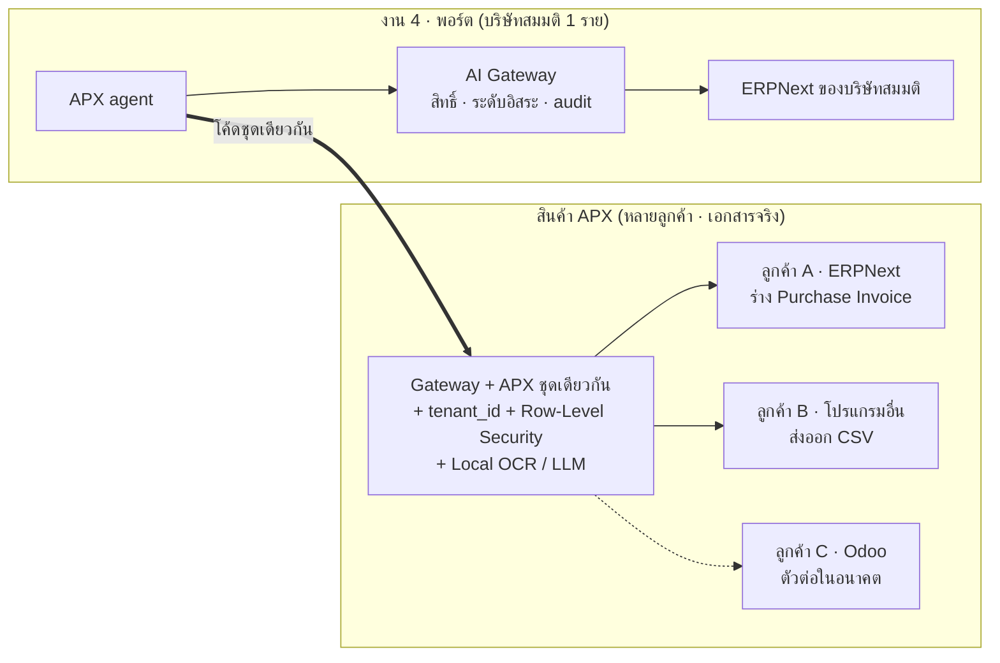
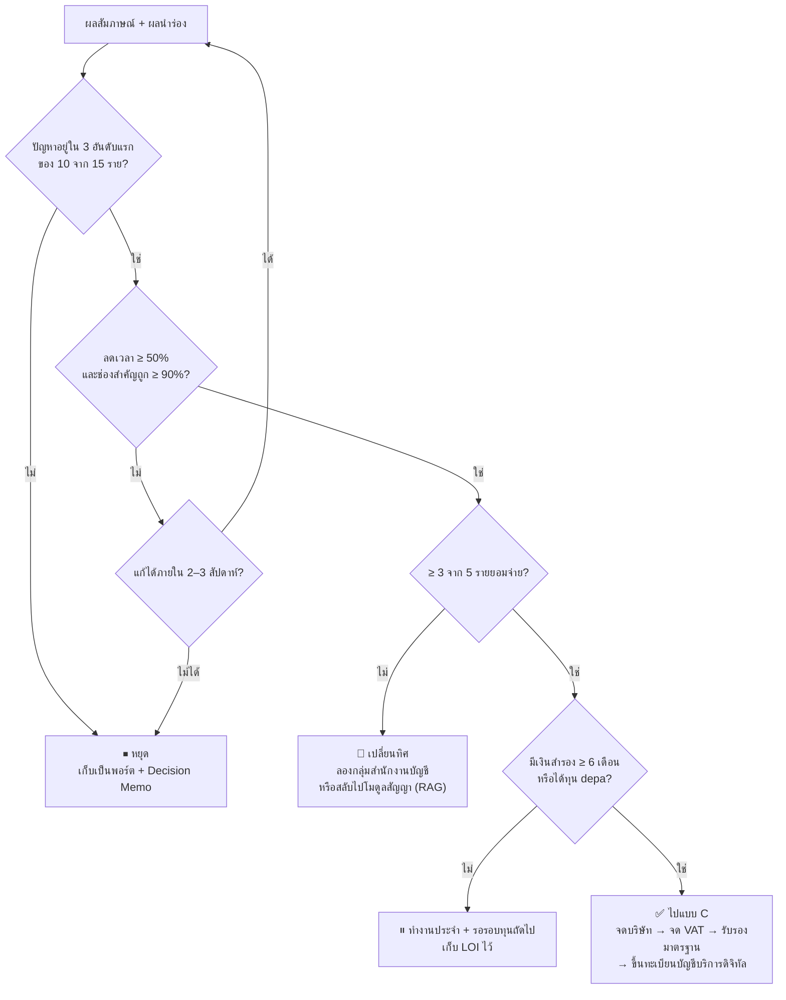
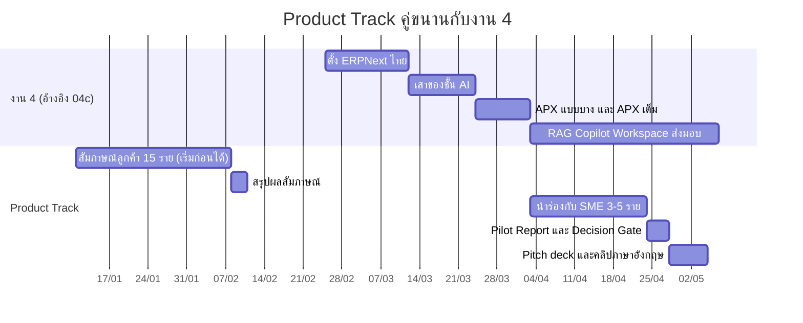

# 🚀 งานที่ 4b — Product Track: ทำพอร์ตเป็นหลัก ทุน depa เป็นโบนัส (แบบ B)

> ส่วนขยายของ [งานที่ 4 · Enterprise OS](04-enterprise-os.md) — ดึง **1 โมดูล** ออกมาทดสอบกับลูกค้าจริง แล้วเตรียมยื่นทุน depa
> ← [งานที่ 4](04-enterprise-os.md) · [04a Company Blueprint](04a-company-blueprint.md) · [MD หลัก](../README.md)

| หัวข้อ | สรุป |
|---|---|
| **แนวคิด** | ทำพอร์ตตามแผนเดิม + ทดลองทำเป็นสินค้าแบบต้นทุนต่ำ — ทุกขั้นได้ของใส่พอร์ตแม้ไม่ได้ทุน |
| **โมดูลที่เลือก** | **AI ตรวจเอกสารซื้อ**: อ่านใบกำกับภาษีไทย (OCR) → ตรวจความถูกต้อง → จับคู่ PO → กันจ่ายซ้ำ |
| **โค้ดเนม** | **APX** (ชื่อชั่วคราว — ตรวจเครื่องหมายการค้าก่อนใช้จริง) |
| **ลูกค้าเป้าหมาย** | SME ที่รับใบกำกับภาษีจากผู้ขาย 50–500 ใบ/เดือน · สำนักงานบัญชีที่ดูแลลูกค้าหลายราย |
| **สาขา depa** | FinTech / การบริการและพาณิชย์ |
| **เวลาเพิ่ม** | ~3–5 สัปดาห์ (สัมภาษณ์ทำคู่ขนานได้ตั้งแต่ตอนนี้) |
| **เงินที่ต้องจ่ายเพิ่ม** | แทบไม่มี — ไม่ต้องจดบริษัท |
| **ทุนที่ลุ้น** | depa Digital Startup Fund ระดับ Idea Stage (รอบปี 2568 ให้ 200,000 บาท/ทีม) |
| **รูปแบบสินค้า** | บริการ AI แยก (Gateway + APX ชุดเดียวกับงาน 4) · ส่งร่างเข้า **ERPNext ของลูกค้า** เป็นทางหลัก · โหมด CSV สำหรับโปรแกรมอื่น · ตัวต่อ Odoo ทีหลัง |
| **จบที่** | Decision Gate: ไปแบบ C (เปิดบริษัท) / เปลี่ยนทิศ / หยุดและเก็บเป็นพอร์ต |

> ⚠️ วงเงิน คุณสมบัติ สาขาเป้าหมาย และรูปแบบการยื่นของ depa **เปลี่ยนทุกรอบ** — ตัวเลขในไฟล์นี้มาจากรอบที่ผ่านมา ให้ตรวจประกาศปีงบ 2570 ฉบับเต็มก่อนยื่น
> ส่วนภาษีและกฎหมายเป็นข้อมูลทั่วไปเพื่อวางแผน ไม่ใช่คำปรึกษาทางกฎหมาย/ภาษี

---

## สารบัญ
1. [หลักคิดของแบบ B](#1-หลักคิดของแบบ-b)
2. [ทำไมเลือกโมดูลนี้ (และทางสลับไป RAG)](#2-ทำไมเลือกโมดูลนี้-และทางสลับไป-rag)
3. [นิยามสินค้า](#3-นิยามสินค้า)
4. [ดึงโมดูลออกจากงาน 4 ยังไง](#4-ดึงโมดูลออกจากงาน-4-ยังไง)
5. [สัมภาษณ์ลูกค้า 15 ราย](#5-สัมภาษณ์ลูกค้า-15-ราย)
6. [นำร่องกับลูกค้าจริง 3–5 ราย](#6-นำร่องกับลูกค้าจริง-35-ราย)
7. [โมเดลรายได้และตัวเลข](#7-โมเดลรายได้และตัวเลข)
8. [คู่แข่งและจุดต่าง](#8-คู่แข่งและจุดต่าง)
9. [ชุดเอกสารยื่น depa](#9-ชุดเอกสารยื่น-depa)
10. [Decision Gate: ไป C / เปลี่ยนทิศ / หยุด](#10-decision-gate-ไป-c--เปลี่ยนทิศ--หยุด)
11. [Timeline](#11-timeline)
12. [ความเสี่ยง](#12-ความเสี่ยง)
13. [ของที่ได้ใส่พอร์ตแม้ไม่ได้ทุน](#13-ของที่ได้ใส่พอร์ตแม้ไม่ได้ทุน)

---

## 1. หลักคิดของแบบ B

- **พอร์ตมาก่อน:** งาน 4 ยังเป็นงานหลักเพื่อหางาน — Product Track เป็น "การทดลองราคาถูก" ที่ทำคู่ขนาน
- **พิสูจน์ด้วยลูกค้า ไม่ใช่ด้วยโค้ด:** depa และผู้สัมภาษณ์งานสนใจ "ปัญหาจริง + ตัวเลขจริง" มากกว่าจำนวนฟีเจอร์
- **ไม่ลงเงินจนกว่าจะมีหลักฐาน:** ยังไม่จดบริษัท ยังไม่ขอรับรองมาตรฐาน — เรื่องเหล่านี้อยู่ในแบบ C และจะทำต่อเมื่อผ่าน [Decision Gate](#10-decision-gate-ไป-c--เปลี่ยนทิศ--หยุด)
- **ทุกขั้นต้องเหลือของ:** ถ้าหยุดตรงไหน สิ่งที่ทำไปแล้วต้องใช้ในพอร์ตได้ทันที (ดูข้อ 13)

---

## 2. ทำไมเลือกโมดูลนี้ (และทางสลับไป RAG)

| ตัวเลือก | ลูกค้า | ตรงสาขา depa | ใช้โค้ดงาน 4 ได้ | จุดต่าง | ความเสี่ยงหลัก | คะแนน |
|---|---|---|---|---|---|---|
| **AI ตรวจเอกสารซื้อ** ⭐ | SME, สำนักงานบัญชี | FinTech / การบริการ | **สูงมาก** (APX agent + Gateway ของงาน 4) | ใบกำกับภาษีไทยโดยเฉพาะ · Local LLM (PDPA) · วัดผลเป็นนาที/ใบได้ชัด | โปรแกรมบัญชีเริ่มเพิ่ม OCR | ★★★★ |
| AI ตรวจสัญญาภาษาไทย (RAG) | SME, ฝ่ายกฎหมายเล็ก | การบริการ | สูง (งาน 1 + Legal) | คู่แข่งภาษาไทยน้อย | ความรับผิดทางกฎหมายถ้าตรวจพลาด · วัดผลยากกว่า | ★★★ |
| งาน 1 เจาะกลุ่ม (ค้นระเบียบราชการ/มหาวิทยาลัย) (RAG) | หน่วยงานรัฐ, สถานศึกษา | GovTech / EdTech | สูง (งาน 1) | ตรงสาขาเป้าหมายมาก | วงจรขายภาครัฐยาว | ★★★ |

**เหตุผลที่เลือกตัวแรก:** ปัญหาเกิดทุกเดือนในทุกบริษัท · ผลลัพธ์วัดเป็นเวลาและเงินได้ตรงๆ · เป็น agent ตัวแรกที่ต้องทำในงาน 4 อยู่แล้ว ([04c Stage 4–5.1](04c-build-guide.md#8-stage-4--ห้องตัวอย่าง-apx-แบบบางครบเส้น))

> 🔁 **ถ้าอยากให้สินค้าเป็น RAG:** ใช้ไฟล์นี้ได้เหมือนเดิม เปลี่ยนแค่ 4 จุด
> 1. ลูกค้าและสคริปต์สัมภาษณ์ (ข้อ 5) → ถามเรื่องการตรวจสัญญา/การค้นระเบียบ
> 2. ตัวชี้วัดนำร่อง (ข้อ 6) → เวลาตรวจสัญญาต่อฉบับ, % clause เสี่ยงที่จับได้เทียบกับทนาย
> 3. โค้ดที่ดึงออก (ข้อ 4) → agent ตรวจสัญญา + เครื่อง RAG จาก [งาน 1](../01-enterprise-rag.md) แทน APX agent (Gateway ใช้ชุดเดิม)
> 4. ข้อความปฏิเสธความรับผิด → "ผลตรวจเป็นข้อเสนอแนะ ไม่ใช่ความเห็นทางกฎหมาย"

---

## 3. นิยามสินค้า

### 3.1 ปัญหา (สมมติฐานที่ต้องพิสูจน์ในข้อ 5)

| สมมติฐาน | วิธีพิสูจน์ |
|---|---|
| H1 · คนบัญชีใช้เวลา **3–10 นาทีต่อใบ** ในการคีย์และตรวจใบกำกับภาษีผู้ขาย | ถามจำนวนใบ + จับเวลาจริงตอนนำร่อง |
| H2 · มีความผิดพลาดที่เสียเงินจริง เช่น ยอดไม่ตรง PO, จ่ายซ้ำ, ใบกำกับข้อมูลไม่ครบจนใช้ขอคืนภาษีซื้อไม่ได้ | ถามเหตุการณ์ครั้งล่าสุด |
| H3 · เครื่องมือที่ใช้อยู่ช่วยเรื่อง "อ่าน" แต่ไม่ช่วยเรื่อง "ตรวจและจับคู่" | ถามว่าใช้อะไรอยู่ และยังต้องทำอะไรด้วยมือ |
| H4 · ลูกค้ายอมจ่ายรายเดือนถ้าลดเวลาได้ครึ่งหนึ่ง | ถามหลังนำร่อง + ขอหนังสือแสดงความสนใจ (LOI) |

### 3.2 สิ่งที่สินค้าทำ


### 3.3 ขอบเขต MVP ของสินค้า

| ลำดับ | ฟีเจอร์ |
|---|---|
| **Must** | อัปโหลด PDF/รูป · OCR ไทย → JSON · กฎตรวจความถูกต้อง · **ตัวต่อ ERPNext (อ่าน PO/ใบรับของ + สร้างร่าง Purchase Invoice)** · นำเข้า PO จาก CSV · จับคู่ PO · ตรวจจ่ายซ้ำ · หน้าตรวจ/ยืนยัน · ส่งออก CSV · แยกข้อมูลรายบริษัท (multi-tenant) · audit log |
| **Should** | รับเอกสารทางอีเมล · สรุปรายเดือน (ใบที่ผ่าน/ติดปัญหา/เวลาที่ประหยัด) · โหมดสำนักงานบัญชี (สลับดูหลายบริษัท) |
| **Won't (ยังไม่ทำ)** | ทำบัญชีเต็มรูป · จ่ายเงินแทนลูกค้า · เชื่อมโปรแกรมบัญชีทุกยี่ห้อ · ยื่นภาษีแทน |

### 3.4 กฎตรวจที่เป็นโค้ด (ไม่ใช้ AI)

| กฎ | ตรวจอะไร |
|---|---|
| เลขผู้เสียภาษี | 13 หลัก + check digit ถูกต้อง · ตรงกับทะเบียนผู้ขาย |
| รหัสสาขา | 5 หลัก (`00000` = สำนักงานใหญ่) |
| VAT | = 7% ของยอดก่อน VAT (คลาดได้ไม่เกินเศษสตางค์จากการปัดเศษ) |
| ยอดรวม | ยอดก่อน VAT + VAT = ยอดรวม |
| วันที่ | ไม่อยู่ในอนาคต · อยู่ในงวดที่ยังเปิด |
| ซ้ำ | ผู้ขาย + เลขที่ใบ ไม่เคยบันทึกมาก่อน |
| ข้อมูลครบ | มีข้อมูลที่ใบกำกับภาษีเต็มรูปต้องมี (ชื่อ ที่อยู่ เลขผู้เสียภาษีทั้งสองฝ่าย ฯลฯ) |

```python
def valid_thai_tax_id(tid: str) -> bool:
    """check digit ของเลข 13 หลัก — ทดสอบกับเลขตัวอย่างจริงก่อนใช้งาน"""
    if len(tid) != 13 or not tid.isdigit():
        return False
    s = sum(int(d) * (13 - i) for i, d in enumerate(tid[:12]))
    return (11 - s % 11) % 10 == int(tid[12])
```

> AI ทำแค่ "อ่าน" — ส่วน "ตัดสินว่าถูกหรือผิด" เป็นกฎในโค้ด ทดสอบได้ 100% (หลักเดียวกับ [งาน 2 ข้อ 1](../02-it-support-agent.md#1-หลักคิดสำคัญที่สุดของงานนี้))

---

## 4. ดึงโมดูลออกจากงาน 4 ยังไง

ในงาน 4 (แบบ ERPNext) APX เป็น **agent ตัวแรกของ AI Gateway** อยู่แล้ว — การทำเป็นสินค้าคือเพิ่ม 3 อย่าง: รองรับหลายลูกค้า · เชื่อมกับ ERP ของลูกค้า · โหมด CSV



### 4.1 ทางเลือกการขาย

| รูปแบบ | ลูกค้า | ข้อดี | ข้อเสีย |
|---|---|---|---|
| **ส่วนเสริม ERPNext** (ทางหลัก) | SME ที่ใช้ ERPNext (มักผ่านบริษัทวางระบบ) | ส่งร่างเข้า ERPNext ตรงๆ · ใช้ erpnext_thailand เดิม · ขายผ่านบริษัทวางระบบได้ | ผู้ใช้ ERPNext ในไทยยังไม่มาก |
| **โหมด CSV** | SME ที่ใช้โปรแกรมบัญชีอื่น | ตลาดใหญ่ที่สุด | ลูกค้าต้องนำเข้าเอง |
| **ตัวต่อ Odoo** (04c Stage 8) | ผู้ใช้ Odoo รุ่นฟรีที่ไม่มี OCR ในตัว | ตลาดใหญ่ในไทย | ต้องทำตัวต่อเพิ่ม |

### 4.2 สิ่งที่ต้องออกแบบตั้งแต่ตอนทำงาน 4 (แทบไม่เพิ่มงาน ถ้าทำตั้งแต่แรก)

| เรื่อง | ทำอะไร | ทำไม |
|---|---|---|
| แยกข้อมูลรายลูกค้า | ตารางของชั้น AI มี `tenant_id` + เปิด Row-Level Security | ลูกค้าหลายรายใช้ DB เดียวกันได้โดยข้อมูลไม่ปนกัน |
| โค้ดเรียก ERP อยู่ที่เดียว | ทุกการเรียก ERPNext อยู่ใน `erp/` | เพิ่มโหมด CSV / ตัวต่อ Odoo ได้โดยไม่แตะ agent |
| ข้อมูลเชื่อมต่อของลูกค้า | URL + key ของ ERPNext ลูกค้าเก็บแบบเข้ารหัส · ฝั่งลูกค้าใช้ role `AI Agent` (สร้างได้แค่ Draft) | ลูกค้ามั่นใจว่า APX ลงบัญชีเองไม่ได้ |
| ข้อมูลออก | ร่างใน ERP หรือ CSV | ลูกค้าใช้โปรแกรมเดิมต่อ |
| AI | รัน Local ได้เต็มรูป | เอกสารการเงินจริงเป็นข้อมูลลับ (PDPA) |

```sql
-- แยกข้อมูลรายลูกค้าที่ระดับ DB (โค้ดลืม WHERE ก็ไม่รั่ว)
ALTER TABLE ai_proposal ENABLE ROW LEVEL SECURITY;
ALTER TABLE ai_proposal FORCE ROW LEVEL SECURITY;   -- ให้มีผลกับเจ้าของตารางด้วย

CREATE POLICY tenant_isolation ON ai_proposal
    USING (tenant_id = current_setting('app.tenant_id')::uuid);

-- ทุก request: ตั้งค่าใน transaction จากข้อมูลผู้ใช้ที่ login
SET LOCAL app.tenant_id = '<tenant uuid ของผู้ใช้>';
```

> แอปต้องต่อ DB ด้วย role ที่ไม่ใช่ superuser (superuser ข้าม RLS ได้เสมอ) — ใส่เป็น test: "ผู้ใช้บริษัท A ค้นใบของบริษัท B ต้องได้ 0 แถว"

---

## 5. สัมภาษณ์ลูกค้า 15 ราย

ทำได้ **ตั้งแต่ตอนนี้** ไม่ต้องรอโค้ด — ใช้เวลาราย 30–45 นาที

### 5.1 สัมภาษณ์ใคร

| กลุ่ม | จำนวน | หาจากไหน |
|---|---|---|
| เจ้าของ SME / ผู้จัดการ | 5 | คนรู้จัก, กลุ่ม Facebook ผู้ประกอบการ, LinkedIn |
| พนักงานบัญชีใน SME (คนที่คีย์จริง) | 5 | กลุ่ม Facebook นักบัญชี, คนรู้จัก |
| สำนักงานบัญชี | 5 | ค้นในพื้นที่, งานสัมมนาวิชาชีพบัญชี |

### 5.2 สคริปต์ (ถามเรื่องที่เกิดขึ้นจริงในอดีต ไม่ขายของ)

1. ช่วยเล่าขั้นตอนตั้งแต่ได้รับใบกำกับภาษีจากผู้ขาย จนจ่ายเงินเสร็จ
2. เดือนที่แล้วมีประมาณกี่ใบ? ใครทำ? ใช้เวลาต่อใบประมาณกี่นาที?
3. ครั้งล่าสุดที่เกิดปัญหา (กรอกผิด ยอดไม่ตรง จ่ายซ้ำ ใบกำกับข้อมูลไม่ครบ) เกิดอะไรขึ้น? เสียเวลาหรือเงินเท่าไร?
4. ตอนนี้ใช้โปรแกรมหรือวิธีอะไรช่วย? จ่ายเท่าไร? ส่วนไหนยังต้องทำมือ?
5. เคยหาวิธีแก้ไหม? ทำไมยังไม่เปลี่ยน?
6. ในงานบัญชีทั้งหมด เรื่องนี้ลำบากเป็นอันดับเท่าไร?
7. *(ข้อสุดท้ายเท่านั้น)* ถ้ามีเครื่องมือช่วยเรื่องนี้ ยินดีลองกับเอกสารจริง 2 สัปดาห์ไหม?

**กฎ:** ไม่ถามว่า "จะซื้อไหม" (คนมักตอบเอาใจ) · ไม่ pitch ก่อนถามเสร็จ · จดตัวเลขทุกครั้ง

### 5.3 ตารางเก็บผล

| ราย | กลุ่ม | ใบ/เดือน | นาที/ใบ | ปัญหาครั้งล่าสุด | เครื่องมือที่ใช้ | จ่ายอยู่/เดือน | อันดับความลำบาก (1–5) | ยอมนำร่อง? |
|---|---|---|---|---|---|---|---|---|
| 1 | … | … | … | … | … | … | … | … |

**ผ่านเมื่อ:** ≥ 10 จาก 15 ราย จัดเรื่องนี้อยู่ใน 3 อันดับแรก และมีอย่างน้อย 5 รายยอมนำร่อง

---

## 6. นำร่องกับลูกค้าจริง 3–5 ราย

ระยะเวลา 2–3 สัปดาห์ หลัง APX เต็มในงาน 4 เสร็จ ([04c Stage 5.1](04c-build-guide.md#9-stage-5--agent-ทีละตัว))

### 6.1 การดูแลข้อมูล (ต้องทำก่อนรับเอกสารจริง)

| เรื่อง | ทำอะไร |
|---|---|
| ความยินยอม | หนังสือตกลงนำร่อง: ขอบเขต ระยะเวลา ข้อมูลที่ใช้ การลบข้อมูล |
| PDPA | ทำ DPA (ข้อตกลงประมวลผลข้อมูล) เพราะใบกำกับจากผู้ขายบุคคลธรรมดามีข้อมูลส่วนบุคคล |
| ที่เก็บ | รันบนเครื่อง/เซิร์ฟเวอร์ที่คุมได้ ใช้ Local LLM เท่านั้น |
| การลบ | ลบเอกสารและข้อมูลภายใน 30 วันหลังจบนำร่อง (หรือตามที่ตกลง) |
| รายงาน | ตัวอย่างในพอร์ตใช้ข้อมูลที่ปกปิดแล้วหรือเอกสารสมมติเท่านั้น |

### 6.2 ตัวชี้วัด

| ตัวชี้วัด | วิธีวัด | เกณฑ์ผ่าน |
|---|---|---|
| เวลาต่อใบ | จับเวลาแบบเดิม vs แบบใช้ APX (รวมเวลาตรวจ/ยืนยัน) | ลด **≥ 50%** |
| ช่องสำคัญอ่านถูกโดยไม่ต้องแก้ | เลขผู้เสียภาษี, เลขที่ใบ, วันที่, ยอดก่อน VAT, VAT, ยอดรวม เทียบกับค่าที่คนยืนยัน | **≥ 90%** ต่อช่อง |
| จับคู่ PO อัตโนมัติ | % ใบที่ match ผ่านโดยไม่ต้องแก้ | ≥ 70% |
| ความผิดปกติที่จับได้ | จ่ายซ้ำ / ยอดไม่ตรง / เลขผู้เสียภาษีไม่ตรง | รายงานจำนวน + มูลค่า |
| อยากใช้ต่อ | ถามหลังนำร่อง (1–5) | เฉลี่ย ≥ 4 |
| ยอมจ่าย | ถามราคา + ขอ LOI | **≥ 3 จาก 5 ราย** |

### 6.3 รายงานนำร่อง (Pilot Report) — 1 หน้า

ลูกค้า (ปกปิดชื่อ) · จำนวนใบ · เวลาก่อน/หลัง · ความแม่นยำรายช่อง · ความผิดปกติที่พบ · คำพูดลูกค้า 2–3 ประโยค · สิ่งที่ต้องแก้

---

## 7. โมเดลรายได้และตัวเลข

> ⚠️ ตัวเลขในหัวข้อนี้ **เป็นสมมติฐานทั้งหมด** — ใช้ผลสัมภาษณ์และนำร่องปรับก่อนใส่ใน pitch

### 7.1 ราคา (สมมติฐานที่ต้องทดสอบ)

| แพ็กเกจ | สำหรับ | ราคาสมมติ |
|---|---|---|
| Starter | SME ≤ 100 ใบ/เดือน | 990 บาท/เดือน |
| Growth | SME ≤ 500 ใบ/เดือน | 2,490 บาท/เดือน |
| Accounting Firm | สำนักงานบัญชี (คิดต่อบริษัทลูกค้า) | 490 บาท/บริษัท/เดือน |

### 7.2 ต้นทุนต่อใบ (กรณีใช้ Cloud LLM)

```text
input ≈ 1,500 tokens (ข้อความจาก OCR + คำสั่ง) · output ≈ 300 tokens (JSON)
ราคาสมมติ input $0.50 / 1M · output $2.00 / 1M
ต้นทุน ≈ (1,500 × 0.5 + 300 × 2) / 1,000,000 ≈ $0.0014 ต่อใบ  →  ไม่กี่สตางค์
โหมด Local: ค่า token = 0 แต่มีค่าเครื่องและค่าไฟคงที่
```

→ ต้นทุนหลักไม่ใช่ AI แต่เป็น **เวลาดูแลลูกค้าและค่าใช้จ่ายคงที่ของบริษัท** (ในแบบ C)

### 7.3 จุดคุ้มทุน (ถ้าไปแบบ C — ตัวเลขสมมติ)

| รายการ/เดือน | บาท |
|---|---|
| Cloud + เครื่องมือ | 5,000 |
| ทำบัญชี + สอบบัญชี (เฉลี่ยต่อเดือน) | 5,000 |
| เงินเดือนผู้ก่อตั้ง | 30,000 |
| **รวม** | **40,000** |
| ราคาเฉลี่ยต่อลูกค้า | 1,500 |
| **ลูกค้าที่ต้องมีเพื่อคุ้มทุน** | **≈ 27 ราย** (ยังไม่รวมค่าหาลูกค้า) |

### 7.4 Lean Canvas

| ช่อง | เนื้อหา |
|---|---|
| ปัญหา | คีย์/ตรวจใบกำกับภาษีผู้ขายช้า · ยอดไม่ตรง PO · จ่ายซ้ำ · ใบกำกับข้อมูลไม่ครบ |
| ลูกค้า | SME 50–500 ใบ/เดือน · สำนักงานบัญชี |
| คุณค่าหลัก | "ลดเวลาตรวจใบกำกับภาษีครึ่งหนึ่ง และไม่จ่ายซ้ำอีก — เอกสารไม่ออกนอกบริษัท" |
| ทางแก้ | OCR ไทย + กฎตรวจ + จับคู่ PO + กันจ่ายซ้ำ + ส่งออกไปโปรแกรมเดิม |
| ช่องทาง | สำนักงานบัญชี (1 รายพาลูกค้าหลายบริษัท) · กลุ่มนักบัญชีออนไลน์ |
| รายได้ | รายเดือนตามจำนวนใบ |
| ต้นทุน | เครื่อง/Cloud · ดูแลลูกค้า · ค่าใช้จ่ายบริษัท |
| ตัวชี้วัด | ใบที่ประมวลผล/เดือน · เวลาที่ประหยัด · ลูกค้าที่จ่าย · อัตราเลิกใช้ |
| ข้อได้เปรียบ | เข้าใจใบกำกับภาษีไทย + รันแบบ Local ได้ + ข้อมูลนำร่องจริง |

---

## 8. คู่แข่งและจุดต่าง

> อ้างอิงผลค้นเมื่อ 15 ต.ค. 2569 ([04 ข้อ 2](04-enterprise-os.md#2-ของที่มีอยู่แล้ว-prior-art)) · แถวที่เขียนว่า "สมมติฐาน" ให้ตรวจจริงระหว่างสัมภาษณ์

| สิ่งที่ลูกค้าใช้ตอนนี้ | ข้อดี | ช่องว่าง | APX ต่างยังไง |
|---|---|---|---|
| คีย์มือ / จ้างสำนักงานบัญชี | ยืดหยุ่น | ช้า ผิดพลาด จ่ายซ้ำ | ลดเวลา + จับความผิดปกติ |
| Odoo Enterprise (OCR ในตัว ใช้เครดิตแบบเสียเงิน) | อยู่ในระบบเดียว | เฉพาะผู้ใช้ Odoo Enterprise · เอกสารส่งไปบริการของผู้ขาย | ใช้กับ ERPNext / Odoo รุ่นฟรี / CSV · รันในองค์กร |
| โปรแกรมบัญชีไทยที่มี OCR | อยู่ในระบบเดียว | (สมมติฐาน) จับคู่ PO / กันจ่ายซ้ำได้แค่ไหน | เน้น "ตรวจและจับคู่" |
| AP agent โอเพนซอร์ส ([invoice-to-pay-agent](https://github.com/mshojaei77/invoice-to-pay-agent), [APilot](https://github.com/emmaGH1/APilot) ฯลฯ) | ฟรี | **ไม่รองรับใบกำกับภาษีไทย** · ยังเป็นต้นแบบ | ทำเพื่อเอกสารไทย + พร้อมใช้ |
| ต่อ [Typhoon OCR](https://github.com/scb-10x/typhoon-ocr) + LLM เอง | ฟรี ยืดหยุ่น | ต้องมีทีมทำเอง · ไม่มีตัวเลขความแม่นยำ | APX คือชุดนี้ที่วัดผลแล้ว + เชื่อม ERP แล้ว |

### 8.1 สิ่งที่ทำให้ลอกยาก

ใครก็ต่อ OCR + LLM ได้ในไม่กี่วัน — สิ่งที่ลอกยากคือ:

| สิ่งที่ลอกยาก | ทำยังไง |
|---|---|
| **Benchmark ใบกำกับภาษีไทย** | ชุดทดสอบ 300+ ใบ (ปกปิด/สมมติ) · เปิดผลความแม่นยำต่อสาธารณะ · ใช้เทียบทุกโมเดลใหม่ |
| การเชื่อมกับระบบที่ลูกค้าใช้อยู่ | ERPNext ก่อน → CSV → Odoo |
| รันในองค์กร | เอกสารไม่ออกนอกบริษัทลูกค้า |
| บริการ | ช่วยตั้งค่าและดูแลหลังขาย |

> ถ้าสัมภาษณ์แล้วพบว่าโปรแกรมที่ลูกค้าใช้ทำได้ครบแล้ว → นั่นคือข้อมูลที่ดี ให้ไปทาง "เปลี่ยนทิศ" ใน [ข้อ 10](#10-decision-gate-ไป-c--เปลี่ยนทิศ--หยุด)

---

## 9. ชุดเอกสารยื่น depa

### 9.1 Checklist

- [ ] สมัคร depa Member และติดตามประกาศที่ [depa.or.th/th/startup](https://www.depa.or.th/th/startup)
- [ ] อ่านประกาศรอบปีงบ 2570 ฉบับเต็ม: ระยะทุน · วงเงิน · รับบุคคลธรรมดาไหม · สาขาเป้าหมาย · ค่าใช้จ่ายที่เบิกได้ · ภาระหลังได้ทุน
- [ ] Pitch deck 5 นาที (ภาษาอังกฤษ)
- [ ] คลิป pitch 2 นาที (ภาษาอังกฤษ)
- [ ] สรุปผลสัมภาษณ์ 15 ราย (ข้อ 5.3)
- [ ] Pilot report (ข้อ 6.3) — ถ้ารอบเปิดก่อนนำร่องเสร็จ ยื่นด้วยผลสัมภาษณ์ + demo ไปก่อนได้ (Idea Stage ไม่ต้องมีรายได้)
- [ ] Demo link + วิดีโอสาธิต
- [ ] แผนใช้เงิน + ผลผลิตที่วัดได้ (KPI)
- [ ] ข้อมูลทีม (ถ้ามีผู้ร่วมก่อตั้งที่รู้บัญชี/การขาย จะแข็งขึ้นมาก)

### 9.2 โครง Pitch Deck (10 สไลด์ / 5 นาที)

| # | สไลด์ | เนื้อหา |
|---|---|---|
| 1 | Title | ชื่อ + ประโยคเดียว: "Thai invoice checking in half the time — data never leaves your office" |
| 2 | Problem | ตัวเลขจากสัมภาษณ์: ใบ/เดือน, นาที/ใบ, เหตุการณ์จ่ายซ้ำ |
| 3 | Customer | กลุ่มลูกค้า + วิธีคำนวณขนาดตลาดแบบ bottom-up (จำนวนบริษัทเป้าหมาย × ราคา × 12) จากแหล่งข้อมูลทางการ เช่น รายงาน สสว. |
| 4 | Solution | ภาพ flow ข้อ 3.2 + screenshot |
| 5 | Why Thai / Why now | ใบกำกับภาษีไทย, PDPA, Local LLM ทำได้จริงแล้ว |
| 6 | Traction | ผลนำร่อง: เวลาที่ลด, ความแม่นยำ, คำพูดลูกค้า, LOI |
| 7 | Business model | ราคา + ต้นทุนต่อใบ + จุดคุ้มทุน |
| 8 | Competition | ตารางข้อ 8 |
| 9 | Team | ทักษะ + ผลงาน (ลิงก์งาน 1–4) |
| 10 | Ask | ใช้ทุนทำอะไร + KPI 6–12 เดือน |

**คลิป 2 นาที:** ปัญหา 20 วิ → demo 60 วิ → ผลนำร่อง 20 วิ → สิ่งที่ขอ 20 วิ

### 9.3 ตัวอย่างแผนใช้เงิน 200,000 บาท (ตัวอย่าง — หมวดที่เบิกได้จริงดูตามประกาศ)

| รายการ | บาท |
|---|---|
| จดบริษัท + ทำบัญชี/สอบบัญชีปีแรก | 40,000 |
| เครื่อง/GPU สำหรับ Local LLM + Cloud | 50,000 |
| ขยายนำร่องเป็น 10–20 ราย | 40,000 |
| เตรียมมาตรฐานและเอกสารขึ้นทะเบียนบัญชีบริการดิจิทัล | 30,000 |
| การตลาดกลุ่มสำนักงานบัญชี | 20,000 |
| สำรอง | 20,000 |
| **รวม** | **200,000** |

### 9.4 ตัวอย่าง KPI ที่วัดได้ (6–12 เดือนหลังได้ทุน)

ลูกค้าที่จ่ายเงิน ≥ 10 ราย · ประมวลผล ≥ 5,000 ใบ/เดือน · ลดเวลาเฉลี่ย ≥ 50% · จดบริษัทแล้ว · พร้อมยื่นขึ้นทะเบียนบัญชีบริการดิจิทัล

---

## 10. Decision Gate: ไป C / เปลี่ยนทิศ / หยุด

ตัดสินหลังได้ Pilot Report — เขียนผลเป็น **Decision Memo 1 หน้า** (ตัวนี้ก็เป็นของใส่พอร์ตได้)



### เมื่อไปถึงแบบ C ได้อะไรเพิ่ม (ทำได้ต่อเมื่อจดบริษัทและขึ้นทะเบียนแล้วเท่านั้น)

| เครื่องมือขาย | ใครได้ประโยชน์ | เงื่อนไข |
|---|---|---|
| สิทธิหักภาษี 2 เท่า | ลูกค้า SME (ทุนชำระแล้ว ≤ 5 ล้าน, รายได้ ≤ 30 ล้าน) สำหรับยอดไม่เกิน 300,000 บาท | สินค้าต้องอยู่ในบัญชีบริการดิจิทัล · ใช้ได้ถึง 31 ธ.ค. 2570 |
| d-Transform | ลูกค้า SME (รอบก่อนสมทบสูงสุด 200,000 บาท/ราย) | รอประกาศรอบใหม่ |
| จัดซื้อภาครัฐ | หน่วยงานรัฐเลือกซื้อสินค้าในบัญชีได้สะดวกขึ้น | ขึ้นทะเบียนแล้ว |
| Startup Fund S2 | บริษัทของคุณ | บริษัทจดไม่เกิน 3 ปี + มีลูกค้านำร่อง |

> ❗ ห้ามใช้ "ลดหย่อนภาษี 200%" ในการขายจนกว่าสินค้าจะขึ้นทะเบียนจริง

---

## 11. Timeline

ต่อจาก Roadmap เส้นทาง C ใน [MD หลัก](../README.md#9-กลยุทธ์เลือกเส้นทาง--roadmap) (เต็มเวลา)



| ช่วง | สิ่งที่ทำ | หมายเหตุ |
|---|---|---|
| ตอนนี้ – ม.ค. 2570 | สมัคร depa Member · เฝ้าประกาศรอบปีงบ 2570 | รอบก่อนๆ มักเปิดช่วงต้นปีถึงกลางปี — ตรวจวันจริงจากประกาศ |
| ระหว่างทำงาน 2 | สัมภาษณ์ 15 ราย (ราย 30–45 นาที) | ไม่ต้องรอโค้ด |
| หลัง APX เต็ม ([04c Stage 5.1](04c-build-guide.md#9-stage-5--agent-ทีละตัว)) | นำร่อง 2–3 สัปดาห์ | ใช้ APX + ตัวต่อ ERPNext ที่เพิ่งทำเสร็จ |
| หลังนำร่อง | Decision Gate + Pitch | ถ้ารอบทุนเปิดก่อน ยื่นด้วยผลสัมภาษณ์ + demo ได้ |

**เวลาที่เพิ่มจากแผนเดิม:** ~3–5 สัปดาห์ (ส่วนใหญ่ทำคู่ขนานได้)

---

## 12. ความเสี่ยง

| ความเสี่ยง | ป้องกัน |
|---|---|
| ข้อมูลเอกสารจริงรั่ว | Local เท่านั้น · DPA · ลบตามกำหนด · ไม่เก็บในเครื่องส่วนตัว · audit log |
| AI อ่านผิดแล้วลูกค้าจ่ายผิด | คนยืนยันทุกใบ · ไฮไลต์ช่องที่ไม่มั่นใจ · กฎตรวจในโค้ด (ข้อ 3.4) |
| ได้งานประจำระหว่างทาง | อ่านสัญญาจ้างเรื่องงานเสริมและทรัพย์สินทางปัญญา · แจ้งนายจ้างถ้าจำเป็น · แยกเวลาและอุปกรณ์ |
| ได้ทุนแล้วทำต่อไม่ไหว | อ่านภาระผูกพันในประกาศก่อนยื่น (รายงาน, KPI, การคืนเงิน) |
| เงื่อนไขทุนเปลี่ยน | ใช้ตัวเลขจากประกาศรอบจริงเท่านั้น |
| ชื่อสินค้าซ้ำเครื่องหมายการค้า | ตรวจที่กรมทรัพย์สินทางปัญญาก่อนใช้ชื่อจริง |
| สัญญาเกินจริงกับลูกค้านำร่อง | บอกชัดว่าเป็นเวอร์ชันทดลอง ไม่รับประกันความถูกต้อง 100% |
| ใช้โค้ด GPL/AGPL ในสินค้า | ใช้ได้เฉพาะ MIT/Apache · AGPL ห้ามเด็ดขาดถ้าเปิดเป็นบริการ · ปรึกษาผู้รู้เรื่อง license ก่อนขายจริง ([04 ข้อ 2](04-enterprise-os.md#2-ของที่มีอยู่แล้ว-prior-art)) |
| ตลาด ERPNext ในไทยเล็ก | มีโหมด CSV ตั้งแต่ MVP · ตัวต่อ Odoo เป็นขั้นต่อไป |

---

## 13. ของที่ได้ใส่พอร์ตแม้ไม่ได้ทุน

| ชิ้นงาน | ใช้ตอนสมัครตำแหน่ง | เล่าอะไรได้ |
|---|---|---|
| สรุปผลสัมภาษณ์ 15 ราย | PM, BA, Product Owner | ทำ customer discovery เป็น ไม่ได้แค่เขียนโค้ด |
| Pilot Report | AI Engineer, Solution Engineer | ตัวเลข impact จากเอกสารจริง ไม่ใช่ข้อมูลสมมติ |
| ดีไซน์ multi-tenant + RLS | Backend, Architect | ออกแบบ SaaS ที่ข้อมูลลูกค้าไม่ปนกัน |
| Pitch deck (EN) | ทุกตำแหน่ง | สื่อสารงานเทคนิคให้คนธุรกิจเข้าใจ |
| Decision Memo | ทุกตำแหน่ง | ตัดสินใจจากข้อมูล รวมถึงกล้าหยุดเมื่อตัวเลขไม่ผ่าน |

---

### แหล่งข้อมูลทุนและมาตรการ (ตรวจฉบับล่าสุดก่อนใช้)

- [depa Startup — ประกาศและมาตรการ](https://www.depa.or.th/th/startup)
- [Final Pitching Idea Stage 2568 (ผู้จัดการออนไลน์)](https://mgronline.com/business/detail/9680000046305)
- [Digital Startup Fund 2568 — สาขาเป้าหมาย (SE Thailand)](https://www.sethailand.org/se-thailand-%E0%B9%80%E0%B8%8A%E0%B8%B4%E0%B8%8D%E0%B8%8A%E0%B8%A7%E0%B8%99%E0%B8%9C%E0%B8%B9%E0%B9%89%E0%B8%9B%E0%B8%A3%E0%B8%B0%E0%B8%81%E0%B8%AD%E0%B8%9A%E0%B8%81%E0%B8%B2%E0%B8%A3%E0%B8%AA/)
- [บัญชีบริการดิจิทัล — คุณสมบัติผู้ขึ้นทะเบียน](https://www.depa.or.th/th/thailanddigitalcatalog/about)
- [d-Transform / AI Transformation (TechTalkThai)](https://www.techtalkthai.com/depa-supports-smes-in-driving-business-growth-with-digital-technology-pr/)
- [มาตรการภาษี 2 เท่าสำหรับ SME (ประชาชาติ)](https://www.prachachat.net/finance/news-1834382)

← [งานที่ 4](04-enterprise-os.md) · [MD หลัก](../README.md)
