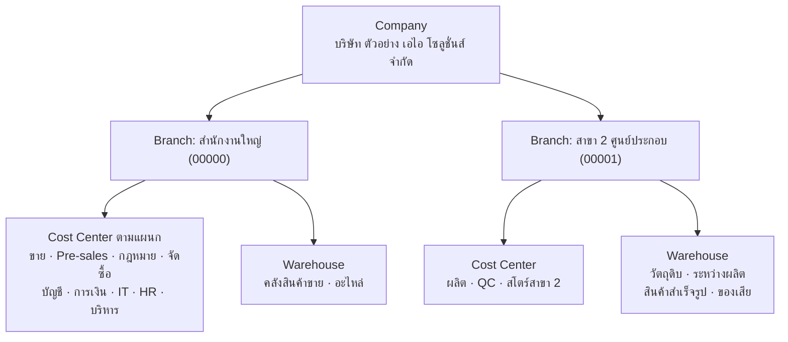
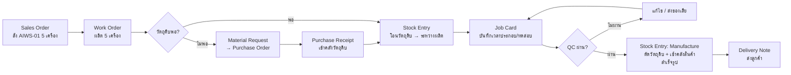
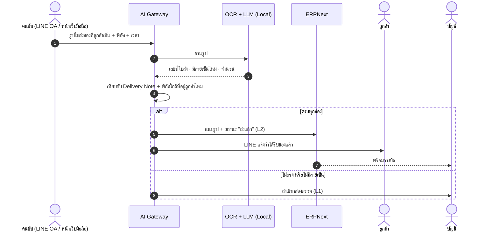

# 🏭 งานที่ 4d — สาย ERP: สาขา 2 · ผลิต · สต๊อก · เบิก · ครุภัณฑ์ · รายงาน

> ตั้งค่า ERPNext ให้ครอบคลุมงานหลังบ้านที่บริษัทจริงต้องใช้ทุกวัน — **เกือบทั้งหมดเป็นการตั้งค่า ไม่ใช่เขียนโค้ด**
> ← [หน้าแรกงาน 4](README.md) · [04 สเปกหลัก](04-enterprise-os.md) · [04a บริษัทจำลอง](04a-company-blueprint.md) · [04c คู่มือสร้าง](04c-build-guide.md)

| หัวข้อ | สรุป |
|---|---|
| **ครอบคลุม** | รายรับ-รายจ่ายแต่ละแผนก/สาขา · รายงานรายเดือน/ไตรมาส/ปี · สาขา 2 · ผลิต · สต๊อกวัตถุดิบและสินค้า · แจ้งเตือนใกล้หมด · ใบเบิก · ใบแจ้งหนี้ ใบเสร็จ ใบส่งสินค้า · เจ้าหนี้-ลูกหนี้ · วิธีจ่ายเงิน · ครุภัณฑ์ ซ่อม ตรวจนับ · พนักงาน ลงเวลา สรุปวันทำงาน · ส่งของและติดตามรถ (ทางเลือก) |
| **ไม่รวม** | คิดเงินเดือนแบบไทยเต็มรูป (ประกันสังคม, ภ.ง.ด.1, ตัวคูณ OT) → [งาน 5](../05-thai-payroll-erpnext/README.md) |
| **เวลา (เต็มเวลา)** | ~15–22 วัน (3–4.5 สัปดาห์) · Phase MVP+ ของงาน 4 |
| **ได้อะไรในพอร์ต** | ทักษะ ERP Implementer + ข้อมูลจริงให้ AI ทำงาน (พยากรณ์วัตถุดิบหมด, ตรวจ OT ผิดปกติ, Copilot ตามแผนก/สาขา) |
| **ข้อมูลอ้างอิง** | [research/erpnext-reference.md](research/erpnext-reference.md) · [research/thai-tax-labor-reference.md](research/thai-tax-labor-reference.md) |

---

## สารบัญ
1. [สาขา 2: ศูนย์ประกอบเครื่อง](#1-สาขา-2-ศูนย์ประกอบเครื่อง)
2. [โครงสร้างบริษัทใน ERPNext](#2-โครงสร้างบริษัทใน-erpnext)
3. [รายรับ-รายจ่ายแต่ละแผนก/สาขา และรายงาน](#3-รายรับ-รายจ่ายแต่ละแผนกสาขา-และรายงาน)
4. [การผลิต](#4-การผลิต)
5. [สต๊อกและแจ้งเตือนวัตถุดิบใกล้หมด](#5-สต๊อกและแจ้งเตือนวัตถุดิบใกล้หมด)
6. [ใบเบิก](#6-ใบเบิก)
7. [เอกสารขาย: ใบส่งสินค้า ใบแจ้งหนี้ ใบเสร็จ](#7-เอกสารขาย-ใบส่งสินค้า-ใบแจ้งหนี้-ใบเสร็จ)
8. [เจ้าหนี้-ลูกหนี้ และวิธีจ่ายเงิน](#8-เจ้าหนี้-ลูกหนี้-และวิธีจ่ายเงิน)
9. [ครุภัณฑ์: ทะเบียน ซ่อม ตรวจนับ](#9-ครุภัณฑ์-ทะเบียน-ซ่อม-ตรวจนับ)
10. [พนักงาน ลงเวลา สรุปวันทำงาน](#10-พนักงาน-ลงเวลา-สรุปวันทำงาน)
11. [สิทธิ์และข้อมูลลับ](#11-สิทธิ์และข้อมูลลับ)
12. [AI ช่วยตรงไหน](#12-ai-ช่วยตรงไหน)
13. [Test, เวลา และ Gate](#13-test-เวลา-และ-gate)
14. [ส่งของและติดตามรถ (ทางเลือก)](#14-ส่งของและติดตามรถ-ทางเลือก)

---

## 1. สาขา 2: ศูนย์ประกอบเครื่อง

บริษัทจำลองใน [04a](04a-company-blueprint.md#3-company-profile-ของบริษัทสมมติ) เป็นบริษัท IT Solution — เพิ่ม **สาขา 2 ที่ประกอบ AI Workstation และ Edge Box ขายเอง** ทำให้มีการผลิต วัตถุดิบ และคนงานรายวันอย่างสมเหตุสมผล

| หัวข้อ | ค่า (สมมติ) |
|---|---|
| รหัสสาขา | 00001 (สำนักงานใหญ่ 00000) |
| สินค้า | `AIWS-01` AI Workstation · `EDGE-01` Edge Box |
| วัตถุดิบ | CPU, GPU, RAM, SSD, เมนบอร์ด, PSU, เคส, ชุดระบายความร้อน |
| คน | หัวหน้าสาขา 1 · หัวหน้าไลน์ 1 · ช่างประกอบ (รายวัน) 10 · QC 1 · สโตร์ 1 |
| เวลาทำงาน | 08:00–17:00 (พัก 1 ชม.) · OT ช่วงเย็นตามงาน |
| ยอดผลิต | ~40 เครื่อง/เดือน |

---

## 2. โครงสร้างบริษัทใน ERPNext



| ตั้งอะไร | ทำยังไง | หมายเหตุ |
|---|---|---|
| Branch | 2 สาขา | ใช้เป็น Accounting Dimension ด้วย |
| Accounting Dimension "Branch" | บังคับกรอกในเอกสารบัญชีทุกชนิด | รายงานแยกสาขาได้ทุกรายงาน |
| Cost Center | 1 ต่อแผนก (ใต้แต่ละสาขา) | รายรับ-รายจ่ายแยกแผนก |
| Department | ตาม [04a ข้อ 5](04a-company-blueprint.md#5-role-catalog--ทุกตำแหน่งทำอะไรในระบบ) | ผูกพนักงานและ Cost Center |
| Warehouse | แยกตามสาขาและหน้าที่ | ตามแผนภาพ |
| ค่าเริ่มต้นต่อผู้ใช้ | ผูก Branch / Cost Center / Warehouse ของผู้ใช้ | เอกสารที่สร้างจะติดมิติถูกเอง |

---

## 3. รายรับ-รายจ่ายแต่ละแผนก/สาขา และรายงาน

| รายงาน | ตัวกรอง | ช่วง | ใครดู | ส่งอัตโนมัติ |
|---|---|---|---|---|
| งบกำไรขาดทุน | Cost Center (แผนก) · Branch | รายเดือน / ไตรมาส / ปี | ผู้บริหาร, หัวหน้าแผนก (เฉพาะแผนกตัวเอง) | ✅ ทุกต้นเดือน (Auto Email Report) |
| งบฐานะการเงิน | Branch | รายเดือน / ปี | ผู้บริหาร, หัวหน้าบัญชี | ✅ |
| เทียบงบประมาณกับจริง | Cost Center | รายเดือน / ไตรมาส | หัวหน้าแผนก, CFO | ✅ |
| ลูกหนี้ / เจ้าหนี้ตามอายุหนี้ | Branch · ลูกค้า/ผู้ขาย | ณ วันที่ | การเงิน | ✅ ทุกสัปดาห์ |
| ยอดขายตามสินค้า/ลูกค้า | Branch · Item Group | รายเดือน / ไตรมาส | ขาย | — |
| ต้นทุนการผลิตต่อเครื่อง | Work Order · Item | รายเดือน | ผลิต, บัญชี | — |
| สต๊อกคงเหลือ / เคลื่อนไหว | Warehouse | ณ วันที่ | สโตร์, จัดซื้อ | ✅ ทุกวันจันทร์ |
| สรุปการมาทำงาน | Department · Branch | รายเดือน | HR, หัวหน้าแผนก | ✅ |

**Dashboard ต่อแผนก:** ใช้ Dashboard Chart + Number Card ของ ERPNext (ยอดเดือนนี้ เทียบเดือนก่อน งานค้าง) · ผู้บริหารดูภาพรวมทุกสาขาใน AI Workspace ([04 ข้อ 8](04-enterprise-os.md#8-architecture))

> **กติกาให้รายงานแยกแผนกถูก:** ทุกรายการบัญชีต้องมี Cost Center และ Branch — ตั้งเป็นช่องบังคับ + ค่าเริ่มต้นต่อผู้ใช้ ไม่ใช่พึ่งให้คนจำ

---

## 4. การผลิต

### 4.1 สูตรการผลิต (BOM) ตัวอย่าง

| รหัส | รายการ | จำนวนต่อเครื่อง `AIWS-01` |
|---|---|---|
| RM-CPU-01 | CPU | 1 |
| RM-GPU-24 | GPU 24 GB | 1 |
| RM-RAM-32 | RAM 32 GB | 2 |
| RM-SSD-2T | SSD 2 TB | 1 |
| RM-MB-01 | เมนบอร์ด | 1 |
| RM-PSU-1K | PSU 1000W | 1 |
| RM-CASE-01 | เคส | 1 |
| RM-COOL-01 | ชุดระบายความร้อน | 1 |
| **Operation** | ประกอบ 2 ชม. + ทดสอบ 1 ชม. ที่ Workstation "ไลน์ประกอบ" (ตั้งอัตราค่าแรงต่อชั่วโมง) | — |

ต้นทุนต่อเครื่อง = วัตถุดิบ + ค่าแรงตาม Operation × อัตรา Workstation → ERPNext คำนวณให้ใน BOM และตอนปิด Work Order

### 4.2 Flow การผลิต



### 4.3 แก้ไขหรือเพิ่มสินค้าที่ผลิต

| ต้องการ | ทำยังไง |
|---|---|
| เพิ่มสินค้าใหม่ | สร้าง Item + BOM ใหม่ |
| เปลี่ยนสเปค (เช่น เปลี่ยน GPU) | **สร้าง BOM เวอร์ชันใหม่** แล้วตั้งเป็นค่าเริ่มต้น — BOM ที่ยืนยันแล้วแก้ตรงไม่ได้ เพื่อให้ต้นทุนย้อนหลังถูกต้อง |
| แก้ข้อมูลสินค้า (ชื่อ ราคา รูป) | แก้ที่ Item ได้ตามสิทธิ์ · เปิด Track Changes เก็บประวัติ |
| แก้เอกสารที่ยืนยันแล้ว | ยกเลิก (Cancel) แล้วแก้ (Amend) — ระบบเก็บทั้งฉบับเดิมและฉบับใหม่ |

---

## 5. สต๊อกและแจ้งเตือนวัตถุดิบใกล้หมด

| ตั้งอะไร | ค่าตัวอย่าง |
|---|---|
| Item Reorder ของ RM-GPU-24 ที่คลังวัตถุดิบสาขา 2 | Reorder Level 6 · Reorder Qty 10 · ประเภท Purchase |
| Stock Settings | เปิดให้สร้าง Material Request อัตโนมัติเมื่อถึงจุดสั่งซื้อ + แจ้งอีเมล |
| ผู้รับแจ้งเตือน | จัดซื้อ + สโตร์สาขา 2 |
| รายงานประจำ | Stock Balance · Stock Ledger · Stock Projected Qty |

**AI พยากรณ์ก่อนถึงจุดสั่งซื้อ** (สถิติ ไม่ใช้ LLM) — ถ้าวัตถุดิบจะหมดก่อนระยะเวลาที่ผู้ขายส่งของ ให้ร่างใบขอซื้อล่วงหน้า (L1)

```python
def days_to_stockout(projected_qty: float, used_last_30_days: float) -> float | None:
    daily = used_last_30_days / 30
    return None if daily == 0 else projected_qty / daily

assert days_to_stockout(60, 90) == 20
# ถ้า days_to_stockout < lead_time_days ของผู้ขาย → เสนอ Material Request (L1)
```

---

## 6. ใบเบิก

| ประเภท | ใน ERPNext | ใครอนุมัติ | AI ช่วย |
|---|---|---|---|
| **เบิกวัสดุ/อะไหล่** ใช้ภายใน | Material Request (Material Issue) → Stock Entry (Material Issue) | หัวหน้าแผนก (Workflow) | — |
| **โอนของระหว่างสาขา** | Material Request (Material Transfer) → Stock Entry | สโตร์ทั้งสองฝั่ง | — |
| **เบิกเพื่อผลิต** | จาก Work Order | หัวหน้าไลน์ | — |
| **เบิกเงินคืน** (จ่ายไปก่อน) | Expense Claim (Frappe HR) | หัวหน้า → การเงิน | OCR ใบเสร็จ → ร่าง Expense Claim (L1) |
| **เบิกเงินล่วงหน้า** | Employee Advance → ปิดยอดด้วย Expense Claim | หัวหน้า → การเงิน | — |

---

## 7. เอกสารขาย: ใบส่งสินค้า ใบแจ้งหนี้ ใบเสร็จ

| เอกสาร | DocType | หมายเหตุ |
|---|---|---|
| ใบเสนอราคา | Quotation | Workflow อนุมัติส่วนลด ([04a ข้อ 11.2](04a-company-blueprint.md#112-approval-matrix--workflow)) |
| ใบสั่งขาย | Sales Order | — |
| **ใบส่งสินค้า** | Delivery Note | ตัดสต๊อกสินค้าสำเร็จรูป |
| **ใบแจ้งหนี้ / ใบกำกับภาษี** | Sales Invoice | erpnext_thailand จัดการ VAT · ระบุรหัสสาขาผู้ออก |
| ใบวางบิล | เอกสารวางบิลของ erpnext_thailand | — |
| **ใบเสร็จรับเงิน** | Payment Entry + แบบพิมพ์ใบเสร็จ | หัก ณ ที่จ่ายถ้าเป็นงานบริการ |
| ใบลดหนี้ | Sales Invoice แบบ Return | ห้ามแก้ใบเดิม |

**เลขที่เอกสารแยกสาขา:** Naming Series เช่น `INV-00000-.YYYY.-` และ `INV-00001-.YYYY.-` · แบบพิมพ์ภาษาไทยใช้จาก erpnext_thailand แล้วปรับโลโก้/ที่อยู่สาขา

---

## 8. เจ้าหนี้-ลูกหนี้ และวิธีจ่ายเงิน

| ตั้งอะไร | ค่าตัวอย่าง |
|---|---|
| Customer Group / Supplier Group | เอกชน · ราชการ · ต่างประเทศ / ผู้ขายฮาร์ดแวร์ · ผู้รับจ้าง · สาธารณูปโภค |
| Payment Terms Template | เงินสด · เครดิต 30 วัน · เครดิต 60 วัน · มัดจำ 50% ส่งของ 50% |
| Mode of Payment | เงินสด · โอนธนาคาร · เช็ค · บัตรเครดิต |
| Credit Limit | ต่อลูกค้า — เกินแล้วต้องอนุมัติ |
| รายงาน | Accounts Receivable / Payable (ตามอายุหนี้) · Summary รายลูกค้า/ผู้ขาย |

---

## 9. ครุภัณฑ์: ทะเบียน ซ่อม ตรวจนับ

| งาน | ใน ERPNext | หมายเหตุ |
|---|---|---|
| ทะเบียน + ค่าเสื่อม | Asset Category (คอมพิวเตอร์, เครื่องมือช่าง, เฟอร์นิเจอร์, ยานพาหนะ) + Asset | ระบุสถานที่ + ผู้รับผิดชอบ |
| ย้าย/มอบให้คน | Asset Movement | เชื่อม Hire-to-Retire ([04a ข้อ 9.2](04a-company-blueprint.md#92-flow-e--hire-to-retire-hr--it--จุดโชว์-security)) |
| บำรุงรักษาตามรอบ | Asset Maintenance (Preventive / Calibration) | แจ้งเตือนเมื่อถึงรอบ |
| **รอการซ่อม** | Asset Repair สถานะ **Pending** → Completed / Cancelled | รายงานรายการที่ยัง Pending = รอซ่อม |
| **ตรวจนับ** | **ไม่มีในตัว** → ฟอร์ม "Asset Count" ใน `ai_bridge` | ดูด้านล่าง |
| ตัดจำหน่าย | Scrap / Sell Asset | ลงบัญชีกำไรขาดทุนจากการจำหน่ายให้เอง |

### ฟอร์มตรวจนับ (custom DocType เล็กๆ)

| ช่อง | ความหมาย |
|---|---|
| วันที่ · สถานที่ / สาขา · ผู้ตรวจนับ | หัวเอกสาร |
| ตาราง: Asset · พบ/ไม่พบ · สภาพ · รูปถ่าย · หมายเหตุ | สแกน QR ที่ติดบนครุภัณฑ์เพื่อเติมรายการ |
| ผลสรุป | จำนวนที่พบ / ไม่พบ / ต้องซ่อม → ปุ่มสร้าง Asset Repair จากรายการที่ "ต้องซ่อม" |

---

## 10. พนักงาน ลงเวลา สรุปวันทำงาน

| งาน | ใน Frappe HR |
|---|---|
| ข้อมูลพนักงาน | Employee (แผนก ตำแหน่ง สาขา วันเริ่มงาน ประเภทการจ้าง: รายเดือน/รายวัน) |
| กะ | Shift Type 08:00–17:00 (สาขา 2) · กะสำนักงาน |
| ลงเวลา | Employee Checkin (นำเข้าจากเครื่องสแกน หรือมือถือ) → Attendance อัตโนมัติ |
| ลา | Leave Type ตามขั้นต่ำกฎหมาย (ลาป่วย · ลากิจ · พักร้อน — [ดูข้อมูลอ้างอิง](research/thai-tax-labor-reference.md#5-วันลา-ขั้นต่ำตามกฎหมาย)) |
| **สรุปวันทำงาน** | รายงานสรุปการมาทำงานรายเดือน (มา ขาด ลา สาย) ต่อแผนก/สาขา |
| **OT** | Overtime Type + Overtime Slip ดึงชั่วโมงจาก Attendance · **ตัวคูณตามกฎหมายไทยทำใน [งาน 5](../05-thai-payroll-erpnext/README.md)** |

---

## 11. สิทธิ์และข้อมูลลับ

| ข้อมูล | ใครเห็น | ทำยังไง |
|---|---|---|
| รายรับ-รายจ่ายแผนก | หัวหน้าแผนกเห็นเฉพาะ Cost Center ตัวเอง · ผู้บริหารเห็นทั้งหมด | User Permission บน Cost Center |
| ข้อมูลสาขา | พนักงานสาขา 2 เห็นเฉพาะสาขา 2 | User Permission บน Branch / Warehouse |
| ข้อมูลพนักงาน | HR · หัวหน้าเห็นเฉพาะลูกทีม | Role + User Permission |
| **ค่าแรง / OT / เงินเดือน** | HR / Payroll เท่านั้น | **confidential** ใน data_classification · Copilot ตอบได้เฉพาะ role นี้ · รันในเครื่องเท่านั้น |

---

## 12. AI ช่วยตรงไหน

| งาน ERP | AI ช่วย | ระดับ |
|---|---|---|
| วัตถุดิบใกล้หมด | พยากรณ์วันที่จะหมด → ร่างใบขอซื้อล่วงหน้า | L1 |
| OT | ตรวจ OT ที่ไม่ตรงกับเวลาเข้า-ออก / สูงผิดปกติ | แจ้งเตือนเท่านั้น |
| เบิกเงิน | OCR ใบเสร็จ → ร่าง Expense Claim | L1 |
| ครุภัณฑ์เสีย | HelpBot รับแจ้ง → ร่าง Asset Repair | L1 |
| ตรวจนับ | สรุปรายการที่ไม่พบ + เทียบรอบก่อน | L2 (แนบรายงาน) |
| รายงานแผนก/สาขา | Copilot ตอบตามสิทธิ์ · ร่างสรุปประจำเดือน | L3 อ่าน / L1 ร่าง |

เครื่องมือใหม่ที่ต้องเพิ่มใน [Tool Catalog](04-enterprise-os.md#101-tool-catalog-เปิดเป็น-mcp-ด้วย--ai-รุ่นไหนก็เรียกใช้ได้): `stock.forecast` (อ่าน) · `erp.create_draft` สำหรับ Material Request / Expense Claim / Asset Repair (ใช้ของเดิม)

---

## 13. Test, เวลา และ Gate

### Test ที่ต้องมี (integration test ผ่าน API)

| Test | ผ่านเมื่อ |
|---|---|
| ผลิต AIWS-01 1 เครื่อง | วัตถุดิบลดตาม BOM · สินค้าสำเร็จรูป +1 · ต้นทุน = วัตถุดิบ + ค่าแรง |
| สต๊อก GPU ต่ำกว่า Reorder Level | เกิด Material Request อัตโนมัติ |
| งบกำไรขาดทุนแยกสาขา | ผลรวมทุกสาขา = งบรวมบริษัท |
| ผู้ใช้สาขา 2 เปิดเอกสารสำนักงานใหญ่ | ถูกปฏิเสธ |
| Asset Repair Pending | ขึ้นในรายงานรอซ่อม |
| ฟอร์มตรวจนับ | รายการ "ต้องซ่อม" สร้าง Asset Repair ได้ |
| Attendance จาก Checkin | สรุปวันทำงานตรงกับข้อมูลลงเวลา |

### เวลา

| ส่วน | วัน |
|---|---|
| สาขา 2 + แผนก + Cost Center + รายงาน + Auto Email | 2–3 |
| การผลิต + คลัง + BOM + แจ้งเตือนใกล้หมด | 4–6 |
| ใบเบิก + เอกสารขาย + แบบพิมพ์ไทย | 2–3 |
| พนักงาน ลงเวลา กะ ลา สรุปวันทำงาน | 3–4 |
| ครุภัณฑ์ + ฟอร์มตรวจนับ | 3–4 |
| เจ้าหนี้-ลูกหนี้ + วิธีจ่ายเงิน | 1–2 |
| **รวม** | **~15–22 วัน** |

**Gate:** test ทั้งหมดผ่าน · ทุกการตั้งค่าเป็นสคริปต์ใน `erpnext/setup/` · seed ธุรกรรมสาขา 2 ย้อนหลัง 3 เดือน · `git tag erp-track`

---

## 14. ส่งของและติดตามรถ (ทางเลือก)

> ใช้กับสาขา 2 ที่ส่งเครื่องให้ลูกค้าทั่วประเทศ และกับลูกค้าธุรกิจกลุ่ม **"ผลิตเองแล้วกระจายสินค้าเอง"** (โรงงานเครื่องดื่ม/ไวน์ อาหาร วัสดุก่อสร้าง) ซึ่งปัญหาต่อกันชัด: ส่งของไม่มีหลักฐาน → วางบิลไม่ได้ → เก็บเงินช้า

### 14.1 SME ที่ส่งของด้วยรถบรรทุกติดตามแบบไหน

| วิธี | ใครใช้ | ได้ข้อมูลอะไร | หมายเหตุ |
|---|---|---|---|
| รถของตัวเอง + GPS tracker | บริษัทที่มีรถเอง | ตำแหน่งสด ความเร็ว จุดจอด ชั่วโมงขับ | **รถลากจูงและรถบรรทุก 10 ล้อขึ้นไปต้องติด GPS ที่เชื่อมกับศูนย์ของกรมการขนส่งทางบก** (ตั้งแต่ปี 2559 — ตรวจประกาศล่าสุด) · รถ 4–6 ล้อไม่บังคับแต่นิยมติด |
| จ้างบริษัทขนส่ง / พัสดุ | ส่งร้านเล็กทั่วประเทศ | เลขติดตาม + สถานะ | ข้อมูลอยู่ที่บริษัทขนส่ง |
| LINE + โทร + รูปใบส่งของที่เซ็น | เกือบทุก SME | หลักฐานส่งมอบแบบกระจัดกระจาย | หายง่าย ตามยาก |
| เครื่องบันทึกอุณหภูมิ | สินค้าไวต่ออุณหภูมิ (ไวน์ อาหาร ยา) | อุณหภูมิระหว่างทาง | — |

### 14.2 ระบบเรามีอะไร — 4 ชั้น

| ชั้น | มีไหม | ทำยังไง |
|---|---|---|
| **A. วางแผนส่งของ** | ✅ มีในตัว ตั้งค่า | Delivery Note + **Delivery Trip** (คนขับ รถ จุดส่ง · Google Maps คำนวณเวลาถึงและจัดลำดับเส้นทาง) |
| **B. หลักฐานส่งมอบ + สถานะ** | ✅ ทำเพิ่ม (เล็ก) | คนขับส่งรูปใบส่งของที่เซ็น + พิกัด ผ่าน LINE OA หรือหน้าเว็บมือถือ → แนบกับ Delivery Note → พร้อมวางบิล |
| **C. ตำแหน่งรถแบบสด** | ❌ ไม่สร้างเอง → ✅ เชื่อมต่อ | ดึงตำแหน่ง/เวลาถึงจาก GPS ของลูกค้าผ่าน API หรือแนบลิงก์ติดตาม · บริษัทขนส่ง: เก็บเลขพัสดุแล้วดึงสถานะ |
| **D. อุณหภูมิ** | ทางเลือก | รับค่าจากเครื่องบันทึกอุณหภูมิ → แจ้งเตือนเมื่อเกินช่วง |

> **ทำไมไม่สร้าง GPS เอง:** ต้องมีฮาร์ดแวร์ ซิม การรับรองเชื่อมกรมการขนส่งทางบก และระบบเปิด 24 ชม. — เป็นธุรกิจอีกแบบที่มีเจ้าตลาดอยู่แล้ว คุณค่าของเราคือผูกข้อมูลการส่งเข้ากับคำสั่งซื้อ ใบแจ้งหนี้ และ AI

### 14.3 Flow หลักฐานส่งมอบ



### 14.4 ข้อมูลที่เก็บเพิ่ม (custom field ใน `ai_bridge`)

| ที่ | ฟิลด์ |
|---|---|
| Delivery Note | บริษัทขนส่ง + เลขพัสดุ · สถานะการส่ง · รูปหลักฐาน · พิกัดและเวลาที่ส่ง · ชื่อผู้รับ |
| Delivery Trip | ลิงก์ติดตามจากผู้ให้บริการ GPS · เวลาถึงโดยประมาณล่าสุด |
| สินค้าไวอุณหภูมิ | อุณหภูมิสูงสุด/ต่ำสุดระหว่างทาง |
| สุรา / ไวน์ | เลขใบอนุญาตและเอกสารกำกับการขน — **ยืนยันข้อกำหนดกับกรมสรรพสามิต** |

### 14.5 การเชื่อมต่อภายนอก

| แหล่ง | วิธี |
|---|---|
| GPS ของลูกค้า | ถ้ามี API: ดึงตำแหน่ง/เวลาถึงทุก 5–15 นาที เฉพาะรถที่อยู่ในเที่ยวส่ง · ถ้าไม่มี: แนบลิงก์ติดตามอย่างเดียว |
| บริษัทขนส่ง | ดึงสถานะจาก API ด้วยเลขพัสดุ (ทำตัวต่อทีละเจ้า) |
| เครื่องบันทึกอุณหภูมิ | รับไฟล์เมื่อจบเที่ยว หรือรับค่าสดถ้าอุปกรณ์ส่งได้ |

### 14.6 ข้อควรระวัง

| เรื่อง | ทำยังไง |
|---|---|
| ตำแหน่งคนขับเป็นข้อมูลส่วนบุคคล (PDPA) | เก็บเฉพาะระหว่างเที่ยวส่ง · แจ้งคนขับ · กำหนดอายุเก็บ |
| รถที่บังคับติด GPS อยู่แล้ว | ใช้ข้อมูลจากอุปกรณ์เดิม ไม่ติดซ้ำ |
| สุรา / ไวน์ | ข้อกำหนดการขนและเอกสารกำกับของกรมสรรพสามิต — ยืนยันกับกรมก่อนทำจริง |

### 14.7 AI ช่วยตรงไหน

| งาน | AI ช่วย | ระดับ |
|---|---|---|
| ตรวจรูปใบส่งของ | มีลายเซ็น วันที่ จำนวนตรงไหม → เสนอปิดงานส่ง | L1 → L2 เมื่อ eval ผ่าน |
| แจ้งลูกค้า | ร่าง LINE แจ้งเวลาถึง / แจ้งส่งช้า | L1 → L2 |
| จับความผิดปกติ | ช้ากว่าแผน · จอดนานผิดปกติ · อุณหภูมิเกิน · ส่งไม่ครบ | แจ้งเตือน |
| Copilot | "ของที่ส่งร้าน X ถึงไหนแล้ว" · "เดือนนี้ส่งช้ากี่เที่ยว" | L3 อ่าน |
| จัดเที่ยวรถ | เสนอรวมใบส่งของเป็นเที่ยวตามพื้นที่และน้ำหนัก | L0–L1 |

### 14.8 Test และเวลา

| Test | ผ่านเมื่อ |
|---|---|
| ส่งรูปหลักฐานที่ตรงทุกช่อง | Delivery Note เป็น "ส่งแล้ว" + บัญชีเห็นว่าพร้อมวางบิล |
| รูปไม่มีลายเซ็น / จำนวนไม่ตรง | เข้ากล่องตรวจ ไม่เปลี่ยนสถานะเอง |
| คนขับส่งรูปเดิมซ้ำ | ทำงานครั้งเดียว |
| ตำแหน่งนอกช่วงเที่ยวส่ง | ไม่ถูกเก็บ |

| งาน | วัน |
|---|---|
| ตั้งค่า Delivery Trip | 1–2 |
| หลักฐานส่งมอบผ่าน LINE OA / หน้าเว็บมือถือ | 3–4 |
| เชื่อม GPS หรือบริษัทขนส่ง (ต่อ 1 ผู้ให้บริการ) | 2–3 |
| **รวม** | **~4–8 วัน** |

> 💼 **ขายเป็นส่วนเสริมได้:** "หลักฐานส่งมอบ + แจ้งลูกค้า" ใช้กับลูกค้าที่มี ERP อยู่แล้วโดยไม่ต้องเปลี่ยนระบบ — ดู [04e ข้อ 0](04e-saas-business-model.md#0-ลูกค้าแบบไหน-ซื้ออะไร)

แหล่ง: [ERPNext — Delivery Trip](https://docs.frappe.io/erpnext/user/manual/en/delivery-trip) · [Thai PBS — รถบรรทุก 10 ล้อจดทะเบียนใหม่ต้องติด GPS](https://www.thaipbs.or.th/news/content/7477) · [มติชน — ขบ. พัฒนาระบบ GPS รถบรรทุก](https://www.matichon.co.th/economy/news_684013)

← [หน้าแรกงาน 4](README.md)
