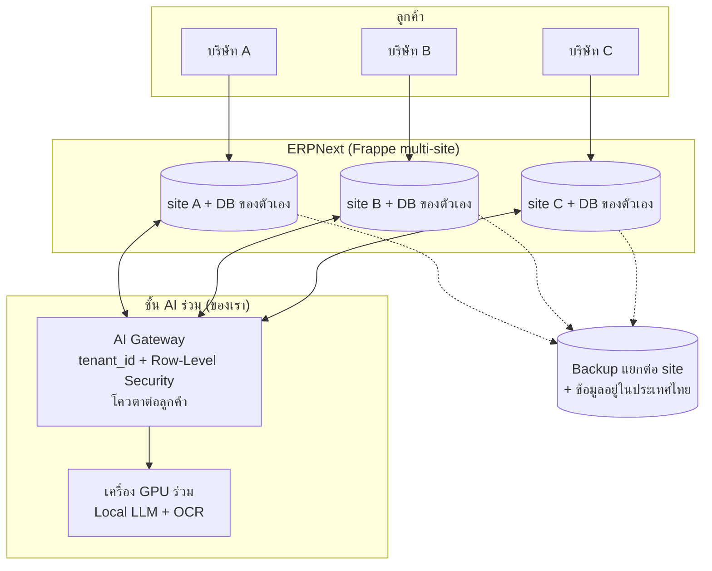

# 💼 งานที่ 4e — ให้บริษัทอื่นเช่าใช้รายเดือน: เวิร์คไหม

> วิเคราะห์ว่าถ้าเปิดให้บริษัทภายนอกใช้ระบบงาน 4 แล้ว**จ่ายรายเดือนให้เรา** จะเป็นธุรกิจได้จริงไหม และต้องมีเงื่อนไขอะไร
> ← [หน้าแรกงาน 4](README.md) · [04b Product Track (depa)](04b-depa-product-track.md) · ข้อมูลอ้างอิง: [prior-art-market](research/prior-art-market.md) · [erpnext-reference](research/erpnext-reference.md)

> ⚠️ ตัวเลขเงินในไฟล์นี้เป็น **สมมติฐาน** สำหรับวางแผน · เรื่อง license / กฎหมาย / ภาษี ให้ปรึกษาผู้รู้ก่อนทำจริง

---

## คำตอบสั้น

| ถ้าทำแบบนี้ | เวิร์คไหม | เพราะ |
|---|---|---|
| ขาย "ERPNext host ให้" อย่างเดียว | ❌ | Frappe Cloud ทางการเริ่ม $5/เดือน — แข่งราคาไม่ได้ และไม่มีจุดต่าง |
| SaaS ราคาถูก ให้ SME สมัครแล้วใช้เองได้ทันที | ❌ (ตอนนี้) | ERP ต้องตั้งค่าตามแต่ละบริษัท · งาน support หนัก · โปรแกรมบัญชีออนไลน์ไทยแข่งอยู่แล้ว |
| **ERP + AI แบบดูแลให้ (managed) สำหรับกลุ่มเฉพาะ** · ค่าวางระบบ + รายเดือน | ✅ | ลูกค้าจ่ายเพื่อ "ระบบไทยที่ตั้งให้เสร็จ + AI ที่ข้อมูลไม่ออกนอก + คนดูแล" ไม่ได้จ่ายค่า host |
| **ส่วนเสริม AI อย่างเดียว** (APX, Copilot) ให้คนที่ใช้ ERPNext/Odoo อยู่แล้ว | ✅ | ต้นทุนดูแลต่ำ ขยายได้ง่าย — คือแนวทาง [04b](04b-depa-product-track.md) |
| AI ตอบแชท + จองคิว สำหรับคลินิก | ❌ แข่งยาก | Jib OS (HDmall) 6,000/เดือน ไม่จำกัดสาขา มีทีม ทุน และทราฟฟิกจาก Google → เราไม่แข่งตรงนี้ · รับแค่งานสะพานให้คลินิก · กลุ่มเป้าหมายรวมดู [04i](04i-sme-segments.md) |

**สรุป:** เวิร์คได้ ถ้าวางตัวเป็น "บริการวางระบบและดูแล ERP + AI สำหรับ SME ไทยกลุ่มเฉพาะ" และเริ่มจากลูกค้าน้อยรายที่จ่ายจริง — **ไม่เวิร์ค** ถ้าคิดว่าเป็น SaaS ราคาถูกแบบสมัครเองใช้เอง · ผลประเมินเต็มอยู่ใน [ข้อ 9](#9-ประเมินความเหมาะสม-เป้าหมาย-หางาน--ทำธุรกิจ)

---

## 0. ลูกค้าแบบไหน ซื้ออะไร

### 0.1 บริษัทส่วนใหญ่มี ERP แล้วหรือยัง

| ขนาด (SME ไทย 3.28 ล้านราย ปี 2568) | ปกติใช้อะไร | เราเข้าไปแบบไหน |
|---|---|---|
| รายย่อย (~2.75 ล้านราย, ราว 84% — ข้อมูลปี 2567) | ส่งเอกสารให้สำนักงานบัญชี / แอปบัญชีง่ายๆ / Excel | ไม่ใช่ลูกค้า ERP · ขาย APX ผ่านสำนักงานบัญชีได้ |
| **ขนาดย่อม** (~4.55 แสนราย) | มักเป็นโปรแกรมบัญชี + Excel + LINE + กระดาษ แต่ละฝ่ายแยกกัน | ✅ **ลูกค้าระบบเต็ม** |
| **ขนาดกลาง** (~5 หมื่นราย) | หลายรายมีโปรแกรมบัญชี/ERP แล้ว บางรายระบบเก่าไม่พอใช้ | ✅ **ส่วนเสริม AI** หรือย้ายระบบเมื่อเจ็บจริง |
| ขนาดใหญ่ | มี ERP (SAP, Oracle ฯลฯ) | ส่วนเสริมเท่านั้น ขายยาก |

ยังไม่พบตัวเลขทางการว่า SME ไทยกี่ % ใช้ ERP · ผลสำรวจ สสว. ปี 2568 พบอุปสรรคหลักคือ **งบประมาณ ระบบใช้ยาก และทักษะคน** — แหล่ง: [ธปท. สรุปสถานการณ์ SME Q3 2568](https://www.bot.or.th/content/dam/bot/documents/th/financial-innovation/%E0%B8%81%E0%B8%B2%E0%B8%A3%E0%B9%80%E0%B8%87%E0%B8%B4%E0%B8%99%E0%B9%80%E0%B8%9E%E0%B8%B7%E0%B9%88%E0%B8%AD%E0%B8%84%E0%B8%A3%E0%B8%B1%E0%B8%A7%E0%B9%80%E0%B8%A3%E0%B8%B7%E0%B8%AD%E0%B8%99%E0%B9%81%E0%B8%A5%E0%B8%B0-sme/sme/%E0%B8%AA%E0%B8%A3%E0%B8%B8%E0%B8%9B%E0%B8%AA%E0%B8%96%E0%B8%B2%E0%B8%99%E0%B8%81%E0%B8%B2%E0%B8%A3%E0%B8%93%E0%B9%8C%20SME%20%E0%B9%84%E0%B8%97%E0%B8%A2_Q32568.pdf) · [ไทยรัฐ](https://www.thairath.co.th/news/governmentpolicy/2902091) · [ผู้จัดการออนไลน์ (ผลสำรวจ สสว.)](https://mgronline.com/smes/detail/9680000038117)

### 0.2 ลูกค้า 3 แบบ

| ลูกค้า | ขายอะไร | สิ่งที่เปลี่ยนในบริษัทเขา |
|---|---|---|
| **① ยังไม่มี ERP** | **ระบบเต็ม**: ERPNext ไทย + ชั้น AI + ดูแลให้ (ไฟล์นี้) | ทุกฝ่ายทำงานในระบบเดียว ไม่กรอกซ้ำ เอกสารไหลต่อกัน |
| **② มีระบบแล้วและพอใจ** | **ส่วนเสริม AI**: APX · หลักฐานส่งมอบ ([04d ข้อ 14](04d-erp-implementation.md#14-ส่งของและติดตามรถ-ทางเลือก)) · Copilot · ตรวจสัญญา | ระบบเดิมไม่เปลี่ยน เปลี่ยนแค่งานมือที่ลดลง |
| **③ ระบบเก่า / แพง / ไม่รองรับภาษีไทย** | **ย้ายระบบ** มาเป็น ERPNext + AI | เปลี่ยนมากและเสี่ยงที่สุด — ทำเมื่อลูกค้าเจ็บจริง (ต่อ license แพง ระบบเลิกพัฒนา) |

### 0.3 ส่วนเสริมต่อกับระบบเดิมยังไง

```text
 เอกสารเข้า (ใบกำกับภาษี / รูปใบส่งของ)
          │
          ▼
  ชั้น AI ของเรา (อ่าน → ตรวจ → จับคู่ → คนยืนยัน)
          │
          ▼
  ระบบเดิมของลูกค้า (ไม่เปลี่ยน)
   ├─ ERPNext / Odoo      → ส่งผ่าน API
   └─ โปรแกรมบัญชีไทยอื่น  → ส่งเป็นไฟล์ CSV / Excel ให้นำเข้า
```

> โปรแกรมบางตัวไม่มี API ส่งได้แค่ไฟล์นำเข้า — เช็กยี่ห้อที่ลูกค้าใช้ตอนสัมภาษณ์

| | ระบบเต็ม / ย้ายระบบ | ส่วนเสริม AI |
|---|---|---|
| ลูกค้าต้องเปลี่ยน | ทุกฝ่าย ย้ายข้อมูล อบรมใหม่ | แทบไม่ต้อง |
| เวลาเริ่มใช้ | หลายสัปดาห์–หลายเดือน | ไม่กี่วัน |
| ราคา | ค่าวางระบบ + รายเดือนสูง | รายเดือนต่ำ |
| ความกลัวของลูกค้า | สูง | ต่ำ |
| งานของเรา | หนัก | เบา |

**ทั้งสองแบบใช้ชั้น AI ชุดเดียวกับงาน 4** — ต่างกันแค่ฝั่ง ERP (ใช้ ERPNext ที่เราตั้ง หรือต่อกับระบบที่ลูกค้ามี)

---

## 1. เงื่อนไขที่ต้องรู้ก่อน

| เรื่อง | สรุป | ผลต่อแผน |
|---|---|---|
| License ERPNext (GPL-3) | ตามความเข้าใจทั่วไป การให้ลูกค้าใช้ผ่านเว็บไม่ถือเป็นการแจกจ่ายโค้ด (ต่างจาก AGPL) · ถ้าแจกจ่ายโค้ดที่แก้ ต้องเปิดซอร์ส | ให้บริการได้ · หลีกเลี่ยงโค้ด AGPL · ปรึกษาผู้รู้ก่อนขาย |
| **เครื่องหมายการค้า "ERPNext"** | ห้ามใช้ในชื่อสินค้า/บริษัท/โดเมน/โฆษณาโดยไม่ได้รับอนุญาต · ใช้อธิบายบริการได้ ([policy](https://frappe.io/erpnext/license-trademark)) | **ตั้งชื่อสินค้าของตัวเอง** · ในเว็บเขียนว่า "ทำงานบน ERPNext" ได้ในเนื้อหาอธิบาย |
| คู่แข่งด้านโฮสต์ | Frappe Cloud: Sites เริ่ม $5/เดือน · Servers เริ่ม $40/เดือน | ไม่แข่งค่าโฮสต์ — ขายบริการและ AI |
| PDPA | เราเป็น **ผู้ประมวลผลข้อมูล** ของลูกค้า | DPA ทุกราย · บันทึกกิจกรรม · แจ้งเหตุข้อมูลรั่วตามกฎหมาย |
| ภาษี/บริษัท | ต้องจดบริษัท + จด VAT เมื่อรายรับเกินเกณฑ์ | ดู [04b ข้อ 10](04b-depa-product-track.md#10-decision-gate-ไป-c--เปลี่ยนทิศ--หยุด) |
| depa | ขึ้นทะเบียนบัญชีบริการดิจิทัล → ลูกค้า SME หักรายจ่ายได้ 2 เท่า (ถึงสิ้นปี 2570) | เครื่องมือช่วยขาย หลังจดบริษัทแล้ว |

---

## 2. ลูกค้าจ่ายเงินเพื่ออะไร

| สิ่งที่ลูกค้าได้ | ทำไมยอมจ่าย |
|---|---|
| ERP ที่ตั้งเป็นแบบไทยเสร็จ (ภาษี วางบิล หัก ณ ที่จ่าย สาขา) | ไม่ต้องจ้างคนวางระบบแพงๆ เอง |
| **ชั้น AI ที่ข้อมูลไม่ออกนอก** (APX, ตรวจสัญญา, Copilot) | ลดงานบัญชี/เอกสาร · ไม่ต้องกลัวข้อมูลไปคลาวด์ต่างประเทศ |
| คนดูแล อัปเดต backup แก้ปัญหา | SME ไม่มีทีม IT |
| อัปเดตตามกฎหมายไทย (อัตราภาษี ประกันสังคม) | ไม่ต้องตามเอง |
| (ถ้ามีงาน 5) เงินเดือนไทยครบ | ปิดเงินเดือนได้ในระบบเดียว |

---

## 3. สถาปัตยกรรมเมื่อมีหลายลูกค้า



| เรื่อง | ทำยังไง |
|---|---|
| แยกข้อมูลลูกค้า | ERPNext: 1 site ต่อลูกค้า (DB แยก) · ชั้น AI: `tenant_id` + Row-Level Security |
| ทรัพยากร AI | GPU ร่วม · จำกัดโควตาเอกสาร/คำถามต่อลูกค้า · คิวงานไม่ให้รายใหญ่แย่งรายเล็ก |
| ที่ตั้งข้อมูล | ศูนย์ข้อมูล/คลาวด์ในประเทศไทย (ขายได้ง่ายขึ้นเรื่อง PDPA) |
| ความต่อเนื่อง | Backup ทุกวันต่อ site · ทดลอง restore ทุกเดือน · monitoring + แจ้งเตือน |
| อัปเกรด | ทดสอบบน staging ด้วย test ภาษีไทย ([04 ข้อ 14](04-enterprise-os.md#14-ภาษีไทย-ตรวจผลกับ-erpnext)) ก่อนอัปเกรดลูกค้าจริง |

---

## 4. ตัวเลข (สมมติฐานทั้งหมด)

### 4.1 รูปแบบราคา

| รายการ | รูปแบบ | ราคาสมมติ |
|---|---|---|
| ค่าวางระบบ (ครั้งเดียว) | ตั้งค่าบริษัท นำเข้าข้อมูล อบรม | 30,000–80,000 บาท ตามขนาด |
| รายเดือน — Standard | ERP ไทย + backup + support เวลาทำการ | 3,000 บาท |
| รายเดือน — AI | + APX / ตรวจสัญญา / Copilot ตามโควตา | +2,000 บาท |
| ส่วนเสริม AI อย่างเดียว (ลูกค้ามี ERP แล้ว) | APX ตามจำนวนใบ | ตาม [04b ข้อ 7](04b-depa-product-track.md#7-โมเดลรายได้และตัวเลข) |

### 4.2 จุดคุ้มทุน

| ต้นทุนคงที่ต่อเดือน (สมมติ) | บาท |
|---|---|
| เครื่อง GPU (เช่า) สำหรับ AI ร่วม | 25,000 |
| เซิร์ฟเวอร์ ERPNext + backup + monitoring | 10,000 |
| ทำบัญชี/สอบบัญชี/กฎหมายของบริษัทเราเอง (เฉลี่ย) | 5,000 |
| เงินเดือนผู้ก่อตั้ง | 40,000 |
| **รวม** | **80,000** |

| สมมติ | ผล |
|---|---|
| ลูกค้าเฉลี่ยจ่าย 5,000 บาท/เดือน (Standard + AI) | **จุดคุ้มทุน ≈ 16 ราย** (ไม่นับค่าวางระบบ) |
| support เฉลี่ย 3 ชม./ราย/เดือน | 16 ราย ≈ 48 ชม./เดือน — คนเดียวยังไหว แต่เกิน ~30 ราย ต้องมีทีม |
| ค่าวางระบบ 50,000 × 4 รายแรก | 200,000 บาท — ใช้จ่ายช่วงที่ยังไม่ถึงจุดคุ้มทุน |

> สิ่งที่ทำให้ตัวเลขพัง: งานวางระบบต่อรายใช้เวลานานกว่าคิด · ลูกค้าขอปรับแต่งเฉพาะ · ค่า GPU ถ้าใช้น้อยแต่ต้องเช่าตลอด → เริ่มด้วย GPU เครื่องเดียวที่ใช้ร่วมกับงานพัฒนา

---

## 5. Checklist ก่อนรับลูกค้าที่จ่ายเงินรายแรก

- [ ] จดบริษัท · จด VAT (เมื่อถึงเกณฑ์หรือสมัครใจ)
- [ ] ชื่อสินค้าของตัวเอง (ไม่มีคำว่า ERPNext) + ตรวจเครื่องหมายการค้า
- [ ] สัญญาบริการ: ขอบเขต · SLA · การ backup · การคืนข้อมูลเมื่อเลิกใช้ · **จำกัดความรับผิด** (AI เป็นข้อเสนอ ไม่ใช่คำปรึกษาบัญชี)
- [ ] DPA + นโยบายความเป็นส่วนตัว + ขั้นตอนเมื่อข้อมูลรั่ว
- [ ] ความปลอดภัย: ทดสอบเจาะระบบเบื้องต้น · MFA สำหรับ admin · หมุน key
- [ ] Backup + ทดลอง restore แล้วจริง
- [ ] ช่องทาง support + เวลาตอบกลับที่สัญญาได้จริง
- [ ] ระบบเก็บเงินรายเดือน + ออกใบกำกับภาษีให้ลูกค้าเอง (ใช้ ERPNext ของเราเองได้)

---

## 6. เส้นทางเข้าตลาด

| ขั้น | ทำอะไร | เป้า |
|---|---|---|
| 1 | พอร์ต (งาน 4) + Product Track ([04b](04b-depa-product-track.md)) | Pilot Report + Decision Memo |
| 2 | ลูกค้านำร่อง 3–5 ราย (ลดราคา) — กลุ่มเฉพาะ เช่น SME ที่ประกอบ/ผลิต + ขาย หรือบริษัท IT ขนาดเล็ก | ลูกค้า ≥ 3 รายยอมจ่ายต่อ |
| 3 | จดบริษัท + ขึ้นทะเบียนบัญชีบริการดิจิทัล + ยื่นทุน depa | ใช้สิทธิภาษี 2 เท่าช่วยขาย |
| 4 | ขายผ่านสำนักงานบัญชีและบริษัทวางระบบ (แบ่งรายได้) | 10–16 รายที่จ่ายเต็ม |
| 5 | ขยายทีม support เมื่อเกิน ~30 ราย | — |

---

## 7. ความเสี่ยง

| ความเสี่ยง | ระดับ | ป้องกัน |
|---|---|---|
| งานวางระบบต่อรายบานปลาย | 🔴 | แพ็กเกจมาตรฐาน + คิดค่าปรับแต่งแยก · เลือกลูกค้ากลุ่มเดียวกัน |
| support ล้นคนเดียว | 🔴 | จำกัดจำนวนลูกค้าต่อคน · เอกสารช่วยเหลือ · HelpBot ฝั่งลูกค้า |
| ความผิดพลาดทางบัญชีของลูกค้า | 🟠 | AI ร่างเท่านั้น (เพดาน L1 สำหรับลงบัญชี) · สัญญาจำกัดความรับผิด · test ภาษีไทยก่อนอัปเกรด |
| ข้อมูลรั่ว | 🟠 | แยก DB ต่อลูกค้า · RLS · audit · ข้อมูลในประเทศ |
| ใช้ชื่อ ERPNext ผิดเงื่อนไข | 🟠 | ตั้งชื่อเอง |
| ค่า GPU ไม่คุ้มช่วงลูกค้าน้อย | 🟠 | เครื่องเดียวใช้ร่วม · เปิด AI เป็นแพ็กเกจเสริม |
| อัปเกรด ERPNext ทำให้ของลูกค้าพัง | 🟠 | staging + test อัตโนมัติ · pin เวอร์ชัน |
| ผู้ก่อตั้งคนเดียว | 🟠 | หาผู้ร่วมก่อตั้งด้านบัญชี/ขาย · เอกสารทุกขั้นตอน |

---

## 8. ข้อสรุปและสิ่งที่ต้องตัดสินใจ

1. **แผนนี้เวิร์ค** ถ้าเป็นบริการวางระบบ + ดูแล + AI ที่ข้อมูลไม่ออกนอก สำหรับ SME ไทยกลุ่มเฉพาะ
2. **อย่าเริ่มที่ "เปิด SaaS ให้สมัครเอง"** — เริ่มที่ลูกค้านำร่องไม่กี่รายแล้ววัดเวลา support จริง
3. **ใช้ Decision Gate ของ [04b](04b-depa-product-track.md#10-decision-gate-ไป-c--เปลี่ยนทิศ--หยุด)** ตัดสินว่าจะเปิดบริษัทหรือไม่ ด้วยตัวเลขจากลูกค้าจริง
4. **ทางเริ่มที่เสี่ยงน้อยสุด:** ส่วนเสริม AI (APX) ให้คนที่ใช้ ERP อยู่แล้ว → ค่อยขยายเป็นบริการ ERP เต็ม

---

## 9. ประเมินความเหมาะสม (เป้าหมาย: หางาน + ทำธุรกิจ)

**คะแนนตอนนี้ 6/10** — ตลาดใหญ่และดีไซน์พร้อม แต่ยังไม่มีข้อมูลจากลูกค้าจริง · ถ้าผ่านการทดสอบ 3 เรื่อง (ลูกค้ายอมจ่าย · ชั่วโมงวางระบบต่อราย · ช่องทางหาลูกค้า) ขึ้นได้ถึง 8/10

### 9.1 ภาพรายได้ (สมมติฐานทั้งหมด)

| ช่วง | ลูกค้า | รายได้ประจำ/เดือน | ค่าวางระบบ (เฉลี่ย/เดือน) | ต้นทุน/เดือน | เหลือ/เดือน |
|---|---|---|---|---|---|
| ปีที่ 1 | 10 | 50,000 | ~41,700 | 80,000 (รวมเงินเดือนตัวเอง 40,000) | ~+11,700 |
| ปีที่ 2 | 30 | 150,000 | ~41,700 | 105,000 (+ support 1 คน) | ~+86,700 |
| ปีที่ 3 | 60 | 300,000 | ~62,500 | 170,000 (+ ทีม 3 คน) | ~+192,500 |

### 9.2 ปัจจัยชี้ขาด 7 ข้อ

| # | ปัจจัย | ตอนนี้ | ทดสอบยังไง | ผ่านเมื่อ |
|---|---|---|---|---|
| 1 | ปัญหาจริงและยอมจ่าย | ❓ | สัมภาษณ์ 15 ราย ([04b](04b-depa-product-track.md)) + หนังสือแสดงความสนใจ | ≥ 3 รายยอมจ่ายตามราคาสมมติ |
| 2 | **ชั่วโมงวางระบบต่อราย** | ❓ | นำร่อง 1–3 รายแล้วจับเวลาจริง | ≤ 40 ชม./ราย |
| 3 | ชั่วโมง support ต่อราย | ❓ | จดเวลา 2 เดือน | ≤ 3 ชม./ราย/เดือน |
| 4 | **ช่องทางหาลูกค้า** | ❌ | คุยสำนักงานบัญชี 5 ราย + บริษัทวางระบบ 2 ราย | ≥ 1 รายยอมแนะนำลูกค้า |
| 5 | ความเชื่อใจ | 🟡 | เอกสาร security + สาธิต backup/restore + สัญญา | ลูกค้านำร่องยอมใส่ข้อมูลจริง |
| 6 | คู่แข่ง | 🟡 | ถามลูกค้าว่าทำไมจะเลือกเรา | จุดต่างที่ลูกค้าบอกตรงกับที่เราคิด |
| 7 | เวลาของผู้ก่อตั้ง | 🟡 | ตั้งชั่วโมงต่อสัปดาห์ + เช็กสัญญาจ้าง | ≥ 10 ชม./สัปดาห์ ต่อเนื่อง 3 เดือน |

### 9.3 ทางที่คุ้มกว่า: วางระบบก่อน แล้วค่อยเป็นรายเดือน

| ขั้น | ทำอะไร | ความเสี่ยง |
|---|---|---|
| A | รับงานวางระบบ ERPNext + AI เป็นรายโครงการ (งานเสริม) | ต่ำ |
| B | ลูกค้าที่วางระบบแล้ว → สัญญาดูแลรายเดือน (**ไฟล์นี้**) | ต่ำ–กลาง |
| C | สิ่งที่ทำซ้ำทุกรายทำเป็นแพ็กเกจ → ค่าวางระบบต่อรายลดลง | กลาง |
| D | เปิดแบบสมัครเองใช้เอง — เมื่อวางระบบต่อรายใช้ไม่เกิน ~8 ชม. | สูง |

### 9.4 หางาน + ทำธุรกิจไปพร้อมกัน

| ช่วง | งานหลัก | ธุรกิจ (คู่ขนาน) |
|---|---|---|
| เดือน 0–6 | พอร์ต งาน 1 → 2 → 4 · เริ่มสมัครงาน | สัมภาษณ์ลูกค้า 15 ราย |
| เดือน 6–9 | สมัครงาน / เริ่มงานใหม่ | นำร่อง 1–3 ราย · จับเวลาวางระบบและ support |
| เดือน 9–12 | ทำงานประจำ | Gate: ไปต่อเป็นงานเสริม 5–10 ราย หรือหยุด |
| ภายหลัง | — | ทำเต็มเวลาเมื่อรายได้ประจำครอบคลุมค่าใช้จ่ายตัวเอง + ต้นทุนบริษัทได้ 6 เดือน |

ข้อระวัง: อ่านสัญญาจ้างเรื่องงานเสริม/ทรัพย์สินทางปัญญา/การแข่งขันกับนายจ้าง · ทำงานบริษัทวางระบบ ERP = ได้ประสบการณ์ตรง แต่ธุรกิจจะแข่งกับนายจ้าง

### 9.5 เกณฑ์หยุด (หรือถอยไปขายแค่ส่วนเสริม)

- คุย 15 รายแล้ว คนสนใจจ่ายไม่ถึง 3 ราย
- วางระบบเกิน 80 ชม./ราย และลดไม่ได้
- support เกิน 6 ชม./ราย/เดือน
- 6 เดือนแล้วยังไม่มีพาร์ทเนอร์ช่วยหาลูกค้า

### 9.6 คำตัดสิน

| คำถาม | คำตอบ |
|---|---|
| เหมาะไหม | เหมาะเป็นเป้าหมาย 1–3 ปี · ยังไม่เหมาะเป็นสิ่งแรกที่ลงทุน |
| ศักยภาพ | สูง: รายได้ประจำ ลูกค้าติดแน่น ตลาดใหญ่พอ |
| ความเสี่ยงหลัก | ชั่วโมงวางระบบ · support · ช่องทางขาย |
| ทางที่คุ้มที่สุด | ส่วนเสริมก่อน (ลูกค้าแบบ ②) + รับวางระบบให้ลูกค้าแบบ ① แล้วแปลงเป็นรายเดือน |
| รู้ผลได้ใน | ~3 เดือนหลังงาน 4 MVP เสร็จ ต้นทุนแทบเป็นศูนย์ |

---

## 10. ขายสะพาน และลูกค้าต่างธุรกิจ

> ด้านเทคนิค (ช่องทางต่อระบบ · รูปแบบกลาง · contract tests · แยกลูกค้า) อยู่ใน [04h](04h-connectors.md)
> **อัปเดต 16 ต.ค. 2569:** สำรวจคู่แข่งแล้วพบ Jib OS → ไม่แข่ง AI ตอบแชทคลินิก และเลิกคิดราคาต่อสาขา
> **เป้าหมายรวมคือ SME ครบวงจร** — ลำดับกลุ่มลูกค้าทั้ง 17 กลุ่มอยู่ใน [04i](04i-sme-segments.md) · ข้อ 10.3 ด้านล่างเป็นเฉพาะ**กลุ่มธุรกิจที่มีการนัด** (ชุดนัดหมาย)

### 10.1 รับต่อสะพานเป็นบริการได้ไหม

ได้ แต่**ไม่ควรขายสะพานเปล่าๆ** — ลูกค้าจ่ายเพื่อผลลัพธ์ (ตอบแชทเอง · อ่านใบกำกับเอง) สะพานเป็นแค่ทางไปถึง

| แบบ | ขายอะไร | ข้อดี | ข้อเสีย |
|---|---|---|---|
| 1. รับจ้างต่อสะพานอย่างเดียว | งานเชื่อมระบบ รายโปรเจกต์ | เริ่มได้ทันที | ไม่มีรายได้ประจำ · แข่งกับ n8n / Zapier / บริษัท SI · ทุกงานเริ่มใหม่ |
| **2. AI + ค่าติดตั้งสะพาน** ⭐ | ค่าติดตั้งครั้งเดียว + ค่า AI รายเดือน (รวมค่าดูแลสะพาน) | รายได้ประจำ · ค่าติดตั้งจ่ายต้นทุนสะพาน | ต้องมี AI ที่ใช้ได้จริงก่อน |
| 3. สะพานสำเร็จรูปของระบบยอดนิยม | ต่อโปรแกรมที่คนใช้เยอะได้ทันที | ทำครั้งเดียว ขายหลายราย | ต้องเลือกระบบให้ถูก · ตามอัปเดตของเขา |

**ทาง:** เริ่มแบบ 2 → สะพานทุกตัวเป็นทรัพย์สิน → ลูกค้ารายที่ 2 ที่ใช้ระบบเดียวกันได้ใช้ของเดิม → สะสมจนเป็นแบบ 3

### 10.2 คู่แข่งในกลุ่มธุรกิจที่มีการนัด

#### Jib OS — คู่แข่งตรงตัวในกลุ่มคลินิก

| เรื่อง | ข้อมูล |
|---|---|
| เจ้าของ | HD (HDmall) · บริษัท เฮลท์ ดีดี จำกัด · ตั้งปี 2019 · marketplace สุขภาพ |
| ทีม | Jib OS ไม่เปิดเผย · บริษัทแม่ ~125 คน (🟡 แหล่งเดียว ยังไม่ยืนยัน) |
| ทุน | หลายรอบจาก VC + MSD (Merck) · ยอดแต่ละแหล่งไม่ตรงกัน ($5.6M–$7.8M ในรอบ Series A · รวม ~$18M ตามรายงานหนึ่ง) |
| ราคา | **6,000 บาท/เดือน** (จ่ายล่วงหน้า 3 เดือน = 5,000) · ทดลองฟรี 1 เดือน · สัญญาขั้นต่ำ 3 เดือน · **ไม่มีค่าติดตั้ง · ไม่จำกัดผู้ใช้และสาขา** |
| มีอะไร | AI ตอบแชท 24 ชม. หลายภาษา · รวมแชททุกช่องทาง · จองคิว · CRM · ทราฟฟิกจาก Google / HDmall |
| ทำเงินจากไหนอีก | แคมเปญ HDmall Plus หัก 20–30% · เว็บไซต์ AI +6,000/เดือน · งานเชื่อม HIS/EHR ให้องค์กรใหญ่โดยทีม Forward-deployed (คิดแยก) |
| ช่องทางที่คนอื่นไม่มี | ปุ่ม "Book Now" บน Google Maps เฉพาะลูกค้า Jib OS (partnership กับ Google) |
| สิ่งที่เขาบอกว่าไม่ทำ | ไม่แข่งกับระบบเวชระเบียน / งานหลังบ้านของคลินิก |

**ทำไมขายถูกได้:** Jib OS เป็นเครื่องมือดึงคลินิกเข้า marketplace — เงินหลักมาจากส่วนอื่น · สินค้าเดียวขายหลายพันแห่ง (อ้าง 2,500+ แต่ยังไม่ชัดว่านับอะไร) · มีทุน VC ตั้งราคาเพื่อแย่งตลาดได้

#### คู่แข่งกลุ่มอื่น (ราคาตามเว็บผู้ขาย ต่อเดือน)

| กลุ่ม | ตัวอย่าง | ราคา |
|---|---|---|
| แชทบอท / รวมแชททั่วไป | ZWIZ.AI · OHO Chat · KaoJai.ai · Zaapi · SleekFlow · klink.cloud · Botnoi · AIYA · Zipai · AI ใน LINE OA (เบต้า) | 0.12 บาท/ข้อความ – 3,300 · ส่วนใหญ่ 590–1,900 |
| โปรแกรมคลินิก | DentCloud · Dentapop · Dentaloncloud · DoctorEase · JERA Cloud · Keenix · MediCloud · Cliniter · Expert8 | ฟรี – 2,900 |
| จ้างทำเอง | ฟรีแลนซ์ · เอเจนซี | ครั้งเดียว 1,500–60,000 |

> แหล่ง: [Jib OS](https://hdmall.co.th/jib-os/) · [รวม 8 ระบบแชท LINE OA สำหรับคลินิก](https://hdmall.co.th/jib-os/blog/7-line-oa-chat-systems-for-clinics/index.md) · [โปรแกรมคลินิกทันตกรรมในไทย](https://hdmall.co.th/jib-os/resources/100-thai-dental-clinic-software-landscape/) · [Techsauce](https://techsauce.co/news/hd-secures-5-point-6m-baht-series-a-leading-healthcare-and-surgery-marketplace-in-sea-with-llm) · [Signalbase](https://www.trysignalbase.com/news/funding/hd-secures-22m) — บทความเทียบส่วนใหญ่เขียนโดย HDmall เอง ตรวจซ้ำก่อนอ้าง

### 10.3 กลุ่มเป้าหมาย

> ตารางนี้ครอบคลุมเฉพาะ**ธุรกิจที่มีการนัด** (ชุดนัดหมาย = ระลอก 3) · ระลอก 1–2 ของ SME ครบวงจร (สำนักงานบัญชี · บริษัท IT · ค้าส่ง · โรงงาน ฯลฯ) อยู่ใน [04i ข้อ 6](04i-sme-segments.md#6-ลำดับเข้าตลาด-3-ระลอก)

| กลุ่ม | สถานะ | ทำไม |
|---|---|---|
| **สถาบันสอนที่มีคาบเรียน** (ดนตรี · กวดวิชา · ภาษา · กีฬา · ศิลปะ) | ✅ **เป้าหมายของชุดนัดหมาย** (ระลอก 3) | HDmall ทำเฉพาะสุขภาพ · ปัญหาชัด: ตารางเรียน เรียนชดเชย ชั่วโมงคงเหลือ ต่อคอร์ส · ใช้ชุดนัดหมายได้เต็ม ([04h ข้อ 7.2](04h-connectors.md#72-ชุดนัดหมาย-booking-pack--ใช้ซ้ำกับธุรกิจบริการที่มีการนัด)) · 🟡 ยังไม่ได้สำรวจโปรแกรมจัดการโรงเรียนที่มีอยู่ — ทำก่อนลงมือ |
| คลินิกที่ต้องต่อโปรแกรมหลังบ้าน หรือต้องการ AI ในเครื่อง | 🟡 ช่องรอง | ขายเป็น**งานสะพาน** ไม่แข่งตอบแชท · Jib OS บอกเองว่าไม่ทำงานหลังบ้าน (แต่ทีมเขารับงานเชื่อมให้องค์กรใหญ่ → เราเล็งคลินิกเล็ก-กลาง) · อาจเป็นพาร์ทเนอร์ได้ |
| ฟิตเนส · สตูดิโอโยคะ | 🟡 ต้องเช็กก่อน | อาจทับกับ HDmall (สุขภาพ/wellness) |
| AI ตอบแชท + จองคิว สำหรับคลินิก / ความงาม / สปา | ❌ ไม่แข่ง | Jib OS + เครื่องมือแชท 10+ เจ้า · เขามีทีม ทุน และทราฟฟิกจาก Google |
| ธุรกิจต่างกลุ่มมาก (เช่น โรงงาน) | ❌ ตอนนี้ | สร้างใหม่เกือบหมด → รับเมื่อจ่ายค่าวางระบบเต็ม |

**กฎ:** เลือกกลุ่มเดียว แล้วขยายในกลุ่ม · สร้างชุดนัดหมายเมื่อมีนำร่องยอมจ่าย ≥ 1 ราย และคุยกลุ่มเดียวกันอีก ≥ 5 รายแล้วเจ็บเรื่องเดียวกัน

### 10.4 ราคา (สมมติฐาน · ไม่รวม VAT)

**หลักคิด**
- **คิดตามปริมาณงาน ไม่คิดตามสาขา** — Jib OS ไม่จำกัดสาขาที่ 6,000 คิดต่อสาขาแข่งไม่ได้ · ต้นทุนเราขึ้นกับจำนวนแชทและชั่วโมงดูแล ไม่ใช่จำนวนสาขา
- **ไม่มีค่าติดตั้งถ้าไม่ต้องทำสะพาน** (ตลาดคาดหวังแบบนี้แล้ว) · เก็บค่าติดตั้งเฉพาะสะพาน
- **ดูแลไม่เกิน 1.5 ชม./ราย/เดือน** — เกินนี้ขาดทุนที่ราคาเหล่านี้

| แพ็กเกจ | ปริมาณ (บทสนทนา/เดือน) | มีอะไร | ค่าติดตั้ง | รายเดือน |
|---|---|---|---|---|
| เริ่มต้น | ≤ 1,000 | AI ตอบคำถามจากเอกสาร (RAG) · ร่างนัดให้คนกดยืนยัน · เตือนนัด · ใช้ Sheets แม่แบบของเรา | 0 | 2,900 |
| **มาตรฐาน** ⭐ | ≤ 3,000 | + ตามลูกค้าที่หายไป / ชั่วโมงใกล้หมด · รายงานผลรายเดือน | 0 | **4,900** |
| ใหญ่ | ≤ 10,000 · ไม่จำกัดสาขา | + แดชบอร์ดแยกสาขา · SLA | 0 | 8,900 |
| + สะพาน (เพิ่มได้ทุกแพ็กเกจ) | — | ต่อระบบเดิมของลูกค้า | CSV 5,000 · Sheets / API 15,000–35,000 · DB อ่านอย่างเดียว 30,000–60,000 | +1,500 ค่าดูแลสะพาน |
| งานสะพานอย่างเดียว (ช่องรองคลินิก) | — | เชื่อมโปรแกรมหลังบ้านกับระบบที่เขาใช้อยู่ | 20,000–60,000 | 1,500–2,500 |

**นำร่อง:** ลด 50% นาน 3 เดือน แลกกรณีศึกษา + ตัวเลขจริง · ตกลงเกณฑ์วัดผลก่อนเริ่ม (ตอบเร็วขึ้น · นัดเพิ่ม · ขาดนัด/ขาดเรียนลดลง)

**ต้นทุนต่อราย (สมมติ):** GPU ใช้ร่วม ~400 · host ~300 · ดูแล 1.5 ชม. × 600 = 900 · สำรองซ่อมสะพาน ~500 → **~1,600–2,100**

| ตรวจตัวเลข | ผล |
|---|---|
| กำไรขั้นต้นที่แพ็กเกจมาตรฐาน | (4,900 − 2,100) ÷ 4,900 ≈ **57%** |
| จุดคุ้มทุน | ต้นทุนคงที่ 70,000 (ข้อ 4.2 หักเซิร์ฟเวอร์ ERPNext 10,000) ÷ 2,800 ≈ **25 ราย** |
| ดูแลเกินเกณฑ์ | ถ้าใช้ 3 ชม./ราย → ต้นทุน ~3,000 · กำไรขั้นต้นเหลือ ~39% · จุดคุ้มทุน ~37 ราย |

**สัญญา:** DPA ทุกราย · ระบุว่าเราอ่านอย่างเดียว / สร้างแค่ร่าง · ค่า LINE OA ลูกค้าจ่าย LINE เอง

← [หน้าแรกงาน 4](README.md)
