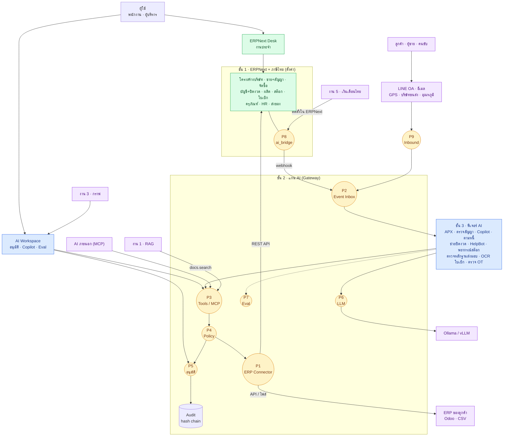
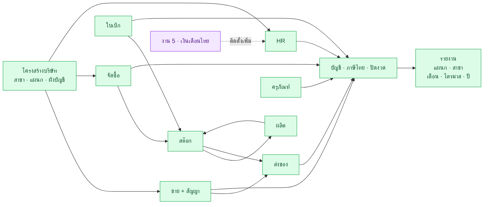
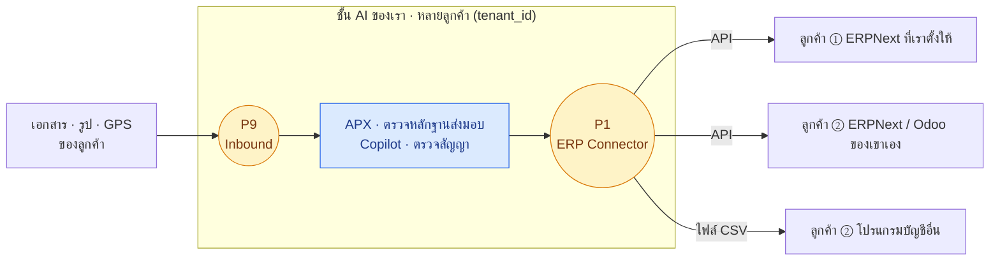
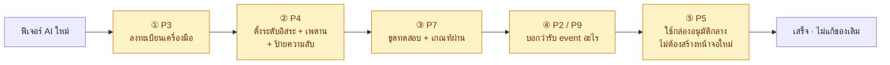

# 🧩 งานที่ 4f — แผนผัง Module และจุดเสียบ (Port)

> ทุก module ของงาน 4 อยู่ตรงไหน ส่วนเสริมแต่ละตัวต่อเข้าที่จุดไหน และอะไรต้องมีก่อน
> ← [หน้าแรกงาน 4](README.md) · [04 สเปกหลัก](04-enterprise-os.md) · [04c คู่มือสร้าง](04c-build-guide.md) · [04d สาย ERP](04d-erp-implementation.md)

**วิธีอ่าน:** กล่องสี่เหลี่ยม = module · **วงกลม P1–P9 = จุดเสียบ** ที่ module ใหม่มาต่อได้โดยไม่ต้องแก้ของเดิม

---

## สารบัญ
1. [ภาพรวมทั้งระบบ](#1-ภาพรวมทั้งระบบ)
2. [จุดเสียบ 9 จุด (P1–P9)](#2-จุดเสียบ-9-จุด-p1p9)
3. [ฟีเจอร์ AI แต่ละตัวเสียบที่จุดไหน](#3-ฟีเจอร์-ai-แต่ละตัวเสียบที่จุดไหน)
4. [ภายใน ERPNext: ส่วนไหนพึ่งส่วนไหน](#4-ภายใน-erpnext-ส่วนไหนพึ่งส่วนไหน)
5. [ส่วนเสริมสำหรับลูกค้าภายนอก](#5-ส่วนเสริมสำหรับลูกค้าภายนอก)
6. [เพิ่ม module ใหม่ทำยังไง](#6-เพิ่ม-module-ใหม่ทำยังไง)
7. [รายการ module ทั้งหมด](#7-รายการ-module-ทั้งหมด)

---

## 1. ภาพรวมทั้งระบบ

สี: 🟩 ERPNext (ตั้งค่า) · 🟦 ฟีเจอร์ AI (สร้างเอง) · 🟨 จุดเสียบ · 🟪 ภายนอก / โปรเจกต์แยก

**อ่านเส้นทางหลัก:** เอกสาร/เหตุการณ์เข้ามาที่ **P2** → ฟีเจอร์ AI ทำงาน → เรียกเครื่องมือผ่าน **P3** → ตรวจสิทธิ์และระดับอิสระที่ **P4** → ถ้าต้องให้คนดูไปที่ **P5** → ลงมือกับ ERP ผ่าน **P1** → ทุกขั้นบันทึกใน **Audit**

---

## 2. จุดเสียบ 9 จุด (P1–P9)

| Port | คืออะไร | สัญญา (รูปแบบที่ต้องตรง) | อยู่ที่ไหน | ใครมาเสียบ |
|---|---|---|---|---|
| **P1** ERP Connector | ทางเดียวที่ AI ใช้อ่าน/เขียน ERP | ฟังก์ชันชุดเดียว: `get_doc` · `list_docs` · `run_report` · `create_draft` · `submit` · `attach_file` · `add_comment` | `gateway/erp/` | ERPNext + CSV (MVP) · Sheets / DB อ่านอย่างเดียว / Odoo (เมื่อมีลูกค้า) — **สะพาน** ดู [04h](04h-connectors.md) |
| **P2** Event Inbox | รับเหตุการณ์ทุกแหล่ง | JSON `{source, doctype, name, event, modified}` + ลายเซ็น + `dedupe_key` UNIQUE | `gateway/inbox.py` | Webhook ERPNext · P9 |
| **P3** Tool Registry / MCP | ทะเบียนเครื่องมือที่ AI เรียกได้ | ชื่อ · input schema · allowlist ต่อ agent | `gateway/tools/` | ฟีเจอร์ AI ทุกตัว · งาน 1 · AI ภายนอก |
| **P4** Policy | ระดับอิสระ + ป้ายความลับ | `policy/autonomy.yaml` · `policy/data_classification.yaml` | `gateway/policy/` | ทุก action |
| **P5** อนุมัติ | กล่องอนุมัติกลาง | ตาราง `ai_proposal` + หน้าจอกลางใน AI Workspace | `gateway/proposals.py` · `apps/web` | ทุก action ระดับ L1 |
| **P6** LLM Gateway | เรียกโมเดล | OpenAI-compatible `base_url` + `model` · บังคับตามป้ายความลับ | `gateway/llm.py` | ฟีเจอร์ที่ใช้ LLM |
| **P7** Eval | ชุดทดสอบ | `eval_case {dataset, input, expected}` + เกณฑ์ผ่าน | `eval/` | ฟีเจอร์ AI ทุกตัว |
| **P8** ai_bridge | จุดเสียบ**ใน** ERPNext | custom field · ปุ่มใน Desk · role `AI Agent` · ตั้ง webhook | `frappe-apps/ai_bridge` | ปุ่ม "ส่งให้ AI" · ฟอร์มตรวจนับ · งาน 5 ติดตั้งคู่กัน |
| **P9** Inbound Adapter | แปลงข้อมูลภายนอกเป็น event มาตรฐาน | รับข้อมูลแหล่งไหนก็ได้ → ส่งต่อเป็นรูปแบบ P2 | `gateway/adapters/` | LINE OA · อีเมล · GPS · บริษัทขนส่ง · อุณหภูมิ |

> **P1, P2, P3, P4, P5, P6, P7 ต้องสร้างก่อน** (คือแกน AI ใน [04c Stage 3](04c-build-guide.md#7-stage-3--เสาและคานของชั้น-ai)) · P8 สร้างเล็กๆ ตั้งแต่แรก · P9 เพิ่มทีละ adapter เมื่อต้องใช้

---

## 3. ฟีเจอร์ AI แต่ละตัวเสียบที่จุดไหน

| ฟีเจอร์ | P1 | P2 | P3 | P4 | P5 | P6 | P7 | P8 | P9 | ต้องมี ERP ส่วน | Phase |
|---|:-:|:-:|:-:|:-:|:-:|:-:|:-:|:-:|:-:|---|---|
| **APX** ตรวจใบกำกับ | ✓ | ✓ | ✓ | ✓ | ✓ | ✓ | ✓ | ✓ | ✓ | จัดซื้อ · บัญชี | MVP |
| **ตรวจสัญญา** | ✓ | | ✓ | ✓ | ✓ | ✓ | ✓ | ✓ | | ขาย + สัญญา · งาน 1 | MVP |
| **Copilot** | ✓ | | ✓ | ✓ | | ✓ | ✓ | | | รายงานทุกส่วน | MVP |
| ตามหนี้ | ✓ | ✓ | ✓ | ✓ | ✓ | ✓ | ✓ | | ✓ | บัญชี | MVP+ |
| ช่วยปิดงวด | ✓ | | ✓ | ✓ | ✓ | ✓ | ✓ | | | บัญชี | MVP+ |
| HelpBot | ✓ | ✓ | ✓ | ✓ | ✓ | ✓ | ✓ | | ✓ | HR · งาน 2 | MVP+ |
| พยากรณ์สต๊อก | ✓ | ✓ | ✓ | ✓ | ✓ | | ✓ | | | สต๊อก · ผลิต | MVP+ |
| ตรวจหลักฐานส่งมอบ | ✓ | ✓ | ✓ | ✓ | ✓ | ✓ | ✓ | ✓ | ✓ | ส่งของ | MVP+ |
| OCR ใบเบิกเงิน | ✓ | | ✓ | ✓ | ✓ | ✓ | ✓ | | ✓ | ใบเบิก · HR | MVP+ |
| ตรวจ OT | ✓ | ✓ | ✓ | ✓ | | | ✓ | | | HR · งาน 5 | Pro |

**อ่านตาราง:** ทุกฟีเจอร์ผ่าน P1, P3, P4, P7 เสมอ → นี่คือเหตุผลที่แกน AI ต้องเสร็จก่อน ส่วน P9 ใช้เฉพาะตัวที่รับข้อมูลจากข้างนอก

---

## 4. ภายใน ERPNext: ส่วนไหนพึ่งส่วนไหน

- **ทุกส่วนไหลเข้าบัญชี (E4)** — จึงต้องตั้งโครงสร้างบริษัท (E1) และมิติสาขา/แผนกให้ครบก่อนเปิดส่วนอื่น
- **เปิดใช้ทีละส่วนได้** เช่น เริ่มจาก ขาย + จัดซื้อ + บัญชี แล้วค่อยเปิด ผลิต · ครุภัณฑ์ · ส่งของ ทีหลัง
- **งาน 5** ติดตั้งเพิ่มเข้า HR ได้ทุกเมื่อ ไม่ต้องแตะชั้น AI

---

## 5. ส่วนเสริมสำหรับลูกค้าภายนอก

ชั้น AI ชุดเดียวกัน ต่างกันแค่ฝั่ง ERP ที่ **P1** ต่อเข้าไป ([04e ข้อ 0](04e-saas-business-model.md#0-ลูกค้าแบบไหน-ซื้ออะไร))

| ลูกค้า | เสียบที่ | ต้องทำเพิ่ม |
|---|---|---|
| ① ยังไม่มี ERP | P1 → ERPNext ที่เราตั้ง | ตั้งค่า ERPNext ให้ลูกค้า (สาย ERP) |
| ② ใช้ ERPNext / Odoo อยู่ | P1 → API ของระบบเขา | ตัวต่อ Odoo (ครั้งเดียว ใช้ได้ทุกลูกค้า Odoo) |
| ② ใช้โปรแกรมบัญชีอื่น | P1 → ไฟล์ CSV | รูปแบบไฟล์ของยี่ห้อนั้น |
| ไม่ใช่ธุรกิจซื้อขาย (คลินิก · โรงเรียน) | P1 → Sheets / DB / API ของเขา · P9 → LINE OA | รูปแบบกลางเพิ่ม + ชุดนัดหมาย ([04h ข้อ 7](04h-connectors.md#7-ลูกค้าต่างธุรกิจในระบบเดียว)) |

---

## 6. เพิ่ม module ใหม่ทำยังไง

| จะเพิ่ม | เสียบที่ | แตะของเดิมไหม |
|---|---|---|
| ฟีเจอร์ AI ใหม่ | P3 · P4 · P7 (+ P2/P9) | ไม่ |
| ระบบลูกค้าใหม่ (Odoo · Sheets · DB) | P1 (เพิ่มสะพาน + ผ่าน contract tests) | ไม่ |
| แหล่งข้อมูลใหม่ (GPS, LINE, เครื่องวัด) | P9 (เพิ่ม adapter) | ไม่ |
| โมเดลใหม่ | P6 (แก้ config) + รัน P7 | ไม่ |
| ปุ่ม/ฟิลด์ใหม่ใน ERPNext | P8 | ไม่ |
| ส่วน ERPNext ใหม่ (เช่น ผลิต) | ตั้งค่าใน ERPNext ([04d](04d-erp-implementation.md)) | ไม่ (ต้องมีโครงสร้างบริษัทแล้ว) |

---

## 7. รายการ module ทั้งหมด

| ชั้น | Module | ประเภท | ต้องมีก่อน | Phase | รายละเอียด |
|---|---|---|---|---|---|
| 1 ERPNext | โครงสร้างบริษัท + รายงาน | แกน | — | MVP | [04d ข้อ 2–3](04d-erp-implementation.md#2-โครงสร้างบริษัทใน-erpnext) |
| 1 ERPNext | ขาย + สัญญา | แกน | โครงสร้างบริษัท | MVP | [04 ข้อ 4](04-enterprise-os.md#4-flow-a--ขาย--รับเงิน) |
| 1 ERPNext | จัดซื้อ | แกน | โครงสร้างบริษัท | MVP | [04 ข้อ 5](04-enterprise-os.md#5-flow-b--ซื้อ--จ่ายเงิน-apx) |
| 1 ERPNext | บัญชี + ภาษีไทย + ปิดงวด | แกน | โครงสร้างบริษัท | MVP | [04 ข้อ 6, 14](04-enterprise-os.md#6-flow-c--ปิดงบ) |
| 1 ERPNext | ผลิต | ส่วนเสริม | สต๊อก | MVP+ | [04d ข้อ 4](04d-erp-implementation.md#4-การผลิต) |
| 1 ERPNext | สต๊อก + แจ้งเตือน | ส่วนเสริม | จัดซื้อ | MVP+ | [04d ข้อ 5](04d-erp-implementation.md#5-สต๊อกและแจ้งเตือนวัตถุดิบใกล้หมด) |
| 1 ERPNext | ใบเบิก | ส่วนเสริม | สต๊อก · HR | MVP+ | [04d ข้อ 6](04d-erp-implementation.md#6-ใบเบิก) |
| 1 ERPNext | ครุภัณฑ์ | ส่วนเสริม | บัญชี | MVP+ | [04d ข้อ 9](04d-erp-implementation.md#9-ครุภัณฑ์-ทะเบียน-ซ่อม-ตรวจนับ) |
| 1 ERPNext | HR พื้นฐาน | ส่วนเสริม | โครงสร้างบริษัท | MVP+ | [04d ข้อ 10](04d-erp-implementation.md#10-พนักงาน-ลงเวลา-สรุปวันทำงาน) |
| 1 ERPNext | ส่งของ | ส่วนเสริม | ขาย · สต๊อก | MVP+ | [04d ข้อ 14](04d-erp-implementation.md#14-ส่งของและติดตามรถ-ทางเลือก) |
| 2 แกน AI | P1–P7 + Audit | **แกน (ต้องทำก่อน)** | ERPNext ทำงานได้ | MVP | [04c Stage 3](04c-build-guide.md#7-stage-3--เสาและคานของชั้น-ai) |
| 2 แกน AI | P8 ai_bridge | แกน (เล็ก) | ERPNext | MVP | [04 ข้อ 8](04-enterprise-os.md#8-architecture) |
| 2 แกน AI | P9 adapters | ส่วนเสริม (ทีละตัว) | P2 | MVP+ | ข้อ 2 |
| 3 ฟีเจอร์ AI | APX · ตรวจสัญญา · Copilot | แกนของ MVP | แกน AI | MVP | [04 ข้อ 10](04-enterprise-os.md#10-agent-และเครื่องมือ) |
| 3 ฟีเจอร์ AI | ตามหนี้ · ช่วยปิดงวด · HelpBot · พยากรณ์สต๊อก · ตรวจหลักฐานส่งมอบ · OCR ใบเบิกเงิน | ส่วนเสริม | แกน AI + ส่วน ERP ที่ใช้ | MVP+ | ข้อ 3 |
| 3 ฟีเจอร์ AI | ตรวจ OT | ส่วนเสริม | แกน AI + งาน 5 | Pro | [งาน 5](../05-thai-payroll-erpnext/README.md) |
| 4 หน้าจอ | AI Workspace | แกน | P5 | MVP | [04c Stage 6](04c-build-guide.md#10-stage-6--ai-workspace-และ-dashboard) |
| 5 ภายนอก | ตัวต่อ Odoo / CSV | ส่วนเสริม | P1 | ธุรกิจ | ข้อ 5 |
| 5 ภายนอก | LINE OA · GPS · บริษัทขนส่ง · อุณหภูมิ | ส่วนเสริม | P9 | MVP+ | ข้อ 2 |
| แยก | งาน 1 RAG · งาน 3 กราฟ · งาน 5 เงินเดือน | โปรเจกต์แยก | — (ต่อเข้ามาทีหลัง) | ตามแผน | [MD หลัก](../README.md) |

← [หน้าแรกงาน 4](README.md)
