# 👥 งานที่ 4g — Flow การทำงานของพนักงานแต่ละฝ่าย

> แต่ละตำแหน่งทำอะไรในระบบ ทีละขั้น · ตัดสินใจตรงไหน · ใครอนุมัติ · ส่งต่อให้ฝ่ายไหน · AI ช่วยตรงไหน
> ← [หน้าแรกงาน 4](README.md) · [04a ตำแหน่งและเอกสาร](04a-company-blueprint.md) · [04d สาย ERP](04d-erp-implementation.md) · [04f แผนผัง module](04f-module-map.md)

### วิธีอ่าน diagram

| สัญลักษณ์ | ความหมาย |
|---|---|
| 🟩 กล่องเขียว | เอกสาร/ขั้นตอนใน ERPNext |
| 🟦 กล่องฟ้า | AI ช่วย (ระบุระดับ L0–L3 · L1 = ร่างรอคนอนุมัติ) |
| 🟨 กล่องเหลือง | จุดอนุมัติ |
| 🟪 กล่องม่วง | ส่งต่อให้ฝ่ายอื่น / คนภายนอก |
| ◇ | จุดตัดสินใจ (แตกแขนง) |

> วงเงินอนุมัติและการแบ่งหน้าที่อ้างอิง [04a ข้อ 11](04a-company-blueprint.md#11-แปลงผังบริษัทเป็น-erpnext) · ระดับอิสระของ AI อ้างอิง [04 ข้อ 9.3](04-enterprise-os.md#93-ระดับอิสระ-autonomy-dial)

---

## สารบัญ
0. [แผนที่ส่งต่องานระหว่างฝ่าย](#0-แผนที่ส่งต่องานระหว่างฝ่าย)
1. [ขาย](#1-ขาย)
2. [Pre-sales](#2-pre-sales)
3. [กฎหมาย](#3-กฎหมาย)
4. [จัดซื้อ](#4-จัดซื้อ)
5. [คลังและขนส่ง](#5-คลังและขนส่ง)
6. [สาขา 2 ศูนย์ประกอบ](#6-สาขา-2-ศูนย์ประกอบ)
7. [บัญชี](#7-บัญชี)
8. [การเงิน](#8-การเงิน)
9. [HR](#9-hr)
10. [IT](#10-it)
11. [ผู้บริหาร](#11-ผู้บริหาร)
12. [ธุรการ / สารบรรณ](#12-ธุรการ--สารบรรณ)
13. [PMO และ Customer Support](#13-pmo-และ-customer-support)
14. [รอบงานประจำวัน / สัปดาห์ / เดือน / ปี](#14-รอบงานประจำวัน--สัปดาห์--เดือน--ปี)

---

## 0. แผนที่ส่งต่องานระหว่างฝ่าย

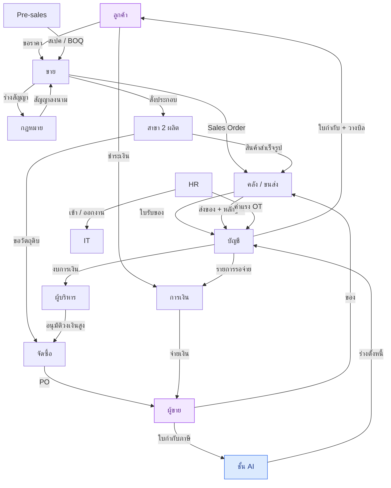

---

## 1. ขาย

**ตำแหน่ง:** Account Manager · Sales Manager · Sales Director (อนุมัติส่วนลดสูง)

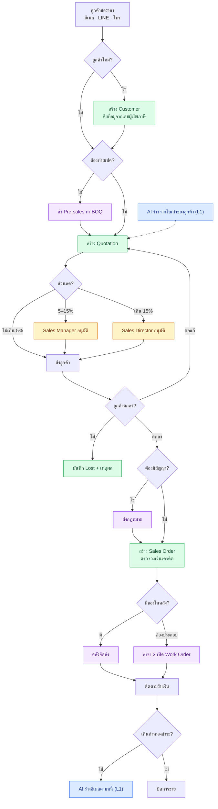

| ขั้น | ทำที่ | เอกสาร | ส่งต่อ | AI |
|---|---|---|---|---|
| รับคำขอ | อีเมล / LINE → Router ส่งเข้าขาย | — | — | จัดหมวดคำขอ (L1) |
| ลูกค้าใหม่ | ERPNext Desk | Customer | — | — |
| ใบเสนอราคา | Desk | Quotation | Pre-sales (ถ้าต้องสเปค) | ร่างจากใบเก่า (L1) |
| อนุมัติส่วนลด | Desk (Workflow) | Quotation | Sales Manager / Director | — |
| ปิดการขาย | Desk | Sales Order | กฎหมาย · คลัง · สาขา 2 | — |
| ติดตามเงิน | AI Workspace | AR Aging | การเงิน | ร่างอีเมลตามหนี้ (L1) |

---

## 2. Pre-sales

**ตำแหน่ง:** Solution Engineer

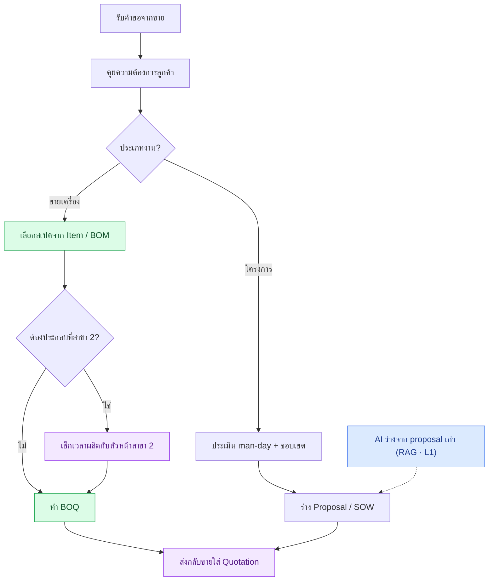

---

## 3. กฎหมาย

**ตำแหน่ง:** Legal Counsel · ผู้มีอำนาจลงนาม (กรรมการ)

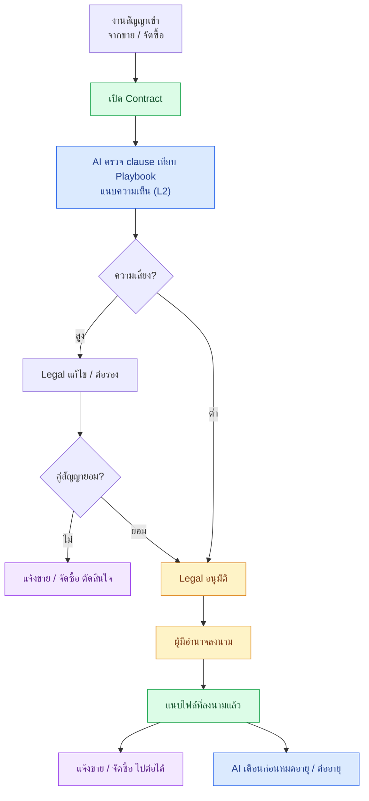

งานอื่นของกฎหมาย: NDA · หนังสือมอบอำนาจ · ตรวจ template ที่ฝ่ายอื่นใช้ (สัญญาจ้าง, ใบเสนอราคา) · อนุมัติทำลายเอกสารที่ครบอายุเก็บ

---

## 4. จัดซื้อ

**ตำแหน่ง:** Buyer · Procurement Manager · ผู้อนุมัติตามวงเงิน

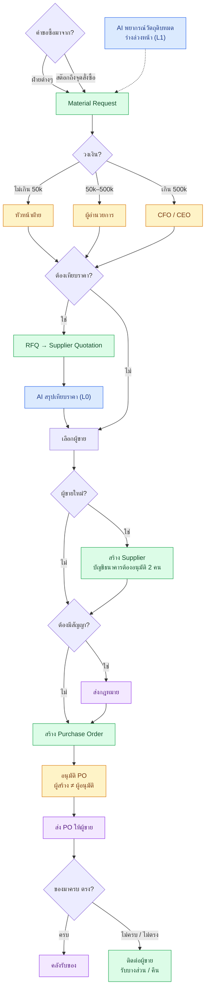

---

## 5. คลังและขนส่ง

**ตำแหน่ง:** Warehouse Officer · Logistics / Messenger · คนขับ

### 5.1 รับของเข้า

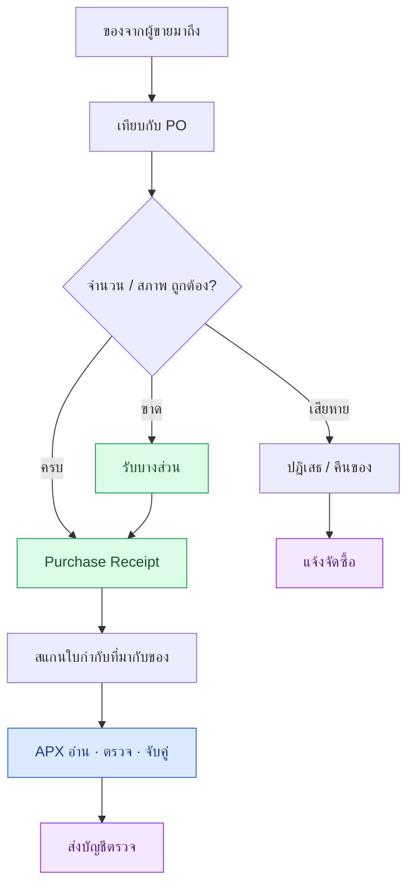

### 5.2 ส่งของออก

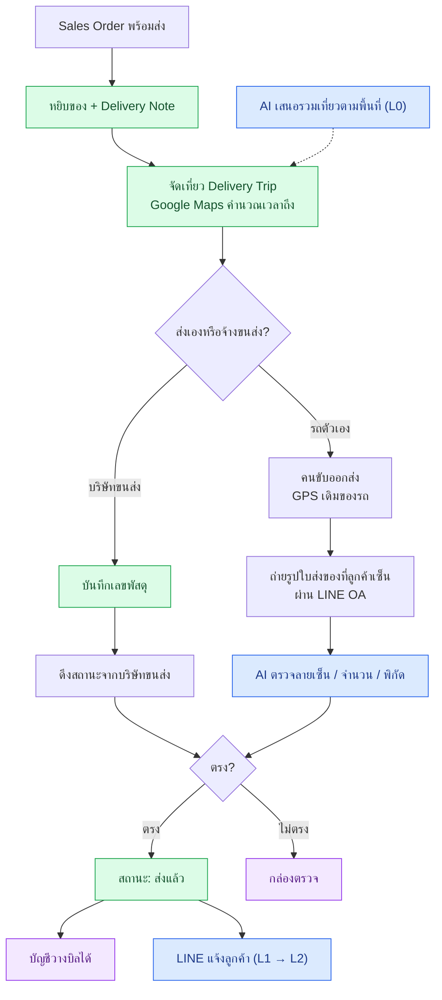

### 5.3 งานภายในคลัง

| งาน | เอกสาร | ใครอนุมัติ |
|---|---|---|
| จ่ายของตามใบเบิก | Material Request → Stock Entry (Material Issue) | หัวหน้าฝ่ายผู้ขอ |
| โอนของระหว่างสาขา | Stock Entry (Material Transfer) | สโตร์ทั้งสองฝั่ง |
| ตรวจนับสต๊อกรายเดือน | Stock Reconciliation | หัวหน้าคลัง |
| วางบิล / รับเช็คตามรอบ (Messenger) | เอกสารวางบิล · Payment Entry | — |

---

## 6. สาขา 2 ศูนย์ประกอบ

**ตำแหน่ง:** หัวหน้าสาขา 2 · หัวหน้าไลน์ · ช่างประกอบ (รายวัน) · QC · สโตร์สาขา 2

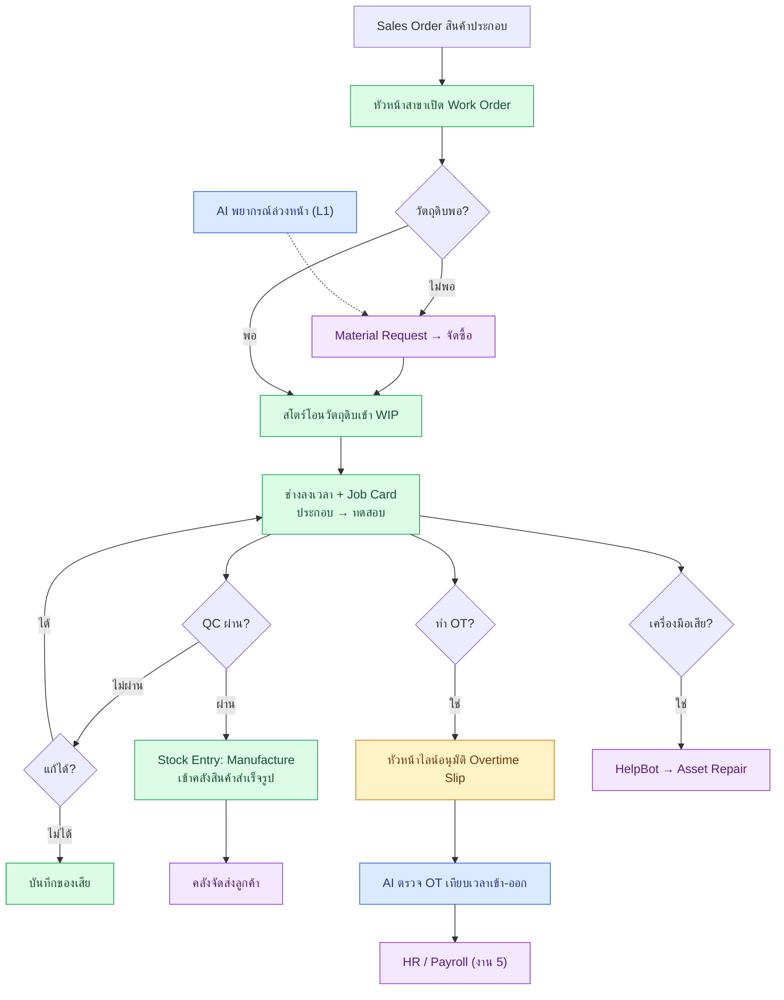

| ตำแหน่ง | ทำอะไรทุกวัน |
|---|---|
| หัวหน้าสาขา 2 | เปิด/ปิด Work Order · ดูต้นทุนต่อเครื่อง · ดูวัตถุดิบวิกฤต |
| หัวหน้าไลน์ | แจกงาน · อนุมัติ OT · ตรวจ Job Card |
| ช่างประกอบ | ลงเวลาเข้า-ออก · บันทึกงานใน Job Card |
| QC | Quality Inspection ผ่าน/ไม่ผ่าน · บันทึกของเสีย |
| สโตร์สาขา 2 | รับวัตถุดิบ · จ่ายเข้าผลิต · ตรวจนับ |

---

## 7. บัญชี

**ตำแหน่ง:** AP Accountant · AR Accountant · GL / Tax Accountant · Chief Accountant

### 7.1 เจ้าหนี้ (AP) — ใบกำกับผู้ขาย

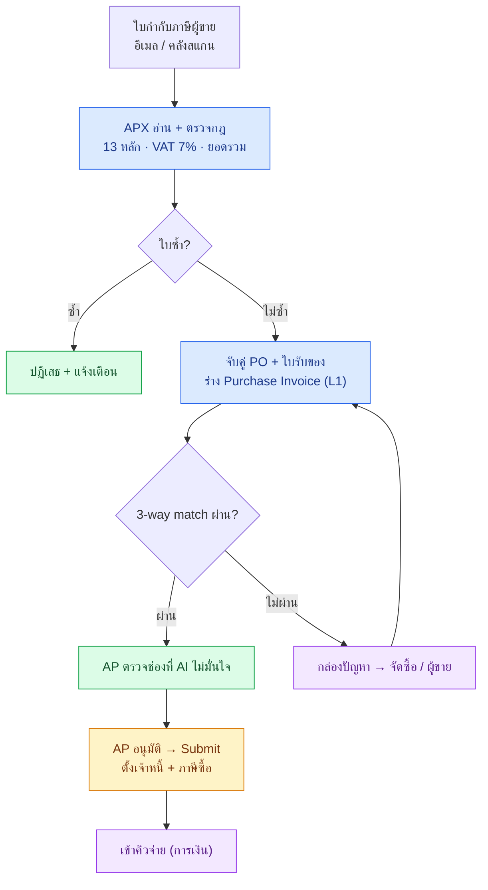

### 7.2 ลูกหนี้ (AR) — ออกใบกำกับถึงรับเงิน

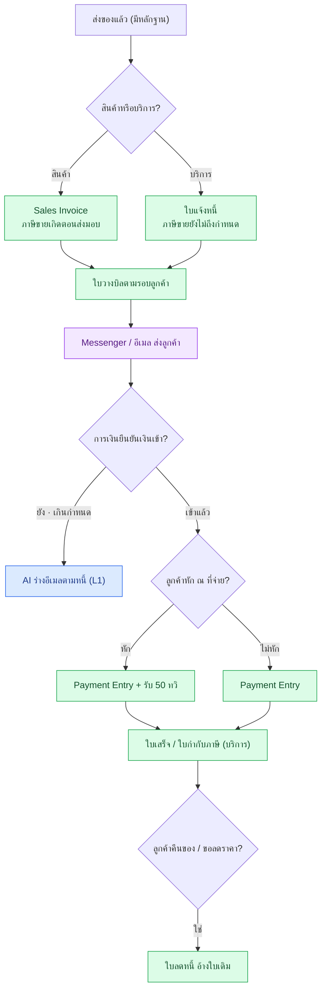

### 7.3 ปิดงวดรายเดือน / รายปี

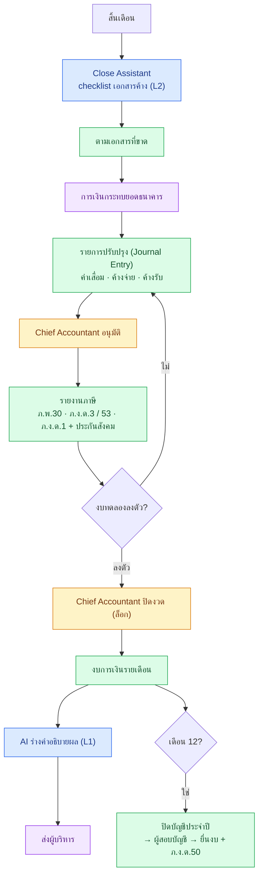

---

## 8. การเงิน

**ตำแหน่ง:** Finance Officer · Finance Manager · Credit Controller · CFO (วงเงินสูง)

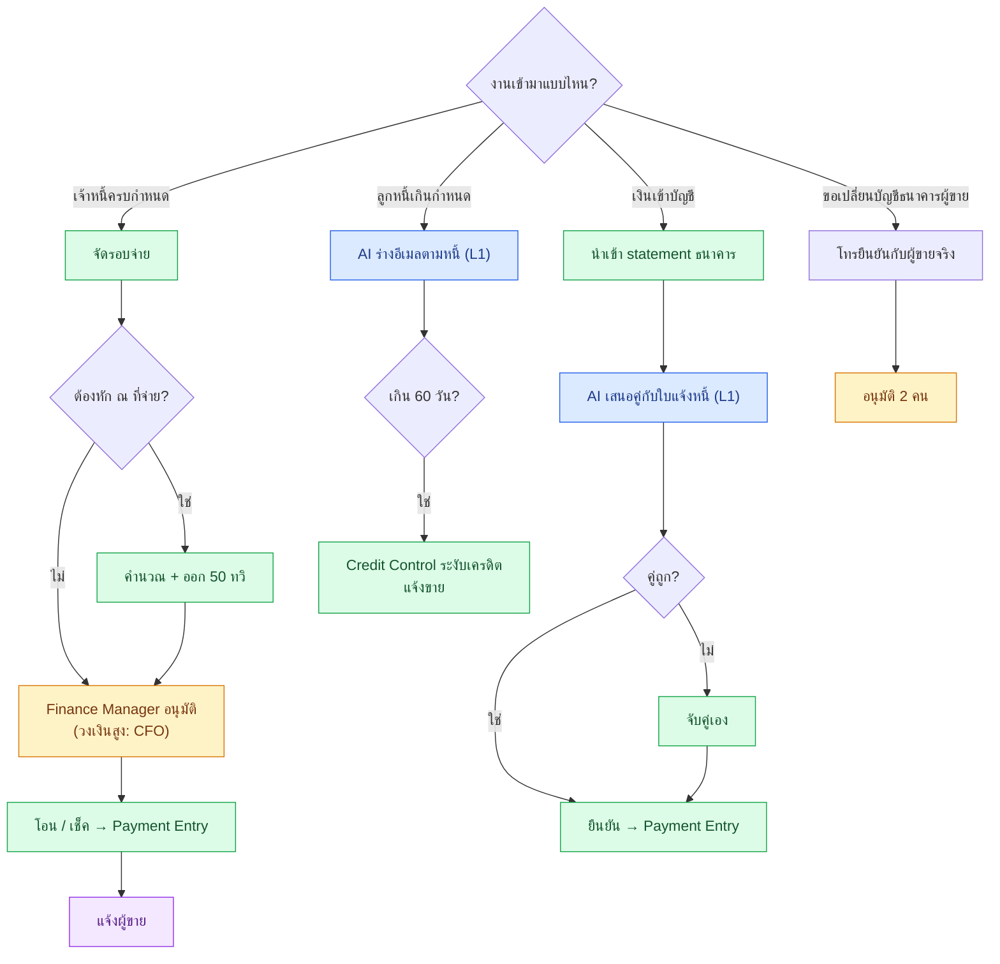

> AI **ไม่มีเครื่องมือจ่ายเงิน** — ทุกการจ่ายผ่านคน 2 คนเสมอ

---

## 9. HR

**ตำแหน่ง:** HR / Recruiter · HR Admin / Payroll · หัวหน้าแต่ละฝ่าย (อนุมัติลา/OT)

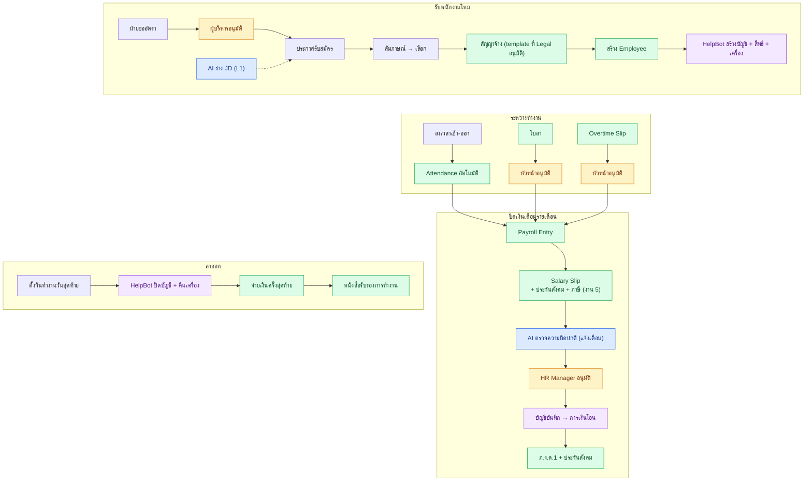

> ข้อมูลเงินเดือนเป็น **confidential** — เห็นได้เฉพาะ HR / Payroll · AI รันในเครื่องเท่านั้น

---

## 10. IT

**ตำแหน่ง:** IT Manager · IT Support · System Admin · IT Security · IT Asset Admin

### 10.1 Helpdesk

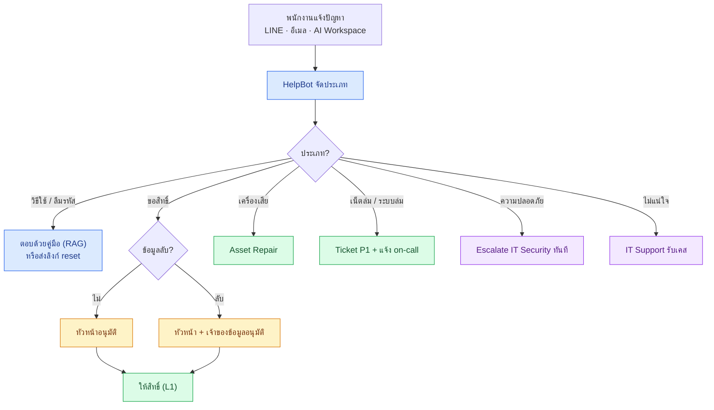

### 10.2 งานประจำของ IT

| งาน | รอบ | ใคร | ทำที่ |
|---|---|---|---|
| สร้าง/ปิดบัญชีตาม HR | ทุกครั้งที่มีคนเข้า/ออก | HelpBot + IT Admin | อัตโนมัติจาก event |
| มอบ/รับคืนเครื่อง | ทุกครั้ง | IT Asset Admin | Asset Movement |
| ดู security alert + audit | รายวัน | IT Security | AI Workspace |
| ทบทวนสิทธิ์ทุกฝ่าย | รายไตรมาส | IT Manager + หัวหน้าฝ่าย | รายการสิทธิ์ → หัวหน้ายืนยัน → ถอดที่ไม่ใช้ |
| ทดลอง restore backup | รายเดือน | System Admin | ทั้ง MariaDB และ PostgreSQL |
| เปลี่ยนโมเดล AI / เลื่อนระดับอิสระ | เมื่อมีโมเดลใหม่ | IT Manager อนุมัติ | Eval Dashboard |

---

## 11. ผู้บริหาร

**ตำแหน่ง:** CEO · CFO · CTO · COO

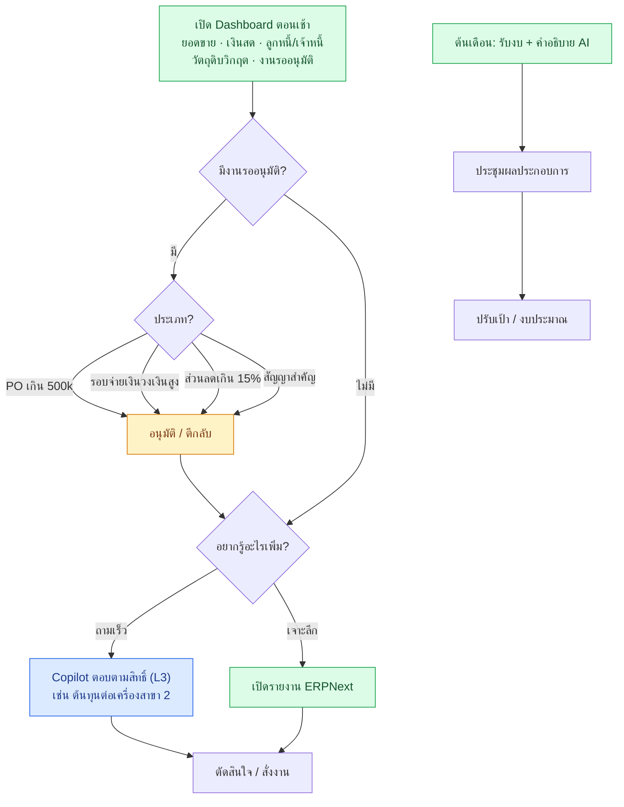

---

## 12. ธุรการ / สารบรรณ

**ตำแหน่ง:** Admin / สารบรรณ

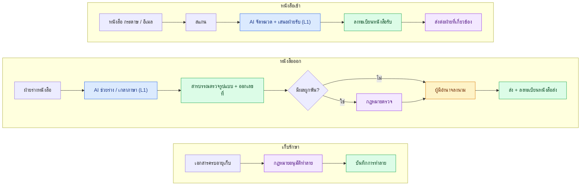

---

## 13. PMO และ Customer Support

**ตำแหน่ง:** Project Manager · BA · Engineer · Helpdesk ลูกค้า (Phase MVP+ / Pro)

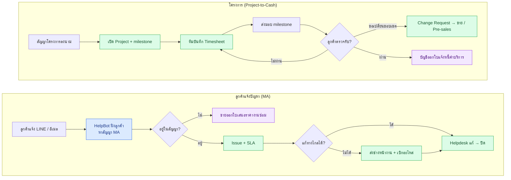

---

## 14. รอบงานประจำวัน / สัปดาห์ / เดือน / ปี

| ฝ่าย | รายวัน | รายสัปดาห์ | รายเดือน | รายปี |
|---|---|---|---|---|
| ขาย | ใบเสนอราคา · ติดตามลูกค้า | ทบทวน pipeline | ยอดขายเทียบเป้า | ตั้งเป้าปีหน้า |
| จัดซื้อ | ใบขอซื้อ · PO · ตามของ | ดูวัตถุดิบใกล้หมด | ประเมินผู้ขาย | ต่อสัญญาผู้ขาย |
| คลัง / ขนส่ง | รับของ · ส่งของ · หลักฐานส่งมอบ | วางแผนเที่ยวรถ | ตรวจนับสต๊อก | ตรวจนับใหญ่สิ้นปี |
| สาขา 2 | Work Order · Job Card · QC · ลงเวลา | ทบทวนแผนผลิต | ต้นทุนต่อเครื่อง | — |
| บัญชี | ตรวจใบกำกับ (APX) · ออกใบกำกับ | วางบิลตามรอบ | ภาษี · ปิดงวด · งบรายเดือน | ปิดบัญชีปี · ผู้สอบบัญชี · ภ.ง.ด.50 |
| การเงิน | จับคู่เงินเข้า | รอบจ่าย · กระแสเงินสด | กระทบยอดธนาคาร | — |
| HR | ลา · OT · ลงเวลา | — | เงินเดือน · ภ.ง.ด.1 · ประกันสังคม | 50 ทวิ พนักงาน · ภ.ง.ด.1ก · ประเมินผล |
| IT | helpdesk · security alert | — | ทดลอง restore | — · **รายไตรมาส: ทบทวนสิทธิ์** |
| ผู้บริหาร | Dashboard · อนุมัติ | — | ประชุมผลประกอบการ | อนุมัติงบการเงิน · งบประมาณ |
| ธุรการ | หนังสือเข้า-ออก | — | — | ทำลายเอกสารครบอายุ |

← [หน้าแรกงาน 4](README.md)
