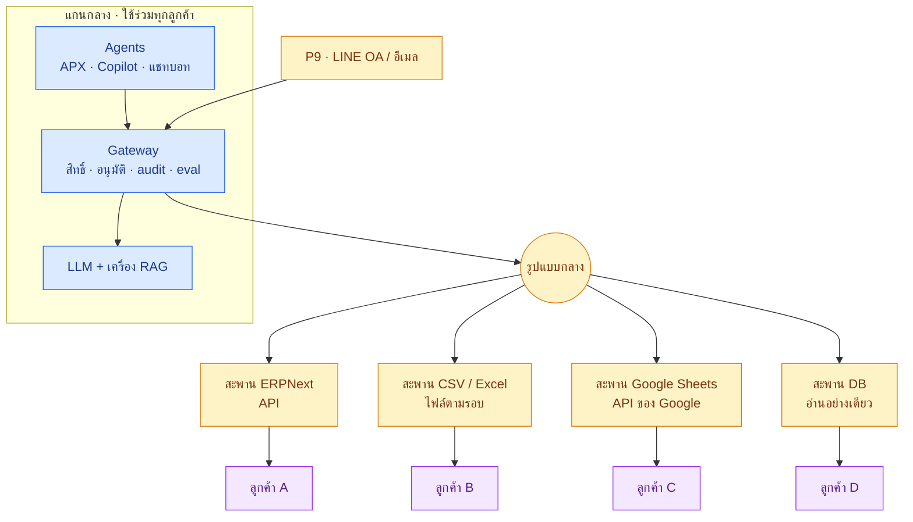
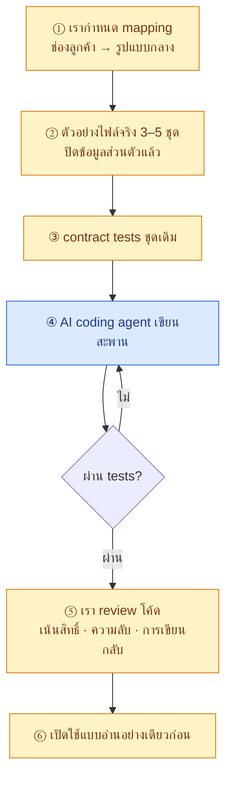
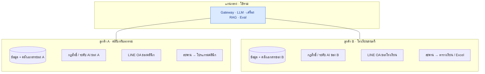

# 🌉 งานที่ 4h — สะพานเชื่อมระบบลูกค้า (Connector) และลูกค้าหลายประเภท

> ทำให้ชั้น AI ต่อกับบริษัทที่**ไม่ได้ใช้ ERPNext** ได้ · อะไรใช้ร่วมกันทุกลูกค้า อะไรต้องทำแยกต่อราย · ลูกค้าต่างธุรกิจ (คลินิกทันตกรรม / โรงเรียนดนตรี) อยู่ระบบเดียวกันยังไง
> ← [หน้าแรกงาน 4](README.md) · [04f จุดเสียบ P1–P9](04f-module-map.md) · [04e ธุรกิจรายเดือน](04e-saas-business-model.md) · [เส้นทางอาชีพ](../career-roadmap.md)

## คำตอบสั้น

| คำถาม | คำตอบ |
|---|---|
| ส่วนไหนต่อกับระบบของบริษัทอื่น | **สะพาน (Connector)** ที่จุด **P1** สำหรับข้อมูลธุรกิจ และ **P9** สำหรับข้อมูลที่ไหลเข้า (LINE, อีเมล) — **ไม่ใช่ LLM หรือ RAG** |
| อะไรเหมือนกันทุกลูกค้า | Gateway (สิทธิ์ · อนุมัติ · audit) · LLM · เครื่อง RAG · Eval · Agent |
| อะไรต้องทำต่อลูกค้า | สะพานตามระบบที่เขาใช้ · ตั้งค่าสิทธิ์/ระดับ AI · เอกสารที่ใส่เข้า RAG |
| ต้องผ่านฐานข้อมูล / JSON / CSV เท่านั้นไหม | ไม่ — นั่นคือ "รูปแบบไฟล์" ส่วน "ช่องทาง" มีได้หลายแบบ ([ข้อ 2](#2-ช่องทางต่อระบบ)) |
| ทำให้พอร์ตเห็นยังไง | MVP มี **2 สะพาน** (ERPNext + CSV) ผ่านชุดทดสอบเดียวกัน → พิสูจน์ว่าเปลี่ยนระบบข้างล่างได้โดยไม่แก้ AI ([ADR-013](README.md#การตัดสินใจหลัก-adr)) |

---

## สารบัญ
1. [อะไรใช้ร่วม อะไรทำต่อลูกค้า](#1-อะไรใช้ร่วม-อะไรทำต่อลูกค้า)
2. [ช่องทางต่อระบบ](#2-ช่องทางต่อระบบ)
3. [รูปแบบกลาง](#3-รูปแบบกลาง)
4. [สัญญาของสะพาน](#4-สัญญาของสะพาน)
5. [ชุดทดสอบเดียว ใช้กับทุกสะพาน](#5-ชุดทดสอบเดียว-ใช้กับทุกสะพาน)
6. [ใครเขียนสะพาน: คนกำหนด AI เขียน](#6-ใครเขียนสะพาน-คนกำหนด-ai-เขียน)
7. [ลูกค้าต่างธุรกิจในระบบเดียว](#7-ลูกค้าต่างธุรกิจในระบบเดียว)
8. [งานที่เพิ่มในระบบ](#8-งานที่เพิ่มในระบบ)

---

## 1. อะไรใช้ร่วม อะไรทำต่อลูกค้า



| ส่วน | ใช้ร่วม | ทำต่อลูกค้า |
|---|:-:|:-:|
| Gateway · Policy · อนุมัติ · audit | ✅ | ตั้งค่าเท่านั้น |
| LLM · OCR | ✅ | — |
| เครื่อง RAG | ✅ | **คลังเอกสารแยกต่อลูกค้า** |
| Agent | ✅ | prompt/กฎเฉพาะธุรกิจ (ถ้ามี) |
| Eval | ✅ เครื่องมือ | **ชุดทดสอบของลูกค้าแต่ละราย** |
| สะพาน | ใช้ซ้ำได้ถ้าระบบยี่ห้อเดียวกัน | ✅ |
| LINE OA | ✅ adapter | **บัญชี OA ของลูกค้า** |

---

## 2. ช่องทางต่อระบบ

"ช่องทาง" = ดึงข้อมูลจากไหน · "รูปแบบ" = ข้อมูลหน้าตาแบบไหน — เป็นคนละเรื่องกัน

| # | ช่องทาง | รูปแบบที่ได้ | สดแค่ไหน | เขียนกลับ | ใช้เมื่อ |
|---|---|---|---|---|---|
| 1 | **API** | JSON | ทันที | ✅ (สร้างได้แค่ร่าง) | ระบบคลาวด์ส่วนใหญ่ · ERPNext · Odoo |
| 2 | **Webhook** | JSON | ทันที | — | ระบบที่ส่งเหตุการณ์ออกได้ → เข้า P2 |
| 3 | **ฐานข้อมูลตรง** | ตาราง SQL | เกือบทันที | ❌ ห้าม | โปรแกรมติดตั้งในเครื่อง ไม่มี API · ใช้ user อ่านอย่างเดียว |
| 4 | **Google Sheets** | API ของ Google | เกือบทันที | ✅ | ธุรกิจเล็กที่จดทุกอย่างในชีต |
| 5 | **ไฟล์ส่งออก** | CSV / Excel | ตามรอบ | ❌ → ส่งไฟล์นำเข้าให้คนกด | ระบบที่ส่งออกได้แค่ไฟล์ |
| 6 | **LINE / อีเมล** (P9) | ข้อความ · รูป · PDF | ทันที | — | ไม่มีระบบ · หรือรับเอกสารจากคนภายนอก |
| 7 | ~~บอทกดหน้าจอแทนคน~~ | — | — | — | **ไม่ทำ** พังทุกครั้งที่หน้าจอเปลี่ยน |

**กฎเขียนกลับ:** ไม่เขียนลงฐานข้อมูลลูกค้าตรงๆ · AI สร้างได้แค่**ร่าง** · ถ้าระบบเขารับร่างไม่ได้ → สร้าง**ไฟล์นำเข้า**ให้คนตรวจแล้วกดเอง

---

## 3. รูปแบบกลาง

Agent และ Gateway เห็นแต่รูปแบบนี้ — ไม่รู้ว่าข้อมูลมาจาก Excel หรือ API

| กติกา | ทำไม |
|---|---|
| เริ่มเฉพาะ entity ที่ agent ใน MVP ใช้: `party` (ลูกค้า/ผู้ขาย) · `item` · `purchase_order` · `purchase_receipt` · `purchase_invoice` · `sales_invoice` · `payment` · `file` | ไม่ออกแบบล่วงหน้าเกินที่ใช้ |
| ทุกแถวมี `tenant_id` · `source` · `external_id` | แยกลูกค้า · ย้อนกลับไปหาต้นทางได้ |
| เงินเป็น `Decimal` + `currency` · วันที่ ISO | ไม่มีเศษทศนิยมเพี้ยน |
| ฟิลด์ภาษีไทย: `tax_id` 13 หลัก · `branch_code` | ใช้ตรวจใบกำกับภาษี |
| สะพาน ERPNext แปลงแทบ 1:1 จาก DocType | MVP ไม่เพิ่มงาน |

```python
# ข้อมูลเดียวกันจาก 2 สะพาน → รูปแบบกลางเดียวกัน (โค้ดนี้รันผ่าน assert แล้ว)
from decimal import Decimal

def to_canonical(row: dict, mapping: dict, source: str) -> dict:
    out = {mapping[k]: str(v).strip() for k, v in row.items() if k in mapping}
    out["grand_total"] = Decimal(out["grand_total"].replace(",", ""))
    out["source"] = source
    return out

def check_contract(docs: list[dict]) -> None:
    for d in docs:
        assert len(d["tax_id"]) == 13 and d["tax_id"].isdigit(), d
        assert isinstance(d["grand_total"], Decimal), d
        assert d["source"], d

csv_row = {"เลขผู้เสียภาษี": "0105551234567", "ชื่อผู้ขาย": "บจก. ตัวอย่าง", "ยอดรวม": "10,700.00"}
api_row = {"tax_id": "0105551234567", "supplier_name": "บจก. ตัวอย่าง", "grand_total": "10700.00"}
a = to_canonical(csv_row, {"เลขผู้เสียภาษี": "tax_id", "ชื่อผู้ขาย": "name", "ยอดรวม": "grand_total"}, "csv")
b = to_canonical(api_row, {"tax_id": "tax_id", "supplier_name": "name", "grand_total": "grand_total"}, "erpnext")
check_contract([a, b])
assert {k: v for k, v in a.items() if k != "source"} == {k: v for k, v in b.items() if k != "source"}
```

---

## 4. สัญญาของสะพาน

ใช้ชื่อฟังก์ชันเดิมของ P1 ([04f ข้อ 2](04f-module-map.md#2-จุดเสียบ-9-จุด-p1p9)) เพิ่มแค่ `capabilities` บอกว่าสะพานนี้ทำอะไรได้ — Gateway เช็กก่อนเรียกเสมอ

```python
# gateway/erp/base.py — แยกออกมาตอนทำสะพานที่ 2 (Stage 5.6) ไม่ทำล่วงหน้า
class Connector(Protocol):
    capabilities: frozenset[str]     # {"read", "draft", "submit", "events", "export"}
    def list_docs(self, entity: str, since: str | None = None) -> list[dict]: ...
    def get_doc(self, entity: str, external_id: str) -> dict: ...
    def create_draft(self, entity: str, data: dict) -> str: ...   # เฉพาะสะพานที่มี "draft"
```

| สะพาน | read | draft | submit | events | export | สถานะ |
|---|:-:|:-:|:-:|:-:|:-:|---|
| ERPNext | ✅ | ✅ | ✅ ด้วย token คนเท่านั้น | ✅ webhook | — | MVP |
| CSV / Excel | ✅ | — | — | — | ✅ ไฟล์นำเข้า | **MVP (สะพานที่ 2)** |
| Google Sheets | ✅ | ✅ (แถวสถานะ "ร่าง") | — | — | — | เมื่อมีลูกค้าใช้ |
| DB อ่านอย่างเดียว | ✅ | — | — | — | ✅ | เมื่อมีลูกค้าใช้ |
| Odoo | ✅ | ✅ | ✅ ด้วย token คน | ✅ | — | เมื่อมีลูกค้าใช้ |

---

## 5. ชุดทดสอบเดียว ใช้กับทุกสะพาน

สะพานใหม่ "เสร็จ" เมื่อผ่าน **contract tests ชุดเดียวกับสะพานเดิม** — นี่คือสิ่งที่ทำให้เพิ่มลูกค้าได้โดยไม่กลัวพัง

| Test | ตรวจอะไร |
|---|---|
| รูปแบบ | ทุกแถวผ่าน `check_contract()` · เงินเป็น Decimal · `tax_id` 13 หลัก |
| เทียบคำตอบ | ข้อมูลชุดเดียวกันผ่านสะพาน A และ B ได้ผลเท่ากัน |
| นำเข้าซ้ำ | รันซ้ำ 2 ครั้ง ข้อมูลไม่ซ้ำ (`external_id` UNIQUE ต่อ `tenant_id`) |
| ความสามารถ | สะพานที่ไม่มี `draft` → เรียก `create_draft` แล้วถูกปฏิเสธ |
| ความลับ | log ไม่มี key / รหัสผ่านของลูกค้า |
| ข้ามลูกค้า | ค้นด้วย `tenant_id` A ไม่เห็นข้อมูล B = 0 แถว |
| ข้อมูลเสีย | ไฟล์ขาดคอลัมน์ / ตัวเลขผิดรูป → แจ้งเตือน ไม่เงียบ |

---

## 6. ใครเขียนสะพาน: คนกำหนด AI เขียน

ภายในปี 2026–27 AI coding agent น่าจะเขียนสะพานตัวหนึ่งได้เองในไม่กี่ชั่วโมง ([เส้นทางอาชีพ ข้อ 2](../career-roadmap.md#2-ai-จะทำงานแทนคนได้ยาวแค่ไหน)) งานที่ยังเป็นของเราคือ**กำหนด ตรวจ และรับผิดชอบ**



> ในพอร์ต ให้เก็บหลักฐานไว้ใน README ของ repo: สะพานไหน AI เขียน · tests กี่ข้อ · review เจออะไร — นี่คือทักษะที่ตลาดปี 2028 ต้องการ

---

## 7. ลูกค้าต่างธุรกิจในระบบเดียว

### 7.1 ตัวอย่าง: คลินิกทันตกรรม + โรงเรียนดนตรี

> **บทบาทในแผนธุรกิจ (อัปเดต 16 ต.ค. 2569):** โรงเรียน / สถาบันสอน = **เป้าหมายของชุดนัดหมาย** (ระลอก 3 · เป้าหมายรวมของ SME ครบวงจรอยู่ใน [04i](04i-sme-segments.md)) · คลินิก = ช่องรอง ขายเฉพาะงานสะพานและ AI ในเครื่อง เพราะ AI ตอบแชทคลินิกมี Jib OS ทำอยู่แล้ว ([04e ข้อ 10.2–10.3](04e-saas-business-model.md#102-คู่แข่งในกลุ่มธุรกิจที่มีการนัด))



| | 🦷 คลินิกทันตกรรม | 🎹 โรงเรียนดนตรี |
|---|---|---|
| ปัญหาหลัก | แชทถามราคา/โปรเยอะ · คนไข้จัดฟันขาดนัด | ผู้ปกครองถามตารางใน LINE · ขอเรียนชดเชย · ลืมต่อคอร์ส |
| บทบาทในแผน | 🟡 ช่องรอง | ✅ เป้าหมายของชุดนัดหมาย (ระลอก 3) |
| ที่เราขาย | สะพานเชื่อมโปรแกรมคลินิกกับระบบแชท/จองที่ใช้อยู่ · AI ในเครื่องสำหรับข้อมูลสุขภาพ | ตอบตาราง · จองเรียนชดเชย · เตือนชั่วโมงใกล้หมด · ตามค่าเรียน |
| คู่แข่งหลัก | Jib OS (6,000/เดือน ไม่จำกัดสาขา) + เครื่องมือแชท 10+ เจ้า | 🟡 ยังไม่ได้สำรวจโปรแกรมจัดการโรงเรียน |
| ข้อมูลเพิ่ม | คนไข้ · นัด · แผนการรักษา | นักเรียน · คอร์ส · ตารางเรียน · ครู · ห้อง · ชั่วโมงคงเหลือ |
| เอกสาร RAG | ราคา · โปร · ขั้นตอนหลังทำฟัน | ระเบียบ · คอร์ส · ค่าเรียน |
| PDPA | 🔴 ข้อมูลสุขภาพ = ข้อมูลอ่อนไหว → AI ในเครื่องเท่านั้น + ขอความยินยอมชัดเจน | 🟠 ข้อมูลเด็ก → ความยินยอมผู้ปกครอง |
| ระดับ AI เริ่ม | L1 · เรื่องการรักษาต้องคนตอบเสมอ | L1 → L2 ได้เร็วกว่า |

> 🟡 เรื่อง PDPA ข้อมูลสุขภาพและข้อมูลเด็ก ให้ผู้รู้กฎหมายตรวจก่อนรับลูกค้าจริง · สาขาแฟรนไชส์อาจต้องขออนุญาตบริษัทแม่ก่อนเชื่อมระบบ

### 7.2 ชุดนัดหมาย (Booking Pack) — ใช้ซ้ำกับธุรกิจบริการที่มีการนัด

ทั้ง 2 ธุรกิจทำงานแบบเดียวกัน: **ทัก LINE → ถาม → จองเวลา → มาตามนัด → ตามให้กลับมา** · เริ่มที่**สถาบันสอน** แล้วใช้ต่อกับกวดวิชา ภาษา กีฬา ศิลปะ · ไม่ขายให้คลินิก / ความงาม / สปา (ทับ Jib OS) · ฟิตเนสต้องเช็กก่อน

| ส่วน | ของชุดนัดหมาย |
|---|---|
| รูปแบบกลางเพิ่ม | `contact` · `service` (คอร์ส / การรักษา) · `appointment` (คาบเรียน / นัด) · `package_balance` (ชั่วโมง / ครั้งคงเหลือ) |
| เครื่องมือ (P3) | `booking.find_slots` · `booking.create_draft` · `reminder.schedule` · `followup.list_lapsed` |
| ระดับ AI (P4) | จองคิว L1 → L2 เมื่อ eval ผ่าน · ยกเลิกนัด L1 ถาวร · เรื่องเงิน/การรักษา L1 ถาวร |
| ใช้ร่วมโดยประมาณ | ~70% · ที่เหลือคือคำศัพท์และกฎเฉพาะธุรกิจ (ประเมินเอง) |

> **สถานะ: ออกแบบไว้เท่านั้น** — สร้างเมื่อมีสถาบันสอนนำร่องยอมจ่ายอย่างน้อย 1 ราย ตามเกณฑ์ใน [04e ข้อ 10.3](04e-saas-business-model.md#103-กลุ่มเป้าหมาย) · ราคาอยู่ใน [04e ข้อ 10.4](04e-saas-business-model.md#104-ราคา-สมมติฐาน--ไม่รวม-vat)

### 7.3 กฎแยกลูกค้า

| ชั้น | แยกยังไง |
|---|---|
| ฐานข้อมูลชั้น AI | `tenant_id` ทุกตาราง + Row-Level Security |
| คลังเอกสาร RAG | collection แยกต่อลูกค้า · ค้นข้ามลูกค้า = 0 (มี test) |
| key / รหัสสะพาน | เข้ารหัส แยกต่อลูกค้า |
| log / audit | แยกต่อลูกค้า · ลูกค้าขอดูของตัวเองได้ |
| LLM | ใช้เครื่องร่วมได้ (ไม่จำข้ามคำถาม) · **ห้าม fine-tune ด้วยข้อมูลลูกค้าคนอื่น** |

---

## 8. งานที่เพิ่มในระบบ

รายละเอียดอยู่ใน [04c](04c-build-guide.md)

| งาน | อยู่ที่ | วัน | เมื่อไร |
|---|---|---|---|
| **สะพานที่ 2: CSV / Excel** + แยก `Connector` + contract tests | Stage 5.6 | 3 | **MVP** |
| OCR สลับได้ 2 แบบ (OCR + LLM / โมเดลอ่านภาพตรง) + eval เทียบ | Stage 5.1 | +1 | MVP |
| ฉากเดโม: สลับ ERPNext ↔ CSV สด | Stage 7 | +0.5 | MVP |
| สะพาน Google Sheets / DB อ่านอย่างเดียว / Odoo | Stage 8 | 2–5 ต่อตัว | เมื่อมีลูกค้าใช้ |
| test แยกลูกค้า (ข้ามลูกค้า = 0) | Stage 8 | 1 | ก่อนรับลูกค้ารายที่ 2 |
| ชุดนัดหมาย | Stage 8 | 8–12 | เมื่อมีสถาบันสอนนำร่อง |
| สำรวจโปรแกรมจัดการโรงเรียน + สัมภาษณ์สถาบันสอน 5 ราย | งานธุรกิจ ([04b](04b-depa-product-track.md)) | 3–5 | ก่อนสร้างชุดนัดหมาย |

← [หน้าแรกงาน 4](README.md)
