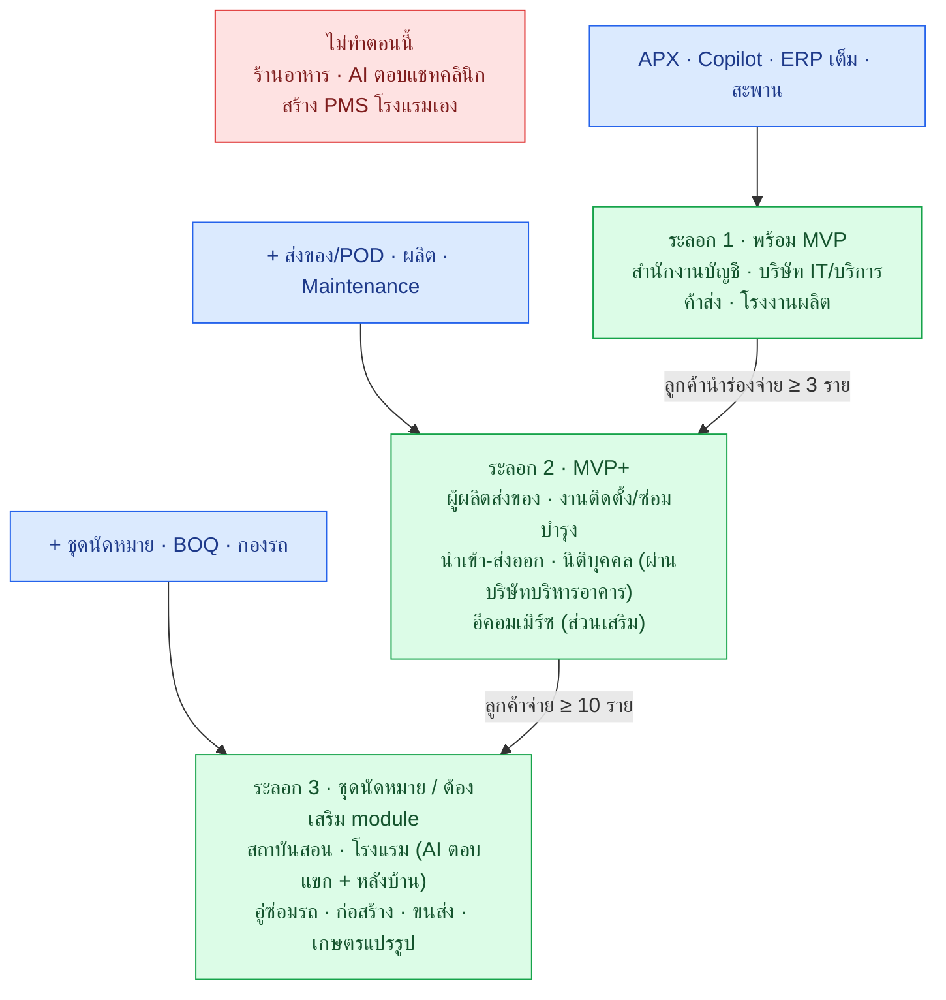

# 🗺️ งานที่ 4i — แผนที่กลุ่ม SME ทั้งหมด: ขายใคร ด้วยชุดไหน

> เป้าหมายคือ **SME ครบวงจร** — ระบบเดียว หลายชุดสินค้า · ไฟล์นี้เทียบ **17 กลุ่มธุรกิจ** และให้น้ำหนักกับกลุ่มที่**ตรงกับงาน AI เงินเดือนแสนขึ้นไป** (เป้าหมาย: ได้งาน + ทำธุรกิจ)
> ← [หน้าแรกงาน 4](README.md) · [04e ธุรกิจรายเดือน](04e-saas-business-model.md) · [04h สะพาน](04h-connectors.md) · [เส้นทางอาชีพ](../career-roadmap.md)
>
> ⚠️ **แก้ของเดิม:** 04e ข้อ 10.3 ฉบับก่อนตั้งสถาบันสอนเป็น "เป้าหมายหลัก" — ผิด เพราะดูแค่ธุรกิจที่มีการนัด · สถาบันสอนเป็นแค่เป้าหมายของ**ชุดนัดหมาย** (ระลอก 3) · เป้าหมายรวมให้ใช้ไฟล์นี้

## คำตอบสั้น

| คำถาม | คำตอบ |
|---|---|
| ขายใครก่อน (เน้นตรงงาน AI แสน+) | ① **สำนักงานบัญชี** 8.15 · ② **บริษัท IT / บริการ** 7.50 · ③ **ค้าส่ง / ตัวแทนจำหน่าย** 7.20 · ④ **โรงงานผลิต** 7.20 |
| ทำไมกลุ่มนี้ | ใช้ชุดที่พิสูจน์ทักษะที่งานแสน+ ต้องการ: อ่านเอกสารด้วย AI (ธนาคาร/ประกัน) · เชื่อมระบบ + คุมสิทธิ์ (AI Architect / Forward Deployed) · Copilot บนข้อมูลธุรกิจ (ค้าปลีก / การผลิต) |
| ไม่ทำตอนนี้ | ร้านอาหาร · AI ตอบแชทคลินิก · สร้างระบบโรงแรม (PMS) เอง — มีเจ้าตลาดเฉพาะทาง |
| นิติบุคคล · โรงแรม | **ทำ** — นิติบุคคลอยู่ระลอก 2 (ขายผ่านบริษัทบริหารอาคาร) · โรงแรมอยู่ระลอก 3 (AI ตอบแขก + หลังบ้าน ต่อ PMS เดิม) — ปรับคะแนนแล้วในข้อ 4 |
| ข้อจริงที่ต้องรู้ | งาน AI แสน+ เกือบทั้งหมดอยู่ใน**องค์กรใหญ่** ไม่ใช่ SME → ที่เชื่อมกันคือ "ปัญหาและทักษะแบบเดียวกัน" ไม่ใช่ลูกค้าคนเดียวกัน |

---

## สารบัญ
1. [SME ไทยโดยรวม](#1-sme-ไทยโดยรวม)
2. [ชุดสินค้าของระบบเรา](#2-ชุดสินค้าของระบบเรา)
3. [งาน AI แสน+ อยู่ในอุตสาหกรรมไหน](#3-งาน-ai-แสน-อยู่ในอุตสาหกรรมไหน)
4. [เทียบ 17 กลุ่ม](#4-เทียบ-17-กลุ่ม)
5. [วิธีให้คะแนน](#5-วิธีให้คะแนน)
6. [ลำดับเข้าตลาด 3 ระลอก](#6-ลำดับเข้าตลาด-3-ระลอก)
7. [ต้องตรวจเพิ่ม](#7-ต้องตรวจเพิ่ม)

---

## 1. SME ไทยโดยรวม

| ข้อมูล | ค่า | แหล่ง |
|---|---|---|
| จำนวน SME (2567) | ~3.26 ล้านราย · รายย่อย 84% | สสว. ผ่าน The Standard |
| เรียงตามจำนวนราย | การค้า > บริการ > การผลิต | เดียวกัน |
| สัดส่วน GDP ของ SME (Q2/2568) | บริการ 44.5% · **การผลิต 34.0%** · การค้า 21.1% · เกษตร 0.4% | LH Bank SME Outlook |

**อ่านตัวเลข:** การผลิตมีจำนวนรายน้อยที่สุดในสามภาค แต่สร้างมูลค่า 34% → มูลค่าต่อรายสูง = **จ่ายค่าระบบได้มากกว่า** · การค้ามีรายเยอะที่สุด = ตลาดกว้าง แต่คู่แข่งโปรแกรมบัญชีเยอะ

---

## 2. ชุดสินค้าของระบบเรา

ระบบเดียว — แต่ละกลุ่ม SME ใช้ชุดต่างกัน

| ชุด | คืออะไร | อยู่ที่ | สถานะ |
|---|---|---|---|
| **ERP ไทยเต็ม** | ERPNext + erpnext_thailand ตั้งให้ครบทุกฝ่าย | [04d](04d-erp-implementation.md) | MVP |
| **APX** | อ่านและตรวจใบกำกับภาษี → ร่างตั้งหนี้ | [04](04-enterprise-os.md) · [04b](04b-depa-product-track.md) | MVP |
| **Copilot** | ถามข้อมูลธุรกิจด้วยภาษาพูด ตามสิทธิ์ผู้ถาม | [04](04-enterprise-os.md) | MVP |
| ตรวจสัญญา | RAG เทียบ playbook | [งาน 1](../01-enterprise-rag.md) | MVP |
| **สะพาน** | ต่อระบบเดิมของลูกค้า (ERPNext · CSV · Sheets · DB) | [04h](04h-connectors.md) | MVP (2 ตัว) |
| ผลิต + สต๊อก + พยากรณ์ | BOM · ใบสั่งผลิต · แจ้งเตือนใกล้หมด | [04d](04d-erp-implementation.md) | MVP+ |
| ส่งของ + หลักฐานส่งมอบ | Delivery Trip + POD + เชื่อม GPS เดิม | [04d ข้อ 14](04d-erp-implementation.md#14-ส่งของและติดตามรถ-ทางเลือก) | MVP+ |
| HelpBot | งาน IT / เข้า-ออกพนักงาน | [งาน 2](../02-it-support-agent.md) | MVP+ |
| เงินเดือนไทย | OT · ประกันสังคม · ภ.ง.ด.1 | [งาน 5](../05-thai-payroll-erpnext/README.md) | ทางเลือก |
| ชุดนัดหมาย | จองคาบ / นัด · เตือน · ตามลูกค้า | [04h ข้อ 7.2](04h-connectors.md#72-ชุดนัดหมาย-booking-pack--ใช้ซ้ำกับธุรกิจบริการที่มีการนัด) | ออกแบบไว้ |

---

## 3. งาน AI แสน+ อยู่ในอุตสาหกรรมไหน

จาก JobsDB "AI Engineer" เงินเดือน ≥ 100,000 (57 ตำแหน่ง · ดูหน้าแรก 30) และประกาศ AI ทั่วไป 30 ตำแหน่ง ([career-roadmap ข้อ 1](../career-roadmap.md#1-ตลาดงานตอนนี้)) · ตรวจ 16 ต.ค. 2569

| อุตสาหกรรมผู้จ้าง | ตัวอย่าง | ทักษะที่ต้องการ | ชุดของเราที่พิสูจน์ทักษะ | กลุ่ม SME ที่ปัญหาเหมือนกัน |
|---|---|---|---|---|
| **ธนาคาร / ประกัน / การเงิน** | ttb (AI Solution Architect) · SCB · Generali · AIA · Allianz · ทิพยประกันภัย (OCR) · KBTG | อ่านเอกสารด้วย AI · RAG · agent · governance · Azure | APX · Gateway (สิทธิ์ · audit) · ตรวจสัญญา | สำนักงานบัญชี · นำเข้า-ส่งออก |
| **โทรคม / ไอที / ที่ปรึกษา** | True (AI Architect · Head of AI) · Tri Petch · SoftwareONE · Fusion Advantec · Cathcart · INRO (Presales 100–125k) | เชื่อมระบบองค์กร · Forward Deployed · presales | สะพาน 2 ตัว · Gateway · เดโม | บริษัท IT / บริการ |
| **ค้าปลีก / อีคอมเมิร์ซ / สินค้าอุปโภค** | aCommerce · Siam Paragon · Osotspa · Com7 · (Michael Page: retail/e-commerce) | แอป LLM · data platform · ถามข้อมูลด้วยภาษาพูด | Copilot · พยากรณ์สต๊อก | ค้าส่ง · อีคอมเมิร์ซ |
| **การผลิต / อุตสาหกรรม** | Nan Yang Knitting · SCG · B.Grimm · Gulf | AI transformation · POC → ใช้จริง | ERP + ผลิต + Copilot | โรงงาน · เกษตรแปรรูป |
| โลจิสติกส์ / mobility | Mobility Insight (Toyota / SCG / True JV · 90–120k) | data · SaaS | ส่งของ + หลักฐานส่งมอบ | ผู้ผลิตส่งของ · ขนส่ง |
| การศึกษา / สื่อ | อักษรเจริญทัศน์ (95–120k) | พัฒนาแอปแบบ AI-native | ชุดนัดหมาย (อนาคต) | สถาบันสอน |
| สุขภาพ | Teeth Talk (ตามตกลง · Junior ต่ำกว่าแสน) | LLM + เชื่อม POS / CRM | — | คลินิก |

> "ตรงงาน" = ปัญหาและทักษะเหมือนกัน · ตำแหน่งแสน+ ส่วนใหญ่ต้องมีประสบการณ์ 5 ปีขึ้นไป — พอร์ตช่วยให้**ได้เข้าไป** ส่วนแสน+ มาหลังมีประสบการณ์จริง

---

## 4. เทียบ 17 กลุ่ม

**J** ตรงงาน AI แสน+ · **R** ระบบเราพร้อม · **P** ความเจ็บ / มูลค่า · **C** คู่แข่งน้อย · **W** จ่ายได้ · **U** ใช้ซ้ำได้ (1–10 ประเมินเอง) · **A** = คะแนนธุรกิจล้วน · **B** = ธุรกิจ + ตรงงานแสน+ (ใช้จัดอันดับ)

| # | กลุ่ม | ปัญหาหลัก | ชุดที่ขาย | คู่แข่งหลัก | J | R | P | C | W | U | A | **B** |
|---|---|---|---|---|:-:|:-:|:-:|:-:|:-:|:-:|:-:|:-:|
| 1 | **สำนักงานบัญชี** | คีย์ใบกำกับของลูกค้าหลายราย | APX โหมด CSV | FlowAccount (130,000+ ผู้ใช้) · PEAK · OCR ของโปรแกรมบัญชี 🟡 | 9 | 8 | 9 | 6 | 6 | 10 | 7.85 | **8.15** |
| 2 | **บริษัท IT / บริการ / ที่ปรึกษา** | โครงการ · สัญญา · Timesheet · วางบิลตามงวด | ERP เต็ม + ตรวจสัญญา + Copilot | Odoo / ERPNext partner · โปรแกรมบัญชีทั่วไป | 9 | 8 | 6 | 6 | 7 | 7 | 6.80 | **7.50** |
| 3 | **ค้าส่ง / ตัวแทนจำหน่าย** | สต๊อก · ใบกำกับเข้าเยอะ · ลูกหนี้ | APX → ERP เต็ม + Copilot | Express · PEAK · FlowAccount · SAP B1 · Prosoft · Odoo partner | 7 | 9 | 8 | 4 | 7 | 8 | 7.30 | **7.20** |
| 4 | **โรงงานผลิต เล็ก-กลาง** | ต้นทุนต่อชิ้น · วัตถุดิบหมด · OT | ERP + ผลิต + พยากรณ์ + เงินเดือน | SAP B1 · Prosoft · Odoo partner 🟡 | 7 | 8 | 9 | 5 | 8 | 6 | 7.35 | **7.20** |
| 5 | ผู้ผลิตที่ส่งของทั่วประเทศ | ส่งของ · หลักฐานส่งมอบ · วางบิลช้า | ERP + ส่งของ + POD | ผู้ให้บริการ GPS / TMS | 6 | 8 | 8 | 5 | 8 | 7 | 7.25 | 6.85 |
| 6 | งานติดตั้ง / ซ่อมบำรุง (แอร์ · โซลาร์ · ลิฟต์) | นัดช่าง · ประกัน · อะไหล่ | ERP (Maintenance · Warranty) + POD + ชุดนัดหมาย | Odoo Field Service · เจ้าไทยยังไม่เจอ 🟡 | 6 | 7 | 8 | 7 | 7 | 7 | 7.25 | 6.85 |
| 7 | นำเข้า-ส่งออก | เอกสารเยอะ · หลายสกุลเงิน · ต้นทุนนำเข้า | ERP + APX (อ่านเอกสารนำเข้า) | ERP ทั่วไป 🟡 | 5 | 7 | 8 | 6 | 7 | 6 | 6.90 | 6.30 |
| 8 | **นิติบุคคล / บริหารอาคาร** (ขายผ่านบริษัทบริหารทรัพย์สินที่ดูแลหลายโครงการ) | เก็บค่าส่วนกลาง · ลูกบ้านทักถาม · แจ้งซ่อม · จองพื้นที่ส่วนกลาง | ERP (วางบิลรายเดือน · ลูกหนี้ · แจ้งซ่อม) + ชุดนัดหมาย (จองพื้นที่) + LINE OA + RAG ข้อบังคับ | 🟡 ยังไม่เจอเจ้าไทยที่ชัด · งานวิจัยจุฬาฯ พบบริษัทบริหารที่ดูแล 20+ โครงการ | 5 | 6 | 7 | 6 | 6 | 9 | 6.70 | **6.15** |
| 9 | อีคอมเมิร์ซ | สต๊อกหลายช่องทาง | ส่วนเสริม Copilot / APX เท่านั้น | ระบบจัดการร้านออนไลน์หลายเจ้า 🟡 | 7 | 5 | 7 | 2 | 5 | 8 | 5.35 | 5.75 |
| 10 | รับเหมาก่อสร้าง | BOQ · งวดงาน · เงินประกันผลงาน | ERP + Project (ต้องเสริม BOQ) | Builk · Mango Consultant | 4 | 5 | 9 | 5 | 7 | 6 | 6.45 | 5.60 |
| 11 | ขนส่ง / โลจิสติกส์ | กองรถ · เที่ยววิ่ง · ค่าน้ำมัน | ERP + ส่งของ | GPS / TMS | 5 | 5 | 8 | 4 | 6 | 6 | 5.85 | 5.50 |
| 12 | เกษตรแปรรูป | ล็อตผลิต · วันหมดอายุ | ERP + ผลิต | ERP ทั่วไป 🟡 | 3 | 7 | 7 | 7 | 5 | 6 | 6.55 | 5.50 |
| 13 | สถาบันสอน (ดนตรี · กวดวิชา · ภาษา) | ตารางเรียน · ชดเชย · ต่อคอร์ส | ชุดนัดหมาย | 🟡 ยังไม่ได้สำรวจ | 5 | 4 | 6 | 6 | 5 | 8 | 5.65 | 5.40 |
| 14 | โรงแรม / ที่พัก (เล็ก-กลาง) | ตอบแขกหลายภาษา · จัดซื้อ / สต๊อก F&B · บัญชี | AI ตอบแขก + ERP หลังบ้าน + สะพานต่อ PMS (**ไม่สร้าง PMS เอง**) | PMS / Channel Manager (SiteMinder ฯลฯ · ~$250–750/เดือน สำหรับ 50 ห้อง) | 5 | 5 | 7 | 4 | 6 | 6 | 5.60 | 5.35 |
| 15 | คลินิก / ความงาม | ตอบแชท · ขาดนัด | งานสะพานเท่านั้น | Jib OS + เครื่องมือแชท 10+ · โปรแกรมคลินิก 9+ | 4 | 5 | 7 | 2 | 7 | 7 | 5.50 | 4.95 |
| 16 | อู่ซ่อมรถ / ศูนย์บริการ | ใบสั่งซ่อม · อะไหล่ · นัด | ชุดนัดหมาย + สต๊อก | 🟡 | 3 | 5 | 7 | 5 | 5 | 7 | 5.80 | 4.90 |
| 17 | ร้านอาหาร / คาเฟ่ | หน้าร้าน · สต๊อกวัตถุดิบ | — | Wongnai POS (50,000+ ร้าน) · FoodStory (LINE MAN Wongnai ซื้อ) | 4 | 3 | 6 | 2 | 4 | 7 | 4.30 | 4.10 |

**ปรับคะแนน (16 ต.ค. 2569):** นิติบุคคล J 4→5 · R 4→6 · C 4→6 · W 5→6 · U 7→9 (บริษัทบริหาร 1 ราย = หลายอาคาร · ERPNext วางบิลรายเดือนได้อยู่แล้ว · ยังไม่เจอคู่แข่งไทยที่ชัด) · โรงแรม J 3→5 (travel tech เช่น Agoda จ้าง ML แสน+) · R 3→5 (ทำแค่ AI ตอบแขก + หลังบ้าน ไม่สร้าง PMS)

**สิ่งที่เปลี่ยนเมื่อเน้นงานแสน+ (A → B):** บริษัท IT/บริการ ขึ้นจากอันดับ 7 → 2 · อีคอมเมิร์ซขึ้น · ก่อสร้าง เกษตรแปรรูป อู่ซ่อมรถ ลง เพราะไม่ค่อยมีงาน AI แสน+ ในอุตสาหกรรมเหล่านี้

---

## 5. วิธีให้คะแนน

```python
# คะแนนแต่ละช่องประเมินเอง · เปลี่ยนน้ำหนักได้ตามเป้าหมาย
A = (0,   .25, .25, .20, .15, .15)   # J R P C W U — ธุรกิจล้วน
B = (.30, .20, .15, .15, .10, .10)   # เน้นตรงงาน AI แสน+
score = lambda s, w: round(sum(a * b for a, b in zip(s, w)), 2)

assert score((9, 8, 9, 6, 6, 10), B) == 8.15   # สำนักงานบัญชี
assert score((4, 3, 6, 2, 4, 7), B) == 4.10    # ร้านอาหาร
```

---

## 6. ลำดับเข้าตลาด 3 ระลอก



| ระลอก | ทำไมกลุ่มนี้ | เงื่อนไขก่อนไประลอกถัดไป |
|---|---|---|
| **1** | ชุดสินค้าพร้อมตั้งแต่ MVP · สำนักงานบัญชีเป็น**ช่องทาง**ไปหา SME หลายราย · บริษัท IT คือบริษัทจำลองของเราเอง (เดโมตรงที่สุด) · ตรงงานแสน+ มากที่สุด | นำร่องจ่ายเงิน ≥ 3 ราย · ดูแล ≤ 1.5 ชม./ราย/เดือน |
| **2** | ใช้ module ERP เดิม + ส่งของ/POD ที่ออกแบบไว้แล้ว · นิติบุคคลขายผ่านบริษัทบริหารที่ดูแลหลายโครงการ (ได้ลูกค้าทีละหลายอาคาร) | ลูกค้าจ่าย ≥ 10 ราย · สะพานใช้ซ้ำได้ ≥ 2 ครั้ง |
| **3** | ต้องสร้างชุดใหม่ (นัดหมาย · BOQ · กองรถ) หรือสะพานต่อ PMS โรงแรม — สร้างเมื่อมีลูกค้ายอมจ่าย | ตามเกณฑ์ [04e ข้อ 10.3](04e-saas-business-model.md#103-กลุ่มเป้าหมาย) |

---

## 7. ต้องตรวจเพิ่ม

| เรื่อง | ทำไม |
|---|---|
| จำนวน SME แยกภาคธุรกิจปี 2568 (รายงาน สสว. ฉบับเต็ม) | ตอนนี้มีแค่ลำดับและสัดส่วน GDP |
| ราคา Express · Prosoft · SAP B1 | ยังไม่มีราคา · ต้องขอใบเสนอราคา |
| ฟีเจอร์ OCR / AI ของ FlowAccount และ PEAK สำหรับสำนักงานบัญชี | ถ้ามีครบแล้ว คะแนน C ของกลุ่ม 1 ต้องลด |
| ผู้ให้บริการ field service ในไทย | ยังไม่เจอ — อาจเป็นช่องว่างจริงหรือค้นยังไม่ถึง |
| โปรแกรมจัดการโรงเรียน | ยังไม่ได้สำรวจ |
| โปรแกรม / แอปนิติบุคคลในไทย | ค้นแล้วยังไม่เจอเจ้าที่ชัด — ถ้าสัมภาษณ์บริษัทบริหารอาคารแล้วพบว่ามีใช้กันทั่วไป คะแนน C ต้องลด |
| PMS โรงแรมที่มี API ให้ต่อ | ต้องรู้ก่อนรับโรงแรม — ถ้าต่อไม่ได้ ทำได้แค่ AI ตอบแขก |

**แหล่งข้อมูล:**
- [The Standard (สสว.)](https://thestandard.co/?p=1155769)
- [LH Bank — SME Industry Outlook Q2/2568](https://www.lhbank.co.th/getattachment/99e32016-693b-4f6a-8774-18ed9e80a347/economic-analysis-SME-Industry-Outlook-2025-SME-Economic-Overview-2Q2568)
- [FlowAccount — Series A](https://flowaccount.com/blog/flowaccount-raises-us4-mn-led-by-sequoia-capital-india/)
- [PPTV — โปรแกรมบัญชี](https://www.pptvhd36.com/news/%E0%B8%9B%E0%B8%A3%E0%B8%B0%E0%B8%8A%E0%B8%B2%E0%B8%AA%E0%B8%B1%E0%B8%A1%E0%B8%9E%E0%B8%B1%E0%B8%99%E0%B8%98%E0%B9%8C/275047)
- [LINE MAN Wongnai — FoodStory](https://lmwn.com/tag/foodstory/)
- [Builk / Mango](https://www.mitihoon.com/?p=239787)
- [JobsDB — AI Engineer ≥ 100k](https://th.jobsdb.com/th/ai-engineer-jobs?salaryrange=100000-&salarytype=monthly)
- [Jib OS](https://hdmall.co.th/jib-os/)
- [งานวิจัยจุฬาฯ — แอปจัดการนิติบุคคลอาคารชุด](https://cuir.car.chula.ac.th/xmlui/handle/123456789/76163?show=full)
- [SmartOrder — งบระบบโรงแรม 50 ห้อง](https://www.smartorder.ai/resources/th/blog/how-much-50-room-hotel-budget-pms-channel-manager-booking-engine-th/)
- [Glassdoor — Senior ML Engineer Bangkok (Agoda)](https://www.glassdoor.com/Salaries/bangkok-thailand-senior-machine-learning-engineer-salary-SRCH_IL.0,16_IM1119_KO17,49.htm)

← [หน้าแรกงาน 4](README.md)
