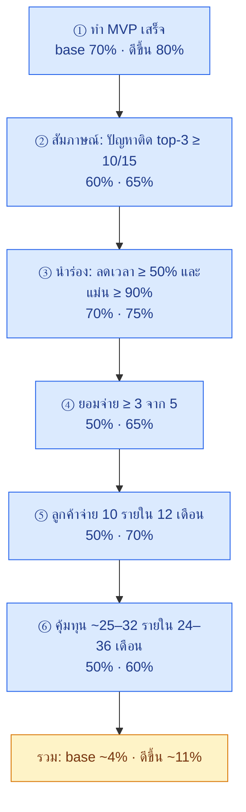
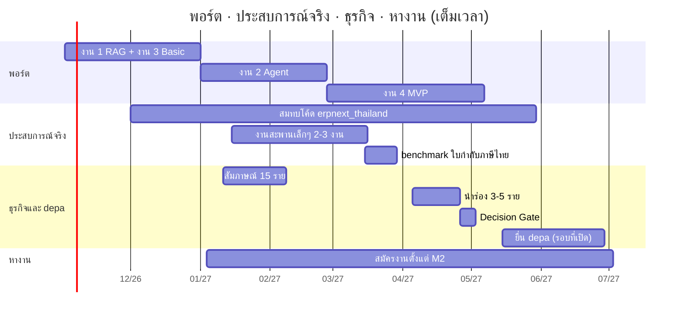

# 🎯 งานที่ 4j — โอกาสสำเร็จ · แผนธุรกิจเสนอ depa · รันงานจริงเพื่อสะสมประสบการณ์

> คำนวณว่าโปรเจกต์นี้มีโอกาสสำเร็จแค่ไหน (แยกตามเป้าหมาย) · แผนธุรกิจสำหรับยื่น depa · ทำงานจริงยังไงให้ได้ประสบการณ์ที่งาน AI เงินเดือนแสน+ ต้องการ · ปัจจัยทั้งหมดที่มีผล
> ← [หน้าแรกงาน 4](README.md) · [04b Product Track (depa)](04b-depa-product-track.md) · [04e ธุรกิจรายเดือน](04e-saas-business-model.md) · [04i กลุ่ม SME](04i-sme-segments.md) · [เส้นทางอาชีพ](../career-roadmap.md)
>
> ⚠️ ตัวเลขความน่าจะเป็นและการเงินเป็น**สมมติฐาน** ยกเว้นอัตรารับทุน depa รอบ 2568 (ข้อมูลจริง) · ใช้เพื่อเทียบทางเลือกและหาจุดที่ควรลงแรง ไม่ใช่คำทำนาย

## คำตอบสั้น

| เป้าหมาย | โอกาส (base) | ถ้ามีปัจจัยเสริมครบ | ที่มา |
|---|:-:|:-:|---|
| ทำ MVP เสร็จ (M1–M4) | 70% | 80% | สมมติฐาน · เต็มเวลา + Gate ทุก Stage |
| ได้งาน AI ภายใน 12 เดือนหลัง M2 | ~80% | — | สมมติฐาน · JobsDB มีประกาศ AI Engineer 262 ตำแหน่ง |
| ถึงเงินเดือนแสนภายใน 5 ปี | ~40% | — | สมมติฐาน · ประกาศแสน+ ส่วนใหญ่ต้องมีประสบการณ์ 5 ปี |
| ได้ทุน depa Idea Stage | 15% (ยื่นแค่ไอเดีย) | 35% (มีผลนำร่อง + LOI) | **ฐานจริงรอบ 2568: ได้ทุน 26 จาก 120 ทีม ≈ 22%** |
| ธุรกิจถึงจุดคุ้มทุน ใน 24–36 เดือน | ~4% | ~11% | สมมติฐาน · ห่วงโซ่ 6 ขั้น (ข้อ 2.1) |
| **ได้อย่างน้อย 1 อย่าง (งาน หรือ ธุรกิจ)** | **~81%** | | 1 − (1 − 0.80)(1 − 0.037) |

**ตีความ:** ทางหางานมีโอกาสสูง · ทางธุรกิจเป็น**ตั๋วราคาถูก** — ถูกเพราะใช้โค้ดชุดเดียวกับพอร์ต และมี Decision Gate ให้หยุดก่อนเสียเงิน · จุดที่ยกโอกาสธุรกิจได้มากที่สุดคือ**ช่องทางขายผ่านสำนักงานบัญชี** และ**ผู้ร่วมก่อตั้งสายขาย/บัญชี** (ข้อ 2.5)

---

## สารบัญ
1. [นิยามคำว่าสำเร็จ](#1-นิยามคำว่าสำเร็จ)
2. [โมเดลความน่าจะเป็น](#2-โมเดลความน่าจะเป็น)
3. [ปัจจัยทั้งหมด](#3-ปัจจัยทั้งหมด)
4. [แผนธุรกิจเสนอ depa](#4-แผนธุรกิจเสนอ-depa)
5. [รันงานจริงเพื่อสะสมประสบการณ์](#5-รันงานจริงเพื่อสะสมประสบการณ์)
6. [แผนเวลารวม 18 เดือน](#6-แผนเวลารวม-18-เดือน)
7. [เกณฑ์ไปต่อ / หยุด](#7-เกณฑ์ไปต่อ--หยุด)
8. [แหล่งข้อมูล](#8-แหล่งข้อมูล)

---

## 1. นิยามคำว่าสำเร็จ

"สำเร็จ" ไม่ใช่ตัวเลขเดียว — แยกเป็นเป้าที่วัดได้

| # | เป้า | วัดยังไง | เมื่อไร |
|---|---|---|---|
| S1 | พอร์ตเสร็จ | M1–M4 อยู่บน GitHub + วิดีโอ + ตัวเลข eval ([MD หลัก](../README.md#milestone--ทุกจุดต้อง-สมัครงานได้แล้ว)) | ~6–7 เดือน (เต็มเวลา) |
| S2 | ได้งาน AI | สัญญาจ้างตำแหน่ง AI / Integration / Solution | ภายใน 12 เดือนหลัง M2 |
| S3 | ได้ทุน depa | ผ่าน Final Pitching Idea Stage | รอบที่เปิดหลังนำร่อง |
| S4 | ธุรกิจคุ้มทุน | รายได้ต่อเดือน ≥ ต้นทุนรวม (รวมเงินเดือนตัวเอง) | 24–36 เดือนหลัง Decision Gate |
| S5 | งานแสน+ | เงินเดือน ≥ 100,000 | ภายใน 5 ปี |

---

## 2. โมเดลความน่าจะเป็น

### 2.1 ธุรกิจ: ห่วงโซ่ 6 ขั้น

ต้องผ่านทุกขั้นตามลำดับ → โอกาสรวม = คูณกันทุกขั้น



| ขั้น | base | ดีขึ้น | สะสม base | สะสม ดีขึ้น | อะไรทำให้ดีขึ้น |
|---|:-:|:-:|:-:|:-:|---|
| ① MVP เสร็จ | 70% | 80% | 70.0% | 80.0% | ทำเต็มเวลา · ตัดเหลือ M1–M4 · Gate ทุก Stage ([04c](04c-build-guide.md)) |
| ② ปัญหาจริง | 60% | 65% | 42.0% | 52.0% | สัมภาษณ์กลุ่มระลอก 1 ([04i](04i-sme-segments.md#6-ลำดับเข้าตลาด-3-ระลอก)) · ถามเรื่องที่เกิดขึ้นแล้ว |
| ③ นำร่องผ่าน | 70% | 75% | 29.4% | 39.0% | benchmark ใบกำกับ 300 ใบก่อนนำร่อง · คนตรวจทุกใบ |
| ④ ยอมจ่าย | 50% | 65% | 14.7% | 25.4% | **ผู้ร่วมก่อตั้งสายขาย/บัญชี** · ราคาตาม [04e ข้อ 10.4](04e-saas-business-model.md#104-ราคา-สมมติฐาน--ไม่รวม-vat) |
| ⑤ 10 ราย | 50% | 70% | 7.3% | 17.7% | **สำนักงานบัญชีพาร์ทเนอร์ 1 ราย** พาลูกค้ามาหลายบริษัท |
| ⑥ คุ้มทุน | 50% | 60% | **3.7%** | **10.6%** | ทุน depa / เงินสำรอง ≥ 6 เดือน · ดูแล ≤ 1.5 ชม./ราย |

> ~4% ฟังดูต่ำ แต่ใกล้กับที่มักอ้างกันว่าสตาร์ทอัพส่วนใหญ่ไม่รอด — สิ่งที่ทำให้แผนนี้คุ้มคือ**ต้นทุนการลองต่ำ** และทุกขั้นที่หยุดยังได้ของใส่พอร์ต ([04b ข้อ 13](04b-depa-product-track.md#13-ของที่ได้ใส่พอร์ตแม้ไม่ได้ทุน))

### 2.2 อาชีพ

| เหตุการณ์ | โอกาส | เหตุผล |
|---|:-:|---|
| ได้งาน AI ภายใน 12 เดือนหลัง M2 | ~80% | ตลาดกลุ่ม "LLM + เชื่อมระบบ" ใหญ่ที่สุด ([career-roadmap ข้อ 1](../career-roadmap.md#1-ตลาดงานตอนนี้)) · สมัครตั้งแต่ M2 |
| ถึงแสนภายใน 5 ปี (ถ้าได้งาน) | ~50% | Mid 60–120k · Senior 120–200k (5 ปี+) |
| **ถึงแสนภายใน 5 ปี** | **~40%** | 0.80 × 0.50 |
| ได้งาน หรือ ธุรกิจคุ้มทุน อย่างน้อย 1 อย่าง | **~81%** | 1 − (1 − 0.80)(1 − 0.037) |

### 2.3 ทุน depa

| | โอกาส | มูลค่าคาดหวัง (× 200,000) |
|---|:-:|:-:|
| ฐานจริงรอบ 2568 (26 / 120 ทีม) | 22% | — |
| ยื่นแค่ไอเดีย + เดโม | ~15% | ~30,000 บาท |
| ยื่นพร้อมผลนำร่อง + LOI | ~35% | ~70,000 บาท |

→ **ทำนำร่องก่อนยื่น** เพิ่มมูลค่าคาดหวังราว 2.3 เท่า · รอบ 2568 มีทีมเข้า Final Pitching 45 ทีม ได้ทุน 26 ทีม (ทีมละ 200,000 บาท)

### 2.4 โค้ดคำนวณ (รันซ้ำได้)

```python
STEPS = [(.70, .80), (.60, .65), (.70, .75), (.50, .65), (.50, .70), (.50, .60)]  # (base, ดีขึ้น)

def chain(col: int) -> float:
    p = 1.0
    for step in STEPS:
        p *= step[col]
    return p

base, better = chain(0), chain(1)
p_job, p_100k_given_job = .80, .50
assert round(base, 3) == 0.037 and round(better, 3) == 0.106
assert round(p_job * p_100k_given_job, 2) == 0.40
assert round(1 - (1 - p_job) * (1 - base), 2) == 0.81
assert round(26 / 120, 2) == 0.22                  # depa Idea Stage 2568
```

### 2.5 ปัจจัยที่ยกโอกาสได้มากที่สุด

| ปัจจัย | ขั้นที่มีผล | เปลี่ยน | ทำได้ยังไง |
|---|---|---|---|
| **สำนักงานบัญชีพาร์ทเนอร์ 1 ราย** | ⑤ | 50% → 70% | ให้ใช้ APX โหมด CSV ฟรีช่วงนำร่อง แลกการพาลูกค้า |
| **ผู้ร่วมก่อตั้งสายขาย/บัญชี** | ④ | 50% → 65% | หาคนที่ปิดการขายเป็น หรือเป็นนักบัญชี — แบ่งหุ้นแทนเงินเดือน |
| ทำเต็มเวลา (ไม่ใช่ part-time) | ① | ~50% → 70–80% | ใช้เงินสำรองช่วงทำพอร์ต 6–7 เดือน |
| ทุน depa / เงินสำรอง ≥ 6 เดือน | ⑥ | 50% → 60% | ยื่นหลังนำร่อง (ข้อ 2.3) |
| เลือกกลุ่มลูกค้าระลอก 1 | ② | 60% → 65% | ตาม [04i](04i-sme-segments.md) |

---

## 3. ปัจจัยทั้งหมด

ผล: 🔴 สูง · 🟠 กลาง · 🟢 ต่ำ · ทิศ: ➕ ช่วย · ➖ ขัด

| หมวด | ปัจจัย | ผล | ทิศ | รับมือ | สัญญาณเตือน |
|---|---|:-:|:-:|---|---|
| **ตัวเรา** | เวลา (เต็มเวลา / part-time) | 🔴 | ± | วางแผนตามเวลาจริง · part-time คูณเวลา ×2 | หลุดแผน Stage เกิน 2 สัปดาห์ |
| | เงินสำรองส่วนตัว | 🔴 | ± | ต้องพอ 6–7 เดือนช่วงทำพอร์ต | เหลือ < 3 เดือน → หางานก่อน |
| | ทักษะขาย / คุยลูกค้า | 🔴 | ➖ | สัมภาษณ์ 15 รายคือการฝึก · หาผู้ร่วมก่อตั้ง | สัมภาษณ์แล้วไม่มีใครให้ติดต่อต่อ |
| | ภาษาอังกฤษ (pitch EN) | 🟠 | ± | ซ้อมคลิป 2 นาที / deck 5 นาที | — |
| | สุขภาพ / แรงจูงใจ | 🟠 | ± | Milestone สั้น · มีของโชว์ทุก 1–2 เดือน | หยุดทำเกิน 2 สัปดาห์ |
| **สินค้า / เทคนิค** | ความแม่นยำอ่านใบกำกับภาษีไทย | 🔴 | ± | benchmark 300 ใบ · ตัวอ่านสลับได้ 2 แบบ | ช่องสำคัญ < 90% |
| | เวลาดูแลลูกค้า | 🔴 | ➖ | ≤ 1.5 ชม./ราย/เดือน · เอกสารช่วยตัวเอง | เกิน 3 ชม./ราย |
| | สะพานพังเมื่อระบบลูกค้าอัปเดต | 🟠 | ➖ | contract tests · ค่าดูแลสะพานรายเดือน | ลูกค้าแจ้งข้อมูลไม่เข้า |
| | อัปเกรด ERPNext | 🟠 | ➖ | pin เวอร์ชัน · test ภาษีไทยก่อนอัปเกรด | test แดงหลังอัปเกรด |
| **ตลาด / คู่แข่ง** | FlowAccount / PEAK เพิ่ม OCR / AI | 🔴 | ➖ | เน้นตรวจ + จับคู่ PO + AI ในเครื่อง · ทำงานร่วมผ่าน CSV | ลูกค้าบอก "โปรแกรมเดิมทำได้แล้ว" |
| | ตลาด ERPNext ในไทยเล็ก | 🟠 | ➖ | โหมด CSV ตั้งแต่ MVP · สะพานอื่นตามลูกค้า | — |
| | Jib OS ในกลุ่มคลินิก | 🟢 | ➖ | ไม่แข่ง AI ตอบแชทคลินิก ([04e ข้อ 10.2](04e-saas-business-model.md#102-คู่แข่งในกลุ่มธุรกิจที่มีการนัด)) | — |
| **ช่องทางขาย** | สำนักงานบัญชีพาร์ทเนอร์ | 🔴 | ➕ | ข้อ 2.5 | ไม่มีพาร์ทเนอร์ใน 6 เดือน |
| | เครือข่ายส่วนตัว (ครอบครัว / คนรู้จักที่มีกิจการ) | 🟠 | ➕ | นำร่อง 3–5 รายแรก | — |
| **การเงิน** | ช่วงเงินขาดปีที่ 2 (~267,000) | 🔴 | ➖ | ทุน depa + เงินสำรอง · ไปเต็มเวลาเมื่อมี 10 ราย ([ข้อ 4.4](#44-ประมาณการ-3-ปี)) | เงินสดติดลบเกินแผน |
| | ค่า GPU | 🟠 | ➖ | เครื่องเดียวใช้ร่วมงานพัฒนา · เช่าเมื่อจำเป็น | — |
| **กฎหมาย / สัญญา** | PDPA (เราเป็นผู้ประมวลผลข้อมูล) | 🔴 | ➖ | DPA ทุกราย · AI ในเครื่อง · ลบตามกำหนด | — |
| | สัญญาจ้างเรื่องทรัพย์สินทางปัญญา / งานเสริม | 🔴 | ➖ | อ่านก่อนเซ็น · แยกเวลาและอุปกรณ์ · แจ้งนายจ้างถ้าจำเป็น | ธุรกิจแข่งกับนายจ้าง |
| | License GPL / AGPL | 🟠 | ➖ | ใช้ MIT/Apache · ปรึกษาผู้รู้ก่อนขาย | — |
| | เครื่องหมายการค้า "ERPNext" | 🟠 | ➖ | ตั้งชื่อสินค้าของตัวเอง | — |
| | จดบริษัท / VAT / ภาษี | 🟠 | ➖ | ทำเมื่อผ่าน Decision Gate | รายรับใกล้ 1.8 ล้าน/ปี → จด VAT |
| **ทุน depa** | อัตรารับ ~22% | 🟠 | ➖ | ยื่นพร้อมผลนำร่อง | — |
| | เงื่อนไขเปลี่ยนทุกรอบ · ภาระหลังได้ทุน | 🟠 | ➖ | อ่านประกาศรอบจริงก่อนยื่น | — |
| **AI / เทคโนโลยี** | AI เก่งขึ้นเร็ว → คู่แข่งทำตามง่าย | 🔴 | ➖ | ความได้เปรียบอยู่ที่ benchmark · สะพาน · ความไว้ใจ · ลูกค้า ไม่ใช่โค้ด | — |
| | AI เก่งขึ้นเร็ว → เราสร้างได้เร็วขึ้น | 🔴 | ➕ | ใช้ coding agent สร้างสะพาน ([04h ข้อ 6](04h-connectors.md#6-ใครเขียนสะพาน-คนกำหนด-ai-เขียน)) | — |
| | โมเดลไทย (เช่น Typhoon) ดีขึ้น | 🟠 | ➕ | eval ทุกโมเดลใหม่ | — |
| **เศรษฐกิจ / นโยบาย** | GDP ของ SME โต 2.8% (Q2/2568) | 🟢 | ➕ | — | — |
| | มาตรการภาษี 2 เท่า (ถึงสิ้นปี 2570) | 🟠 | ➕ | ใช้ได้เมื่อขึ้นทะเบียนบัญชีบริการดิจิทัลแล้วเท่านั้น | หมดเขตก่อนขึ้นทะเบียน |

---

## 4. แผนธุรกิจเสนอ depa

> ใช้คู่กับ [04b ข้อ 9](04b-depa-product-track.md#9-ชุดเอกสารยื่น-depa) (checklist · pitch deck 10 สไลด์ · แผนใช้เงิน) · ไฟล์นี้อัปเดตตลาด คู่แข่ง ราคา และประมาณการให้ตรงกับ 04e / 04i
> 🟡 วงเงิน คุณสมบัติ (บุคคล/ทีม/บริษัท) สาขา และกำหนดการ ให้ตรวจจากประกาศรอบจริง — รอบ 2568 Idea Stage ให้ 200,000 บาท/ทีม · รอบ 2569 มี Info Session Idea Stage 5 มิ.ย. 2569 และรอบ 2 (Early/Growth) ปิดรับ 27 ก.พ. 2569

### 4.1 สรุปหน้าเดียว

| ช่อง | เนื้อหา |
|---|---|
| ชื่อ | ชื่อชั่วคราว (ตรวจเครื่องหมายการค้าก่อน) · ห้ามมีคำว่า ERPNext |
| ประโยคเดียว (EN) | *AI back-office assistant for Thai SMEs — starts with tax-invoice checking; data never leaves the company.* |
| ระยะทุน | Idea Stage |
| สาขา | การเงิน (FinTech) / บริการ |
| ปัญหา | SME และสำนักงานบัญชีคีย์/ตรวจใบกำกับภาษีด้วยมือ · ยอดไม่ตรง PO · จ่ายซ้ำ · ข้อมูลกระจายหลายโปรแกรม (ตัวเลขจริงจากสัมภาษณ์ 15 ราย) |
| ทางแก้ | APX อ่าน → ตรวจ → จับคู่ → ร่างตั้งหนี้ · Copilot ถามข้อมูลธุรกิจ · สะพานต่อระบบเดิม (ERPNext / CSV) · AI ในเครื่อง |
| ลูกค้า | ระลอก 1: สำนักงานบัญชี · บริษัท IT/บริการ · ค้าส่ง · โรงงานผลิต ([04i](04i-sme-segments.md)) |
| รายได้ | รายเดือนตามปริมาณงาน · ค่าติดตั้งเฉพาะสะพาน ([04b ข้อ 7.1](04b-depa-product-track.md#71-ราคา-สมมติฐานที่ต้องทดสอบ) · [04e ข้อ 10.4](04e-saas-business-model.md#104-ราคา-สมมติฐาน--ไม่รวม-vat)) |
| จุดต่าง | benchmark ใบกำกับภาษีไทยที่เปิดผล · AI ในเครื่อง (PDPA) · สะพาน + contract tests · คนอนุมัติทุกงานเสี่ยง |
| Traction | สัมภาษณ์ 15 ราย · นำร่อง 3–5 ราย · LOI |
| ขอ | 200,000 บาท (🟡 ตามรอบจริง) |

### 4.2 ขนาดตลาด (bottom-up · สมมติฐาน)

| ชั้น | คำนวณ | ผล |
|---|---|---|
| SME ขนาดย่อม + กลาง | ~455,000 + ~50,000 ([04e ข้อ 0.1](04e-saas-business-model.md#01-บริษัทส่วนใหญ่มี-erp-แล้วหรือยัง)) | ~505,000 ราย |
| ตรงกลุ่มระลอก 1 และรับใบกำกับ 50–500 ใบ/เดือน | สมมติ 5% | ~25,250 ราย |
| **SAM** | 25,250 × 3,500 × 12 | **~1,060 ล้านบาท/ปี** |
| **SOM (ปีที่ 3)** | 60 ราย × 3,500 × 12 | **~2.5 ล้านบาท/ปี** (~0.24% ของ SAM) |

> แทนที่ 5% ด้วยตัวเลขจากสัมภาษณ์และรายงาน สสว. ก่อนใส่ pitch

### 4.3 ราคาเฉลี่ยที่ใช้ประมาณการ

ราคาเฉลี่ยผสม **3,500 บาท/ราย/เดือน** (APX 990–2,490 · แพ็กเกจ AI 2,900–8,900) · ต้นทุนผันแปร **1,300 บาท/ราย/เดือน** (ลูกค้า APX ใช้เวลาดูแลน้อยกว่าแพ็กเกจ AI)
→ จุดคุ้มทุนในแผนนี้ ~**32 ราย** (ไม่ใช่ 25 ราย ใน 04e เพราะราคาเฉลี่ยต่ำกว่า)

### 4.4 ประมาณการ 3 ปี

| ปี | ลูกค้าปลายปี | รายได้ | กำไร / ขาดทุน | หมายเหตุ |
|---|:-:|--:|--:|---|
| 1 | 10 | 227,500 | +23,000 | ทำคู่งานประจำ · ไม่จ่ายเงินเดือนตัวเอง · ต้นทุนคงที่ 10,000/เดือน |
| 2 | 30 | 875,000 | −290,000 | เต็มเวลาเมื่อมี 10 ราย · ต้นทุนคงที่ 70,000/เดือน · **คุ้มทุนรายเดือนที่เดือน 25 (32 ราย)** |
| 3 | 60 | 1,942,500 | +381,000 | |

**เงินสดสะสมต่ำสุด −267,000 บาท (ปีที่ 2)** → ทุน 200,000 ปิดได้ราว 3/4 · ที่เหลือใช้เงินสำรองหรือรายได้จากงานประจำ · ยังไม่รวมค่าติดตั้งสะพาน (เป็นส่วนบวก)

```python
ARPU, VAR = 3_500, 1_300
FIXED = {1: 10_000, 2: 70_000, 3: 70_000}
TARGET = {0: 0, 12: 10, 24: 30, 36: 60}          # ลูกค้าสุทธิปลายปี (หักเลิกใช้แล้ว)

def customers(m: int) -> int:                      # เพิ่มแบบเส้นตรงภายในแต่ละปี
    y0 = (m - 1) // 12 * 12
    a, b = TARGET[y0], TARGET[y0 + 12]
    return round(a + (b - a) * (m - y0) / 12)

cash = low = 0
for m in range(1, 37):
    n = customers(m)
    cash += n * ARPU - (n * VAR + FIXED[(m - 1) // 12 + 1])
    low = min(low, cash)
assert low == -267_000 and cash == 114_000
```

### 4.5 แผนใช้เงิน + KPI

- แผนใช้เงิน 200,000 บาท: ใช้ตาราง [04b ข้อ 9.3](04b-depa-product-track.md#93-ตัวอย่างแผนใช้เงิน-200000-บาท-ตัวอย่าง--หมวดที่เบิกได้จริงดูตามประกาศ) (จดบริษัท · เครื่อง GPU · ขยายนำร่อง · เตรียมขึ้นทะเบียนบัญชีบริการดิจิทัล · การตลาดกลุ่มสำนักงานบัญชี · สำรอง)
- KPI 6–12 เดือนหลังได้ทุน:

| KPI | เป้า |
|---|---|
| ลูกค้าที่จ่ายเงิน | ≥ 10 ราย |
| สำนักงานบัญชีพาร์ทเนอร์ | ≥ 1 ราย |
| ใบกำกับที่ประมวลผล | ≥ 5,000 ใบ/เดือน |
| ลดเวลาตรวจเฉลี่ย | ≥ 50% |
| ช่องสำคัญอ่านถูก | ≥ 95% |
| เวลาดูแลต่อราย | ≤ 1.5 ชม./เดือน |
| จดบริษัท + พร้อมยื่นขึ้นทะเบียนบัญชีบริการดิจิทัล | ✅ |

### 4.6 สิ่งที่เปลี่ยนใน pitch deck (จาก [04b ข้อ 9.2](04b-depa-product-track.md#92-โครง-pitch-deck-10-สไลด์--5-นาที))

| สไลด์ | เปลี่ยน |
|---|---|
| 3 Customer | ใช้ระลอก 1 จาก [04i](04i-sme-segments.md) + ขนาดตลาดข้อ 4.2 |
| 7 Business model | ราคาเฉลี่ย 3,500 · คุ้มทุน 32 ราย · ประมาณการข้อ 4.4 |
| 8 Competition | เพิ่ม FlowAccount / PEAK / Odoo OCR · บอกชัดว่าไม่แข่งกลุ่มที่ Jib OS ทำ |
| 10 Ask | 200,000 + KPI ข้อ 4.5 + ผลกระทบ (ข้อ 4.7) |

### 4.7 ผลกระทบ (ที่ depa สนใจ)

| ด้าน | วัดยังไง |
|---|---|
| ลดชั่วโมงงานเอกสารของ SME | ชั่วโมงที่ประหยัดต่อเดือนรวมทุกลูกค้า |
| ข้อมูลธุรกิจอยู่ในประเทศ / ในบริษัท | % ลูกค้าที่ใช้ AI ในเครื่อง |
| AI ภาษาไทยที่วัดผลได้ | benchmark ใบกำกับภาษีไทยเปิดสาธารณะ |
| คนทำงานดิจิทัล | จำนวนคนที่จ้างหรือฝึกเมื่อโต |

---

## 5. รันงานจริงเพื่อสะสมประสบการณ์

งานแสน+ ต้องการ **"เคยพาระบบขึ้นใช้จริงและดูแลต่อ"** → สร้างประสบการณ์จริงได้ก่อนได้งาน

| กิจกรรม | ใช้เวลา | ได้ประสบการณ์อะไร | ตรงงานแสน+ กลุ่มไหน | หลักฐานในพอร์ต |
|---|---|---|---|---|
| **นำร่อง APX กับ SME 3–5 ราย** (ข้อมูลจริง ภายใต้ DPA) | 3 สัปดาห์ | ระบบที่คนใช้จริง · วัดผลจริง | ธนาคาร / ประกัน (document AI) | Pilot Report |
| **รับงานสะพานเล็กๆ 2–3 งาน** (เครือข่าย / ฟรีแลนซ์) | 1–2 สัปดาห์/งาน | เชื่อมระบบลูกค้าจริง · ดูแลหลังส่งมอบ | Forward Deployed / SI / Presales | case study + contract tests |
| **ดูแลระบบนำร่องแบบของจริง**: monitoring · incident log · backup / restore | ตลอดนำร่อง | operations | MLOps / LLMOps | incident log + postmortem |
| สมทบโค้ด erpnext_thailand (MIT) / Frappe | ต่อเนื่อง | ทำงานกับโค้ดคนอื่น · ผ่าน review | ERP Developer / Architect | PR ที่ merge แล้ว |
| เปิด benchmark ใบกำกับภาษีไทย (ข้อมูลสมมติ) | 1–2 สัปดาห์ | eval ที่คนอื่นใช้ได้ | AI Engineer ทุกกลุ่ม | repo + ผลแต่ละโมเดล |
| พาร์ทไทม์ / ฝึกงานกับ ERPNext / Odoo partner หรือบริษัท SI | 3–6 เดือน | โครงการลูกค้าในทีม | ทุกกลุ่ม | reference จากหัวหน้างาน |

**กติกา:** ทำสัญญา + DPA ทุกงาน · ไม่เอาข้อมูลลูกค้าขึ้น GitHub · ขออนุญาตก่อนใช้ชื่อลูกค้าในพอร์ต · ถ้าได้งานประจำแล้ว ตรวจสัญญาจ้างเรื่องงานเสริมก่อนรับงาน

---

## 6. แผนเวลารวม 18 เดือน

เทียบกับ Roadmap เส้นทาง C ใน [MD หลัก](../README.md#roadmap-เส้นทาง-c-เต็มเวลา) (เต็มเวลา) · วันยื่น depa เป็นการคาด 🟡



| ช่วง | ถ้าได้งาน | ถ้ายังไม่ได้งาน |
|---|---|---|
| หลัง MVP | ทำธุรกิจคู่งานประจำ (ปีที่ 1 ของประมาณการ) ตามสัญญาจ้าง | ทำนำร่องต่อ + รับงานสะพาน + สมัครต่อ |
| ลูกค้าจ่าย 10 ราย | ตัดสินใจ: ลาออกไปเต็มเวลา หรือหาผู้ร่วมก่อตั้งมาทำเต็มเวลา | ไปเต็มเวลา (ถ้ามีเงินสำรอง/ทุน ≥ 6 เดือน) |

---

## 7. เกณฑ์ไปต่อ / หยุด

| จุด | ไปต่อเมื่อ | หยุด / เปลี่ยนทิศเมื่อ | อ่านต่อ |
|---|---|---|---|
| หลังสัมภาษณ์ | ปัญหาติด top-3 ≥ 10/15 | < 10/15 → หยุด เก็บเป็นพอร์ต | [04b ข้อ 10](04b-depa-product-track.md#10-decision-gate-ไป-c--เปลี่ยนทิศ--หยุด) |
| หลังนำร่อง | ลดเวลา ≥ 50% · แม่น ≥ 90% · ยอมจ่าย ≥ 3/5 | ไม่ผ่าน → แก้ 2–3 สัปดาห์ หรือเปลี่ยนกลุ่ม | 04b ข้อ 10 |
| ระหว่างทำธุรกิจ | ดูแล ≤ 1.5 ชม./ราย · มีพาร์ทเนอร์ใน 6 เดือน | วางระบบ > 80 ชม./ราย · support > 6 ชม./ราย | [04e ข้อ 9.5](04e-saas-business-model.md#95-เกณฑ์หยุด-หรือถอยไปขายแค่ส่วนเสริม) |
| ขยายกลุ่ม | ระลอก 1 จ่าย ≥ 3 ราย → ระลอก 2 | — | [04i ข้อ 6](04i-sme-segments.md#6-ลำดับเข้าตลาด-3-ระลอก) |
| ทบทวนทุก 6 เดือน | อัปเดตตัวเลขในข้อ 2 ด้วยผลจริง | โอกาสธุรกิจสะสม < 2% → เน้นงานประจำ | [career-roadmap ข้อ 7](../career-roadmap.md#7-ทบทวนทุก-6-เดือน) |

---

## 8. แหล่งข้อมูล

- [depa Startup](https://www.depa.or.th/th/startup)
- [ผู้จัดการออนไลน์ — Final Pitching Idea Stage 2568 (120 → 45 → 26 ทีม)](https://mgronline.com/business/detail/9680000046305)
- [กรมบัญชีกลาง (gcc.go.th) — Digital Startup Fund 2569 รอบที่ 2](https://gcc.go.th/2026/01/19/%E0%B8%AA%E0%B8%B3%E0%B8%99%E0%B8%B1%E0%B8%81%E0%B8%87%E0%B8%B2%E0%B8%99%E0%B8%AA%E0%B9%88%E0%B8%87%E0%B9%80%E0%B8%AA%E0%B8%A3%E0%B8%B4%E0%B8%A1%E0%B9%80%E0%B8%A8%E0%B8%A3%E0%B8%A9%E0%B8%90-10/)
- [Thailand Science Park — Digital Startup TDV 2569](https://www.sciencepark.or.th/th/funding-information/151)
- [JobsDB — AI Engineer](https://th.jobsdb.com/th/ai-engineer-jobs) · [≥ 100k](https://th.jobsdb.com/th/ai-engineer-jobs?salaryrange=100000-&salarytype=monthly)
- [LH Bank — SME Outlook Q2/2568](https://www.lhbank.co.th/getattachment/99e32016-693b-4f6a-8774-18ed9e80a347/economic-analysis-SME-Industry-Outlook-2025-SME-Economic-Overview-2Q2568)

← [หน้าแรกงาน 4](README.md)
