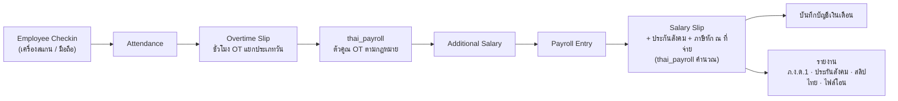

# 🧾 งานที่ 5 — เงินเดือนไทยสำหรับ ERPNext (Thai Payroll app · ทางเลือก)

> app โอเพนซอร์สที่ทำให้ ERPNext / Frappe HR คิดเงินเดือนแบบไทยได้ครบ: ค่าแรงรายวัน/รายเดือน · OT ตามกฎหมาย · ประกันสังคม · ภาษีหัก ณ ที่จ่าย (ภ.ง.ด.1) · รายงานส่งราชการ
> ← [MD หลัก](../README.md) · ใช้กับ [งาน 4](../04-erpnext-enterprise-os/README.md)

| หัวข้อ | สรุป |
|---|---|
| **ทำไมทำ** | ค้นแล้ว (16 ต.ค. 2569) **ยังไม่พบ app เงินเดือนไทยสำหรับ ERPNext** — Odoo มี (SC Thailand Payroll) · erpnext_thailand ครอบคลุมภาษีธุรกิจ ไม่ครอบคลุมเงินเดือน |
| **ใครใช้** | บริษัทไทยที่ใช้ ERPNext (รวมสาขา 2 ของบริษัทจำลองในงาน 4) |
| **สายงานเป้าหมาย** | ERP Developer · HRIS / Payroll System · Frappe Developer |
| **License** | GPL-3.0 (app พึ่ง Frappe HR ซึ่งเป็น GPL-3) |
| **ความยาก** | 7/10 — โค้ดไม่ยาก แต่ **กฎหมายต้องถูก** |
| **เวลา (เต็มเวลา)** | ~4–6 สัปดาห์ |
| **ข้อมูลอ้างอิง** | [thai-tax-labor-reference.md](../04-erpnext-enterprise-os/research/thai-tax-labor-reference.md) |

> ⚠️ เงินเดือนเป็นเรื่องกฎหมายและภาษี — **ทุกตัวเลขในไฟล์นี้ให้ผู้รู้กฎหมายแรงงานและนักบัญชีตรวจก่อนใช้จริง** และ app ต้องอ่านค่าจากตารางตั้งค่าตามปี ไม่ฝังตัวเลขในโค้ด

---

## 1. ขอบเขต

| ลำดับ | ฟีเจอร์ |
|---|---|
| **Must** | ค่าจ้างรายเดือน/รายวัน · หักขาด/ลาไม่รับค่าจ้าง · **OT ตามประเภทวันและประเภทลูกจ้าง** · **ประกันสังคม** (อัตรา + เพดาน + ฐานขั้นต่ำตามปี) · **ภาษีหัก ณ ที่จ่ายรายเดือน** (คำนวณแบบทั้งปีแล้วเฉลี่ย) · สลิปเงินเดือนภาษาไทย · รายงาน **ภ.ง.ด.1** รายเดือน · รายงานเงินสมทบประกันสังคมรายเดือน · ไฟล์โอนเงินเดือน (CSV ทั่วไป) |
| **Should** | ภ.ง.ด.1ก (ประจำปี) · 50 ทวิ ประจำปีของพนักงาน · กองทุนสำรองเลี้ยงชีพ · ลดหย่อนที่พนักงานแจ้ง (ประกันชีวิต บุตร ฯลฯ) |
| **Could** | รูปแบบไฟล์ยื่นออนไลน์ของหน่วยงาน · รูปแบบไฟล์ธนาคารรายเจ้า |
| **Won't** | รับทำเงินเดือนแทน (outsourcing) · ทุกธนาคาร · กฎหมายแรงงานกรณีพิเศษทุกแบบ |

---

## 2. Architecture



| ส่วนของ app | หน้าที่ |
|---|---|
| `Thai Payroll Settings` (ต่อปี) | อัตราประกันสังคม · เพดาน · ฐานขั้นต่ำ · ขั้นบันไดภาษี · ค่าลดหย่อนพื้นฐาน · ตัวคูณ OT |
| `Employee Tax Profile` | ลดหย่อนที่พนักงานแจ้ง · สถานะ (ใช้ประกันสังคมหรือไม่) |
| Hooks บน Salary Slip | คำนวณประกันสังคม + ภาษีก่อนบันทึก |
| Hooks บน Overtime Slip | ใส่ตัวคูณตามประเภทวัน/ประเภทลูกจ้าง |
| Reports + Print Format | ภ.ง.ด.1 · ประกันสังคมรายเดือน · สลิปไทย · ไฟล์โอน |

---

## 3. ตารางตั้งค่าตามปี (ตัวอย่าง 2569 — ต้องตรวจ)

```yaml
year: 2569
social_security:
  rate: 0.05
  wage_ceiling: 17500       # ครม. อนุมัติหลักการ 2 ธ.ค. 2568 — ตรวจราชกิจจานุเบกษา
  wage_floor: 1650          # ตรวจกับสำนักงานประกันสังคม
overtime_multiplier:
  workday_ot: 1.5           # ม.61
  holiday_work_monthly: 1.0 # ม.62 (จ่ายเพิ่ม)
  holiday_work_daily: 2.0   # ม.62
  holiday_ot: 3.0           # ม.63
income_tax:
  employment_expense: { rate: 0.5, cap: 100000 }
  personal_allowance: 60000
  brackets:                 # เงินได้สุทธิต่อปี: อัตรา
    - [150000, 0.00]
    - [300000, 0.05]
    - [500000, 0.10]
    - [750000, 0.15]
    - [1000000, 0.20]
    - [2000000, 0.25]
    - [5000000, 0.30]
    - [null, 0.35]
```

---

## 4. การคำนวณหลัก

```python
from decimal import Decimal as D

def sso(wage: D, rate: D = D("0.05"), ceiling: D = D(17500), floor: D = D(1650)) -> D:
    base = min(max(wage, floor), ceiling)
    return (base * rate).quantize(D("1"))          # ยืนยันวิธีปัดเศษกับสำนักงานประกันสังคม

BRACKETS = [(D(150000), D("0")), (D(300000), D("0.05")), (D(500000), D("0.10")),
            (D(750000), D("0.15")), (D(1000000), D("0.20")), (D(2000000), D("0.25")),
            (D(5000000), D("0.30")), (None, D("0.35"))]

def annual_tax(net: D) -> D:
    tax, lower = D(0), D(0)
    for upper, rate in BRACKETS:
        top = net if upper is None else min(net, upper)
        if top > lower:
            tax += (top - lower) * rate
        if upper is None or net <= upper:
            break
        lower = upper
    return tax

assert sso(D(16000)) == D(800)
assert sso(D(20000)) == D(875)
assert annual_tax(D(150000)) == 0
assert annual_tax(D(300000)) == D(7500)
assert annual_tax(D(500000)) == D(27500)
```

| ตัวอย่างทดสอบ | ผลที่ต้องได้ |
|---|---|
| เงินเดือน 16,000 → ประกันสังคม | 800 |
| เงินเดือน 20,000 → ประกันสังคม (2569) | 875 (ชนเพดาน) |
| เงินเดือน 15,000 · OT วันทำงาน 2 ชม. (ค่าจ้างต่อชั่วโมง 15,000 ÷ 30 ÷ 8 = 62.50) | 62.50 × 1.5 × 2 = **187.50** |
| ลูกจ้างรายวัน 400 บาท/วัน · OT วันหยุด 2 ชม. (ชั่วโมงละ 50) | 50 × 3 × 2 = **300** |
| ภาษีทั้งปี เงินได้สุทธิ 300,000 | 7,500 → หักรายเดือน 625 |

> ภาษีหักรายเดือนคิดแบบ: ประมาณเงินได้ทั้งปี → หักค่าใช้จ่ายและลดหย่อน → ภาษีทั้งปี → หาร 12 · ถ้าเงินเดือนเปลี่ยนกลางปีให้คำนวณสะสมใหม่ (ยืนยันวิธีกับนักบัญชี)

---

## 5. AI ช่วยตรงไหน (เบาๆ)

| งาน | AI ช่วย | ระดับ |
|---|---|---|
| ตรวจ OT | OT ไม่ตรงกับเวลาเข้า-ออก / สูงผิดปกติเทียบเดือนก่อน | แจ้งเตือนเท่านั้น |
| ตรวจก่อนปิดรอบ | เงินเดือนต่างจากเดือนก่อนเกินเกณฑ์ · พนักงานใหม่/ลาออกที่ลืมปรับ | แจ้งเตือนเท่านั้น |
| ถามข้อมูล | Copilot ตอบได้เฉพาะ role HR / Payroll · ข้อมูล **confidential** รันในเครื่องเท่านั้น | L3 อ่าน |

> AI **ไม่คำนวณเงินเดือน** — ตัวเลขทั้งหมดมาจากโค้ดและตารางตั้งค่าที่ทดสอบแล้ว

---

## 6. Roadmap (เต็มเวลา)

| สัปดาห์ | งาน | Definition of Done |
|---|---|---|
| 1 | โครง app + `Thai Payroll Settings` + `Employee Tax Profile` | ติดตั้งลง ERPNext v16 ได้ · ตั้งค่าปี 2569 ได้ |
| 2 | OT ตามประเภทวัน + ประกันสังคม | test ตัวอย่างข้อ 4 ผ่าน |
| 3 | ภาษีหัก ณ ที่จ่ายรายเดือน | test ภาษีหลายระดับเงินเดือนผ่าน · นักบัญชีตรวจตัวอย่าง |
| 4 | รายงาน ภ.ง.ด.1 + ประกันสังคม + สลิปไทย | ตัวเลขในรายงานตรงกับ Salary Slip |
| 5 | ไฟล์โอน + ภ.ง.ด.1ก / 50 ทวิ ประจำปี (Should) | — |
| 6 | เอกสาร + ตัวอย่างข้อมูล + เปิดซอร์ส | README ไทย/อังกฤษ · CI เขียว |

---

## 7. ความเสี่ยง

| ความเสี่ยง | ป้องกัน |
|---|---|
| กฎหมาย/อัตราเปลี่ยน | ตารางตั้งค่าตามปี · ไม่ฝังตัวเลขในโค้ด · ตรวจทุกต้นปี |
| คำนวณผิดแล้วกระทบเงินคนจริง | test ตามตัวอย่างที่นักบัญชียืนยัน · README ระบุชัดว่าต้องตรวจก่อนใช้ |
| ข้อมูลเงินเดือนรั่ว | สิทธิ์ HR/Payroll เท่านั้น · ไม่ส่งออกนอกเครื่อง |
| Frappe HR เปลี่ยนโครงสร้าง | pin `version-16` · test ใน CI ทุกครั้งที่อัปเดต |
| License | เปิดเป็น GPL-3 ให้ตรงกับ Frappe HR |

---

## 8. ของที่มีอยู่แล้ว (อ้างอิง)

| โปรเจกต์ | ใช้ยังไง |
|---|---|
| [SC Thailand Payroll (Odoo 17)](https://apps.odoo.com/apps/modules/17.0/sc_th_payroll) | เทียบขอบเขต (ประกันสังคม, ภาษี, ภ.ง.ด.1) — ไม่ copy โค้ด |
| [Frappe HR — Overtime](https://docs.frappe.io/hr/overtime) | ฐานของการดึงชั่วโมง OT |
| [erpnext_thailand](https://github.com/ecosoft-frappe/erpnext_thailand) | ภาษีธุรกิจไทย (ใช้ร่วมกัน) |

← [MD หลัก](../README.md)
