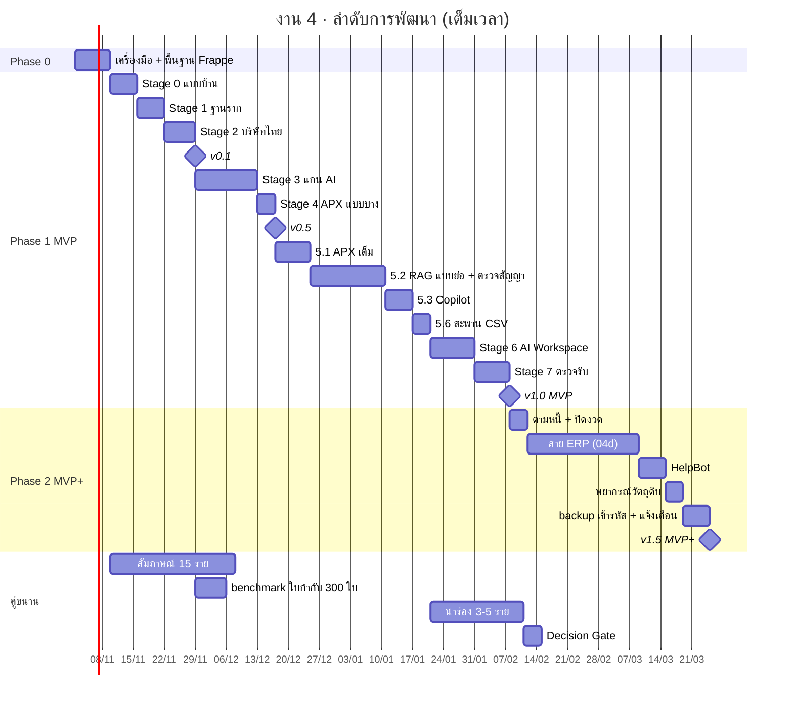
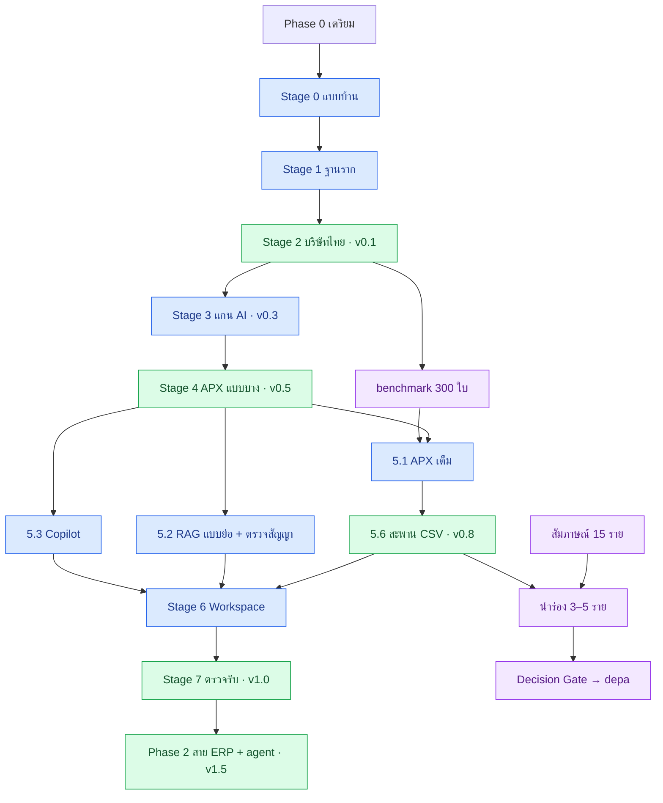

# 🛣️ งานที่ 4k — แผนลำดับการพัฒนา (Roadmap) งาน 4

> **ทำงาน 4 อย่างเดียว** (ตัดสินใจแล้ว: แบบ B + ERPNext + ชั้น AI ที่คุมเอง) — งาน 1–3 ไม่ต้องทำ ส่วนที่เคยยืมจากงาน 1–2 สร้างในงาน 4 เลย ([ข้อ 10](#งาน-13-เกี่ยวไหม))
> ไฟล์นี้เรียงทุกขั้นตั้งแต่เตรียมเครื่องจนถึงต่อยอด ว่าทำอะไรก่อนหลัง ใช้เวลาเท่าไร และเสร็จเมื่อไร
> รายละเอียดวิธีทำแต่ละ Stage อยู่ใน [04c](04c-build-guide.md) · สาย ERP อยู่ใน [04d](04d-erp-implementation.md) · ← [หน้าแรกงาน 4](README.md)
>
> เวลาคิดแบบ**เต็มเวลา** (วันทำงาน · 5 วัน/สัปดาห์) · ทำ part-time ราว 15–20 ชม./สัปดาห์ ให้คูณ ~2 · ติ๊กความคืบหน้าได้ใน [viewer](../../../viewer/index.html)

## คำตอบสั้น

| Phase | ทำอะไร | เวลา | เสร็จแล้วได้อะไร |
|---|---|---|---|
| **0 · เตรียม** | แพ็ก skill · 2FA + เข้ารหัสดิสก์ · ติดตั้งเครื่องมือ · ลอง ERPNext · พื้นฐาน Frappe | ~1–1.5 สัปดาห์ | พร้อมเริ่ม Stage 0 |
| **1 · MVP** | Stage 0–7: ERPNext ไทย → แกน AI → APX → RAG + ตรวจสัญญา → Copilot → สะพาน 2 ตัว → Workspace → ตรวจรับ (+ สแกนความปลอดภัยใน CI · threat model · ZAP) | ~11–14 สัปดาห์ (56–70 วัน) | **v1.0 · สมัครงานได้ · เริ่มนำร่องลูกค้าจริง** |
| **2 · MVP+** | สาย ERP (สาขา 2 ผลิต สต๊อก HR ครุภัณฑ์) + ตามหนี้ + HelpBot + พยากรณ์ + backup เข้ารหัส + แจ้งเตือน | ~5–8 สัปดาห์ (26–38 วัน) | v1.5 · ระบบครบทุกฝ่าย |
| **3 · ต่อยอด** | เงินเดือนไทย · สะพานเพิ่ม · ชุดนัดหมาย · Pro | ตามลูกค้า | ทำเฉพาะสิ่งที่มีคนจ่าย |
| **คู่ขนาน** | สัมภาษณ์ 15 ราย · benchmark · นำร่อง · Decision Gate · depa | ระหว่าง Phase 1–2 | Pilot Report + Decision Memo |
| **งานเสริม** | ผลงานตรงประกาศงานจริง: ท่อข้อมูล Lead · เอกสาร BA · CV | เมื่อจะยื่นสายนั้น | ช่องว่างกับประกาศแคบลง |

**รวม v1.0 ที่สัปดาห์ 13–16 · v1.5 ที่สัปดาห์ 18–23** (นับจากเริ่ม Phase 0)

---

## สารบัญ
1. [Milestone](#milestone)
2. [ภาพรวมลำดับการพัฒนา](#ภาพรวมลำดับการพัฒนา)
3. [ลำดับพึ่งพา](#ลำดับพึ่งพา)
4. [Phase 0 — เตรียม](#phase-0--เตรียม)
5. [Phase 1 — MVP](#phase-1--mvp)
6. [Phase 2 — MVP+](#phase-2--mvp)
7. [Phase 3 — ต่อยอดตามลูกค้า](#phase-3--ต่อยอดตามลูกค้า)
8. [คู่ขนาน — ธุรกิจ depa และประสบการณ์จริง](#คู่ขนาน--ธุรกิจ-depa-และประสบการณ์จริง)
9. [งานเสริม — ผลงานตรงประกาศงานจริง](#งานเสริม--ผลงานตรงประกาศงานจริง)
10. [งาน 1–3 เกี่ยวไหม](#งาน-13-เกี่ยวไหม)
11. [กติกาเดินตามแผน](#กติกาเดินตามแผน)

---

## Milestone

| Milestone | สัปดาห์ที่ | ได้อะไร | Gate / tag |
|---|---|---|---|
| v0.1 | 4–5 | ERPNext ไทย + บริษัทจำลองตั้งด้วยสคริปต์ · test ภาษีไทยผ่าน | `stage-2` |
| v0.3 | 5–7 | แกน AI: สิทธิ์ · อนุมัติ · audit · webhook · LLM gateway | `stage-3` |
| v0.5 | 6–8 | APX ครบเส้น: อัปโหลด → ร่าง → อนุมัติ → ลงบัญชี | `stage-4` |
| v0.8 | 10–13 | APX เต็ม · RAG + ตรวจสัญญา · Copilot · สะพาน ERPNext + CSV | `stage-5` |
| v1.0 MVP | 13–16 | AI Workspace + eval + deploy + วิดีโอ → **สมัครงานได้** · เริ่มนำร่อง | `v1.0-mvp` |
| v1.5 MVP+ | 18–23 | สาย ERP ครบ + ตามหนี้ + HelpBot + พยากรณ์วัตถุดิบ + backup เข้ารหัส + แจ้งเตือน | `erp-track` |
| v2.0 | 23+ | ต่อยอด Phase 3 ตามที่ลูกค้าจ่าย | — |

```python
# คำนวณสัปดาห์จากช่วงวันของแต่ละขั้น (ช่วงล่าง, ช่วงบน)
from math import ceil
P0 = (5, 7)                                                                                    # รวม 0.0 แพ็ก skill + 0.5 ความปลอดภัยเครื่อง
MVP = [(3, 5), (4, 5), (4, 5), (9, 11), (3, 3), (5, 6), (10, 13), (4, 4), (3, 3), (6, 8), (5, 7)]   # Stage 0–7 (5.2 รวม RAG แบบย่อ)
PLUS = [(3, 3), (15, 22), (3, 5), (2, 3), (1, 2), (2, 3)]                                      # 5.4 · สาย ERP · HelpBot · พยากรณ์ · backup · แจ้งเตือน
lo = P0[0] + sum(a for a, _ in MVP); hi = P0[1] + sum(b for _, b in MVP)
assert (ceil(lo / 5), ceil(hi / 5)) == (13, 16)                       # v1.0
lo += sum(a for a, _ in PLUS); hi += sum(b for _, b in PLUS)
assert (ceil(lo / 5), ceil(hi / 5)) == (18, 23)                       # v1.5
```

---

## ภาพรวมลำดับการพัฒนา

ใช้ค่ากลางของแต่ละขั้น · ความยาวแท่งเป็นวันปฏิทิน (วันทำงาน × 1.4) · สมมติเริ่ม 2 พ.ย. 2569 (เริ่มวันอื่นก็เลื่อนทั้งแผน)



---

## ลำดับพึ่งพา

ลูกศร = ต้องเสร็จก่อน · เส้นหลัก (ช้าไปวันไหน v1.0 ช้าไปวันนั้น) คือแถวกลาง



---

## Phase 0 — เตรียม

~1–1.5 สัปดาห์ · ทำก่อนเขียนโค้ดจริง · ความปลอดภัยทุกขั้นอ้างอิง [04l](04l-security-baseline.md)

| # | ขั้น | ทำอะไร | ต้องมีก่อน | วัน | เสร็จเมื่อ |
|---|---|---|---|---|---|
| 0.0 | ติดตั้งแพ็ก skill | `install.ps1`: Frappe 2 skill · Anthropic 3 skill + plugin ความปลอดภัย 2 ตัว · Trail of Bits 4 ตัว · context7 · `how` ([แพ็ก](../../../tools/claude-skills/README.md)) · แก้ `python3` ก่อน · login context7 ผ่าน `/mcp` | — | 0.5 | `claude plugin list` เห็นครบ 7 plugin · skill ขึ้นใน session ใหม่ |
| 0.1 | ติดตั้งเครื่องมือ | Docker Desktop (WSL2 · จำกัด RAM ใน `.wslconfig` 6 GB · ช้าไปเพิ่มเป็น 8 GB) · uv · Git · Node + pnpm ([04c ข้อ 5.1](04c-build-guide.md#51-เครื่องมือ)) | — | 1 | `docker run hello-world` ผ่าน · `uv --version` ได้ |
| 0.2 | ลอง ERPNext แบบเร็ว | `pwd.yml` ของ frappe_docker → login → เดินดูเมนูขาย ซื้อ บัญชี ([ข้อมูลติดตั้ง](research/erpnext-reference.md#2-ติดตั้งด้วย-frappe_docker)) | 0.1 | 0.5 | สร้าง Sales Invoice ทดลองได้ 1 ใบ |
| 0.3 | พื้นฐาน Frappe | DocType · Hooks · REST API · Webhook · custom app (ทำ tutorial ทางการของ Frappe Framework) · ถาม skill `how` ว่าโค้ด Frappe ส่วนไหนทำงานยังไง | 0.2 | 3–4 | เรียก `/api/resource` ได้ · สร้าง custom app เล็กๆ ได้ |
| 0.4 | อ่านแบบ | 04 → 04f → 04c ตามลำดับใน [หน้าแรก](README.md#เอกสารในโฟลเดอร์นี้) | — | 0.5 | รู้ว่าแต่ละ Stage ทำอะไร ส่งต่ออะไร |
| 0.5 | ความปลอดภัยบัญชีและเครื่อง | 2FA: GitHub · อีเมล · ERPNext admin · password manager · BitLocker · อัปเดต Windows + Defender ([04l ชั้น 1 · 11](04l-security-baseline.md#3-12-ชั้นป้องกัน)) | — | 0.5 | login แอดมินต้องใช้ OTP · BitLocker เปิด |

---

## Phase 1 — MVP

~11–14 สัปดาห์ · วิธีทำทีละขั้นอยู่ใน [04c](04c-build-guide.md) · ติ๊กขั้นย่อยของแต่ละ Stage ได้ใน viewer

| # | ขั้น | ทำอะไร | ต้องมีก่อน | วัน | เสร็จเมื่อ |
|---|---|---|---|---|---|
| 1.1 | Stage 0 แบบบ้าน | ผูก flow กับ DocType · role · autonomy.yaml · แผนชุดทดสอบ · ADR | Phase 0 | 3–5 | Gate Stage 0 ([04c ข้อ 4](04c-build-guide.md#4-stage-0--แบบบ้าน)) |
| 1.2 | Stage 1 ฐานราก | ERPNext + erpnext_thailand (build image) · repo ชั้น AI · CI + สแกนความปลอดภัย: gitleaks · Dependabot · pip-audit / npm audit · Trivy · Semgrep / Bandit · ลง Semgrep / CodeQL ให้ plugin `static-analysis` · โครง skill ตรวจงาน `verify-p4` ([04c 5.6](04c-build-guide.md#56-skill-ตรวจงาน-verify-p4)) | 1.1 | 4–5 | `/health` ตอบครบ · CI เขียว · ไม่มี High ค้าง |
| 1.3 | Stage 2 บริษัทไทย | ตั้งค่าด้วยสคริปต์ · seed · test ภาษีไทย | 1.2 | 4–5 | test ภาษีไทยผ่าน → **v0.1** |
| 1.4 | Stage 3 แกน AI | ERP client · OAuth · policy · proposal · audit · inbox · LLM gateway · MCP + threat model (STRIDE + OWASP LLM Top 10) | 1.3 | 9–11 | ai-agent Submit ไม่ได้ → **v0.3** |
| 1.5 | Stage 4 APX แบบบาง | เส้นบางที่สุดที่ผ่านเสาทุกต้น | 1.4 | 3 | E2E ผ่าน → **v0.5** |
| 1.6 | 5.1 APX เต็ม | อีเมล · หลายหน้า · จับคู่ PO · กันจ่ายซ้ำ · ตัวอ่าน 2 แบบ | 1.5 + benchmark | 5–6 | ช่องสำคัญถูก ≥ 95% |
| 1.7 | 5.2 RAG แบบย่อ + ตรวจสัญญา | สร้างเครื่อง RAG ในงาน 4: ดึงข้อความ PDF ไทย · ตัด chunk · hybrid search + กรองสิทธิ์ → ตรวจสัญญา · sync สิทธิ์จาก ERPNext | 1.5 | 10–13 | Recall ≥ 85% · ค้นข้ามสิทธิ์ = 0 |
| 1.8 | 5.3 Copilot | แผนคิวรี → เรียก API ตามสิทธิ์ผู้ถาม | 1.5 | 4 | ถูก ≥ 90% · ล้ำสิทธิ์ = 0 |
| 1.9 | 5.6 สะพาน CSV | แยก Connector · รูปแบบกลาง · contract tests ([04h](04h-connectors.md)) | 1.6 | 3 | APX ใช้ได้ทั้ง 2 สะพาน → **v0.8** |
| 1.10 | Stage 6 AI Workspace | กล่องอนุมัติ · Copilot · Eval dashboard · Audit | 1.6–1.9 | 6–8 | ทุกหน้าใช้งานได้ |
| 1.11 | Stage 7 ตรวจรับ | E2E · backup/restore · deploy หลัง reverse proxy HTTPS + firewall (เปิดแค่ 443) · ZAP baseline · ASVS L2 · `claude-security` ทั้ง repo · วิดีโอ ([04c ข้อ 11](04c-build-guide.md#11-stage-7--ตรวจรับ)) | 1.10 | 5–7 | **v1.0 MVP** · สมัครงานได้ |

---

## Phase 2 — MVP+

~5–8 สัปดาห์ · ทำหลัง v1.0 · ตั้งค่าด้วยสคริปต์ + test ทุกขั้น ([04d](04d-erp-implementation.md))

| # | ขั้น | ทำอะไร | ต้องมีก่อน | วัน | เสร็จเมื่อ |
|---|---|---|---|---|---|
| 2.1 | ตามหนี้ + ปิดงวด (5.4) | ร่างอีเมลจาก AR aging · checklist ปิดงวด · ร่างคำอธิบายงบ | v1.0 | 3 | ตัวเลขในข้อความตรงกับรายงาน 100% |
| 2.2 | สาขา 2 + แผนก + รายงาน | Cost Center · รายงานแยกสาขา · Auto Email Report | v1.0 | 2–3 | งบทุกสาขารวมกัน = งบบริษัท |
| 2.3 | ผลิต + คลัง + แจ้งเตือนใกล้หมด | BOM · Work Order · Reorder Level | 2.2 | 4–6 | ผลิตแล้วต้นทุนถูก · ของต่ำกว่าจุดสั่งซื้อเกิด Material Request |
| 2.4 | ใบเบิก + เอกสารขาย + แบบพิมพ์ไทย | Material Request · ใบเสนอราคา ใบส่งของ ใบกำกับ ใบเสร็จ | 2.2 | 2–3 | พิมพ์เอกสารไทยครบชุด |
| 2.5 | พนักงาน ลงเวลา กะ ลา | Frappe HR · Checkin → Attendance | 2.2 | 3–4 | สรุปวันทำงานตรงข้อมูลลงเวลา |
| 2.6 | ครุภัณฑ์ + ฟอร์มตรวจนับ | Asset · Asset Repair · ฟอร์มตรวจนับ | 2.2 | 3–4 | รายการ "ต้องซ่อม" สร้าง Asset Repair ได้ |
| 2.7 | เจ้าหนี้-ลูกหนี้ + วิธีจ่ายเงิน | Payment Terms · Mode of Payment | 2.2 | 1–2 | ครบตาม [04d ข้อ 13](04d-erp-implementation.md#13-test-เวลา-และ-gate) |
| 2.8 | HelpBot (5.5) | Hire-to-Retire: Employee → User + Role Profile · ปิดบัญชีวันสุดท้าย · อนุมัติผ่านกล่องอนุมัติของงาน 4 (P5) | 2.5 | 3–5 | บัญชีค้างของคนลาออก = 0 |
| 2.9 | พยากรณ์วัตถุดิบหมด | agent ร่าง Material Request ล่วงหน้าจากอัตราใช้ | 2.3 | 2–3 | ร่างทันก่อนของหมด |
| 2.10 | ส่งของ + หลักฐานส่งมอบ (ทางเลือก) | Delivery Trip · POD ผ่าน LINE · ต่อ GPS เดิม ([04d ข้อ 14](04d-erp-implementation.md#14-ส่งของและติดตามรถ-ทางเลือก)) | 2.4 | 4–8 | ทำเมื่อมีลูกค้าส่งของเอง |
| 2.11 | backup เข้ารหัส | ERPNext + PostgreSQL → restic → นอกเครื่อง 1 ชุด + ออฟไลน์ 1 ชุด ([04l ชั้น 8](04l-security-baseline.md#3-12-ชั้นป้องกัน)) | v1.0 | 1–2 | restore เต็มบนเครื่องใหม่สำเร็จ |
| 2.12 | log รวม + แจ้งเตือน | login ล้มเหลว · export จำนวนมาก · ai-agent ถูกปฏิเสธ · audit chain ไม่ผ่าน · uptime ([04l ชั้น 9](04l-security-baseline.md#3-12-ชั้นป้องกัน)) | v1.0 | 2–3 | จำลองเดารหัส → แจ้งเตือนใน 5 นาที · `git tag erp-track` → **v1.5** |

---

## Phase 3 — ต่อยอดตามลูกค้า

ทำเฉพาะเมื่อมีคนจ่าย · ลำดับตามกลุ่มลูกค้าใน [04i](04i-sme-segments.md#6-ลำดับเข้าตลาด-3-ระลอก)

| # | ขั้น | ทำอะไร | ต้องมีก่อน | วัน | เมื่อไร |
|---|---|---|---|---|---|
| 3.0 | ความปลอดภัยก่อนลูกค้ารายแรก | ไล่ checklist 10 ข้อ · ทดสอบเจาะ / review จากภายนอก · runbook เหตุรั่ว · DPA ([04l ข้อ 5–6](04l-security-baseline.md#5-10-ข้อต้องทำก่อนรับลูกค้ารายแรก)) | v1.0 · 2.11 · 2.12 | 5–10 | checklist ครบ · รายงานทดสอบไม่มี High ค้าง |
| 3.1 | แยกลูกค้า (tenant_id + RLS) | test ค้นข้ามลูกค้า = 0 ทั้ง DB และคลัง RAG | v1.0 | 1–2 | ก่อนรับลูกค้ารายที่ 2 |
| 3.2 | สะพานเพิ่ม | Google Sheets · DB อ่านอย่างเดียว · Odoo ผ่าน contract tests เดิม | 1.9 | 2–5 ต่อตัว | มีลูกค้าใช้ระบบนั้น |
| 3.3 | งาน 5 เงินเดือนไทย | OT ตามกฎหมาย · ประกันสังคม · ภ.ง.ด.1 ([งาน 5](../05-thai-payroll-erpnext/README.md)) | 2.5 | 20–30 | ลูกค้ามีคนงานรายวันเยอะ |
| 3.4 | ชุดนัดหมาย | จองคาบ / นัด · เตือน · ตามลูกค้า ([04h ข้อ 7.2](04h-connectors.md#72-ชุดนัดหมาย-booking-pack--ใช้ซ้ำกับธุรกิจบริการที่มีการนัด)) | 3.1 | 8–12 | นำร่องสถาบันสอน / นิติบุคคล |
| 3.5 | Pro: Issue/SLA · Budget · Portal | ตาม [04a ข้อ 10](04a-company-blueprint.md#10-ขอบเขตใหม่ของงาน-4-ตาม-phase) | v1.5 | 20–60 | ลูกค้าระลอก 2 |
| 3.6 | fine-tune เล็ก (Hugging Face) | reranker จากค่าที่คนแก้ใน APX | 1.6 | 3–5 | ต้องชนะตัวเดิมใน eval |
| 3.7 | vLLM | เปลี่ยนจาก Ollama เมื่อผู้ใช้พร้อมกันเยอะ | v1.0 | 2–3 | Ollama รับไม่ไหว |

---

## คู่ขนาน — ธุรกิจ depa และประสบการณ์จริง

ทำระหว่าง Phase 1–2 · รายละเอียดใน [04b](04b-depa-product-track.md) และ [04j](04j-feasibility-business-plan.md)

| # | ขั้น | ทำอะไร | ต้องมีก่อน | วัน | เสร็จเมื่อ |
|---|---|---|---|---|---|
| B1 | สมัคร depa Member | เฝ้าประกาศรอบ Idea Stage | — | 0.5 | เป็นสมาชิกแล้ว |
| B2 | สัมภาษณ์ 15 ราย | กลุ่มระลอก 1: สำนักงานบัญชี · บริษัท IT · ค้าส่ง · โรงงาน ([04b ข้อ 5](04b-depa-product-track.md#5-สัมภาษณ์ลูกค้า-15-ราย)) | — | ~20 | ตารางผลสัมภาษณ์ครบ |
| B3 | benchmark ใบกำกับ 300 ใบ | ข้อมูลสมมติ / ปกปิด · ใช้วัด APX ทุกเวอร์ชัน | 1.3 | 5 | วัด 1.6 ได้ |
| B4 | สมทบโค้ด erpnext_thailand | แก้ bug / เพิ่มเอกสาร | Phase 0 | ต่อเนื่อง | PR merge ≥ 1 |
| B5 | นำร่อง 3–5 ราย | DPA · คนตรวจทุกใบ · วัดเวลา + ความแม่น ([04b ข้อ 6](04b-depa-product-track.md#6-นำร่องกับลูกค้าจริง-35-ราย)) | 1.9 + B2 | 15 | Pilot Report |
| B6 | Decision Gate | ไปต่อ / เปลี่ยนทิศ / หยุด | B5 | 3 | Decision Memo |
| B7 | ยื่น depa | pitch deck + คลิปภาษาอังกฤษ ([04j ข้อ 4](04j-feasibility-business-plan.md#4-แผนธุรกิจเสนอ-depa)) | B6 | ตามรอบ | ยื่นครบ |
| B8 | งานสะพานเล็กๆ 2–3 งาน | ประสบการณ์เชื่อมระบบลูกค้าจริง | 1.9 | 5–10 ต่องาน | case study |

---

## งานเสริม — ผลงานตรงประกาศงานจริง

ผลงานชิ้นเล็กที่ปิดช่องว่างกับประกาศงานที่เจอจริง (ต.ค. 2569) · ทำเมื่อจะยื่นสายนั้น · **ไม่นับในเวลา MVP** · ใช้ข้อมูลสมมติหรือข้อมูลเปิดเท่านั้น · ภาพรวมตลาดงานใน [เส้นทางอาชีพ](../career-roadmap.md#6-แปลงเป็นงานในพอร์ต)

| # | ขั้น | ทำอะไร | ตรงประกาศ | ต้องมีก่อน | วัน | เสร็จเมื่อ |
|---|---|---|---|---|---|---|
| J1 | ท่อข้อมูล Lead SME (Data + AI) | ข้อมูลนิติบุคคลเปิดของกรมพัฒนาธุรกิจการค้า → PostgreSQL → SQL หาข้อมูลซ้ำ (window function · CTE) + กฎตรวจรูปแบบ → LLM จัดหมวดอุตสาหกรรมผ่าน LLM gateway → ตั้งรันอัตโนมัติ → dashboard · เก็บเฉพาะข้อมูลนิติบุคคล ไม่เก็บข้อมูลส่วนบุคคล (PDPA) · ไม่ scrape Google Maps (ผิดเงื่อนไข Google) | Accella: Data / Lead | 1.4 | 5–7 | repo + dashboard · ได้รายชื่อ SME ระลอก 1 ไปใช้ใน B2 |
| J2 | ชุดเอกสาร BA (ภาษาอังกฤษ) | ย่อ [04](04-enterprise-os.md) + [04g](04g-department-flows.md) + ไฟล์นี้เป็น requirement · scope · แผนงาน · แผน UAT 5–8 หน้า | AIT AI Center: Business Analyst | — | 2–3 | PDF 1 ชุดแนบใบสมัครได้ |
| J3 | ตรวจลายเซ็น / ตราประทับ (CV) | รูปใบส่งของสมมติ → YOLO ตรวจจับ → precision / recall / F1 → ONNX → TensorRT วัดความเร็วก่อน-หลังบน RTX 5060 → รายงานผล ([04d 14.3](04d-erp-implementation.md#143-flow-หลักฐานส่งมอบ)) | AIT AI Center: CV Developer | — | 7–10 | รายงาน eval + ตัวเลขความเร็ว · ทำเมื่อจะยื่นสาย CV เท่านั้น |

**ไม่เพิ่ม:** งาน C# / Angular (Sales Logs) — สแต็กไม่ต่อกับงาน 4 · **ลำดับ:** J1 → J2 → J3 (J1 ตรงพอร์ตที่สุดและได้รายชื่อลูกค้าไปด้วย)

---

## งาน 1–3 เกี่ยวไหม

**ไม่ต้องทำ** — งาน 1–3 มาจากแผนพอร์ตเดิม (เส้นทาง C ใน [MD หลัก](../README.md#9-กลยุทธ์เลือกเส้นทาง--roadmap)) ที่ตอนนี้เปลี่ยนเป็นทำงาน 4 อย่างเดียวแล้ว · ที่เคยเกี่ยวกันมีแค่ส่วนที่งาน 4 ยืมไปใช้ ซึ่งแผนนี้สร้างเองในงาน 4 แล้ว

| งาน | เคยเกี่ยวกับงาน 4 ยังไง | ในแผนนี้ |
|---|---|---|
| 1 · Enterprise RAG | เครื่องค้นเอกสารของตรวจสัญญา | สร้างแบบย่อใน 1.7 (+5–7 วัน รวมในเวลาแล้ว) |
| 2 · IT Support Agent | HelpBot เปิด/ปิดบัญชีพนักงาน | สร้างใน 2.8 ใช้กล่องอนุมัติของงาน 4 แทน Slack |
| 3 · Finance Dashboard | กราฟผู้บริหารใน Workspace | ใช้รายงาน ERPNext + กราฟใน 1.10 · ไม่ต้องมีงาน 3 |
| 5 · เงินเดือนไทย | app ที่ติดตั้งลง ERPNext ของงาน 4 | ทางเลือกใน Phase 3 (3.3) เมื่อมีลูกค้าต้องการ |

---

## กติกาเดินตามแผน

| กติกา | ทำไม |
|---|---|
| ไม่ข้าม Gate — ไม่ผ่านให้แก้ก่อน | ปัญหาที่ Stage 3 แก้ถูกกว่าแก้หลังมี agent 6 ตัว ([04c ข้อ 2](04c-build-guide.md#2-กฎลำดับการก่อสร้าง-6-ข้อ)) |
| `git tag` ทุก Gate | ย้อนกลับได้ · เห็นความคืบหน้าใน GitHub |
| ก่อน `git tag` อัปเดตแผนที่ฟีเจอร์ของ `verify-p4` แล้วรันให้ผ่าน | ไม่มีหลักฐานว่าใช้ได้จริง = ยังไม่เสร็จ |
| ช้ากว่าแผน > 30% ใน Stage ไหน → ตัดขอบเขตของ Stage นั้น ไม่ตัด test | เวลาหลุดมักมาจากทำเกินขอบเขต |
| ไม่ `git tag` ถ้ายังมี finding ความปลอดภัยระดับ High ค้าง | แก้ตอนนี้ถูกกว่าแก้หลังมีลูกค้า ([04l](04l-security-baseline.md)) |
| สมัครงานตั้งแต่ v0.8 · ไม่รอ v1.0 | มีของโชว์แล้ว · กระบวนการสมัครใช้เวลา |
| อัปเดตไฟล์นี้เมื่อเวลาจริงต่างจากแผน → รัน `python viewer/build.py` | viewer จะเห็นแผนล่าสุด |

← [หน้าแรกงาน 4](README.md)
