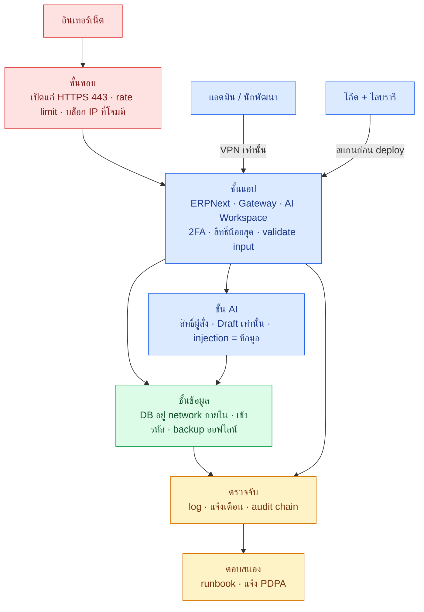
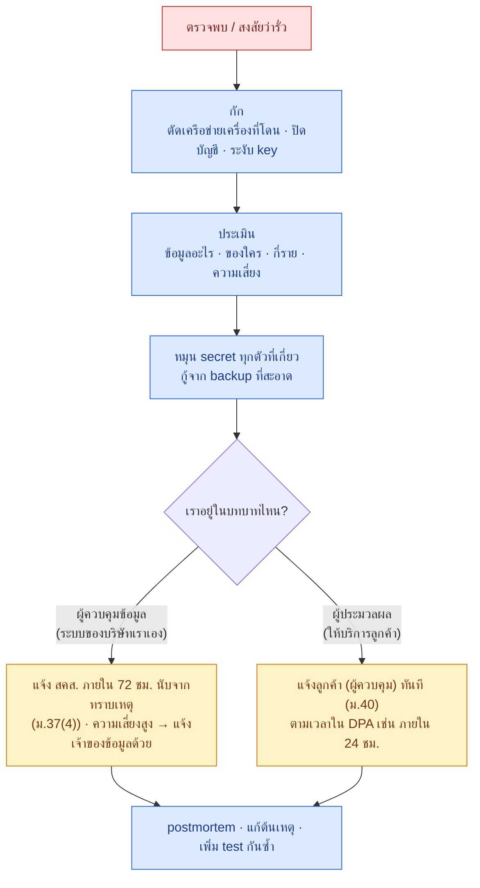

# 🛡️ งานที่ 4l — แผนความปลอดภัยทั้งระบบ (Security Baseline)

> กันแฮ็กและขโมยข้อมูลทั้งระบบงาน 4: ERPNext · Gateway · AI Workspace · ฐานข้อมูล · LLM ในเครื่อง · เครื่องนักพัฒนา
> ภัยฝั่ง AI (สิทธิ์ผู้สั่ง · prompt injection · webhook · audit) อยู่ใน [04 ข้อ 15](04-enterprise-os.md#15-security) แล้ว — ไฟล์นี้เติม**ทุกชั้นที่เหลือ** และบอกว่าทำตอนไหนใน [04k](04k-dev-roadmap.md)
> ← [หน้าแรกงาน 4](README.md)

## คำตอบสั้น

| คำถาม | คำตอบ |
|---|---|
| ใช้อะไรป้องกันดีที่สุด | **ไม่มีเครื่องมือเดียวที่ดีที่สุด** — ใช้หลายชั้นซ้อนกัน (defense in depth) ชั้นหนึ่งพลาด ชั้นถัดไปยังกัน |
| skill ของ Claude พอไหม | **ไม่พอ** — skill ช่วยแค่ชั้น "โค้ด" (และบางส่วนของไลบรารี) ประมาณ 2 จาก 12 ชั้น · ที่เหลือเป็นการตั้งค่า เครื่องมือ และกระบวนการ ([ข้อ 4](#4-skill-ของ-claude-ครอบคลุมแค่ไหน)) |
| ต้องจ่ายเงินไหม | แทบไม่ต้อง — เครื่องมือในไฟล์นี้ฟรีหรือโอเพนซอร์ส ยกเว้นทดสอบเจาะจากภายนอกก่อนรับลูกค้า |
| เริ่มตรงไหน | ข้อ 0.5 ใน 04k: 2FA ทุกบัญชี + password manager + เข้ารหัสดิสก์ — ทำได้วันนี้ ใช้เวลาครึ่งวัน |

---

## สารบัญ
1. [ภาพรวมชั้นป้องกัน](#1-ภาพรวมชั้นป้องกัน)
2. [ภัยที่ต้องกัน](#2-ภัยที่ต้องกัน)
3. [12 ชั้นป้องกัน](#3-12-ชั้นป้องกัน)
4. [skill ของ Claude ครอบคลุมแค่ไหน](#4-skill-ของ-claude-ครอบคลุมแค่ไหน)
5. [10 ข้อต้องทำก่อนรับลูกค้ารายแรก](#5-10-ข้อต้องทำก่อนรับลูกค้ารายแรก)
6. [Runbook เมื่อข้อมูลรั่ว](#6-runbook-เมื่อข้อมูลรั่ว)
7. [งานที่แทรกเข้าแผนพัฒนา](#7-งานที่แทรกเข้าแผนพัฒนา)
8. [แหล่งข้อมูล](#8-แหล่งข้อมูล)

---

## 1. ภาพรวมชั้นป้องกัน

---

## 2. ภัยที่ต้องกัน

| ภัย | ตัวอย่าง | ชั้นที่กัน (ข้อ 3) |
|---|---|---|
| ขโมยบัญชีแอดมิน | phishing · ใช้รหัสซ้ำกับเว็บที่รั่ว | ตัวตน |
| โจมตีจากอินเทอร์เน็ต | สแกนพอร์ต · เดารหัส · ใช้ช่องโหว่ ERPNext/ไลบรารีเก่า | เครือข่าย · ซัพพลายเชน |
| secret / key หลุด | commit `.env` · วางรหัสในแชท · log พิมพ์ token | Secret · เครื่องนักพัฒนา |
| ไลบรารีมีมัลแวร์หรือช่องโหว่ | แพ็กเกจปลอมบน PyPI/npm · CVE ใน base image | ซัพพลายเชน |
| ช่องโหว่ในโค้ดเรา | SQL injection · IDOR · SSRF · XSS | โค้ด · เว็บ/API |
| AI ถูกหลอกหรือทำเกินสิทธิ์ | คำสั่งซ่อนใน PDF · AI ดึงข้อมูลฝ่ายอื่น | AI/LLM (+ [04 ข้อ 15](04-enterprise-os.md#15-security)) |
| ransomware / ลบข้อมูล | เข้ารหัสดิสก์เรียกค่าไถ่ · ลบ backup | ข้อมูล (backup ออฟไลน์) |
| คนในขโมยข้อมูล | export ลูกค้าทั้งหมดก่อนลาออก | ตัวตน (สิทธิ์น้อยสุด) · ตรวจจับ |
| ลูกค้า A เห็นข้อมูลลูกค้า B | ลืมกรอง `tenant_id` | ก่อนรับลูกค้า ([04h ข้อ 7.3](04h-connectors.md#73-กฎแยกลูกค้า)) |
| เครื่องนักพัฒนาโดนเจาะ | มัลแวร์ขโมย token ใน browser | เครื่องนักพัฒนา |

---

## 3. 12 ชั้นป้องกัน

| # | ชั้น | ทำอะไร | เครื่องมือ (ฟรี / โอเพนซอร์ส) | ทำตอน (04k) | เสร็จเมื่อ / ทดสอบ |
|---|---|---|---|---|---|
| 1 | **ตัวตน** | 2FA ทุกบัญชีแอดมิน (GitHub · อีเมล · ERPNext · เซิร์ฟเวอร์/คลาวด์) · password manager · บัญชีแอดมินแยกจากบัญชีใช้งาน · นโยบายรหัสผ่าน + session timeout ใน ERPNext · ปิดบัญชีวันลาออก (HelpBot) | 2FA ในตัวของ Frappe · Bitwarden | 0.5 · 2.8 | login แอดมินโดยไม่มีรหัส OTP ไม่ได้ |
| 2 | **เครือข่าย** | เปิดสู่อินเทอร์เน็ตแค่ 443 · DB / Redis / Ollama / หน้าแอดมินอยู่ docker network ภายใน (ไม่ publish port) · SSH ด้วย key ผ่าน VPN เท่านั้น · rate limit ที่ proxy และ Gateway · บล็อก IP ที่โจมตี | Caddy (HTTPS อัตโนมัติ) · firewall ของ OS · Tailscale / WireGuard · CrowdSec หรือ fail2ban · Cloudflare (ทางเลือก) | 1.11 | สแกนจากภายนอกเห็นแค่ 443 · เดารหัสผิด 20 ครั้ง → ถูกบล็อก |
| 3 | **Secret** | `.env` อยู่ใน `.gitignore` · สแกน secret ก่อน commit และใน CI · เปิด secret scanning + push protection ของ GitHub · key แยก dev / staging / prod · หมุน key ai-agent และ webhook ทุก 90 วันหรือเมื่อสงสัย | gitleaks · GitHub push protection | 1.2 | commit ไฟล์ที่มี key ปลอม → ถูกบล็อก · gitleaks ผ่านทั้งประวัติ |
| 4 | **ซัพพลายเชน** | pin เวอร์ชัน (มีแล้ว) · แจ้งเตือนไลบรารีมีช่องโหว่ · สแกนไลบรารีและอิมเมจใน CI · ตรวจไลบรารีใหม่ก่อนเพิ่ม · รีวิว plugin / skill ก่อนติดตั้ง | Dependabot · pip-audit · npm audit · Trivy · ToB `supply-chain-risk-auditor` · [แพ็ก skill](../../../tools/claude-skills/README.md) | 0.0 · 1.2 | CI แดงเมื่อมีช่องโหว่ระดับ High |
| 5 | **โค้ด** | ตรวจขณะเขียน → ทุก branch → สแกนลึกทุก Gate · Semgrep + Bandit ใน CI · review `ai_bridge` ด้วย checklist ของ Frappe | `security-guidance` · `/security-review` · `claude-security` · Semgrep CE · Bandit · `frappe-code-review` · ToB `static-analysis` / `insecure-defaults` / `differential-review` | ทุก Stage | ไม่มี finding ระดับ High ค้างก่อน `git tag` |
| 6 | **เว็บ / API** | ทำตาม OWASP ASVS ระดับ 2 · security headers (CSP · HSTS · X-Frame-Options) ที่ proxy · cookie `Secure` + `SameSite` · validate ทุก input ด้วย Pydantic · จำกัดชนิด/ขนาดไฟล์อัปโหลด (APX: PDF/JPG/PNG ≤ 10 MB ตรวจจากเนื้อไฟล์ ไม่ใช่นามสกุล) · อ่าน PDF/OCR ใน container แยกที่ไม่มีอินเทอร์เน็ต | OWASP ZAP (baseline scan) · Pydantic | 1.11 | ZAP baseline ไม่มี High · ไฟล์ `.exe` เปลี่ยนนามสกุลเป็น `.pdf` → ถูกปฏิเสธ |
| 7 | **AI / LLM** | ผูก OWASP Top 10 for LLM Apps กับระบบที่มี: prompt injection → เอกสาร = ข้อมูล + allowlist เครื่องมือ + Draft เท่านั้น · ข้อมูลรั่ว → token ผู้สั่ง + `allowed_roles` · ผลลัพธ์ไม่ปลอดภัย → escape HTML ใน Workspace ไม่รันผลลัพธ์ของ LLM · ทำเกินสิทธิ์ → ระดับอิสระ + เพดาน · vector รั่ว → collection แยกต่อลูกค้า · system prompt รั่ว → ไม่ใส่ secret ใน prompt · ใช้ทรัพยากรไม่จำกัด → rate limit + โควตาต่อผู้ใช้ | ชุด injection eval (มีแล้วใน [04c Stage 5](04c-build-guide.md#9-stage-5--agent-ทีละตัว)) | 1.4 · 1.6–1.8 | injection = 0 action · ค้นข้ามสิทธิ์ = 0 |
| 8 | **ข้อมูล** | TLS ทุกจุด · เข้ารหัสดิสก์ · backup ERPNext (`bench backup --with-files`) + `pg_dump` → เข้ารหัส → เก็บนอกเครื่อง 1 ชุด + ออฟไลน์ 1 ชุด (กัน ransomware) · ทดลอง restore รายเดือน · เก็บเอกสารบัญชี 5 ปีแล้วลบตามกำหนด · ปิดบัง PII ใน log | BitLocker / LUKS · restic | 2.11 | restore เต็มบนเครื่องใหม่สำเร็จ · ไฟล์ backup เปิดไม่ได้หากไม่มีรหัส |
| 9 | **ตรวจจับ** | รวม log · แจ้งเตือน: login ล้มเหลวติดกัน · export ข้อมูลจำนวนมาก · ai-agent ถูกปฏิเสธ · webhook 401 ถี่ · Verify audit chain ไม่ผ่าน · ระบบล่ม | Grafana + Loki หรือ Wazuh · Uptime Kuma | 2.12 | จำลองเดารหัส → มีแจ้งเตือนภายใน 5 นาที |
| 10 | **ตอบสนอง** | runbook ข้อ 6 · รายชื่อผู้ติดต่อ · ซ้อมปีละครั้ง | — | 3.0 | ซ้อมจบในเวลา · มีบันทึก postmortem |
| 11 | **เครื่องนักพัฒนา** | อัปเดต OS · Defender · BitLocker · browser แยก profile สำหรับงานแอดมิน · ไม่ติดตั้งของจากแหล่งที่ไม่รู้จัก · เก็บ token ใน Credential Manager เท่านั้น · **ไม่วางรหัสผ่าน / secret ในแชท AI หรือไฟล์** | Windows Security · BitLocker | 0.5 | BitLocker เปิด · Defender ไม่มีภัยค้าง |
| 12 | **ก่อนรับลูกค้า** | ทดสอบเจาะจากภายนอก (หรือให้ผู้เชี่ยวชาญ review) · test แยกลูกค้า · DPA · ประกันภัยไซเบอร์ (ทางเลือก) | ผู้ทดสอบภายนอก | 3.0 · 3.1 | รายงาน pentest ไม่มี High ค้าง |

---

## 4. skill ของ Claude ครอบคลุมแค่ไหน

| ชั้น | skill ช่วยได้ | ยังต้องทำเอง |
|---|---|---|
| โค้ด | ✅ `security-guidance` · `/security-review` · `claude-security` · ToB · `frappe-code-review` | ตั้ง Semgrep + Bandit ใน CI |
| ซัพพลายเชน | 🟡 ToB `supply-chain-risk-auditor` วิเคราะห์ไลบรารีก่อนเพิ่ม | Dependabot · pip-audit · npm audit · Trivy ใน CI |
| เว็บ / API | 🟡 `claude-security` หาช่องโหว่ในโค้ดได้ | รัน ZAP · ไล่ checklist ASVS |
| AI / LLM | 🟡 review โค้ดส่วน agent ได้ | รันชุด injection eval ทุก Gate |
| ตัวตน · เครือข่าย · secret · ข้อมูล · ตรวจจับ · ตอบสนอง · เครื่องนักพัฒนา · ก่อนรับลูกค้า | ❌ | ตั้งค่า เครื่องมือ และกระบวนการตามข้อ 3 |

→ skill ทำให้**โค้ดที่เขียน**ปลอดภัยขึ้นมาก แต่ระบบจะโดนเจาะจากชั้นอื่นได้เสมอ ถ้าไม่ได้ตั้งค่าส่วนที่เหลือ

---

## 5. 10 ข้อต้องทำก่อนรับลูกค้ารายแรก

- [ ] 2FA ทุกบัญชีแอดมิน (ชั้น 1)
- [ ] เปิดสู่อินเทอร์เน็ตแค่ 443 + HTTPS · DB ไม่ publish port (ชั้น 2)
- [ ] gitleaks ผ่านทั้งประวัติ git · ไม่มี secret ใน repo (ชั้น 3)
- [ ] CI สแกนไลบรารี + อิมเมจ ไม่มี High ค้าง (ชั้น 4)
- [ ] `claude-security` + ZAP baseline ไม่มี High ค้าง (ชั้น 5–6)
- [ ] test แยกลูกค้า = 0 รั่ว ทั้ง DB และคลัง RAG (ชั้น 12)
- [ ] backup เข้ารหัส + นอกเครื่อง + restore ทดสอบแล้ว (ชั้น 8)
- [ ] แจ้งเตือนความผิดปกติทำงานจริง (ชั้น 9)
- [ ] runbook + DPA + ช่องทางแจ้งเหตุพร้อม (ชั้น 10)
- [ ] ทดสอบเจาะ / review จากภายนอก (ชั้น 12)

---

## 6. Runbook เมื่อข้อมูลรั่ว

> มีกรณีจริงที่บริษัทเอกชนไทยถูกปรับ 7 ล้านบาท ส่วนหนึ่งเพราะไม่แจ้งเหตุภายใน 72 ชั่วโมง · ถ้อยคำ ม.40 ให้ตรวจจากราชกิจจานุเบกษาหรือเว็บ สคส. ก่อนเขียนลง DPA 🟡

---

## 7. งานที่แทรกเข้าแผนพัฒนา

รายละเอียดอยู่ใน [04k](04k-dev-roadmap.md)

| 04k | งาน | ชั้น |
|---|---|---|
| 0.0 | ติดตั้งแพ็ก skill (รวม skill ความปลอดภัย) | 4 · 5 |
| 0.5 | 2FA ทุกบัญชี · password manager · BitLocker · อัปเดตเครื่อง | 1 · 11 |
| 1.2 | gitleaks · Dependabot · pip-audit / npm audit · Trivy · Semgrep / Bandit ใน CI | 3 · 4 · 5 |
| 1.4 | threat model (STRIDE) ของ Gateway | 5 · 7 |
| 1.11 | reverse proxy HTTPS + firewall · ZAP baseline · ASVS L2 · `claude-security` ทั้ง repo | 2 · 5 · 6 |
| 2.11 | backup เข้ารหัส นอกเครื่อง + ออฟไลน์ | 8 |
| 2.12 | log รวม + แจ้งเตือนความผิดปกติ + uptime | 9 |
| 3.0 | ทดสอบเจาะ · runbook · DPA ก่อนลูกค้ารายแรก | 10 · 12 |

---

## 8. แหล่งข้อมูล

- [Claude Code — security-guidance](https://code.claude.com/docs/en/security-guidance.md) · [Claude Security plugin](https://code.claude.com/docs/en/claude-security.md)
- [Trail of Bits — Claude Code skills](https://github.com/trailofbits/skills)
- [OWASP ASVS](https://owasp.org/www-project-application-security-verification-standard/) · [OWASP Top 10 for LLM Applications](https://genai.owasp.org/llm-top-10/) · [ZAP](https://www.zaproxy.org/)
- [Thai PBS — กรณีปรับเอกชน 7 ล้านบาทตาม PDPA](https://www.thaipbs.or.th/now/content/1538)
- [ข้อมูลอ้างอิงภาษี แรงงาน และ PDPA ของงาน 4](research/thai-tax-labor-reference.md)

← [หน้าแรกงาน 4](README.md)
