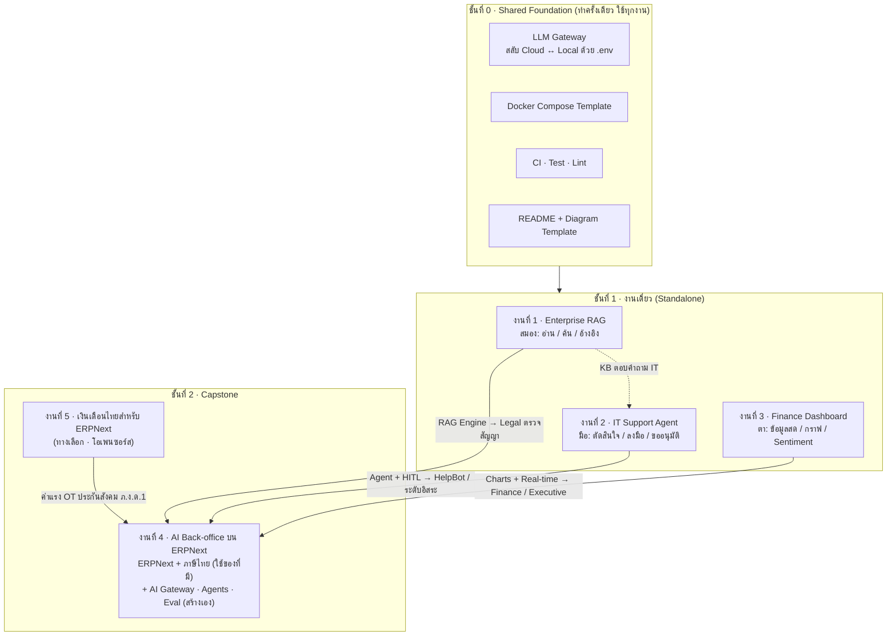
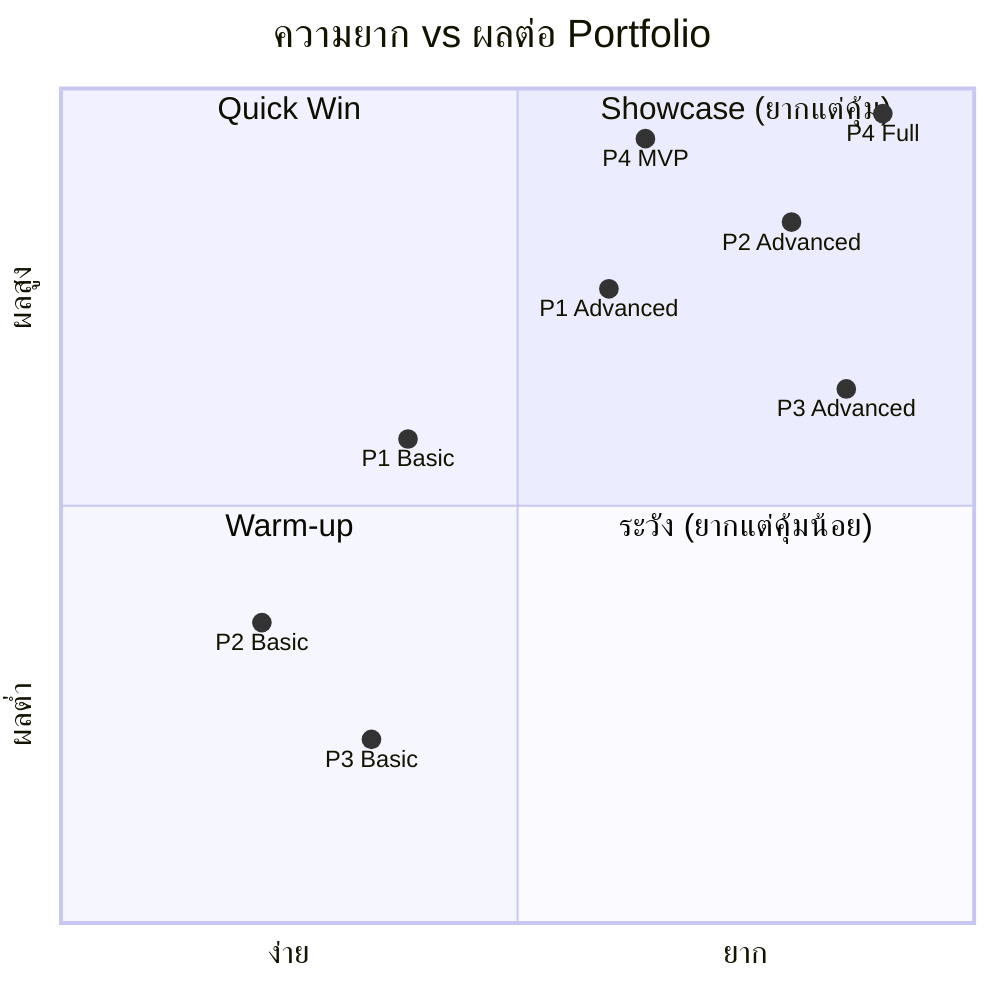
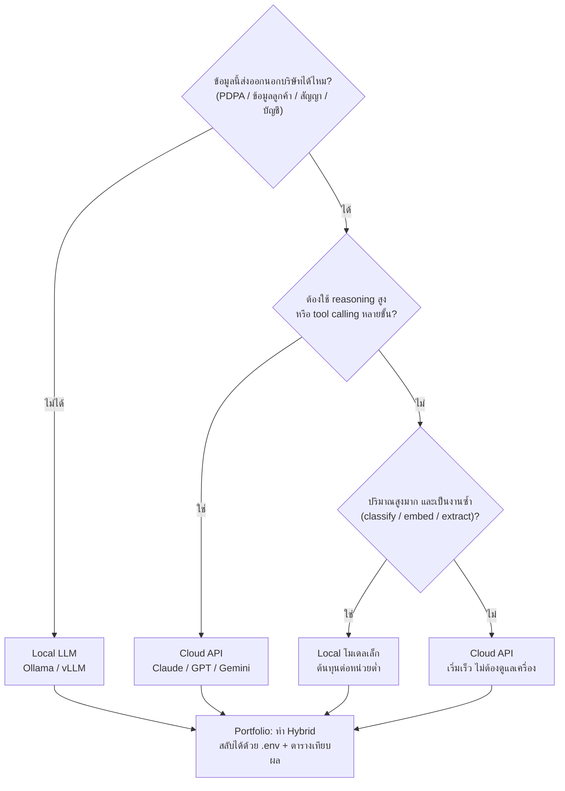
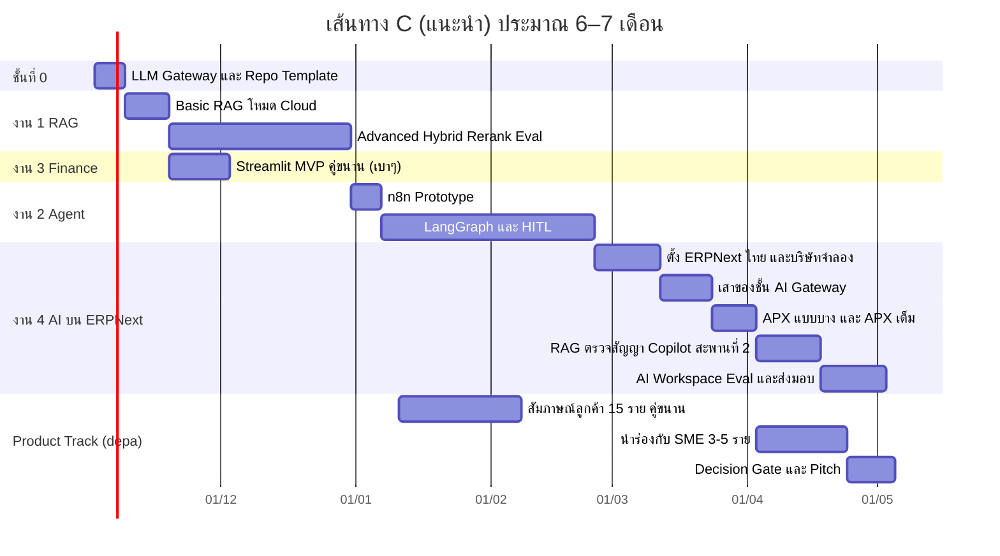

# 🗂️ IT + AI Portfolio — Master Plan (MD หลัก)

> ✅ **ตัดสินใจแล้ว (16 ต.ค. 2569): ทำงาน 4 อย่างเดียว** — แผนลำดับการพัฒนาอยู่ใน [04k](04-erpnext-enterprise-os/04k-dev-roadmap.md) · งาน 1–3 และเส้นทาง C ในไฟล์นี้เป็นแผนเดิม เก็บไว้อ้างอิง
>
> สรุปและวิเคราะห์เชิงลึกจากบทสนทนาทั้งหมด → แตกเป็น **4 งาน** พร้อมโครงสร้าง ขนาดงาน ความยาก ทางเลือก Local vs Cloud
> ความเชื่อมโยงระหว่างงาน และแผนลงมือทำ
>
> ไฟล์ในชุดนี้
>
> | ไฟล์ | เนื้อหา |
> |---|---|
> | **README.md** (ไฟล์นี้) | ภาพรวม 4 งาน, เปรียบเทียบ, ความเชื่อมโยง, Local vs Cloud, Roadmap, จุดที่ต้องแก้จากเอกสารเดิม |
> | [01-enterprise-rag.md](01-enterprise-rag.md) | งานที่ 1 — Enterprise RAG Knowledge Base |
> | [02-it-support-agent.md](02-it-support-agent.md) | งานที่ 2 — Multi-Agent IT Support Automation |
> | [03-finance-ai-dashboard.md](03-finance-ai-dashboard.md) | งานที่ 3 — Full-Stack AI Finance Analytics Dashboard |
> | 📁 [04-erpnext-enterprise-os/](04-erpnext-enterprise-os/README.md) | งานที่ 4 — Enterprise OS บน ERPNext + ชั้น AI ที่คุมเองทั้งหมด (โฟลเดอร์รวมสเปก บริษัทจำลอง สาย ERP คู่มือสร้าง ทุน depa แผนธุรกิจรายเดือน และข้อมูลอ้างอิง) |
> | 📁 [05-thai-payroll-erpnext/](05-thai-payroll-erpnext/README.md) | งานที่ 5 (ทางเลือก) — app เงินเดือนไทยสำหรับ ERPNext: OT ตามกฎหมาย · ประกันสังคม · ภ.ง.ด.1 |
> | 🧭 [career-roadmap.md](career-roadmap.md) | เส้นทางอาชีพ 2026–2034: ตลาดงาน AI ไทย · คาดการณ์ AI · ทักษะที่อยู่ยาว · ให้คะแนนทางเลือก · ทบทวนทุก 6 เดือน |
> | 🖥️ [viewer/index.html](../../viewer/index.html) | **เปิดอ่านเอกสารงาน 4 + Roadmap แบบเว็บในเครื่อง** — ดับเบิลคลิกเปิดได้เลย (ต้องต่อเน็ต) · แก้ MD แล้วรัน `python viewer/build.py` เพื่ออัปเดต · ติ๊กความคืบหน้าแต่ละขั้นได้ · **ฉบับมือถือ (ต้องใส่รหัสผ่าน):** [covaverse.github.io/enterprise-os-plan](https://covaverse.github.io/enterprise-os-plan/) — อัปเดตด้วย `viewer/publish.mjs` แล้ว push ใน `viewer/publish/` |

---

## สารบัญ

1. [คำตอบสั้น: "มี 4 งาน" เข้าใจถูกไหม?](#1-คำตอบสั้น-มี-4-งาน-เข้าใจถูกไหม)
2. [แผนภาพความเชื่อมโยงของ 4 งาน](#2-แผนภาพความเชื่อมโยงของ-4-งาน)
3. [ตารางเปรียบเทียบ 4 งาน](#3-ตารางเปรียบเทียบ-4-งาน)
4. [ประเมินความยากใหม่ เทียบกับเอกสารเดิม](#4-ประเมินความยากใหม่-เทียบกับเอกสารเดิม)
5. [Skill Coverage Matrix](#5-skill-coverage-matrix)
6. [สมัครตำแหน่งไหน ชูงานไหน](#6-สมัครตำแหน่งไหน-ชูงานไหน)
7. [Local LLM vs Cloud API — ต้องใช้ Local ไหม?](#7-local-llm-vs-cloud-api--ต้องใช้-local-ไหม)
8. [ชั้นที่ 0: Shared Foundation (ทำครั้งเดียว ใช้ทุกงาน)](#8-ชั้นที่-0-shared-foundation)
9. [กลยุทธ์เลือกเส้นทาง + Roadmap](#9-กลยุทธ์เลือกเส้นทาง--roadmap)
10. [สิ่งที่ควรแก้/อัปเดตจากเอกสารเดิม](#10-สิ่งที่ควรแก้อัปเดตจากเอกสารเดิม-fact-check)
11. [Template README สำหรับทุก Repo](#11-template-readme-สำหรับทุก-repo)

---

## 1. คำตอบสั้น: "มี 4 งาน" เข้าใจถูกไหม?

**ถูกครับ — สรุปได้ 4 งาน** แต่ต้องเข้าใจ "โครงสร้าง" ของมันให้ถูกด้วย เพราะ 4 งานนี้ไม่ได้อยู่ระดับเดียวกัน

| # | ชื่องาน | ประเภท | บทบาทใน Portfolio | มาจากส่วนไหนของเอกสาร |
|---|---|---|---|---|
| 1 | **Enterprise RAG Knowledge Base** | งานเดี่ยว (Standalone) | 🧠 "สมอง" — AI อ่าน/ค้น/อ้างอิงเอกสารภายใน | ชุด 3 โปรเจกต์แรก |
| 2 | **Multi-Agent IT Support Automation** | งานเดี่ยว | 🤖 "มือ" — AI ตัดสินใจและลงมือทำงาน | ชุด 3 โปรเจกต์แรก |
| 3 | **Full-Stack AI Finance Analytics Dashboard** | งานเดี่ยว | 📈 "ตา" — Full-stack + ข้อมูล Real-time | ชุด 3 โปรเจกต์แรก |
| 4 | **AI Back-office บน ERPNext** | งานรวม (Capstone / Superset) | 🏢 "ทั้งบริษัท" — ทุกแผนกใช้ ERPNext + ชั้น AI ที่เราคุมเองช่วยทุกแผนก | คำถามต่อมา "อยากได้เว็บเดียวที่ทุกแผนกเชื่อมกัน" |
| 5 | **เงินเดือนไทยสำหรับ ERPNext** (ทางเลือก) | app เสริมของงาน 4 | 🧾 ช่องว่างจริงที่ยังไม่มีใครทำ — เปิดซอร์สได้ | คำถามเรื่องค่าแรง OT คนงาน (เพิ่มภายหลัง) |

### จุดที่ต้องเข้าใจให้ตรง 3 ข้อ

1. **งาน 4 ไม่ได้มาแทนงาน 1–3 แต่ "ครอบ" งาน 1–3**
   - RAG (งาน 1) → กลายเป็นโมดูล **ฝ่ายกฎหมาย** ตรวจสัญญา/ค้นนโยบาย
   - Agent (งาน 2) → กลายเป็นโมดูล **IT Helpdesk + ระบบส่งต่องาน/ขออนุมัติ**
   - Dashboard (งาน 3) → กลายเป็นหน้า **การเงิน/ผู้บริหาร** ที่อัปเดตสด
2. **ทุกงานมี 2 ระดับ (Intermediate / Advanced)** → ถ้านับละเอียดคือ 4 × 2 = **8 รูปแบบ** แต่ **ไม่ต้องทำครบทั้ง 8** (ดูหัวข้อ 9)
3. **มี "ชั้นที่ 0" ที่เอกสารเดิมไม่ได้แยกออกมา** คือของที่ทุกงานใช้ร่วมกัน (LLM Gateway สลับ Cloud/Local, Docker template, CI, README template)
   ไม่ใช่งานที่ 5 แต่ถ้าทำครั้งเดียวตั้งแต่ต้น จะประหยัดเวลาทุกงานถัดไป

> **สรุปสูตร:** `4 งาน = 3 งานเดี่ยว (ชิ้นส่วน) + 1 งานรวม (ประกอบชิ้นส่วนเป็นบริษัท)` วางอยู่บน `ชั้นที่ 0 (ของใช้ร่วม)`

---

## 2. แผนภาพความเชื่อมโยงของ 4 งาน



### ความเชื่อมโยง "เชิงโค้ด" (อะไรย้ายไปใช้ต่อได้)

| ชิ้นส่วน | สร้างครั้งแรกในงาน | นำไปใช้ซ้ำใน | วิธี reuse |
|---|---|---|---|
| LLM Gateway (Cloud ↔ Local) | ชั้นที่ 0 | 1, 2, 3, 4 | package ภายใน / copy โมดูลเดียว |
| Ingestion + Chunking + Hybrid Search | 1 | 2 (KB), 4 (Legal, ค้นเอกสารบริษัท) | import โมดูล `retrieve/` หรือเรียก API `/chat` |
| Structured Output (Pydantic schema) | 2 | 3 (sentiment JSON), 4 (OCR → JSON) | pattern เดียวกัน |
| Human-in-the-Loop Approval | 2 | 4 (กล่องอนุมัติ Proposal ของ AI) | ขยายเป็นระดับอิสระ L0–L3 |
| Real-time WebSocket + Redis pub/sub | 3 | 4 (แจ้งเตือนงานเข้า, Dashboard สด) | โมดูล `realtime/` |
| Chart Components (Lightweight Charts) | 3 | 4 (Executive Dashboard) | component React |
| สิทธิ์ของ AI + Audit Log | 4 (AI ใช้สิทธิ์ผู้สั่ง + hash chain) | ย้อนใส่ 1 (sync สิทธิ์เอกสาร), 2 (สิทธิ์ action) | — |
| MCP Tool Gateway + ระดับอิสระ + Eval harness | 4 | เปิดงาน 1, 2 เป็นเครื่องมือ MCP | โมดูล `gateway/` |

---

## 3. ตารางเปรียบเทียบ 4 งาน

> เวลาประมาณจากการทำคนเดียว **เต็มเวลา (~35–40 ชม./สัปดาห์)** — ถ้าทำควบงาน/เรียน (~15–20 ชม.) ให้ **คูณ ~2**
> LOC = บรรทัดโค้ดที่เขียนเอง (ไม่นับ library / ไฟล์ generate)

| มิติ | งาน 1 · RAG | งาน 2 · IT Agent | งาน 3 · Finance | งาน 4 · Enterprise OS |
|---|---|---|---|---|
| **คำถามที่งานนี้ตอบให้ผู้สัมภาษณ์** | "ทำให้ AI รู้ข้อมูลภายในบริษัทได้ยังไง โดยไม่มโน" | "ให้ AI ลงมือทำงานแทนคนได้ยังไง อย่างปลอดภัย" | "สร้างแอปจริงที่ข้อมูลไหลสดได้ไหม" | "เข้าใจธุรกิจทั้งองค์กร + ออกแบบระบบใหญ่ได้ไหม" |
| **ความยาก ระดับต้น** | 5/10 | 5/10 | 5/10 | 7/10 |
| **ความยาก ระดับสูง** | 8/10 | 8.5/10 | 8.5/10 | 9/10 |
| **เวลา (ต้น / สูง)** | 1–2 / 5–7 สัปดาห์ | 1–2 / 6–9 สัปดาห์ | 1–2 / 7–11 สัปดาห์ | MVP 8–9 สัปดาห์ / ครบ 11–12 สัปดาห์ |
| **ขนาดโค้ด (ต้น / สูง)** | 0.8–1.5k / 3–5k LOC | 0.3–0.8k + n8n / 4–7k LOC | 0.6–1.2k / 6–10k LOC | MVP 6–9k / ครบ 8–13k LOC (เฉพาะชั้น AI) |
| **จำนวนตาราง DB (สูง)** | 5–7 | 7–10 | 8–12 | ~12 ของเรา + DocType ของ ERPNext |
| **จำนวน Container (สูง)** | 4–5 | 5–7 | 6–8 | 12–15 (รวม ERPNext stack) |
| **ส่วนที่ยากที่สุด** | คุณภาพการค้น + ภาษาไทย | ความปลอดภัยของ action + HITL | Real-time pipeline + คุณภาพข้อมูล | สิทธิ์และความปลอดภัยของ AI + ตั้งค่า ERPNext ไทย |
| **AI เป็นแกนหรือส่วนเสริม** | แกน (~80%) | แกน (~60%) | เสริม (~25%) | แกน (~60%) |
| **Live Demo** | ได้ (โหมด Cloud) | ได้ แต่ **วิดีโอดีกว่า** | ได้ ดีที่สุด | ได้ แต่ต้องมี GPU ตอนเดโม (วิดีโอเป็นหลัก) |
| **ความเสี่ยงทำไม่จบ** | ต่ำ | กลาง | กลาง | กลาง (ไม่ต้องสร้าง ERP เอง) |

### Difficulty × Impact



**อ่านกราฟ:** ระดับ Basic ของทุกงานอยู่ฝั่ง Warm-up/Quick Win (ทำได้ไว แต่ผู้สมัครคนอื่นก็ทำกัน) — จุดที่ทำให้ "ต่าง" คือ **P1 Advanced, P2 Advanced, P4 MVP**
ส่วน **P4 Full** (agent ครบทุกตัว) คุ้มสุด ใช้ราว 3 เดือนเต็มเวลา

---

## 4. ประเมินความยากใหม่ เทียบกับเอกสารเดิม

| งาน | เอกสารเดิม (ต้น / สูง) | ประเมินใหม่ | เหตุผล |
|---|---|---|---|
| 1 RAG | 5 / 8 | **5 / 8** ✅ เห็นด้วย | แต่ถ้าเอกสารเป็น **ภาษาไทย** ความยากจริง +0.5 (ตัดคำ, PDF สระลอย, OCR ไทย) |
| 2 Agent | 6 / 9 | **5 / 8.5** | n8n ระดับต้นง่ายกว่าที่คิด (ลากต่อ node) · ระดับสูงใช้ mock (LDAP/Jira) ลดภาระได้ — ที่ยากจริงคือ security, idempotency, HITL |
| 3 Finance | 5 / 9 | **5 / 8.5** | Real-time ยาก แต่ไม่ต้องทำ microservices · ที่ยากจริงคือแหล่งข้อมูลฟรีมีข้อจำกัด + ทำให้ข้อมูลถูกต้อง |
| 4 AI บน ERPNext | ไม่ได้ระบุ | **7 / 9** | ตั้งค่า ERPNext + ภาษีไทย · AI ใช้สิทธิ์ผู้สั่ง · ระดับอิสระ · eval · prompt injection — ถ้าสร้าง ERP เองจะเป็น 7/10 และนานกว่ามาก ([04 ข้อ 1](04-erpnext-enterprise-os/04-enterprise-os.md#1-ทำไมไม่สร้าง-erp-เอง-adr-005)) |

---

## 5. Skill Coverage Matrix

● = โชว์เด่น · ◐ = มีบางส่วน · — = ไม่เน้น

| ทักษะ | งาน 1 | งาน 2 | งาน 3 | งาน 4 |
|---|:-:|:-:|:-:|:-:|
| Python Backend / REST API (FastAPI) | ● | ● | ● | ● |
| Frontend (React / Next.js) | ◐ | — | ● | ● |
| Database Design (SQL, ER Diagram) | ◐ | ◐ | ● | ◐ |
| Vector DB / Embedding | ● | ◐ | — | ◐ |
| Prompt Engineering / Structured Output | ● | ● | ◐ | ● |
| RAG + Retrieval Evaluation | ● | ◐ | — | ◐ |
| Agent / Tool Calling / Workflow | — | ● | — | ● |
| System Integration (Slack, Jira, Webhook) | — | ● | ◐ | ● |
| Real-time (WebSocket, Queue, Pub/Sub) | — | ◐ | ● | ◐ |
| Time-series / Data Pipeline | — | — | ● | ◐ |
| OCR / Document AI | ◐ | — | — | ● |
| Security (RBAC, Audit, Prompt Injection) | ◐ | ● | — | ● |
| DevOps (Docker, CI/CD, Cloud Deploy) | ◐ | ● | ● | ● |
| Observability (Logs, Metrics, Cost) | ● | ● | ● | ● |
| Business / Domain Knowledge | ◐ | ◐ | ● (การเงิน) | ● (ทั้งองค์กร) |
| Local LLM / On-Premise | ● | ◐ | ◐ | ● |

**ข้อสังเกต:** งาน 1+2+3 รวมกันครอบคลุมเกือบทุกช่อง ส่วนงาน 4 ช่องเดียวก็ครอบคลุมเกือบทั้งหมด — นี่คือเหตุผลที่งาน 4 เป็น "Masterpiece" แต่ก็เป็นเหตุผลที่มันใหญ่เกินจะทำเป็นงานแรก

---

## 6. สมัครตำแหน่งไหน ชูงานไหน

| ตำแหน่ง (คำค้นใน JobThai) | ชูงานอันดับ 1 | รองลงมา | เรื่องที่ต้องเล่าให้ได้ |
|---|---|---|---|
| AI Engineer / LLM Engineer | 1 (Advanced) | 4 | Retrieval eval, กัน hallucination, Local vs Cloud, ระดับอิสระ, วงจรเปลี่ยนโมเดล |
| Data Scientist / Data & AI Specialist | 1 + 3 | — | การวัดผล, sentiment, time-series, backtest อย่างซื่อตรง |
| AI Automation / RPA Engineer | 2 | 4 | Workflow, HITL, integration หลายระบบ, error handling |
| DevOps / Cloud / Platform Engineer | 2 + 3 | 4 | Docker Compose, CI/CD, monitoring, deploy, fallback |
| IT Support / IT Officer / IT Manager | 2 | 4 (RBAC, Audit) | ลด ticket ซ้ำ, SLA, security, approval |
| Full-Stack / Software Engineer | 3 | 4 | Real-time, API design, DB design, UI/UX |
| Systems Analyst / Business Analyst | 4 + 4a | — | Process O2C / P2P / R2R ผูกกับ DocType · Role · Workflow |
| ERP Developer / Implementer (ERPNext, Odoo) | 4 | 4c | ตั้งค่าด้วยสคริปต์ · custom app · API · ภาษีไทย |
| Solution Architect / Tech Lead | 4 | ทั้งหมด | ADR (build vs buy), trade-off, AI Gateway, webhook/event, ระดับอิสระ |
| FinTech / Quant Developer | 3 | 4 (บัญชี) | Data pipeline, TimescaleDB, latency |
| Cybersecurity / GRC / IT Audit | 2 + 4 | — | Prompt injection, SoD, audit log, PDPA |
| Product Manager / Product Owner / Startup | 4b | 4 | สัมภาษณ์ลูกค้า, ตัวเลขนำร่อง, Decision Gate, pitch |
| **Forward Deployed / AI Integration Engineer** | 4 + 4h | 1, 2 | สะพาน 2 ตัวผ่าน tests ชุดเดียว · สิทธิ์ · eval · สลับ Local ↔ Azure |

> ตลาดงาน AI ไทยตอนนี้และงานไหนอยู่ยาว → [career-roadmap.md](career-roadmap.md) (กลุ่มที่ใหญ่ที่สุดคือ LLM + เชื่อมระบบบริษัท)

---

## 7. Local LLM vs Cloud API — ต้องใช้ Local ไหม?

**คำตอบ: ไม่บังคับ** — แนวทางที่ดีที่สุดสำหรับ Portfolio คือ **"Cloud-first, Local-ready"**
เริ่มด้วย Cloud API ให้ระบบเสร็จก่อน แล้วออกแบบให้ **สลับเป็น Local ได้ด้วยการแก้ `.env`** จากนั้นอัดวิดีโอโชว์ทั้ง 2 โหมด + ตารางเทียบ

### 7.1 Decision Tree — เลือก Local หรือ Cloud ต่อ "งานย่อย"



### 7.2 แนะนำโหมดต่องานย่อย

| งาน | งานย่อย | แนะนำ | เหตุผล |
|---|---|---|---|
| 1 RAG | Embedding | **Local** (bge-m3) | ฟรี, รองรับไทย, ข้อมูลไม่ออกนอก |
| 1 RAG | สร้างคำตอบ | Cloud ก่อน → Local เป็นโหมดสาธิต | Cloud ภาษาไทยดีกว่าโมเดลเล็ก |
| 2 Agent | Classify / Summarize | Local ได้ | งานง่าย ปริมาณมาก |
| 2 Agent | Tool calling หลายขั้น | **Cloud** | โมเดลเล็กเรียก tool พลาดบ่อย |
| 3 Finance | Indicator (RSI, MACD) | **ไม่ใช้ LLM** | ใช้ pandas คำนวณ — แม่นและฟรี |
| 3 Finance | Sentiment ข่าวอังกฤษ | Local (FinBERT) | โมเดลเฉพาะทาง เร็ว ฟรี |
| 3 Finance | Sentiment ข่าวไทย / สรุปรายวัน | Cloud หรือ Local โมเดลไทย | FinBERT ไม่รองรับภาษาไทย |
| 4 AI บน ERPNext | OCR ใบเสร็จ / ใบกำกับภาษี | **Local** | เอกสารการเงินเป็นข้อมูลลับ |
| 4 AI บน ERPNext | ตรวจสัญญา | **Local** | สัญญาเป็นความลับสูงสุด |
| 4 AI บน ERPNext | Executive Q&A / สรุปงบ | Hybrid | ส่งเฉพาะตัวเลขสรุป ไม่ส่งข้อมูลดิบ |

### 7.3 เปรียบเทียบภาพรวม

| มิติ | Cloud API | Local LLM |
|---|---|---|
| คุณภาพคำตอบ (โดยเฉพาะภาษาไทย) | สูง | กลาง–สูง (ขึ้นกับขนาดโมเดล) |
| Tool calling / Agent หลายขั้น | แม่นมาก | โมเดลเล็กมักพลาด |
| Privacy / PDPA | ข้อมูลออกนอกองค์กร | ข้อมูลอยู่ในเครื่อง ✅ |
| ต้นทุน | จ่ายตาม token (แปรผัน) | ค่าเครื่อง + ไฟ (คงที่) |
| Latency | 1–5 วินาที (ขึ้นกับเน็ต) | ขึ้นกับ GPU — CPU อย่างเดียวจะช้ามาก |
| ความยากในการตั้งค่า | ต่ำ | กลาง (Docker, GPU driver, เลือก quantization) |
| Live Demo ออนไลน์ฟรี | ทำง่าย | ยาก (ต้องมี GPU server) → ใช้วิดีโอแทน |

### 7.4 ฮาร์ดแวร์ที่ต้องใช้สำหรับ Local LLM (ประมาณการ)

> สูตรคร่าวๆ: โมเดล quantize แบบ Q4 ใช้หน่วยความจำ ≈ **จำนวนพารามิเตอร์ (B) × 0.6 GB** + ค่า context อีก 1–2 GB

| ขนาดโมเดล | หน่วยความจำ (Q4) | เครื่องที่พอ | เหมาะกับ |
|---|---|---|---|
| 1–4B | 2–4 GB | โน้ตบุ๊กทั่วไป / CPU ได้ | Classify, Router, Extract ง่ายๆ |
| 7–9B | 5–7 GB | GPU 8 GB (เช่น RTX 3060/4060) | RAG ตอบคำถาม, สรุป |
| 12–14B | 9–11 GB | GPU 12–16 GB | Reasoning ดีขึ้น, ไทยดีขึ้น |
| 30–32B | 19–22 GB | GPU 24 GB | ใกล้เคียง Cloud ระดับกลาง |
| 70B+ | 40 GB+ | Server หลาย GPU | Enterprise On-Prem จริง |

**โมเดลที่ควรลองสำหรับภาษาไทย:** ตระกูล Qwen, Llama, Gemma และโมเดลไทยอย่าง Typhoon / OpenThaiGPT — **เลือกรุ่นล่าสุด ณ ตอนที่ทำ** และทดสอบกับเอกสารไทยจริงก่อนตัดสินใจ
**Embedding:** `bge-m3` (หลายภาษา รวมไทย, มีใน Ollama)

### 7.5 วิธีทำให้ "สลับได้ด้วย .env" (โค้ดสั้นที่สุด)

Ollama, vLLM และผู้ให้บริการ Cloud หลายเจ้ามี endpoint แบบ **OpenAI-compatible** → ใช้ client ตัวเดียว เปลี่ยนแค่ URL
(ถ้าเจ้าไหนไม่มี endpoint แบบนี้ ใช้ไลบรารี **LiteLLM** เป็นตัวกลางแทน — ไม่ต้องเขียน adapter เอง)

```env
# .env — โหมด Local
LLM_BASE_URL=http://localhost:11434/v1
LLM_API_KEY=ollama
LLM_MODEL=qwen2.5:7b

# .env — โหมด Cloud (สลับแค่ 3 บรรทัด)
# LLM_BASE_URL=<endpoint ของผู้ให้บริการ>
# LLM_API_KEY=<key จริง เก็บใน secret ห้าม commit>
# LLM_MODEL=<ชื่อรุ่นล่าสุด>
```

```python
# llm.py — ใช้ร่วมกันทุกงาน
import os
from openai import OpenAI

_client = OpenAI(base_url=os.environ["LLM_BASE_URL"], api_key=os.getenv("LLM_API_KEY", "ollama"))

def chat(messages: list[dict], **kw):
    return _client.chat.completions.create(model=os.environ["LLM_MODEL"], messages=messages, **kw)
```

---

## 8. ชั้นที่ 0: Shared Foundation

ทำครั้งเดียว (~1 สัปดาห์) แล้ว copy เป็นจุดเริ่มต้นของทุก repo

| ชิ้นส่วน | รายละเอียด | ทำไมต้องมี |
|---|---|---|
| `llm.py` (LLM Gateway) | ตามหัวข้อ 7.5 + log จำนวน token / เวลา / ค่าใช้จ่ายทุกครั้งที่เรียก | ทุกงานต้องโชว์ Cost & Latency |
| `docker-compose.yml` | postgres (+pgvector), backend, frontend, ollama (profile `local`) | ผู้ตรวจรัน `docker compose up` คำสั่งเดียว |
| `.env.example` | ทุกตัวแปรพร้อมคำอธิบาย ไม่มี key จริง | ความปลอดภัย + รันตามได้ |
| CI (GitHub Actions) | `ruff` (lint) + `pytest` + build image | แสดงวินัยแบบ production |
| Seed / Fake Data | `Faker` (locale `th_TH`) สร้างข้อมูลจำลอง | ห้ามใช้ข้อมูลจริงของบริษัทใดๆ |
| LLM Tracing (ตัวเลือก) | Langfuse (open-source, self-host ได้) | เห็น prompt / token / cost ทุก call |
| `docs/adr/` | Architecture Decision Record สั้นๆ "เลือก X เพราะ Y แลกกับ Z" | ผู้สัมภาษณ์ชอบเห็นเหตุผลมากกว่าโค้ด |

### โครงสร้าง Repo มาตรฐาน (ใช้กับทุกงาน)

```text
<project-name>/
├── README.md                 # ตาม Template หัวข้อ 11
├── docker-compose.yml
├── .env.example
├── Makefile                  # make up / make test / make seed / make eval
├── .github/workflows/ci.yml
├── backend/
│   ├── app/                  # โค้ดหลัก
│   └── tests/
├── frontend/                 # (ถ้ามี)
├── eval/                     # ชุดทดสอบคุณภาพ AI + รายงานผล
├── scripts/                  # seed data, utilities
└── docs/
    ├── architecture.md
    ├── images/               # diagram, screenshot, GIF
    └── adr/
```

---

## 9. กลยุทธ์เลือกเส้นทาง + Roadmap

| เส้นทาง | ทำอะไร | เวลารวม | ข้อดี | ข้อเสีย | เหมาะกับ |
|---|---|---|---|---|---|
| **A · 3 งานแยก** | 1 → 2 → 3 (ระดับกลาง-สูง) | 4–6 เดือน | ครอบคลุม ความเสี่ยงต่ำ | ไม่มีชิ้นใหญ่ "ว้าว" | ต้องหางานเร็ว |
| **B · งาน 4 อย่างเดียว** | Enterprise OS (MVP → Pro) | 6–12 เดือน | ชิ้นเดียวครบทุกด้าน | เสี่ยงทำไม่จบ, ระหว่างทางไม่มีอะไรโชว์ | มีเวลามาก + มีประสบการณ์ |
| **C · บันได (แนะนำ ⭐)** | 1 → 2 → 4 (MVP) โดยดึง 1, 2 เป็นโมดูล · 3 ทำแบบ Basic คู่ขนาน หรือทำเต็มถ้าสมัครสาย FinTech | 6–7 เดือน | มีของโชว์ทุก 1–2 เดือน, reuse โค้ด, จบด้วย Masterpiece | ต้องออกแบบ interface ให้ดีตั้งแต่งาน 1 | คนส่วนใหญ่ |

> เวลาในตารางคิดแบบ **เต็มเวลา** — ถ้าทำ part-time ~15–20 ชม./สัปดาห์ ให้คูณ ~2

### Roadmap เส้นทาง C (เต็มเวลา)



> Product Track ([04b](04-erpnext-enterprise-os/04b-depa-product-track.md)) เพิ่มงานรวม ~3–5 สัปดาห์ แต่ส่วนใหญ่ทำคู่ขนานได้ — การสัมภาษณ์ลูกค้าไม่ต้องรอโค้ด

### Milestone — ทุกจุดต้อง "สมัครงานได้แล้ว"

| Milestone | เดือนที่ (เต็มเวลา) | สิ่งที่มีใน GitHub | สมัครได้ |
|---|---|---|---|
| M1 | 1 | งาน 1 Basic + Demo Link + งาน 3 Basic | AI/Data Junior, Full-Stack Junior |
| M2 | 2 | งาน 1 Advanced (eval report) | AI Engineer |
| M3 | 4 | งาน 2 (วิดีโอ HITL) | AI Automation, IT, DevOps |
| M4 | 6 | งาน 4 MVP: ERPNext ไทย + ชั้น AI + APX + Copilot + **สะพาน 2 ตัว (ERPNext + CSV)** + ฉากสลับ Local ↔ Azure | ทุกสาย รวม AI Engineer, Forward Deployed, ERP Developer, SA/BA |
| M5 | 7 | Pilot Report + Decision Memo + Pitch deck (04b) | PM/PO + ยื่นทุน depa เมื่อรอบเปิด |

---

## 10. สิ่งที่ควรแก้/อัปเดตจากเอกสารเดิม (Fact-check)

| # | ในเอกสารเดิม | ปัญหา | ควรใช้แทน |
|---|---|---|---|
| 1 | แจ้งเตือนผ่าน **LINE Notify** | LINE Notify **ปิดบริการแล้ว** (31 มี.ค. 2025) | **LINE Messaging API** (Official Account) / Slack / Discord / MS Teams webhook |
| 2 | "TradingView Charts" | Charting Library ตัวเต็มต้องขอ license | **TradingView Lightweight Charts** (open-source ต้องใส่ attribution) |
| 3 | FinBERT วิเคราะห์ข่าว | FinBERT รองรับ **ภาษาอังกฤษเท่านั้น** | ข่าวไทยใช้ LLM (Cloud หรือโมเดลไทย Local) |
| 4 | Microservices / สร้าง ERP เองทั้งหมด (งาน 4) | ทำคนเดียวเพิ่มงานมหาศาล · ERP เปิดซอร์สที่มีภาษีไทยครบมีอยู่แล้ว | **ต่อยอด ERPNext + erpnext_thailand แล้วสร้างเฉพาะชั้น AI** ([04 ข้อ 1](04-erpnext-enterprise-os/04-enterprise-os.md#1-ทำไมไม่สร้าง-erp-เอง-adr-005)) |
| 5 | Fine-tuned Llama/DeepSeek (งาน 4) | ต้องมี dataset + GPU, ไม่จำเป็นกับงานเอกสาร | RAG + few-shot + JSON schema · Fine-tune เป็น "Future Work" |
| 6 | Pinecone = ระดับต้น, Chroma = ระดับสูง | ตัว DB ไม่ได้บอกระดับ ความยากอยู่ที่ pipeline | ใช้ **PostgreSQL + pgvector** ทั้งสองระดับได้ (DB ตัวเดียวจบ) |
| 7 | Yahoo Finance / News API ฟรี | `yfinance` ไม่ใช่ API ทางการ อาจพังได้ · News API ฟรีมีข้อจำกัดการใช้งานจริง | อ่าน ToS, ทำ adapter รองรับหลายแหล่ง, cache, แสดงสถานะ "ข้อมูลล่าช้า" |
| 8 | "สัญญาณการเทรด" | ถูกมองเป็นคำแนะนำการลงทุนได้ | ใส่ disclaimer, เรียกว่า **Market Sentiment Indicator**, โชว์ backtest ที่ซื่อตรง |
| 9 | ไม่ได้พูดถึงภาษาไทย | ไทยไม่มีเว้นวรรค → keyword search พัง, PDF ไทยสระลอย, OCR ไทยยาก | PyThaiNLP ตัดคำ, bge-m3, PaddleOCR/Tesseract (`tha`), ทดสอบกับเอกสารไทยจริง |
| 10 | AI รีเซ็ตรหัสผ่านอัตโนมัติ (งาน 2) | ห้ามส่งรหัสผ่านทางแชท/อีเมล | ส่ง **ลิงก์ self-service reset** + ยืนยันตัวตน |
| 11 | AI อ่านอีเมลแล้วลงมือ | เสี่ยง **Prompt Injection** จากเนื้อหาอีเมล | AI เป็นแค่ "ผู้เสนอ" · action สิทธิ์สูงต้อง HITL · tool allowlist |
| 12 | "RAG Triad / Ragas" | RAG Triad เป็นแนวคิดของ TruLens, Ragas เป็นอีกเฟรมเวิร์ก | เลือกตัวใดตัวหนึ่ง + มี **Golden Set** คำถามของตัวเอง |
| 13 | Live Demo สำหรับ Local LLM | Host ฟรีไม่มี GPU | Live Demo ใช้โหมด Cloud · โหมด Local ใช้ **วิดีโอ + ตารางเทียบ** |

---

## 11. Template README สำหรับทุก Repo

ผู้ตรวจพอร์ตส่วนใหญ่ใช้เวลาดู repo **ไม่เกิน 2–3 นาที** → README ต้องตอบให้ได้ในจอแรก

```markdown
# <ชื่อโปรเจกต์> — <ประโยคเดียวบอกว่าแก้ปัญหาอะไร>


**Live Demo:** <link> · **Video (2 นาที):** <link> · **Demo account:** ดูใน .env.example

## Problem → Solution → Impact
- ปัญหา: ...
- ทางแก้: ...
- ผลลัพธ์ (ตัวเลข): เช่น ค้นคำตอบจาก 5 นาที → 10 วินาที, Hit@5 = 0.89

## Architecture
<diagram>

## Key Features
## Tech Stack (และเหตุผล → ลิงก์ ADR)
## Evaluation / Metrics          ← ส่วนที่ทำให้ต่างจากคนอื่นมากที่สุด
## Local vs Cloud
## Quick Start                   ← docker compose up
## Project Structure
## Limitations & Future Work     ← ความซื่อตรง = ความเป็นมืออาชีพ
```

---

### ไปต่อที่รายละเอียดแต่ละงาน

| งาน | ไฟล์ | อ่านเพื่อ |
|---|---|---|
| 1 | [01-enterprise-rag.md](01-enterprise-rag.md) | Pipeline RAG, ภาษาไทย, กัน hallucination, cost, eval |
| 2 | [02-it-support-agent.md](02-it-support-agent.md) | Decision flow, HITL, error handling, security |
| 3 | [03-finance-ai-dashboard.md](03-finance-ai-dashboard.md) | Real-time pipeline, TimescaleDB, sentiment index |
| 4 | 📁 [04-erpnext-enterprise-os/](04-erpnext-enterprise-os/README.md) | **หน้าแรกของงาน 4** — ลำดับการอ่าน, ADR, ข้อเท็จจริงที่ใช้บ่อย, สถานะ |
| 4 | [04-enterprise-os.md](04-erpnext-enterprise-os/04-enterprise-os.md) | สเปกหลัก: ERPNext + ชั้น AI คุมเอง · Gateway (สิทธิ์ ระดับอิสระ audit) · Agents · Eval · ภาษีไทย |
| 4a | [04a-company-blueprint.md](04-erpnext-enterprise-os/04a-company-blueprint.md) | บริษัทจำลอง IT Solution & AI + สาขา 2 ศูนย์ประกอบ · 48 ตำแหน่ง · Document Ownership · Role/Workflow |
| 4b | [04b-depa-product-track.md](04-erpnext-enterprise-os/04b-depa-product-track.md) | ทำ APX เป็นสินค้า: สัมภาษณ์, นำร่อง, โมเดลรายได้, ชุดยื่น depa, Decision Gate |
| 4c | [04c-build-guide.md](04-erpnext-enterprise-os/04c-build-guide.md) | ลงมือสร้าง: ERPNext v16 ด้วย Docker, ตั้งค่าด้วยสคริปต์, เสาของชั้น AI, Agent ทีละตัว, Gate |
| 4d | [04d-erp-implementation.md](04-erpnext-enterprise-os/04d-erp-implementation.md) | สาย ERP: สาขา 2 · ผลิต · สต๊อก · แจ้งเตือนใกล้หมด · ใบเบิก · ครุภัณฑ์ · ลงเวลา · รายงานแผนก/สาขา · ส่งของและติดตามรถ |
| 4f | [04f-module-map.md](04-erpnext-enterprise-os/04f-module-map.md) | แผนผัง module ทั้งหมด + จุดเสียบ P1–P9 ที่ส่วนเสริมมาต่อ |
| 4g | [04g-department-flows.md](04-erpnext-enterprise-os/04g-department-flows.md) | flow การทำงานของพนักงานแต่ละฝ่าย: จุดตัดสินใจ · ผู้อนุมัติ · ส่งต่อ · AI ช่วยตรงไหน |
| 4k | [04k-dev-roadmap.md](04-erpnext-enterprise-os/04k-dev-roadmap.md) | **แผนลำดับการพัฒนางาน 4** (งานที่ทำจริง): Phase 0 → MVP → MVP+ → ต่อยอด · Milestone · งานคู่ขนาน |
| 4l | [04l-security-baseline.md](04-erpnext-enterprise-os/04l-security-baseline.md) | แผนความปลอดภัยทั้งระบบ: 12 ชั้น · เครื่องมือ · checklist ก่อนรับลูกค้า · runbook PDPA · [แพ็ก skill](../../tools/claude-skills/README.md) |
| 4h | [04h-connectors.md](04-erpnext-enterprise-os/04h-connectors.md) | สะพานเชื่อมระบบลูกค้าที่ไม่ใช้ ERPNext · รูปแบบกลาง · contract tests · ลูกค้าต่างธุรกิจ · ชุดนัดหมาย |
| 4i | [04i-sme-segments.md](04-erpnext-enterprise-os/04i-sme-segments.md) | แผนที่กลุ่ม SME 17 กลุ่ม · คู่แข่ง · คะแนนเน้นตรงงาน AI แสน+ · 3 ระลอก |
| 4j | [04j-feasibility-business-plan.md](04-erpnext-enterprise-os/04j-feasibility-business-plan.md) | โอกาสสำเร็จ (งาน ~80% · ธุรกิจ ~4–11%) · แผนธุรกิจเสนอ depa · ประมาณการ 3 ปี · รันงานจริง |
| 4e | [04e-saas-business-model.md](04-erpnext-enterprise-os/04e-saas-business-model.md) | ลูกค้า 3 แบบ · ให้บริษัทอื่นเช่ารายเดือน · ผลประเมิน · เกณฑ์หยุด · ข้อกฎหมาย · ขายสะพาน · คู่แข่ง Jib OS · ราคาตามปริมาณงาน · กลุ่มเป้าหมายสถาบันสอน |
| 5 | 📁 [05-thai-payroll-erpnext/](05-thai-payroll-erpnext/README.md) | app เงินเดือนไทยสำหรับ ERPNext (ทางเลือก) |
| 🧭 | [career-roadmap.md](career-roadmap.md) | ตลาดงาน · คาดการณ์ AI 2026–2034 · เส้นทางปลดล็อกทักษะ · ทบทวนทุก 6 เดือน |
