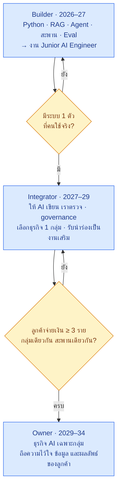

# 🧭 เส้นทางอาชีพ AI 2026–2034 — ตลาดงาน · คาดการณ์ · ปลดล็อกทักษะ

> เป้าหมาย 2 ข้อ: **ได้งาน** และ **ทำธุรกิจ** · ใช้ไฟล์นี้ตัดสินใจว่าพอร์ตควรเน้นอะไร และทบทวนทุก 6 เดือนเพื่อไม่ตกยุค
> ← [MD หลัก](README.md) · [งาน 4](04-erpnext-enterprise-os/README.md) · [04h สะพานเชื่อมระบบลูกค้า](04-erpnext-enterprise-os/04h-connectors.md)
>
> ข้อมูลตรวจเมื่อ 16 ต.ค. 2569 · คะแนนและตัวเลขที่เขียนว่า "ประเมินเอง" เป็นความเห็น ไม่ใช่ข้อมูลวัดจริง

## คำตอบสั้น

| คำถาม | คำตอบ |
|---|---|
| งาน AI ที่ตลาดไทยหาเยอะที่สุด | **เอา LLM / RAG / Agent ไปต่อกับระบบของบริษัท** — ราวครึ่งหนึ่งของประกาศที่สำรวจ |
| ทางที่คะแนนสูงสุด | **AI Integration + Governance** (8.1/10) — ต่อสะพาน คุมสิทธิ์ วัดผล รับผิดชอบ |
| อะไรจะตกยุคก่อน | เขียนโค้ดตามสเปค · จำ API ของ framework · เทคนิค prompt |
| อะไรอยู่ยาว | เข้าใจธุรกิจ · ออกแบบระบบให้ไว้ใจได้ · วัดผล AI · ดูแลระบบที่มีคนใช้จริง · ความสัมพันธ์กับลูกค้า |
| เส้นทาง | Builder (2026–27) → Integrator (2027–29) → Owner (2029–34) |

---

## สารบัญ
1. [ตลาดงานตอนนี้](#1-ตลาดงานตอนนี้)
2. [AI จะทำงานแทนคนได้ยาวแค่ไหน](#2-ai-จะทำงานแทนคนได้ยาวแค่ไหน)
3. [ทักษะไหนหมดอายุเร็ว ทักษะไหนอยู่ยาว](#3-ทักษะไหนหมดอายุเร็ว-ทักษะไหนอยู่ยาว)
4. [ให้คะแนนทางเลือก](#4-ให้คะแนนทางเลือก)
5. [เส้นทางปลดล็อกทักษะ](#5-เส้นทางปลดล็อกทักษะ)
6. [แปลงเป็นงานในพอร์ต](#6-แปลงเป็นงานในพอร์ต)
7. [ทบทวนทุก 6 เดือน](#7-ทบทวนทุก-6-เดือน)
8. [แหล่งข้อมูล](#8-แหล่งข้อมูล)

---

## 1. ตลาดงานตอนนี้

### 1.1 สำรวจประกาศ "AI Engineer" บน JobsDB (หน้าแรก 30 จาก 262 ตำแหน่ง)

| กลุ่มงาน | ประมาณ (จาก 30) | ตัวอย่างบริษัท | ทำอะไร |
|---|---|---|---|
| **LLM + เชื่อมระบบบริษัท** | **~14** | PTT Digital · ttb spark · LH Bank · True · aCommerce · Thai Life · G-Able | RAG · Agent · แชทบอท · ต่อกับระบบเดิม |
| ML ดั้งเดิม / Data Science | ~5 | KBTG · Triple T · AIGEN · Osotspa | พยากรณ์ จัดกลุ่ม ตรวจความผิดปกติ |
| Computer Vision / OCR | ~4 | ทิพยประกันภัย · SCG · SKY ICT | อ่านเอกสาร ตรวจภาพ หุ่นยนต์ |
| วิจัย / หัวหน้า / กลยุทธ์ | ~4 | ธนาคารกรุงเทพ · Fusion Advantec | ต้องมีประสบการณ์สูง |
| Automation | ~2 | Bond Innoventure | workflow อัตโนมัติ |
| ความปลอดภัยของ AI | 1 | PRTR | ป้องกันระบบ AI |

ทักษะที่ถูกถามบ่อย (นับเฉพาะข้อความที่หน้ารวมแสดง): LLM 10 · ML 8 · Automation 7 · Agent 6 · เชื่อมระบบ/API 6 · MLOps 6 · Cloud 5 · CV 5 · RAG 3

**สังเกต:** ผู้จ้างส่วนใหญ่เป็นองค์กรใหญ่ · Azure / Microsoft Copilot โผล่บ่อย · มีตำแหน่ง **Forward Deployed AI Engineer** (ไปหน้างานลูกค้า ต่อสะพาน วาง AI) ซึ่งตรงกับโมเดลธุรกิจใน [04e](04-erpnext-enterprise-os/04e-saas-business-model.md)

### 1.2 กรณีศึกษา: Teeth Talk Dental Clinic

คลินิกทันตกรรมราว 23–24 สาขาในกรุงเทพฯ เปิดรับ (JobBKK, 16 ต.ค. 2569)

| ตำแหน่ง | ประสบการณ์ / อายุ | งานตามประกาศ |
|---|---|---|
| AI Engineer (Senior) ×1 | 3–7 ปี (AI ≥ 3) · 26–35 | สถาปัตยกรรม LLM · multi-agent · RAG · vector DB · fine-tune · LLMOps · cloud |
| AI Engineer (Junior) ×2 | 1–3 ปี · 22–30 | **เชื่อม AI กับ POS · CRM · People Management** · data pipeline · Python · LangChain / LangGraph / CrewAI |
| IT Manager ×1 | 3–8 ปี · 40–45k | ดูแลระบบ เครือข่าย เครื่อง POS ทุกสาขา |

ประกาศไม่ได้บอก use case — **ที่น่าจะทำ (คาดเอง):** ตอบแชทและจองคิว · ตามคนไข้จัดฟันให้มาตามนัด · ถามยอดขายแต่ละสาขาด้วยภาษาพูด · บอทถามตอบนโยบาย HR · ช่วยทีมคอนเทนต์

**เทียบกับพอร์ต:** RAG = งาน 1 · Agent = งาน 2 · เชื่อมระบบ + สิทธิ์ + eval = งาน 4 → เล่าว่า **"ชั้น AI ที่เสียบกับระบบเดิมได้โดยไม่รื้อ"** · เหมาะสมัคร **Junior**

---

## 2. AI จะทำงานแทนคนได้ยาวแค่ไหน

**ฐาน (METR):** วัดว่างานที่คนใช้เวลา X ชั่วโมง AI ทำสำเร็จ 50% — Claude Opus 4.5 ≈ **5.3 ชม.** (ปลาย 2025) · เพิ่มเป็น 2 เท่าทุก **~196 วัน** (ระยะยาว) หรือ **~131 วัน** (หลังปี 2023)

```python
# คำนวณซ้ำได้ — ฐาน 5.3 ชม. ปลาย 2025
base_h = 5.3
for name, dbl_days in [("ช้า", 196.5), ("เร็ว", 130.8)]:
    for year, months in [(2026, 12), (2027, 24), (2028, 36)]:
        h = base_h * 2 ** (months / (dbl_days / 30.44))
        print(name, year, round(h), "ชม.")
```

| ปลายปี | แบบช้า | แบบเร็ว | ความหมายต่องานเรา |
|---|---|---|---|
| 2026 | ~19 ชม. (2–3 วันทำงาน) | ~37 ชม. (1 สัปดาห์) | AI เขียน**สะพาน 1 ตัว**ได้เอง |
| 2027 | ~70 ชม. (~2 สัปดาห์) | ~254 ชม. (~1.5 เดือน) | AI สร้าง**ทั้ง module** |
| 2028 | ~253 ชม. (~1.5 เดือน) | ~1,763 ชม. (~10 เดือน) | AI สร้าง**ระบบขนาดงาน 4** ได้เกือบทั้งหมด |
| 2030–34 | ❓ | ❓ | คาดไม่ได้ — แนวโน้มน่าจะชะลอ |

**ข้อจำกัดที่ METR บอกเอง:** วัดจากงานที่โจทย์ชัด (งานจริงยุ่งกว่า) · สำเร็จ 50% ≠ ปล่อยให้ทำเองได้ (บางงานต้อง 98%+) · งานที่ต้องกดหน้าจอได้ผลต่ำกว่า 40–100 เท่า · ไม่ควรต่อเส้นไปหลายเดือนหรือหลายปี

**สรุปจากตัวเลข:** ภายใน 2–3 ปี "เขียนโค้ดตามโจทย์" AI ทำได้เอง → มูลค่าย้ายไปที่ **กำหนดโจทย์ · ตรวจผล · รับผิดชอบ**

---

## 3. ทักษะไหนหมดอายุเร็ว ทักษะไหนอยู่ยาว

ประเมินเอง

| หมดอายุเร็ว (1–3 ปี) | กลาง (3–5 ปี) | อยู่ยาว (8 ปีขึ้นไป) |
|---|---|---|
| เขียนโค้ดตามสเปค | รายละเอียดการทำ RAG | **เข้าใจธุรกิจ** (ภาษีไทย · งานคลินิก) |
| จำ API ของ LangChain | framework สำหรับ agent | **ออกแบบระบบให้ไว้ใจได้** (สิทธิ์ · อนุมัติ · audit) |
| เทคนิคเขียน prompt | ตั้งค่า cloud | **วัดผล AI** (eval) |
| เขียนสะพานด้วยมือ | | **เข้าถึงข้อมูลลูกค้าอย่างปลอดภัย** (PDPA) |
| ต่อ pipeline OCR เอง | | **ความสัมพันธ์กับลูกค้า + การขาย** |
| | | **ดูแลระบบที่มีคนใช้จริง** |

---

## 4. ให้คะแนนทางเลือก

น้ำหนัก: อยู่ถึงปี 2034 **35%** · มีตลาดตอนนี้ **25%** · ตรงกับพอร์ต **25%** · ความเสี่ยงต่ำ **15%** · คะแนนแต่ละช่องประเมินเอง (10 = ดีที่สุด)

| ทางเลือก | อยู่ยาว | ตลาด | ตรงพอร์ต | เสี่ยงต่ำ | **รวม** |
|---|:-:|:-:|:-:|:-:|:-:|
| **AI Integration + Governance** | 8 | 8 | 9 | 7 | **8.10** 🥇 |
| เขียนแอป AI อย่างเดียว | 3 | 9 | 9 | 8 | 6.75 |
| ธุรกิจ AI เฉพาะกลุ่ม | 9 | 6 | 6 | 4 | 6.75 |
| Data Engineer | 6 | 7 | 5 | 7 | 6.15 |
| วิจัย / เทรนโมเดล | 7 | 4 | 3 | 3 | 4.65 |
| Prompt Engineer | 1 | 4 | 7 | 8 | 4.30 |

> "เขียนแอป AI" ได้งานง่ายตอนนี้แต่หมดอายุเร็ว · "ธุรกิจเฉพาะกลุ่ม" อยู่ยาวที่สุดแต่เสี่ยงตอนเริ่ม → **ใช้อันดับ 1 หางาน แล้วขยับไปธุรกิจเฉพาะกลุ่ม**

---

## 5. เส้นทางปลดล็อกทักษะ



| ช่วง | ปลดล็อก | หลักฐานที่ต้องมี |
|---|---|---|
| Builder | RAG + eval (งาน 1) · Agent + HITL (งาน 2) · Gateway + สะพาน 2 ตัว (งาน 4) · สลับ Local ↔ Azure | repo + ตัวเลข eval + วิดีโอเดโม |
| Integrator | ใช้ coding agent สร้างสะพาน/feature โดยเราเขียน spec + tests · ออกแบบระดับอิสระให้ลูกค้า · คุยกับลูกค้าเอง | ระบบที่มีผู้ใช้จริง · รายงานนำร่อง |
| Owner | ขาย · ตั้งราคา · ดูแลหลายลูกค้า · PDPA ในฐานะผู้ประมวลผลข้อมูล | ลูกค้ารายเดือน · ตัวเลขต่ออายุสัญญา |

---

## 6. แปลงเป็นงานในพอร์ต

| ช่องว่างจากตลาด | ทำอะไร | อยู่ที่ |
|---|---|---|
| เชื่อมระบบที่ไม่ใช่ ERPNext | สะพานที่ 2 (CSV) + contract tests | [04h](04-erpnext-enterprise-os/04h-connectors.md) · [04c Stage 5.6](04-erpnext-enterprise-os/04c-build-guide.md#9-stage-5--agent-ทีละตัว) |
| Azure (องค์กรใหญ่ใช้เยอะ) | ตั้งค่า Azure OpenAI ใน P6 + ฉากเดโมสลับ Local ↔ Azure (ข้อมูลไม่ลับเท่านั้น) | [04c Stage 7](04-erpnext-enterprise-os/04c-build-guide.md#11-stage-7--ตรวจรับ) |
| LangGraph / CrewAI | งาน 2 ใช้ LangGraph อยู่แล้ว → เสียบเข้า P3 ของงาน 4 · Gateway ไม่ผูก framework (ADR-014) | [งาน 2](02-it-support-agent.md) |
| Hugging Face / fine-tune | ทางเลือกหลัง MVP: fine-tune ตัวจัดอันดับผลค้นหา (reranker) จากค่าที่คนแก้ใน APX | [04c Stage 8](04-erpnext-enterprise-os/04c-build-guide.md#12-stage-8--ต่อเติม) |
| ใช้ coding agent เป็น | บันทึกใน README ว่าส่วนไหน AI เขียน · tests กี่ข้อ · review เจออะไร | [04h ข้อ 6](04-erpnext-enterprise-os/04h-connectors.md#6-ใครเขียนสะพาน-คนกำหนด-ai-เขียน) |
| OCR จะตกยุค | ทำให้สลับได้: OCR + LLM / โมเดลอ่านภาพตรง · eval เทียบ | 04c Stage 5.1 |
| เลือกลูกค้าให้ตรงงานแสน+ | ขายระลอกแรกให้สำนักงานบัญชี · บริษัท IT · ค้าส่ง · โรงงาน (ปัญหาเหมือนธนาคาร/ประกัน/ค้าปลีก/การผลิต) | [04i](04-erpnext-enterprise-os/04i-sme-segments.md) |
| ประกาศงานจริงที่เจอ (ต.ค. 2569): Data + AI · BA · CV | ผลงานเล็ก 3 ชิ้น: ท่อข้อมูล Lead SME · ชุดเอกสาร BA · ตรวจลายเซ็นด้วย YOLO + TensorRT | [04k งานเสริม](04-erpnext-enterprise-os/04k-dev-roadmap.md#งานเสริม--ผลงานตรงประกาศงานจริง) |

**ลำดับที่แนะนำ:** ทำ M1–M4 ใน [MD หลัก](README.md#milestone--ทุกจุดต้อง-สมัครงานได้แล้ว) ให้จบก่อน · ส่วน ERP ที่ไม่ช่วยหางาน AI (ผลิต · เงินเดือน · ส่งของ) ไว้หลังได้งาน หรือเมื่อมีลูกค้าต้องการ

---

## 7. ทบทวนทุก 6 เดือน

| ตรวจ | ดูอะไร | ถ้าเปลี่ยน |
|---|---|---|
| METR time horizon | ตัวเลขล่าสุด + อัตราเพิ่ม | ปรับตารางข้อ 2 · เลื่อนช่วงในข้อ 5 เร็วขึ้น/ช้าลง |
| ประกาศงาน 30 ตำแหน่งแรก | กลุ่มงาน + ทักษะที่ถูกถาม | ปรับข้อ 1 และช่องว่างข้อ 6 |
| ระดับอิสระในระบบเรา | action ไหนผ่าน `promote_when` แล้ว | เลื่อนระดับ — นี่คือ "อัปเกรดตาม AI" แบบวัดได้ |
| โมเดลใหม่ | รัน eval ทุกชุดกับโมเดลใหม่ | เปลี่ยนเมื่อชนะเท่านั้น |
| ตัวเอง | อยู่ช่วงไหนในข้อ 5 · ผ่านหลักฐานครบไหม | ไปช่วงถัดไปเมื่อผ่านเกณฑ์ ไม่ใช่เมื่อ "รู้สึกพร้อม" |

---

## 8. แหล่งข้อมูล

- [JobsDB — AI Engineer jobs](https://th.jobsdb.com/th/ai-engineer-jobs)
- [JobBKK — AI Engineer (Senior), Teeth Talk](https://www.jobbkk.com/jobs/detailurgent/241952/1393779) · [AI Engineer (Junior)](https://www.jobbkk.com/jobs/detailurgent/241952/1393776) · [IT Manager](https://www.jobbkk.com/jobs/detailurgent/241952/1395706)
- [TikTok — Teeth Talk case study](https://ads.tiktok.com/business/en/inspiration/teeth-talk-case-study)
- [METR — Time Horizon 1.1](https://metr.org/blog/2026-1-29-time-horizon-1-1/) · [Clarifying limitations of time horizon](https://metr.org/notes/2026-01-22-time-horizon-limitations/)
- [WEF — Future of Jobs Report 2025](https://www.weforum.org/media/future-of-jobs-report-2025-78-million-new-job-opportunities-by-2030-but-urgent-upskilling-needed-to-prepare-workforces/)
- [TDRI — ตลาดแรงงานเอไอ](https://tdri.or.th/2025/08/ai-job-market-2tracked-growth/)

← [MD หลัก](README.md)
